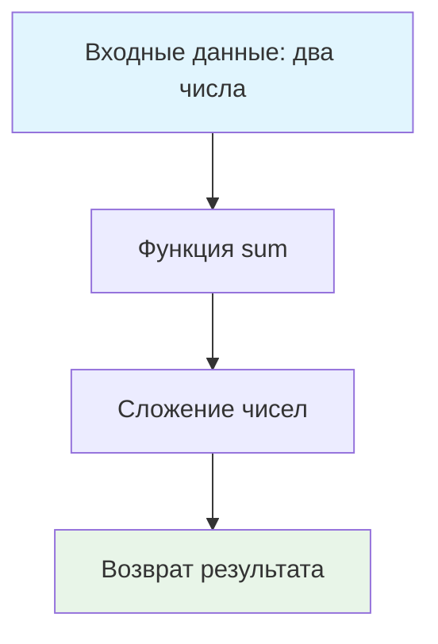

# 📊 Сумма чисел

> **Добро пожаловать в JavaScript задачник!** 🎉  
> Это ваша первая задача — идеальное место для знакомства с проектом и основами функций.

## 🎯 Задача

Создайте функцию `sum`, которая принимает два числа и возвращает их сумму.

```js
sum(1, 1) === 2
sum(2, 5) === 7
sum(-3, 8) === 5
```

## 🔍 Что нужно сделать



1. **Создайте функцию** с именем `sum`
2. **Принимайте два параметра** (например, `m` и `n`)
3. **Верните результат** сложения этих чисел
4. **Экспортируйте функцию** как default export

## ✅ Ожидаемый результат

Ваш файл `sum.js` должен содержать функцию, которая проходит все тесты:

```js
function sum(m, n) {
  // Ваш код здесь
}

export default sum;
```

## 🧪 Тестирование

Запустите тесты командой:
```bash
npm test
```

Все тесты должны быть зелеными ✅

## 💡 Концепции, которые вы изучите

- **Функции**: объявление и вызов
- **Параметры**: передача значений в функцию
- **Return**: возврат результата
- **ES6 Modules**: экспорт и импорт

## 🎓 Для новичков

**Что такое функция?**  
Функция — это блок кода, который выполняет определенную задачу. Она может принимать данные (параметры) и возвращать результат.

**Зачем экспортировать функцию?**  
`export default` позволяет использовать вашу функцию в других файлах (например, в тестах).

## ⚡ Частые ошибки

❌ **Забыть return**
```js
function sum(m, n) {
  m + n; // Результат не возвращается!
}
```

✅ **Правильно**
```js
function sum(m, n) {
  return m + n; // Результат возвращается
}
```

## 🔗 Что дальше?

После успешного выполнения этой задачи вы будете готовы к более сложным концепциям JavaScript!

---
📚 **Полезные ссылки:**
- [MDN: Функции](https://developer.mozilla.org/ru/docs/Web/JavaScript/Guide/Functions)
- [MDN: Export](https://developer.mozilla.org/ru/docs/Web/JavaScript/Reference/Statements/export)
