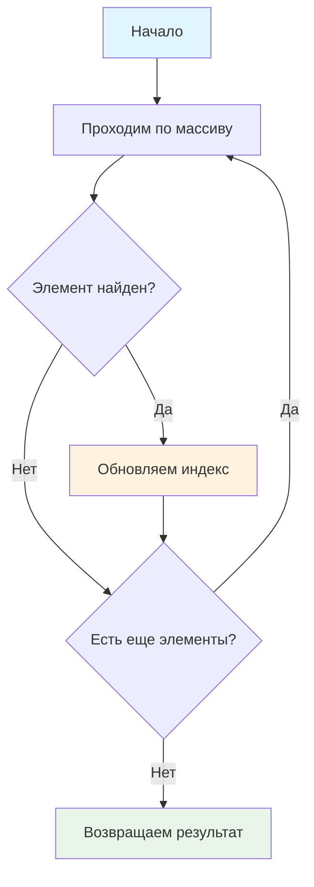

# 🔍 Поиск элемента в массиве (последнее вхождение)

> **Развиваем навыки работы с массивами!** 📚  
> Эта задача научит вас искать последнее вхождение элемента и понимать разные стратегии поиска.

## 🎯 Задача

Найдите **последнее** (правое) вхождение числа **X** в массиве чисел. Если элемент не найден, верните **-1**.

```js
findElementInSequence(2, [1, 2, 3, 2, 4, 3]) === 3  // последнее на позиции 3
findElementInSequence(12, [1, 2, 3, 2, 4, 3]) === -1 // не найден
```

> **⚠️ Примечание:** В условии упоминается "положительное число X", но код работает с любыми числами

## 🔍 Алгоритм поиска



## 📋 Входные данные

| Параметр | Тип      | Описание                                    |
|----------|----------|---------------------------------------------|
| `x`      | `number` | Искомое число                              |
| `nums`   | `Array`  | Массив целых чисел (по модулю ≤ 1000)     |

## 📤 Выходные данные

- **Число** — индекс первого вхождения элемента (начиная с 0)
- **-1** — если элемент не найден

## ✅ Примеры

| Вызов функции                              | Результат | Пояснение                    |
|--------------------------------------------|:---------:|------------------------------|
| `findElementInSequence(2, [1, 2, 3, 2, 4, 3])` |    3      | Последнее вхождение 2 на позиции 3 |
| `findElementInSequence(12, [1, 2, 3, 2, 4, 3])` |   -1      | Число 12 отсутствует       |
| `findElementInSequence(1, [1, 1, 1])`     |    2      | Последнее вхождение на позиции 2  |
| `findElementInSequence(5, [])`            |   -1      | Пустой массив               |

## 🛠️ Что нужно реализовать

```js
function findElementInSequence(x, nums) {
  // Ваш код здесь
}

export default findElementInSequence;
```

## 💡 Концепции, которые вы изучите

- **Циклы for**: полный перебор массива
- **Условные операторы**: проверка равенства элементов
- **Индексация массива**: доступ к элементам по позиции
- **Стратегии поиска**: разница между первым и последним вхождением
- **Перезапись переменных**: обновление результата при каждом совпадении

## 🎓 Для новичков

**Что такое индекс массива?**  
Индекс — это позиция элемента в массиве, начиная с 0:
```js
const nums = [10, 20, 30];
//            ↑   ↑   ↑
//            0   1   2  ← индексы
```

**Почему не останавливаемся на первом найденном?**  
Для поиска **последнего** вхождения нужно просмотреть весь массив и запомнить позицию последнего совпадения.

## ⚡ Частые ошибки

❌ **Остановка на первом найденном (неправильно для этой задачи)**
```js
function findElementInSequence(x, nums) {
  for (let i = 0; i < nums.length; i++) {
    if (nums[i] === x) {
      return i; // ❌ Вернет ПЕРВОЕ вхождение!
    }
  }
  return -1;
}
```

✅ **Правильно — перебор всего массива**
```js
function findElementInSequence(x, nums) {
  let lastIndex = -1;
  for (let i = 0; i < nums.length; i++) {
    if (nums[i] === x) {
      lastIndex = i; // ✅ Обновляем при каждом найденном
    }
  }
  return lastIndex; // ✅ Вернется последний найденный индекс
}
```

❌ **Забыть инициализировать переменную**
```js
let lastIndex; // ❌ undefined вместо -1
```

## 🧪 Тестирование

```bash
npm test
```

Убедитесь, что все тесты проходят, включая граничные случаи!

## 🔗 Альтернативные решения

После выполнения задачи, изучите встроенные методы массивов:

```js
// Современный JavaScript подход
const index = nums.lastIndexOf(x); // Ищет последнее вхождение!
```

## 🔄 Сравнение с поиском первого вхождения

| Аспект | Первое вхождение | Последнее вхождение |
|--------|------------------|---------------------|
| **Стратегия** | Остановка при первом найденном | Полный перебор массива |
| **Производительность** | O(1) в лучшем случае | Всегда O(n) |
| **Метод JS** | `indexOf(x)` | `lastIndexOf(x)` |

## 🚀 Что дальше?

Теперь вы понимаете разные стратегии поиска! Следующие темы: алгоритмы сортировки и более сложная работа с массивами.

---
📚 **Полезные ссылки:**
- [MDN: Циклы for](https://developer.mozilla.org/ru/docs/Web/JavaScript/Reference/Statements/for)
- [MDN: Array.lastIndexOf()](https://developer.mozilla.org/ru/docs/Web/JavaScript/Reference/Global_Objects/Array/lastIndexOf)
- [MDN: Массивы](https://developer.mozilla.org/ru/docs/Web/JavaScript/Reference/Global_Objects/Array)
