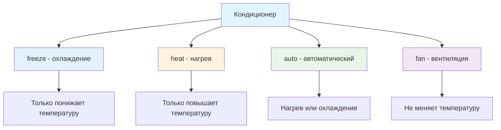

# 🌡️ Кондиционер

> **Изучаем условную логику и сложные алгоритмы!** ❄️🔥  
> Эта задача научит вас работать с множественными условиями и логическими операторами.

## 🏢 История

В офисе программиста Петра установили кондиционер нового типа. Этот кондиционер отличается особой простотой в управлении — всего два параметра: **желаемая температура** и **режим работы**.

## 🎯 Задача

Определите, какая температура установится в комнате через час работы кондиционера.

```js
setConditioner(10, 20, 'heat') === 20   // нагрев до желаемой
setConditioner(10, 20, 'freeze') === 10 // охлаждение не работает
setConditioner(25, 20, 'auto') === 20   // автоматическое охлаждение
```

## 🔧 Режимы работы кондиционера



### ❄️ **«freeze»** — охлаждение
- **Может только** уменьшать температуру
- **Выключается**, если комната уже холоднее желаемой температуры

### 🔥 **«heat»** — нагрев
- **Может только** увеличивать температуру
- **Выключается**, если комната уже теплее желаемой температуры

### 🤖 **«auto»** — автоматический
- **Может** как нагревать, так и охлаждать
- **Всегда** доводит до желаемой температуры

### 💨 **«fan»** — вентиляция
- **Только** вентилирует воздух
- **Не изменяет** температуру

## 📋 Входные данные

| Параметр | Тип      | Описание                        | Диапазон    |
|----------|----------|---------------------------------|-------------|
| `tRoom`  | `number` | Текущая температура в комнате   | -50 ≤ t ≤ 50 |
| `tCond`  | `number` | Желаемая температура            | -50 ≤ t ≤ 50 |
| `mode`   | `string` | Режим работы кондиционера       | freeze/heat/auto/fan |

## 📤 Выходные данные

**Число** — температура в комнате через час работы

## ✅ Примеры работы

| tRoom | tCond | mode   | Результат | Объяснение |
|-------|-------|--------|:---------:|------------|
| 10    | 20    | heat   | 20        | Нагрев: 10°C → 20°C |
| 10    | 20    | freeze | 10        | Охлаждение не работает (комната холоднее) |
| 25    | 20    | freeze | 20        | Охлаждение: 25°C → 20°C |
| 25    | 20    | heat   | 25        | Нагрев не работает (комната теплее) |
| 10    | 20    | auto   | 20        | Автоматический нагрев |
| 25    | 20    | auto   | 20        | Автоматическое охлаждение |
| 15    | 25    | fan    | 15        | Вентиляция (температура не меняется) |

## 🛠️ Логика работы

```js
function setConditioner(tRoom, tCond, mode) {
  // Проверка диапазона температур (-50 до 50)
  
  if (mode === 'freeze') {
    // Охлаждение: работает только если комната теплее
    return tRoom > tCond ? tCond : tRoom;
  }
  
  if (mode === 'heat') {
    // Нагрев: работает только если комната холоднее
    return tRoom < tCond ? tCond : tRoom;
  }
  
  if (mode === 'auto') {
    // Автоматический: всегда достигает желаемой температуры
    return tCond;
  }
  
  if (mode === 'fan') {
    // Вентиляция: температура не меняется
    return tRoom;
  }
}
```

## 💡 Концепции, которые вы изучите

- **Множественные условия**: `if/else if/else`
- **Логические операторы**: сравнение чисел
- **Валидация входных данных**: проверка диапазонов
- **Моделирование реальных систем**: бизнес-логика устройств

## 🎓 Для новичков

**Что такое условная логика?**  
Это способ программы принимать решения на основе разных условий, как в реальной жизни: "Если холодно — включить обогрев, если жарко — включить охлаждение".

**Почему кондиционер может "не работать"?**  
В реальности кондиционер не может нагревать в режиме охлаждения или охлаждать в режиме нагрева — это физические ограничения.

## ⚡ Частые ошибки

❌ **Неправильная проверка диапазона температур**
```js
// Неправильно: такая проверка всегда возвращает false!
let isValid = -50 <= tRoom <= 50;
```

✅ **Правильная проверка диапазона**
```js
// Правильно: проверяем оба условия отдельно
let isValid = tRoom >= -50 && tRoom <= 50;
```

❌ **Забыть обработать все режимы**
```js
if (mode === 'heat') { /* ... */ }
if (mode === 'freeze') { /* ... */ }
// ❌ Что если mode === 'auto' или 'fan'?
```

✅ **Полная обработка всех случаев**
```js
if (mode === 'heat') { /* ... */ }
else if (mode === 'freeze') { /* ... */ }
else if (mode === 'auto') { /* ... */ }
else if (mode === 'fan') { /* ... */ }
else { /* неизвестный режим */ }
```

## 🧪 Тестирование

```bash
npm test
```

Проверьте все режимы работы и граничные случаи!

## 🔧 Оптимизация

После решения подумайте о:
- **Switch/case** вместо множественных if
- **Тернарные операторы** для коротких условий
- **Валидации** входных параметров

```js
// Альтернативное решение с switch
switch (mode) {
  case 'freeze': return tRoom > tCond ? tCond : tRoom;
  case 'heat': return tRoom < tCond ? tCond : tRoom;
  case 'auto': return tCond;
  case 'fan': return tRoom;
  default: return tRoom;
}
```

## 🚀 Что дальше?

Эта задача подготовила вас к работе со сложной условной логикой и моделированием реальных систем!

---
📚 **Полезные ссылки:**
- [MDN: if...else](https://developer.mozilla.org/ru/docs/Web/JavaScript/Reference/Statements/if...else)
- [MDN: switch](https://developer.mozilla.org/ru/docs/Web/JavaScript/Reference/Statements/switch)
- [MDN: Логические операторы](https://developer.mozilla.org/ru/docs/Web/JavaScript/Reference/Operators/Logical_Operators)
