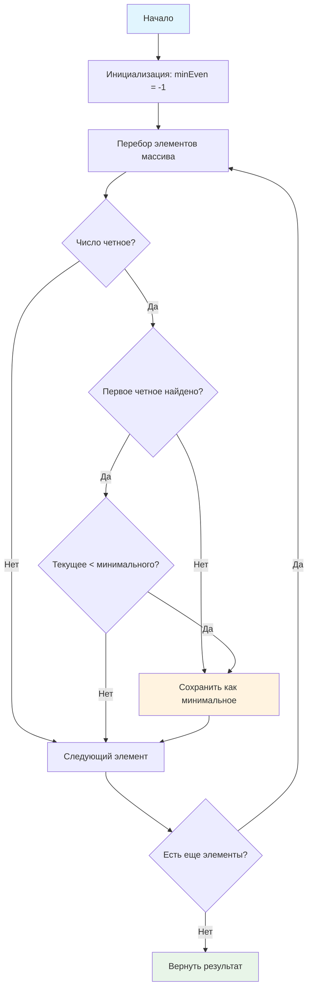

# 🔢 Поиск минимального четного числа

> **Комбинируем условия и поиск экстремумов!** 🎯  
> Эта задача научит вас фильтровать элементы по условию и находить минимальное значение.

## 🎯 Задача

Найдите **минимальное четное число** в массиве. Если четных чисел нет, верните **-1**.

```js
findMinEvenNumber([1, 121, 3, 21, 45, 3]) === -1  // нет четных чисел
findMinEvenNumber([5, 81, 12, 3, 42, 4, 3, 22, 234]) === 4  // минимальное четное: 4
findMinEvenNumber([0, 2, 12, 3, 2, 4, 3, 22, 34]) === 0  // ноль тоже четное!
```

## 🔍 Алгоритм решения



## 📋 Входные данные

| Параметр | Тип     | Описание                              |
|----------|---------|---------------------------------------|
| `nums`   | `Array` | Массив целых чисел (по модулю ≤ 1000) |

## 📤 Выходные данные

- **Число** — минимальное четное число в массиве
- **-1** — если четных чисел нет

## ✅ Примеры работы

| Массив                              | Четные числа           | Минимальное | Результат | Пояснение                    |
|-------------------------------------|------------------------|-------------|:---------:|------------------------------|
| `[1, 121, 3, 21, 45, 3]`            | отсутствуют            | —           |    -1     | Все числа нечетные           |
| `[5, 81, 12, 3, 42, 4, 3, 22, 234]` | 12, 42, 4, 22, 234     | 4           |     4     | Минимальное из четных        |
| `[0, 2, 12, 3, 2, 4, 3, 22, 34]`    | 0, 2, 12, 2, 4, 22, 34 | 0           |     0     | Ноль — четное число          |
| `[-8, -2, 5, 7]`                    | -8, -2                 | -8          |    -8     | Отрицательные тоже считаются |
| `[]`                                | отсутствуют            | —           |    -1     | Пустой массив                |

## 🛠️ Что нужно реализовать

```js
function findMinEvenNumber(nums) {
  // Ваш код здесь
}

export default findMinEvenNumber;
```

## 💡 Концепции, которые вы изучите

- **Оператор остатка (%)**: проверка четности числа
- **Условная фильтрация**: выбор элементов по критерию
- **Поиск минимума**: сравнение и обновление значения
- **Комбинирование условий**: четность + минимальность
- **Обработка пустых результатов**: возврат -1

## 🎓 Для новичков

**Как определить четное число?**  
Число четное, если остаток от деления на 2 равен 0:

```js
4 % 2 === 0  // true  - четное
5 % 2 === 0  // false - нечетное
0 % 2 === 0  // true  - ноль четное!
```

**Почему ноль считается четным?**  
Математически: четное число — это число, которое нацело делится на 2. Ноль делится на 2 нацело (0 ÷ 2 = 0).

**Стратегия поиска минимума:**

1. Запомнить первое найденное четное как "текущий минимум"
2. При каждом новом четном сравнивать с текущим минимумом
3. Если новое меньше — обновить минимум

## ⚡ Частые ошибки

❌ **Неправильная проверка четности**

```js
if (nums[i] % 2 === 1) {} // ❌ Проверяет нечетность!
```

✅ **Правильная проверка четности**

```js
if (nums[i] % 2 === 0) {}// ✅ Проверяет четность
```

❌ **Неправильная инициализация минимума**

```js
let minEven = 0; // ❌ Может быть меньше реальных чисел
let minEven = Infinity; // ❌ Не покажет "не найдено"
```

✅ **Правильная инициализация**

```js
let minEven = -1; // ✅ Показывает "не найдено"
// или
let minEven = null; // ✅ Альтернативный вариант
```

❌ **Забыть про отрицательные числа**

```js
// Отрицательные четные числа тоже нужно учитывать!
// -8, -6, -4, -2 — все четные
```

## 🧪 Пошаговый пример

Массив: `[5, 12, 3, 8, 7, 4]`

| Шаг | Элемент | Четное? | Действие                  | minEven |
|-----|---------|---------|---------------------------|---------|
| 1   | 5       | Нет     | Пропуск                   | -1      |
| 2   | 12      | Да      | Первое четное → запомнить | 12      |
| 3   | 3       | Нет     | Пропуск                   | 12      |
| 4   | 8       | Да      | 8 < 12? Да                | 8       |
| 5   | 7       | Нет     | Пропуск                   | 8       |
| 6   | 4       | Да      | 4 < 8? Да → обновить      | 4       |

**Результат:** 4

## 🔧 Альтернативные решения

После решения изучите современные подходы:

```js
// Функциональное программирование
function findMinEvenNumber(nums) {
  const evenNumbers = nums.filter(num => num % 2 === 0);
  return evenNumbers.length > 0 ? Math.min(...evenNumbers) : -1;
}

// Однострочное решение
const findMinEvenNumber = nums => {
  const evens = nums.filter(n => n % 2 === 0);
  return evens.length ? Math.min(...evens) : -1;
};
```

## 🧪 Тестирование

```bash
npm test
```

Проверьте граничные случаи: пустой массив, только нечетные, отрицательные числа!

## 🚀 Что дальше?

Эта задача подготовила вас к более сложным алгоритмам поиска и работе с условиями!

---
📚 **Полезные ссылки:**

- [MDN: Операtor остатка (%)](https://developer.mozilla.org/ru/docs/Web/JavaScript/Reference/Operators/Remainder)
- [MDN: Math.min()](https://developer.mozilla.org/ru/docs/Web/JavaScript/Reference/Global_Objects/Math/min)
- [MDN: Array.filter()](https://developer.mozilla.org/ru/docs/Web/JavaScript/Reference/Global_Objects/Array/filter)
