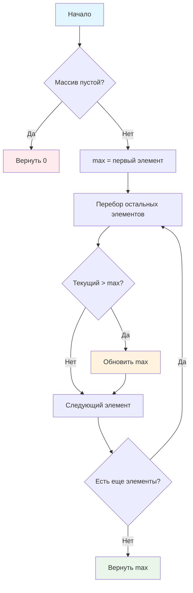

# 📈 Поиск максимального числа

> **Осваиваем классический алгоритм поиска экстремума!** 🏆  
> Эта задача научит вас базовому и важнейшему алгоритму в программировании.

## 🎯 Задача

Найдите **максимальное число** в массиве чисел.

```js
findSequenceMax([2, 4, 3, 2, 5, 6]) === 6          // максимальное: 6
findSequenceMax([100, 0, 20, -10, 5, 101]) === 101 // максимальное: 101
findSequenceMax([-8, -14, -3, -2, -4]) === -2      // даже среди отрицательных
```

## 🔍 Алгоритм поиска максимума



## 📋 Входные данные

| Параметр | Тип     | Описание                               |
|----------|---------|----------------------------------------|
| `nums`   | `Array` | Массив целых чисел (по модулю ≤ 1000) |

## 📤 Выходные данные

- **Число** — максимальное значение в массиве
- **0** — если массив пустой (согласно коду)

## ✅ Примеры работы

| Массив | Максимальное | Результат | Пояснение |
|--------|--------------|:---------:|-----------|
| `[2, 4, 3, 2, 5, 6]` | 6 | 6 | Максимальное из положительных |
| `[100, 0, 20, -10, 5, 101]` | 101 | 101 | Наибольшее значение |
| `[-8, -14, -3, -2, -4]` | -2 | -2 | Наименьшее по модулю отрицательное |
| `[42]` | 42 | 42 | Единственный элемент |
| `[]` | — | 0 | Пустой массив |

## 🛠️ Что нужно реализовать

```js
function findSequenceMax(nums) {
  // Ваш код здесь
}

export default findSequenceMax;
```

## 💡 Концепции, которые вы изучите

- **Инициализация переменных**: выбор начального значения
- **Поиск экстремума**: базовый алгоритм максимума
- **Сравнение чисел**: операторы больше/меньше
- **Граничные случаи**: обработка пустого массива
- **Оптимизация циклов**: начало с нужного индекса

## 🎓 Для новичков

**Почему начинаем с первого элемента?**  
Это гарантирует, что у нас есть реальное значение из массива как отправная точка. Начинать с 0 или -∞ может дать неверный результат.

**Классический алгоритм поиска максимума:**
1. Взять первый элемент как "текущий максимум"
2. Сравнить каждый следующий элемент с текущим максимумом
3. Если найден больший — обновить максимум
4. В конце получим наибольший элемент

## ⚡ Частые ошибки

❌ **Неправильная инициализация**
```js
let max = 0; // ❌ Что если все числа отрицательные?
let max = -Infinity; // ❌ Работает, но менее читаемо
```

✅ **Правильная инициализация**
```js
let max = nums[0]; // ✅ Берем первый элемент массива
```

❌ **Неэффективный цикл**
```js
for (let i = 0; i < nums.length; i++) { // ❌ Сравниваем первый с собой
  if (nums[i] > max) max = nums[i];
}
```

✅ **Оптимизированный цикл**
```js
for (let i = 1; i < nums.length; i++) { // ✅ Начинаем со второго
  if (nums[i] > max) max = nums[i];
}
```

❌ **Забыть проверить пустой массив**
```js
let max = nums[0]; // ❌ Ошибка при пустом массиве!
```

## 🧪 Пошаговый пример

Массив: `[3, 7, 2, 9, 1]`

| Шаг | Индекс | Элемент | max до | Сравнение | max после | Действие |
|-----|--------|---------|---------|-----------|-----------|----------|
| 0 | 0 | 3 | — | — | 3 | Инициализация |
| 1 | 1 | 7 | 3 | 7 > 3? Да | 7 | Обновить |
| 2 | 2 | 2 | 7 | 2 > 7? Нет | 7 | Без изменений |
| 3 | 3 | 9 | 7 | 9 > 7? Да | 9 | Обновить |
| 4 | 4 | 1 | 9 | 1 > 9? Нет | 9 | Без изменений |

**Результат:** 9

## 🔧 Альтернативные решения

После решения изучите встроенные методы:

```js
// Современный JavaScript
function findSequenceMax(nums) {
  return nums.length === 0 ? 0 : Math.max(...nums);
}

// Функциональное программирование
const findSequenceMax = nums => 
  nums.length ? Math.max(...nums) : 0;

// Метод reduce
const findSequenceMax = nums => 
  nums.length ? nums.reduce((max, curr) => curr > max ? curr : max) : 0;
```

## ⚠️ Особенности реализации

**Обработка пустого массива:**  
В данной задаче код возвращает `0` для пустого массива. В других задачах может быть логичнее вернуть `null`, `undefined` или выбросить ошибку.

**Производительность:**
- Временная сложность: O(n) — проходим массив один раз
- Пространственная сложность: O(1) — используем одну переменную

## 🧪 Тестирование

```bash
npm test
```

Проверьте: положительные числа, отрицательные, смешанные, одиночный элемент, пустой массив!

## 🚀 Что дальше?

Этот алгоритм — основа для многих других: поиск минимума, второго максимума, k-го наибольшего элемента!

---
📚 **Полезные ссылки:**
- [MDN: Math.max()](https://developer.mozilla.org/ru/docs/Web/JavaScript/Reference/Global_Objects/Math/max)
- [MDN: Array.reduce()](https://developer.mozilla.org/ru/docs/Web/JavaScript/Reference/Global_Objects/Array/reduce)
- [MDN: Spread operator](https://developer.mozilla.org/ru/docs/Web/JavaScript/Reference/Operators/Spread_syntax)
