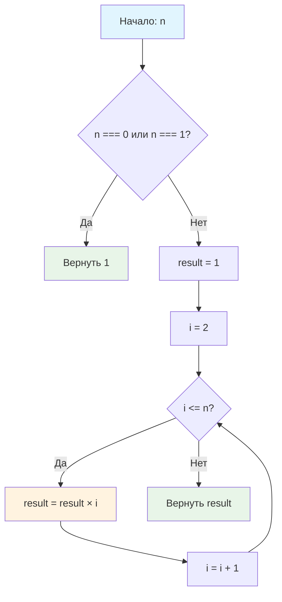

# 🧮 Вычислить факториал числа

> **Изучаем математические алгоритмы и циклы!** 📊  
> Эта задача познакомит вас с классической математической функцией и различными видами циклов.

## 📚 Что такое факториал?

**[Факториал](https://ru.wikipedia.org/wiki/Факториал)** натурального числа **n** — это произведение всех натуральных чисел от **1** до **n** включительно. Обозначается **n!**

### 🔢 Математическое определение:

```
n! = 1 × 2 × 3 × ... × (n-1) × n
```

**Особый случай:** принято, что **0! = 1**

## 🎯 Задача

Напишите функцию `factorial(n)`, которая возвращает **n!**, используя цикл (`while` или `for`).

```js
factorial(0) === 1   // особый случай
factorial(1) === 1   // базовый случай  
factorial(3) === 6   // 1 × 2 × 3
factorial(5) === 120 // 1 × 2 × 3 × 4 × 5
```

## 🔍 Алгоритм вычисления



## 📊 Примеры вычислений

| n | Формула | Пошаговое вычисление | Результат |
|---|---------|---------------------|:---------:|
| 0 | 0! | По определению | **1** |
| 1 | 1! | 1 | **1** |
| 2 | 2! | 2 × 1 = 2 | **2** |
| 3 | 3! | 3 × 2 × 1 = 6 | **6** |
| 4 | 4! | 4 × 3 × 2 × 1 = 24 | **24** |
| 5 | 5! | 5 × 4 × 3 × 2 × 1 = 120 | **120** |
| 6 | 6! | 6 × 5 × 4 × 3 × 2 × 1 = 720 | **720** |

## 🛠️ Что нужно реализовать

```js
function factorial(n) {
  // Ваш код здесь (используйте цикл!)
}

export default factorial;
```

## 💡 Концепции, которые вы изучите

- **Циклы while/for**: повторение операций
- **Накопление результата**: умножение в цикле
- **Граничные случаи**: обработка 0! и 1!
- **Математические алгоритмы**: перевод формул в код
- **Инициализация переменных**: правильное начальное значение

## 🎓 Для новичков

**Почему 0! = 1?**  
Это математическое соглашение. Факториал связан с количеством перестановок: у пустого множества есть одна "пустая" перестановка.

**Почему начинаем накопление с 1?**  
Если начать с 0, то результат всегда будет 0 (так как 0 × что угодно = 0).

**Разные подходы к циклу:**
- **Восходящий**: 1 × 2 × 3 × ... × n
- **Нисходящий**: n × (n-1) × (n-2) × ... × 1

## ⚡ Частые ошибки

❌ **Неправильная инициализация**
```js
let result = 0; // ❌ Умножение на 0 даст 0!
```

✅ **Правильная инициализация**
```js
let result = 1; // ✅ Нейтральный элемент для умножения
```

❌ **Забыть обработать граничные случаи**
```js
// ❌ Не учитывает, что 0! = 1 и 1! = 1
for (let i = 2; i <= n; i++) {
  result *= i;
}
```

✅ **Правильная обработка**
```js
if (n === 0 || n === 1) return 1; // ✅ Граничные случаи
// затем основной цикл
```

❌ **Неправильные границы цикла**
```js
for (let i = 0; i <= n; i++) { // ❌ Умножение на 0!
for (let i = 1; i < n; i++) {  // ❌ Не включает n!
```

## 🧪 Пошаговый пример: factorial(4)

| Шаг | i | result до | Операция | result после |
|-----|---|-----------|----------|--------------|
| 0 | — | 1 | Инициализация | 1 |
| 1 | 1 | 1 | 1 × 1 = 1 | 1 |
| 2 | 2 | 1 | 1 × 2 = 2 | 2 |
| 3 | 3 | 2 | 2 × 3 = 6 | 6 |
| 4 | 4 | 6 | 6 × 4 = 24 | 24 |

**Результат:** 24

## 🔧 Различные подходы к решению

### 📈 Восходящий цикл (1 → n)
```js
function factorial(n) {
  if (n === 0 || n === 1) return 1;
  
  let result = 1;
  for (let i = 2; i <= n; i++) {
    result *= i;
  }
  return result;
}
```

### 📉 Нисходящий цикл (n → 1)
```js
function factorial(n) {
  if (n === 0 || n === 1) return 1;
  
  let result = 1;
  for (let i = n; i >= 2; i--) {
    result *= i;
  }
  return result;
}
```

### 🔄 Цикл while
```js
function factorial(n) {
  if (n === 0 || n === 1) return 1;
  
  let result = 1;
  let counter = 2;
  while (counter <= n) {
    result *= counter;
    counter++;
  }
  return result;
}
```

## ⚠️ Ограничения и особенности

**💥 Быстрый рост значений:**
- 10! = 3,628,800
- 15! = 1,307,674,368,000
- 20! = 2,432,902,008,176,640,000

**🔢 Точность JavaScript:**
- Факториалы больше 20! могут терять точность
- Для больших чисел нужны специальные библиотеки

## 🧪 Тестирование

```bash
npm test
```

Проверьте граничные случаи: 0!, 1!, и несколько стандартных значений!

## 🚀 Что дальше?

После освоения итеративного подхода изучите:
- **Рекурсивный факториал** (но не в этой задаче!)
- **Мемоизация** для оптимизации
- **Большие числа** и библиотеки для работы с ними

---
📚 **Полезные ссылки:**
- [Wikipedia: Факториал](https://ru.wikipedia.org/wiki/Факториал)
- [MDN: Циклы for](https://developer.mozilla.org/ru/docs/Web/JavaScript/Reference/Statements/for)
- [MDN: Циклы while](https://developer.mozilla.org/ru/docs/Web/JavaScript/Reference/Statements/while)
```
