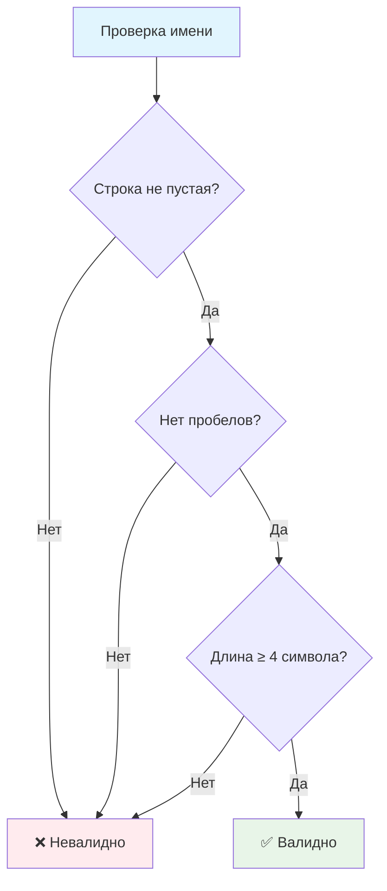

# ✅ Валидация имени пользователя

> **Изучаем валидацию данных и работу со строками!** 🔐  
> Эта задача научит вас проверять пользовательский ввод и обрабатывать различные граничные случаи.

## 🎯 Задача

Создайте функцию валидации, которая проверяет имя пользователя по заданным критериям. Приветствуем только пользователей с корректными именами!

```js
isValid("John") === true      // корректное имя
isValid("Al") === false       // слишком короткое  
isValid("John Doe") === false // содержит пробел
isValid("") === false         // пустая строка
isValid(null) === false       // отсутствует значение
```

## 📋 Критерии валидации

Имя считается **корректным**, если выполняются **ВСЕ** условия:



### 🔍 Детальные требования:

1. **📝 Не пустая строка**
  - `name` не должен быть `null`, `undefined`, или `""`

2. **🚫 Без пробелов**
  - Имя не должно содержать символ пробела ` `

3. **📏 Минимальная длина**
  - Длина строки должна быть минимум 4 символа

## 🛠️ Функция для реализации

```js
/**
 * Проверяет корректность имени пользователя
 * @param {string | null} name - Имя для проверки
 * @returns {boolean} - true если имя корректно, false иначе
 */
function isValid(name) {
  // Ваш код здесь...
}
```

## ✅ Примеры валидации

| Ввод | Результат | Причина |
|------|:---------:|---------|
| `"John"` | ✅ `true` | Все критерии выполнены |
| `"Alice"` | ✅ `true` | Все критерии выполнены |
| `"Bob"` | ❌ `false` | Длина < 4 символов |
| `"Al"` | ❌ `false` | Длина < 4 символов |
| `"John Doe"` | ❌ `false` | Содержит пробел |
| `"Mary Jane"` | ❌ `false` | Содержит пробел |
| `""` | ❌ `false` | Пустая строка |
| `null` | ❌ `false` | Отсутствует значение |
| `undefined` | ❌ `false` | Отсутствует значение |
| `"User123"` | ✅ `true` | Все критерии выполнены |

## 💡 Концепции, которые вы изучите

- **Валидация данных**: проверка пользовательского ввода
- **Логические операторы**: комбинирование условий
- **Методы строк**: `.indexOf()`, `.length`
- **Обработка null/undefined**: проверка существования значений
- **Булева логика**: возврат true/false

## 🎓 Для новичков

**Что такое валидация?**  
Валидация — это проверка данных на соответствие определенным правилам. Важно проверять пользовательский ввод, чтобы избежать ошибок в программе.

**Почему проверяем на пробелы?**  
В некоторых системах пробелы в именах пользователей могут вызывать проблемы (URL, базы данных, файловые системы).

**Зачем минимальная длина?**  
Короткие имена могут быть неинформативными или конфликтовать с системными именами.

## ⚡ Частые ошибки

❌ **Неправильная проверка пустоты**
```js
if (name === "") { // ❌ Не учитывает null/undefined
  return false;
}
```

✅ **Правильная проверка пустоты**
```js
if (!name) { // ✅ Проверяет "", null, undefined
  return false;
}
```

❌ **Неправильный поиск пробелов**
```js
if (name.includes(" ")) { // ❌ Может не поддерживаться в старых браузерах
```

✅ **Универсальный поиск пробелов**
```js
if (name.indexOf(" ") !== -1) { // ✅ Работает везде
```

❌ **Забыть проверить все условия**
```js
// ❌ Проверяем только одно условие
if (name.length >= 4) {
  return true;
}
```

✅ **Проверить все условия**
```js
// ✅ Все условия должны выполняться
return name && name.indexOf(" ") === -1 && name.length >= 4;
```

## 🧪 Пошаговый пример: isValid("John Doe")

| Шаг | Проверка | Значение | Результат | Действие |
|-----|----------|----------|-----------|----------|
| 1 | `!name` | `!"John Doe"` | `false` | Продолжаем |
| 2 | `name.indexOf(" ")` | `4` | `4 !== -1` | `true` → Есть пробел |
| 3 | — | — | — | Возвращаем `false` |

**Результат:** `false` (содержит пробел на позиции 4)

## 🧪 Пошаговый пример: isValid("Alice")

| Шаг | Проверка | Значение | Результат | Действие |
|-----|----------|----------|-----------|----------|
| 1 | `!name` | `!"Alice"` | `false` | Продолжаем |
| 2 | `name.indexOf(" ")` | `-1` | `-1 !== -1` | `false` → Нет пробелов |
| 3 | `name.length` | `5` | `5 < 4` | `false` → Длина достаточная |
| 4 | — | — | — | Все проверки пройдены |

**Результат:** `true` (все условия выполнены)

## 🔧 Различные подходы к решению

### 📝 Пошаговая проверка
```js
function isValid(name) {
  if (!name) return false;
  if (name.indexOf(" ") !== -1) return false;
  if (name.length < 4) return false;
  return true;
}
```

### ⚡ Одна строка
```js
function isValid(name) {
  return name && name.indexOf(" ") === -1 && name.length >= 4;
}
```

### 🎯 С явными проверками
```js
function isValid(name) {
  const isEmpty = !name;
  const hasSpaces = name && name.indexOf(" ") !== -1;
  const isTooShort = name && name.length < 4;
  
  return !isEmpty && !hasSpaces && !isTooShort;
}
```

## 🔍 Контекст использования

```js
function sayHello() {
  let userName = prompt('Введите ваше имя');

  if (isValid(userName)) {
    print(`Welcome back, ${userName}!`);
  } else {
    print('Некорректное имя пользователя');
  }
}
```

**Как это работает:**
1. Пользователь вводит имя через `prompt()`
2. Функция `isValid()` проверяет имя
3. Показываем приветствие или сообщение об ошибке

## 🧪 Тестирование

```bash
npm test
```

Проверьте все граничные случаи: пустые строки, короткие имена, имена с пробелами!

## 🚀 Что дальше?

Эта задача подготовила вас к более сложной валидации: email, паролей, форм и пользовательского ввода!

---
📚 **Полезные ссылки:**
- [MDN: String.indexOf()](https://developer.mozilla.org/ru/docs/Web/JavaScript/Reference/Global_Objects/String/indexOf)
- [MDN: String.length](https://developer.mozilla.org/ru/docs/Web/JavaScript/Reference/Global_Objects/String/length)
- [MDN: Логические операторы](https://developer.mozilla.org/ru/docs/Web/JavaScript/Reference/Operators/Logical_Operators)
