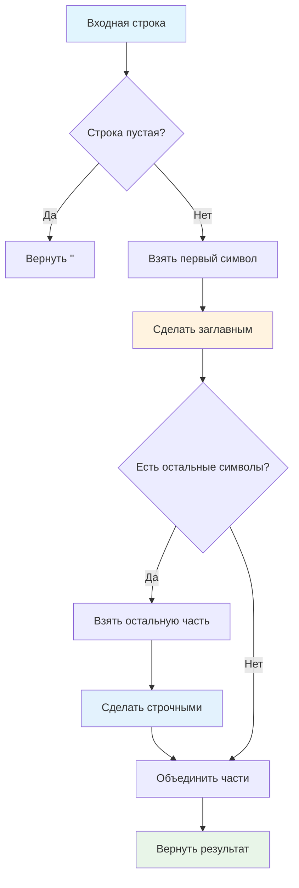

# 🔤 Сделать первую букву заглавной

> **Изучаем методы работы со строками!** ✨  
> Эта задача научит вас манипулировать текстом и обрабатывать граничные случаи.

## 🎯 Задача

Напишите функцию `toUpperCaseFirst(str)`, которая возвращает строку с **заглавной первой буквой** и **строчными остальными**.

```js
toUpperCaseFirst('вася') === 'Вася'       // обычный случай
toUpperCaseFirst('ПЕТР') === 'Петр'       // все заглавные → нормализация
toUpperCaseFirst('д') === 'Д'             // один символ
toUpperCaseFirst('') === ''               // пустая строка
```

## 🔍 Алгоритм обработки



## 📋 Требования к функции

| Входная строка | Обработка | Результат |
|---------------|-----------|-----------|
| Обычная строка | Первая буква заглавная, остальные строчные | ✅ |
| Один символ | Преобразование в заглавную | ✅ |
| Пустая строка | Возврат без изменений | ✅ |
| Уже правильная | Нормализация (может изменить остальные буквы) | ✅ |

## ✅ Примеры работы

| Вход | Ожидаемый результат | Пояснение |
|------|:------------------:|-----------|
| `'вася'` | `'Вася'` | Стандартное преобразование |
| `'АННА'` | `'Анна'` | Нормализация: первая заглавная, остальные строчные |
| `'иВаН'` | `'Иван'` | Исправление смешанного регистра |
| `'д'` | `'Д'` | Один символ в заглавную |
| `'A'` | `'A'` | Уже заглавная, остается без изменений |
| `''` | `''` | Пустая строка остается пустой |
| `'123abc'` | `'123abc'` | Цифры не меняются, буквы обрабатываются |
| `' hello'` | `' hello'` | Пробел в начале — особый случай |

## 🛠️ Что нужно реализовать

```js
function toUpperCaseFirst(str) {
  // Ваш код здесь
}

export default toUpperCaseFirst;
```

## 💡 Концепции, которые вы изучите

- **Методы строк**: `.substring()`, `.toUpperCase()`, `.toLowerCase()`
- **Конкатенация строк**: объединение частей строки
- **Шаблонные литералы**: современный синтаксис с `${}`
- **Граничные случаи**: обработка пустых строк и одного символа
- **Индексация строк**: доступ к символам по позиции

## 🎓 Для новичков

**Как работает substring()?**
```js
const str = "Hello";
str.substring(0, 1) // "H" - первый символ
str.substring(1)    // "ello" - с 1-го символа до конца
```

**Разница между substring() и slice():**
- `substring(start, end)` — не поддерживает отрицательные индексы
- `slice(start, end)` — поддерживает отрицательные индексы

**Что такое шаблонные литералы?**
```js
// Старый способ
const result = str.substring(0, 1).toUpperCase() + str.substring(1).toLowerCase();

// Современный способ
const result = `${str.substring(0, 1).toUpperCase()}${str.substring(1).toLowerCase()}`;
```

## ⚡ Частые ошибки

❌ **Забыть обработать пустую строку**
```js
function toUpperCaseFirst(str) {
  return str[0].toUpperCase() + str.substring(1); // ❌ Ошибка для ""!
}
```

✅ **Правильная обработка всех случаев**
```js
function toUpperCaseFirst(str) {
  if (str === '') return '';
  return str[0].toUpperCase() + str.substring(1).toLowerCase();
}
```

❌ **Не нормализовать остальные буквы**
```js
function toUpperCaseFirst(str) {
  return str[0].toUpperCase() + str.substring(1); // ❌ "иВаН" → "ИВаН"
}
```

✅ **Полная нормализация**
```js
function toUpperCaseFirst(str) {
  return str[0].toUpperCase() + str.substring(1).toLowerCase(); // ✅ "иВаН" → "Иван"
}
```

❌ **Путать индексы в substring**
```js
str.substring(1, 0) // ❌ Вернет первый символ вместо пустой строки
str.substring(0, 1) // ✅ Правильно - первый символ
```

## 🧪 Пошаговый пример: toUpperCaseFirst('иВаН')

| Шаг | Операция | Результат | Объяснение |
|-----|----------|-----------|------------|
| 1 | `str.substring(0, 1)` | `'и'` | Извлекаем первый символ |
| 2 | `'и'.toUpperCase()` | `'И'` | Делаем заглавным |
| 3 | `str.substring(1)` | `'ВаН'` | Извлекаем остальную часть |
| 4 | `'ВаН'.toLowerCase()` | `'ван'` | Делаем строчными |
| 5 | Объединение | `'И' + 'ван'` | Получаем `'Иван'` |

**Результат:** `'Иван'`

## 🔧 Различные подходы к решению

### 🎯 Через шаблонные литералы (современный)
```js
function toUpperCaseFirst(str) {
  if (!str) return str;
  return `${str[0].toUpperCase()}${str.slice(1).toLowerCase()}`;
}
```

### 📝 Через конкатенацию (классический)
```js
function toUpperCaseFirst(str) {
  if (str.length === 0) return str;
  return str.charAt(0).toUpperCase() + str.slice(1).toLowerCase();
}
```

### ⚡ Через массивы (функциональный)
```js
function toUpperCaseFirst(str) {
  if (!str) return str;
  return str.split('')
    .map((char, index) => index === 0 ? char.toUpperCase() : char.toLowerCase())
    .join('');
}
```

### 🔄 Через replace (с регулярными выражениями)
```js
function toUpperCaseFirst(str) {
  return str.toLowerCase().replace(/^./, char => char.toUpperCase());
}
```

## 🌍 Работа с разными языками

**Кириллица:**
```js
toUpperCaseFirst('привет') // 'Привет'
toUpperCaseFirst('МОСКВА') // 'Москва'
```

**Латиница:**
```js
toUpperCaseFirst('hello')  // 'Hello'
toUpperCaseFirst('WORLD')  // 'World'
```

**Смешанный контент:**
```js
toUpperCaseFirst('123abc') // '123abc' (цифры остаются неизменными)
```

## 🧪 Тестирование

```bash
npm test
```

Проверьте: обычные строки, один символ, пустая строка, смешанный регистр!

## 🚀 Что дальше?

Эта задача подготовила вас к более сложной обработке текста: форматирование имен, заголовков, работе с пользовательским вводом!

---
📚 **Полезные ссылки:**
- [MDN: String.substring()](https://developer.mozilla.org/ru/docs/Web/JavaScript/Reference/Global_Objects/String/substring)
- [MDN: String.toUpperCase()](https://developer.mozilla.org/ru/docs/Web/JavaScript/Reference/Global_Objects/String/toUpperCase)
- [MDN: Шаблонные литералы](https://developer.mozilla.org/ru/docs/Web/JavaScript/Reference/Template_literals)
