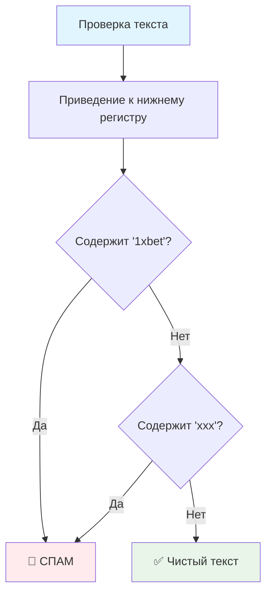

# 🛡️ Проверка на спам

> **Изучаем фильтрацию контента и поиск в строках!** 🔍  
> Эта задача научит вас создавать системы модерации и работать с регистронезависимым поиском.

## 🎯 Задача

Создайте функцию `checkSpam(str)`, которая определяет содержит ли текст запрещенные слова. Функция возвращает `true`, если найден спам, и `false` — если текст чистый.

```js
checkSpam('1XbeT now') === true        // содержит "1xBet" (любой регистр)
checkSpam('free xxxxx') === true       // содержит "XXX"
checkSpam('innocent rabbit') === false // чистый текст
```

## 🚨 Список запрещенных слов

Текст считается **спамом**, если содержит **любое** из слов:



### 📋 Запрещенные слова:
- **`'1xBet'`** — популярная букмекерская контора
- **`'XXX'`** — контент для взрослых

**⚠️ Важно:** Проверка должна быть **нечувствительна к регистру**!

## 📋 Входные данные

| Параметр | Тип      | Описание |
|----------|----------|----------|
| `str`    | `string` | Текст для проверки |

## 📤 Выходные данные

- **`true`** — текст содержит спам
- **`false`** — текст чистый

## ✅ Примеры работы

| Входной текст | Найденное слово | Результат | Пояснение |
|---------------|-----------------|:---------:|-----------|
| `'1XbeT now'` | `1xbet` | ✅ `true` | Найдено "1xBet" в разном регистре |
| `'free xxxxx'` | `xxx` | ✅ `true` | Найдено "XXX" внутри слова |
| `'Check 1XBET odds'` | `1xbet` | ✅ `true` | "1xBet" в верхнем регистре |
| `'xxx movies'` | `xxx` | ✅ `true` | "XXX" в начале строки |
| `'Visit XXX site'` | `xxx` | ✅ `true` | "XXX" в верхнем регистре |
| `'innocent rabbit'` | — | ❌ `false` | Запрещенных слов нет |
| `'hello world'` | — | ❌ `false` | Чистый текст |
| `'bet on sports'` | — | ❌ `false` | Частичное совпадение не считается |
| `''` | — | ❌ `false` | Пустая строка |

## 🛠️ Что нужно реализовать

```js
function checkSpam(str) {
  // Ваш код здесь
}

export default checkSpam;
```

## 💡 Концепции, которые вы изучите

- **Поиск подстрок**: `.indexOf()` и альтернативы
- **Регистронезависимый поиск**: `.toLowerCase()`
- **Логические операторы**: `||` (ИЛИ)
- **Модерация контента**: основы фильтрации
- **Булева логика**: возврат true/false

## 🎓 Для новичков

**Что такое спам-фильтр?**  
Это система, которая автоматически определяет нежелательный контент по ключевым словам, паттернам или другим признакам.

**Почему нужна нечувствительность к регистру?**  
Спамеры часто используют разный регистр букв, чтобы обойти простые фильтры: `1XBeT`, `1xbet`, `1XBET`.

**Как работает indexOf()?**
```js
'Hello World'.indexOf('World') // 6 - позиция найденной подстроки
'Hello World'.indexOf('Mars')  // -1 - подстрока не найдена
```

## ⚡ Частые ошибки

❌ **Забыть про регистронезависимость**
```js
function checkSpam(str) {
  return str.indexOf('1xBet') !== -1; // ❌ Не найдет "1XBET"
}
```

✅ **Правильная обработка регистра**
```js
function checkSpam(str) {
  const lowerStr = str.toLowerCase();
  return lowerStr.indexOf('1xbet') !== -1; // ✅ Найдет любой регистр
}
```

❌ **Неэффективное множественное преобразование**
```js
function checkSpam(str) {
  return str.toLowerCase().indexOf('1xbet') !== -1 || 
         str.toLowerCase().indexOf('xxx') !== -1; // ❌ Двойное преобразование
}
```

✅ **Оптимизированная версия**
```js
function checkSpam(str) {
  const lowerStr = str.toLowerCase();
  return lowerStr.indexOf('1xbet') !== -1 || lowerStr.indexOf('xxx') !== -1;
}
```

❌ **Использование устаревших методов**
```js
// Может не работать в старых браузерах
return str.includes('1xbet'); // ❌ Не везде поддерживается
```

## 🧪 Пошаговый пример: checkSpam('Free XXX content!')

| Шаг | Операция | Результат | Объяснение |
|-----|----------|-----------|------------|
| 1 | `str.toLowerCase()` | `'free xxx content!'` | Приводим к нижнему регистру |
| 2 | `indexOf('1xbet')` | `-1` | "1xbet" не найдено |
| 3 | `indexOf('xxx')` | `5` | "xxx" найдено на позиции 5 |
| 4 | Логическая операция | `-1 !== -1 \|\| 5 !== -1` | `false \|\| true` |
| 5 | Результат | `true` | Спам обнаружен! |

**Результат:** `true` (найдено запрещенное слово "xxx")

## 🔧 Различные подходы к решению

### 🎯 Базовое решение
```js
function checkSpam(str) {
  const lowerStr = str.toLowerCase();
  return lowerStr.indexOf('1xbet') !== -1 || lowerStr.indexOf('xxx') !== -1;
}
```

### ⚡ Современный подход (ES6+)
```js
function checkSpam(str) {
  const lowerStr = str.toLowerCase();
  return lowerStr.includes('1xbet') || lowerStr.includes('xxx');
}
```

### 📝 Через массив запрещенных слов
```js
function checkSpam(str) {
  const spamWords = ['1xbet', 'xxx'];
  const lowerStr = str.toLowerCase();
  return spamWords.some(word => lowerStr.includes(word));
}
```

### 🔍 Через регулярные выражения
```js
function checkSpam(str) {
  const spamPattern = /1xbet|xxx/i; // i = case insensitive
  return spamPattern.test(str);
}
```

### 🏭 Масштабируемое решение
```js
const SPAM_WORDS = ['1xbet', 'xxx'];

function checkSpam(str) {
  const lowerStr = str.toLowerCase();
  return SPAM_WORDS.some(word => lowerStr.indexOf(word) !== -1);
}
```

## 🌟 Расширение функциональности

**Добавление новых запрещенных слов:**
```js
const SPAM_DICTIONARY = [
  '1xbet', 'xxx', 'casino', 'viagra', 'free money'
];

function checkSpam(str, customWords = []) {
  const allWords = [...SPAM_DICTIONARY, ...customWords];
  const lowerStr = str.toLowerCase();
  return allWords.some(word => lowerStr.includes(word));
}
```

**Подсчет найденных слов:**
```js
function analyzeSpam(str) {
  const spamWords = ['1xbet', 'xxx'];
  const lowerStr = str.toLowerCase();
  const found = spamWords.filter(word => lowerStr.includes(word));
  
  return {
    isSpam: found.length > 0,
    foundWords: found,
    count: found.length
  };
}
```

## 🧪 Тестирование

```bash
npm test
```

Проверьте: разный регистр, частичные совпадения, пустые строки, комбинации слов!

## 🚀 Что дальше?

Эта задача подготовила вас к созданию более сложных систем модерации: фильтрация по регулярным выражениям, машинное обучение для спам-детекции, обработка множественных правил!

---
📚 **Полезные ссылки:**
- [MDN: String.indexOf()](https://developer.mozilla.org/ru/docs/Web/JavaScript/Reference/Global_Objects/String/indexOf)
- [MDN: String.includes()](https://developer.mozilla.org/ru/docs/Web/JavaScript/Reference/Global_Objects/String/includes)
- [MDN: Логические операторы](https://developer.mozilla.org/ru/docs/Web/JavaScript/Reference/Operators/Logical_Operators)
