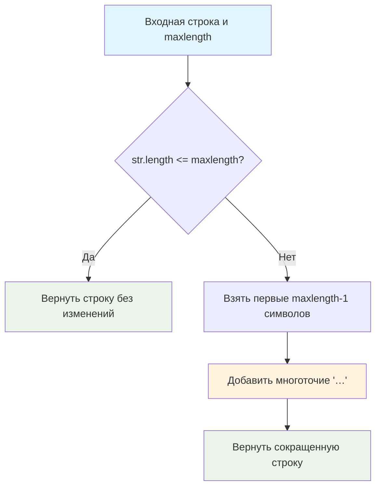

# ✂️ Сокращение длины строки

> **Изучаем обработку текста и пользовательский интерфейс!** 📝  
> Эта задача научит вас создавать превью текста и работать с ограничениями на длину контента.

## 🎯 Задача

Создайте функцию `truncate(str, maxlength)`, которая **умно сокращает** текст до заданной длины, добавляя многоточие в конце при необходимости.

```js
truncate('Вот, что мне хотелось бы сказать на эту тему:', 20) === 'Вот, что мне хотело…'
truncate('Всем привет!', 20) === 'Всем привет!'  // сокращение не нужно
```

## 🔍 Алгоритм сокращения



## 📋 Параметры функции

| Параметр | Тип | Описание |
|----------|-----|----------|
| `str` | `string` | Исходная строка для сокращения |
| `maxlength` | `number` | Максимальная разрешенная длина |

## 📤 Возвращаемое значение

- **Исходная строка** — если сокращение не требуется
- **Сокращенная строка с `…`** — если длина превышает лимит

## ✅ Примеры работы

| Исходная строка | maxlength | Результат | Пояснение |
|----------------|-----------|-----------|-----------|
| `'Вот, что мне хотелось бы сказать на эту тему:'` | 20 | `'Вот, что мне хотело…'` | 39 → 20 символов |
| `'Всем привет!'` | 20 | `'Всем привет!'` | 12 ≤ 20, не сокращаем |
| `'Hello World'` | 11 | `'Hello World'` | Точно равна лимиту |
| `'JavaScript'` | 5 | `'Java…'` | 10 → 5 символов |
| `'Короткий'` | 100 | `'Короткий'` | Гораздо меньше лимита |
| `'A'` | 1 | `'A'` | Один символ |
| `'AB'` | 1 | `'…'` | 2 → 1 символ |
| `''` | 10 | `''` | Пустая строка |

## 🛠️ Что нужно реализовать

```js
function truncate(str, maxlength) {
  // Ваш код здесь
}

export default truncate;
```

⚠️ **Важно:** Используйте специальный символ многоточие `…` (не три точки `...`)!

## 💡 Концепции, которые вы изучите

- **Условные операторы**: проверка длины строки
- **Тернарный оператор**: компактная запись условий
- **Извлечение подстроки**: `.substring()` или `.slice()`
- **Пользовательский интерфейс**: создание превью текста
- **Unicode символы**: работа с `…` vs `...`

## 🎓 Для новичков

**Зачем нужно сокращение текста?**  
В интерфейсах часто ограничено место: заголовки статей, описания товаров, комментарии. Сокращение помогает показать максимум информации в отведенном пространстве.

**Почему именно `…` а не `...`?**
- `…` — один Unicode символ, экономит место
- `...` — три отдельных символа

**Математика сокращения:**
```
Исходная строка: "Hello World" (11 символов)
maxlength: 8
Результат: "Hello W" (7) + "…" (1) = 8 символов
```

## ⚡ Частые ошибки

❌ **Неправильный расчет длины**
```js
return str.substring(0, maxlength) + '…'; // ❌ Может превысить maxlength!
```

✅ **Правильный расчет**
```js
return str.substring(0, maxlength - 1) + '…'; // ✅ Ровно maxlength символов
```

❌ **Использование обычных точек**
```js
return str.substring(0, maxlength - 3) + '...'; // ❌ Три символа вместо одного
```

✅ **Специальный символ многоточия**
```js
return str.substring(0, maxlength - 1) + '…'; // ✅ Один символ
```

❌ **Забыть проверить длину**
```js
function truncate(str, maxlength) {
  return str.substring(0, maxlength - 1) + '…'; // ❌ Всегда сокращает!
}
```

✅ **Проверка необходимости сокращения**
```js
function truncate(str, maxlength) {
  if (str.length <= maxlength) return str; // ✅ Сначала проверяем
  return str.substring(0, maxlength - 1) + '…';
}
```

## 🧪 Пошаговый пример: truncate('JavaScript Programming', 12)

| Шаг | Операция | Значение | Объяснение |
|-----|----------|----------|------------|
| 1 | Проверка длины | `21 <= 12?` | `false` → нужно сокращать |
| 2 | Расчет позиции | `maxlength - 1` | `12 - 1 = 11` |
| 3 | Извлечение | `str.substring(0, 11)` | `'JavaScript '` |
| 4 | Добавление многоточия | `+ '…'` | `'JavaScript …'` |
| 5 | Проверка длины | `length = 12` | ✅ Соответствует лимиту |

**Результат:** `'JavaScript …'` (ровно 12 символов)

## 🔧 Различные подходы к решению

### 🎯 Тернарный оператор (компактно)
```js
function truncate(str, maxlength) {
  return str.length <= maxlength ? str : str.substring(0, maxlength - 1) + '…';
}
```

### 📝 Явная проверка (читаемо)
```js
function truncate(str, maxlength) {
  if (str.length <= maxlength) {
    return str;
  }
  return str.substring(0, maxlength - 1) + '…';
}
```

### ⚡ Через slice (альтернатива)
```js
function truncate(str, maxlength) {
  return str.length <= maxlength ? str : str.slice(0, maxlength - 1) + '…';
}
```

### 🔧 С валидацией параметров
```js
function truncate(str, maxlength) {
  if (typeof str !== 'string') return '';
  if (maxlength <= 0) return '';
  if (maxlength === 1) return str.length > 1 ? '…' : str;
  
  return str.length <= maxlength ? str : str.substring(0, maxlength - 1) + '…';
}
```

## 🌟 Расширенная версия

### 📱 Умное сокращение по словам
```js
function smartTruncate(str, maxlength) {
  if (str.length <= maxlength) return str;
  
  // Пытаемся сократить по словам
  const truncated = str.substring(0, maxlength - 1);
  const lastSpace = truncated.lastIndexOf(' ');
  
  if (lastSpace > 0) {
    return truncated.substring(0, lastSpace) + '…';
  }
  
  // Если нет пробелов, сокращаем посимвольно
  return truncated + '…';
}
```

### 🎨 С настраиваемым окончанием
```js
function truncate(str, maxlength, ending = '…') {
  if (str.length <= maxlength) return str;
  return str.substring(0, maxlength - ending.length) + ending;
}

// Использование:
truncate('Long text', 10, '...')  // 'Long te...'
truncate('Long text', 10, ' →')   // 'Long tex →'
```

## 🎨 Применение в интерфейсах

**Карточки товаров:**
```js
const productTitle = truncate('Смартфон Apple iPhone 15 Pro Max 256GB', 25);
// 'Смартфон Apple iPhone …'
```

**Список сообщений:**
```js
const preview = truncate('Привет! Как дела? Давно не виделись...', 30);
// 'Привет! Как дела? Давно не в…'
```

## 🧪 Тестирование

```bash
npm test
```

Проверьте: длинные строки, короткие строки, точное совпадение длины, граничные случаи!

## 🚀 Что дальше?

Эта задача подготовила вас к созданию более сложных систем обработки текста: умное сокращение по словам, многоязычная поддержка, адаптивный текст!

---
📚 **Полезные ссылки:**
- [MDN: String.substring()](https://developer.mozilla.org/ru/docs/Web/JavaScript/Reference/Global_Objects/String/substring)
- [MDN: Тернарный оператор](https://developer.mozilla.org/ru/docs/Web/JavaScript/Reference/Operators/Conditional_Operator)
- [Unicode: Многоточие](https://unicode-table.com/ru/2026/)
