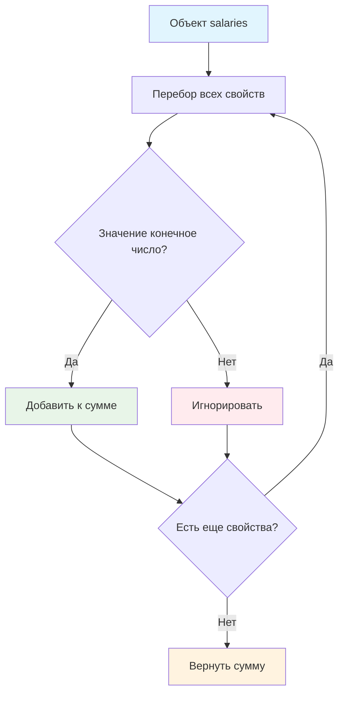

# 💰 Функция суммирования зарплат

> **Изучаем работу с объектами и валидацию данных!** 📊  
> Эта задача научит вас обрабатывать смешанные типы данных и фильтровать валидные числа.

## 🎯 Задача

Создайте функцию `sumSalary(salaries)`, которая **суммирует только числовые значения** из объекта, игнорируя строки, булевы значения и специальные числа.

```js
let salaries = {
  John: 1000,
  Ann: 1600,
  Pete: 1300,
  month: 'December',    // строка - игнорируем
  currency: 'USD',      // строка - игнорируем  
  isPayed: false        // boolean - игнорируем
};

sumSalary(salaries); // 3900 (1000 + 1600 + 1300)
```

## 🔍 Алгоритм обработки



## 📋 Критерии валидации

Значение **включается в сумму**, если:
- ✅ Это **число** (тип `number`)
- ✅ **Конечное** число (не `NaN`, `Infinity`, `-Infinity`)

Значение **игнорируется**, если:
- ❌ Строка (`'December'`, `'USD'`)
- ❌ Булево значение (`true`, `false`)
- ❌ Специальные числа (`NaN`, `Infinity`, `-Infinity`)
- ❌ `null`, `undefined`
- ❌ Объекты, массивы

## 📋 Входные данные

| Параметр | Тип | Описание |
|----------|-----|----------|
| `salaries` | `object` | Объект с различными типами значений |

## 📤 Выходные данные

- **Число** — сумма всех валидных числовых значений
- **0** — если валидных чисел не найдено

## ✅ Примеры работы

### 📊 Основной пример
```js
let salaries = {
  John: 1000,           // ✅ валидное число
  Ann: 1600,            // ✅ валидное число  
  Pete: 1300,           // ✅ валидное число
  month: 'December',    // ❌ строка
  currency: 'USD',      // ❌ строка
  isPayed: false        // ❌ boolean
};
// Результат: 1000 + 1600 + 1300 = 3900
```

### 🧪 Расширенные примеры

| Объект | Результат | Пояснение |
|--------|:---------:|-----------|
| `{a: 100, b: 200}` | 300 | Только числа |
| `{name: 'John', age: 25}` | 25 | Игнорируем строку |
| `{x: NaN, y: Infinity, z: 100}` | 100 | Только конечные числа |
| `{title: 'Report', year: 2024}` | 2024 | Смешанные типы |
| `{active: true, disabled: false}` | 0 | Только булевы значения |
| `{}` | 0 | Пустой объект |

### ⚠️ Специальные числа

```js
let problematicData = {
  valid1: 500,          // ✅ 500
  invalid1: NaN,        // ❌ игнорируем
  invalid2: Infinity,   // ❌ игнорируем  
  invalid3: -Infinity,  // ❌ игнорируем
  valid2: 300           // ✅ 300
};
// Результат: 500 + 300 = 800
```

## 🛠️ Что нужно реализовать

```js
function sumSalary(salaries) {
  // Ваш код здесь
}

export default sumSalary;
```

## 💡 Концепции, которые вы изучите

- **Циклы for...in**: перебор свойств объекта
- **Функция isFinite()**: проверка валидности чисел
- **Фильтрация данных**: отбор нужных значений
- **Накопление суммы**: аккумулятор в цикле
- **Смешанные типы данных**: обработка разнородной информации

## 🎓 Для новичков

**Что такое for...in?**  
Цикл для перебора всех перечисляемых свойств объекта:
```js
for (const key in object) {
  console.log(key, object[key]);
}
```

**Что такое isFinite()?**  
Функция проверяет, является ли значение конечным числом:
```js
isFinite(42)        // true
isFinite('42')      // true (приводится к числу)
isFinite(NaN)       // false
isFinite(Infinity)  // false
isFinite('hello')   // false
```

**Почему важно проверять isFinite()?**  
В JavaScript есть специальные числовые значения, которые могут сломать вычисления:
- `NaN + 100 = NaN`
- `Infinity + 100 = Infinity`

## ⚡ Частые ошибки

❌ **Неправильная проверка типа**
```js
if (typeof salaries[prop] === 'number') { // ❌ Включает NaN и Infinity!
  sum += salaries[prop];
}
```

✅ **Правильная валидация**
```js
if (isFinite(salaries[prop])) { // ✅ Только конечные числа
  sum += salaries[prop];
}
```

❌ **Забыть инициализировать сумму**
```js
let sum; // ❌ undefined + число = NaN
for (const prop in salaries) {
  sum += salaries[prop];
}
```

✅ **Правильная инициализация**
```js
let sum = 0; // ✅ Начинаем с нуля
```

❌ **Использовать неправильный цикл**
```js
for (const value of salaries) { // ❌ Объекты не итерируемы!
```

✅ **Правильный цикл для объектов**
```js
for (const prop in salaries) { // ✅ Перебор свойств
```

## 🧪 Пошаговый пример:

Объект: `{Alice: 1500, Bob: 'manager', Carol: 2000, bonus: NaN}`

| Шаг | Свойство | Значение | isFinite() | Действие | sum |
|-----|----------|----------|------------|----------|-----|
| 0 | — | — | — | Инициализация | 0 |
| 1 | `Alice` | `1500` | `true` | sum += 1500 | 1500 |
| 2 | `Bob` | `'manager'` | `false` | Игнорируем | 1500 |
| 3 | `Carol` | `2000` | `true` | sum += 2000 | 3500 |
| 4 | `bonus` | `NaN` | `false` | Игнорируем | 3500 |

**Результат:** 3500

## 🔧 Различные подходы к решению

### 🎯 Базовое решение (цикл for...in)
```js
function sumSalary(salaries) {
  let sum = 0;
  for (const prop in salaries) {
    if (isFinite(salaries[prop])) {
      sum += salaries[prop];
    }
  }
  return sum;
}
```

### ⚡ Функциональное программирование
```js
function sumSalary(salaries) {
  return Object.values(salaries)
    .filter(value => isFinite(value))
    .reduce((sum, value) => sum + value, 0);
}
```

### 📝 С подробной валидацией
```js
function sumSalary(salaries) {
  let sum = 0;
  
  for (const prop in salaries) {
    const value = salaries[prop];
    
    // Проверяем, что это число и оно конечно
    if (typeof value === 'number' && isFinite(value)) {
      sum += value;
    }
  }
  
  return sum;
}
```

### 🔍 С логированием (для отладки)
```js
function sumSalary(salaries) {
  let sum = 0;
  
  for (const prop in salaries) {
    const value = salaries[prop];
    
    if (isFinite(value)) {
      console.log(`Добавляем ${prop}: ${value}`);
      sum += value;
    } else {
      console.log(`Игнорируем ${prop}: ${value} (${typeof value})`);
    }
  }
  
  return sum;
}
```

## 🌟 Расширенная версия

### 📊 С детальным анализом
```js
function analyzeSalaries(salaries) {
  let sum = 0;
  let validCount = 0;
  let invalidCount = 0;
  const validEntries = [];
  const invalidEntries = [];
  
  for (const prop in salaries) {
    const value = salaries[prop];
    
    if (isFinite(value)) {
      sum += value;
      validCount++;
      validEntries.push({key: prop, value});
    } else {
      invalidCount++;
      invalidEntries.push({key: prop, value, type: typeof value});
    }
  }
  
  return {
    sum,
    validCount,
    invalidCount, 
    validEntries,
    invalidEntries,
    average: validCount > 0 ? sum / validCount : 0
  };
}
```

## 🧪 Тестирование

```bash
npm test
```

Проверьте: смешанные типы, специальные числа, пустые объекты, валидация данных!

## 🚀 Что дальше?

Эта задача подготовила вас к работе с реальными данными: обработка API ответов, валидация форм, агрегация данных!

---
📚 **Полезные ссылки:**
- [MDN: for...in](https://developer.mozilla.org/ru/docs/Web/JavaScript/Reference/Statements/for...in)
- [MDN: isFinite()](https://developer.mozilla.org/ru/docs/Web/JavaScript/Reference/Global_Objects/isFinite)
- [MDN: Object.values()](https://developer.mozilla.org/ru/docs/Web/JavaScript/Reference/Global_Objects/Object/values)
