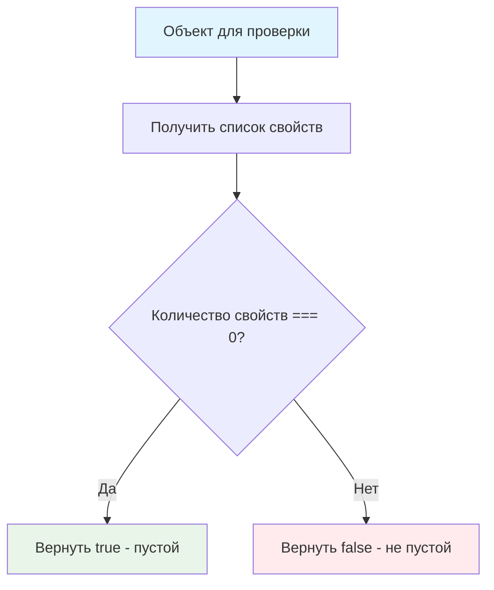

# 📦 Определите наличие свойств в объекте

> **Изучаем проверку объектов и их свойства!** 🔍  
> Эта задача научит вас определять пустые объекты и работать с метаданными объектов.

## 🎯 Задача

Создайте функцию `isEmpty(obj)`, которая проверяет есть ли в объекте **хотя бы одно свойство**.

```js
isEmpty({}) === true                    // пустой объект
isEmpty({name: 'John'}) === false       // есть свойство
isEmpty({a: 1, b: 2}) === false         // несколько свойств
```

## 🔍 Алгоритм проверки



## 📋 Функция isEmpty()

| Параметр | Тип | Описание |
|----------|-----|----------|
| `obj` | `object` | Объект для проверки |

**Возвращает:**
- `true` — объект пустой (нет свойств)
- `false` — объект содержит свойства

## ✅ Примеры работы

| Объект | Результат | Пояснение |
|--------|:---------:|-----------|
| `{}` | ✅ `true` | Совсем нет свойств |
| `{name: 'John'}` | ❌ `false` | Одно свойство |
| `{a: 1, b: 2, c: 3}` | ❌ `false` | Несколько свойств |
| `{age: 0}` | ❌ `false` | Даже если значение 0 |
| `{active: false}` | ❌ `false` | Даже если значение false |
| `{value: null}` | ❌ `false` | Даже если значение null |
| `{data: undefined}` | ❌ `false` | Даже если значение undefined |

## 🛠️ Что нужно реализовать

```js
function isEmpty(obj) {
  // Ваш код здесь
}

export default isEmpty;
```

## 💡 Концепции, которые вы изучите

- **Object.keys()**: получение списка свойств объекта
- **Свойства объектов**: понимание структуры данных
- **Проверка пустоты**: валидация объектов
- **Метаданные объектов**: информация о структуре
- **Булевая логика**: возврат true/false

## 🎓 Для новичков

**Что такое "пустой объект"?**  
Объект без собственных перечисляемых свойств. Важно: он существует, но не содержит данных.

**Как работает Object.keys()?**
```js
Object.keys({a: 1, b: 2})    // ['a', 'b'] - массив ключей
Object.keys({})              // [] - пустой массив
Object.keys({name: 'John'})  // ['name'] - один ключ
```

**Зачем проверять пустоту объектов?**
- Валидация данных перед обработкой
- Условная логика в приложениях
- Проверка результатов API запросов

## ⚡ Частые ошибки

❌ **Неправильная проверка значений свойств**
```js
function isEmpty(obj) {
  for (let key in obj) {
    if (obj[key]) return false; // ❌ Игнорирует falsy значения!
  }
  return true;
}
// isEmpty({active: false}) вернет true - неправильно!
```

✅ **Правильная проверка существования свойств**
```js
function isEmpty(obj) {
  return Object.keys(obj).length === 0; // ✅ Проверяем наличие ключей
}
```

❌ **Путать с проверкой на null/undefined**
```js
function isEmpty(obj) {
  return !obj; // ❌ Это проверка на существование объекта!
}
```

✅ **Проверка именно пустоты**
```js
function isEmpty(obj) {
  return Object.keys(obj).length === 0; // ✅ Проверяем количество свойств
}
```

❌ **Использовать неподходящие методы**
```js
function isEmpty(obj) {
  return obj.length === 0; // ❌ У объектов нет свойства length!
}
```

## 🧪 Пошаговый пример из условия

### Шаг 1: Проверка пустого объекта
```js
let schedule = {};
isEmpty(schedule); // проверяем
```

| Действие | Результат | Объяснение |
|----------|-----------|------------|
| `Object.keys(schedule)` | `[]` | Пустой массив ключей |
| `[].length` | `0` | Длина пустого массива |
| `0 === 0` | `true` | Объект пустой |

### Шаг 2: Добавление свойства
```js
schedule["8:30"] = "подъём";
isEmpty(schedule); // проверяем снова
```

| Действие | Результат | Объяснение |
|----------|-----------|------------|
| `Object.keys(schedule)` | `["8:30"]` | Массив с одним ключом |
| `["8:30"].length` | `1` | Длина массива = 1 |
| `1 === 0` | `false` | Объект не пустой |

## 🔧 Различные подходы к решению

### 🎯 Через Object.keys() (рекомендуемый)
```js
function isEmpty(obj) {
  return Object.keys(obj).length === 0;
}
```

### 🔄 Через цикл for...in
```js
function isEmpty(obj) {
  for (let key in obj) {
    return false; // Если есть хотя бы одно свойство
  }
  return true; // Если цикл не выполнился
}
```

### ⚡ Через Object.getOwnPropertyNames()
```js
function isEmpty(obj) {
  return Object.getOwnPropertyNames(obj).length === 0;
}
```

### 📊 Через JSON.stringify() (не рекомендуется)
```js
function isEmpty(obj) {
  return JSON.stringify(obj) === '{}';
}
// ⚠️ Не учитывает неперечисляемые свойства и функции
```

## 🔍 Сравнение методов

| Метод | Производительность | Читаемость | Совместимость |
|-------|-------------------|------------|---------------|
| `Object.keys()` | ⭐⭐⭐ | ⭐⭐⭐ | ⭐⭐⭐ |
| `for...in` | ⭐⭐⭐ | ⭐⭐ | ⭐⭐⭐ |
| `Object.getOwnPropertyNames()` | ⭐⭐ | ⭐⭐ | ⭐⭐ |
| `JSON.stringify()` | ⭐ | ⭐ | ⭐⭐ |

## 🌟 Расширенная версия

### 🔧 С проверкой типа
```js
function isEmpty(obj) {
  // Проверяем, что это объект
  if (typeof obj !== 'object' || obj === null) {
    return true; // или throw new Error('Ожидался объект')
  }
  
  return Object.keys(obj).length === 0;
}
```

### 📊 С подробной информацией
```js
function analyzeObject(obj) {
  const keys = Object.keys(obj);
  
  return {
    isEmpty: keys.length === 0,
    propertyCount: keys.length,
    properties: keys,
    hasData: keys.length > 0
  };
}

// Использование:
const result = analyzeObject({name: 'John', age: 30});
// {isEmpty: false, propertyCount: 2, properties: ['name', 'age'], hasData: true}
```

### 🎯 Для глубокой проверки
```js
function isDeepEmpty(obj) {
  const keys = Object.keys(obj);
  
  if (keys.length === 0) return true;
  
  // Проверяем, что все значения также пусты
  return keys.every(key => {
    const value = obj[key];
    if (typeof value === 'object' && value !== null) {
      return isDeepEmpty(value); // Рекурсивная проверка
    }
    return false; // Непустое значение найдено
  });
}

// isDeepEmpty({a: {}, b: {}}) === true
// isDeepEmpty({a: {x: 1}}) === false
```

## 🎨 Практическое применение

### 📝 Валидация форм
```js
function validateForm(formData) {
  if (isEmpty(formData)) {
    return {valid: false, error: 'Форма не заполнена'};
  }
  // Дальнейшая валидация...
}
```

### 🌐 Обработка API ответов
```js
function processApiResponse(data) {
  if (isEmpty(data)) {
    console.log('Нет данных для отображения');
    return [];
  }
  return Object.values(data);
}
```

### 🎮 Игровая логика
```js
function checkInventory(inventory) {
  if (isEmpty(inventory)) {
    return 'Инвентарь пуст';
  }
  return `Предметов в инвентаре: ${Object.keys(inventory).length}`;
}
```

## 🧪 Тестирование

```bash
npm test
```

Проверьте: пустые объекты, объекты с данными, falsy значения в свойствах!

## 🚀 Что дальше?

Эта задача подготовила вас к более сложной работе с объектами: глубокая проверка, сравнение объектов, сериализация данных!

---
📚 **Полезные ссылки:**
- [MDN: Object.keys()](https://developer.mozilla.org/ru/docs/Web/JavaScript/Reference/Global_Objects/Object/keys)
- [MDN: for...in](https://developer.mozilla.org/ru/docs/Web/JavaScript/Reference/Statements/for...in)
- [MDN: Object.getOwnPropertyNames()](https://developer.mozilla.org/ru/docs/Web/JavaScript/Reference/Global_Objects/Object/getOwnPropertyNames)
