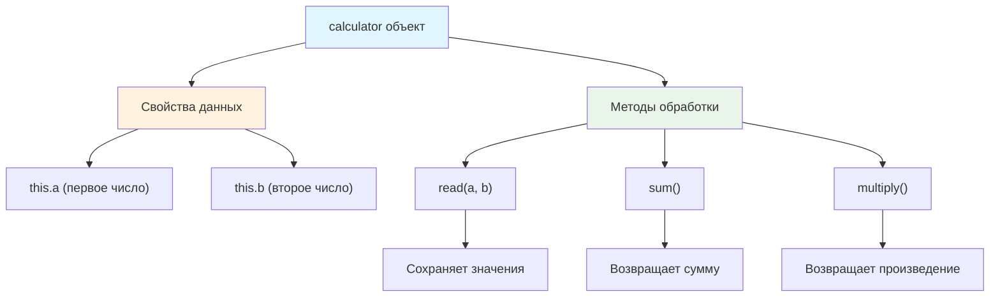

# 🧮 Создайте калькулятор

> **Изучаем объекты с методами и состоянием!** ⚡  
> Эта задача научит вас создавать объекты с внутренними данными и методами для их обработки.

## 🎯 Задача

Создайте объект `calculator` с тремя методами для работы с двумя числами: сохранение, сложение и умножение.

```js
calculator.read(3, 5);
console.log(calculator.sum());      // 8 (3 + 5)
console.log(calculator.multiply()); // 15 (3 × 5)
```

## 🔍 Архитектура калькулятора



## 📋 Спецификация методов

### 📥 read(a, b)
**Назначение:** Сохраняет два числа в свойствах объекта  
**Параметры:**
- `a` — первое число
- `b` — второе число

**Поведение:** Преобразует значения в числа и сохраняет в `this.a` и `this.b`

### ➕ sum()
**Назначение:** Возвращает сумму сохраненных чисел  
**Параметры:** нет  
**Возвращает:** `this.a + this.b`

### ✖️ multiply()
**Назначение:** Возвращает произведение сохраненных чисел  
**Параметры:** нет  
**Возвращает:** `this.a × this.b`

## ✅ Примеры работы

| Действие | Код | Результат | Объяснение |
|----------|-----|-----------|------------|
| Сохранение | `calculator.read(3, 5)` | — | a=3, b=5 |
| Сложение | `calculator.sum()` | `8` | 3 + 5 = 8 |
| Умножение | `calculator.multiply()` | `15` | 3 × 5 = 15 |
| Новые числа | `calculator.read(10, 2)` | — | a=10, b=2 |
| Сложение | `calculator.sum()` | `12` | 10 + 2 = 12 |
| Умножение | `calculator.multiply()` | `20` | 10 × 2 = 20 |

### 🧪 Расширенные примеры

```js
// Работа с десятичными числами
calculator.read(2.5, 4);
calculator.sum();      // 6.5
calculator.multiply(); // 10

// Работа со строками (должны преобразоваться в числа)
calculator.read('7', '3');
calculator.sum();      // 10
calculator.multiply(); // 21

// Отрицательные числа
calculator.read(-5, 3);
calculator.sum();      // -2
calculator.multiply(); // -15
```

## 🛠️ Что нужно реализовать

```js
let calculator = {
  // Ваш код здесь...
};

export default calculator;
```

## 💡 Концепции, которые вы изучите

- **Объекты с методами**: создание "умных" объектов
- **Контекст this**: ссылка на текущий объект
- **Состояние объекта**: хранение данных в свойствах
- **Инкапсуляция**: методы работают с внутренними данными
- **parseFloat()**: преобразование строк в числа

## 🎓 Для новичков

**Что такое this?**  
`this` — это ссылка на текущий объект, в котором выполняется метод:
```js
let obj = {
  name: 'Test',
  getName() {
    return this.name; // this указывает на obj
  }
};
```

**Зачем нужен parseFloat()?**  
Пользователи могут передать строки вместо чисел. `parseFloat()` превращает их в числа:
```js
parseFloat('3.14') // 3.14
parseFloat('42')   // 42
parseFloat('abc')  // NaN
```

**Паттерн "объект с состоянием":**  
Объект хранит данные и предоставляет методы для работы с ними — основа ООП.

## ⚡ Частые ошибки

❌ **Забыть использовать this**
```js
let calculator = {
  read(a, b) {
    a = parseFloat(a); // ❌ Сохраняется в локальную переменную!
    b = parseFloat(b);
  }
};
```

✅ **Правильное использование this**
```js
let calculator = {
  read(a, b) {
    this.a = parseFloat(a); // ✅ Сохраняется в свойство объекта
    this.b = parseFloat(b);
  }
};
```

❌ **Не преобразовать в числа**
```js
read(a, b) {
  this.a = a; // ❌ Может остаться строкой!
  this.b = b;
}
// calculator.read('3', '5'); calculator.sum() = '35' вместо 8
```

✅ **Правильное преобразование**
```js
read(a, b) {
  this.a = parseFloat(a); // ✅ Всегда число
  this.b = parseFloat(b);
}
```

❌ **Неправильный синтаксис методов**
```js
let calculator = {
  read: function(a, b) { ... }, // ❌ Старый синтаксис (работает, но устарел)
  sum: () => { ... }             // ❌ Стрелочная функция теряет this!
};
```

✅ **Современный синтаксис методов**
```js
let calculator = {
  read(a, b) { ... },   // ✅ Современный синтаксис
  sum() { ... }         // ✅ Короткая запись методов
};
```

## 🧪 Пошаговый пример

### Последовательность вызовов:
```js
calculator.read(7, 3);
console.log(calculator.sum());
console.log(calculator.multiply());
```

| Шаг | Действие | this.a | this.b | Результат |
|-----|----------|--------|--------|-----------|
| 1 | `read(7, 3)` | `7` | `3` | Значения сохранены |
| 2 | `sum()` | `7` | `3` | `10` (7 + 3) |
| 3 | `multiply()` | `7` | `3` | `21` (7 × 3) |

## 🔧 Различные подходы к реализации

### 🎯 Базовая реализация
```js
let calculator = {
  read(a, b) {
    this.a = parseFloat(a);
    this.b = parseFloat(b);
  },
  
  sum() {
    return this.a + this.b;
  },
  
  multiply() {
    return this.a * this.b;
  }
};
```

### 🛡️ С валидацией данных
```js
let calculator = {
  read(a, b) {
    this.a = parseFloat(a) || 0;
    this.b = parseFloat(b) || 0;
  },
  
  sum() {
    return this.a + this.b;
  },
  
  multiply() {
    return this.a * this.b;
  },
  
  isValid() {
    return !isNaN(this.a) && !isNaN(this.b);
  }
};
```

### ⚡ Расширенная версия
```js
let calculator = {
  read(a, b) {
    this.a = parseFloat(a);
    this.b = parseFloat(b);
    this.history = this.history || [];
    this.history.push({a: this.a, b: this.b, timestamp: Date.now()});
  },
  
  sum() {
    return this.a + this.b;
  },
  
  multiply() {
    return this.a * this.b;
  },
  
  subtract() {
    return this.a - this.b;
  },
  
  divide() {
    return this.b !== 0 ? this.a / this.b : 'Деление на ноль!';
  },
  
  clear() {
    this.a = 0;
    this.b = 0;
  },
  
  getHistory() {
    return this.history || [];
  }
};
```

### 🏭 Фабричная функция
```js
function createCalculator() {
  return {
    read(a, b) {
      this.a = parseFloat(a);
      this.b = parseFloat(b);
    },
    
    sum() {
      return this.a + this.b;
    },
    
    multiply() {
      return this.a * this.b;
    }
  };
}

// Использование:
const calc1 = createCalculator();
const calc2 = createCalculator(); // Независимый экземпляр
```

## 🌟 Практическое применение

### 📱 В интерфейсе
```js
// HTML: <input id="num1"> <input id="num2"> <button onclick="calculate()">
function calculate() {
  const a = document.getElementById('num1').value;
  const b = document.getElementById('num2').value;
  
  calculator.read(a, b);
  
  document.getElementById('sum').textContent = calculator.sum();
  document.getElementById('product').textContent = calculator.multiply();
}
```

### 🧮 Цепочка вычислений
```js
calculator
  .read(5, 3)
  .sum();  // Можно сделать методы chainable (возвращающие this)
```

## 🧪 Тестирование

```bash
npm test
```

Проверьте: целые числа, десятичные, строки, отрицательные значения!

## 🚀 Что дальше?

Эта задача подготовила вас к созданию более сложных объектов: классы, наследование, приватные свойства, паттерны проектирования!

---
📚 **Полезные ссылки:**
- [MDN: this](https://developer.mozilla.org/ru/docs/Web/JavaScript/Reference/Operators/this)
- [MDN: parseFloat()](https://developer.mozilla.org/ru/docs/Web/JavaScript/Reference/Global_Objects/parseFloat)
- [MDN: Методы объектов](https://developer.mozilla.org/ru/docs/Web/JavaScript/Guide/Working_with_Objects)
