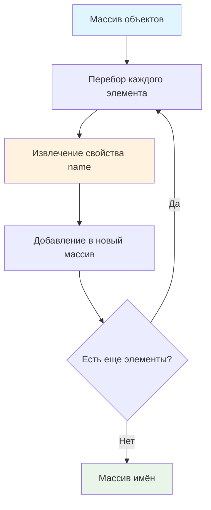

# 🔄 Трансформировать массив объектов в массив имён

> **Изучаем функциональное программирование и метод map()!** 🎯  
> Эта задача научит вас извлекать данные из массивов объектов и создавать новые структуры данных.

## 🎯 Задача

Создайте функцию `namify(users)`, которая преобразует массив объектов пользователей в массив их имён.

```js
let users = [
  { name: 'Вася', age: 25 },
  { name: 'Петя', age: 30 },
  { name: 'Маша', age: 28 }
];

namify(users); // ['Вася', 'Петя', 'Маша']
```

## 🔍 Алгоритм трансформации



## 📋 Входные и выходные данные

### 📥 Входные данные
- **`users`** — массив объектов, каждый содержит свойство `name`

### 📤 Выходные данные
- **Массив строк** — имена пользователей в том же порядке

## ✅ Примеры работы

### 🎭 Основной пример
```js
let vasya = { name: 'Вася', age: 25 };
let petya = { name: 'Петя', age: 30 };
let masha = { name: 'Маша', age: 28 };

let users = [vasya, petya, masha];
let names = namify(users);
// ['Вася', 'Петя', 'Маша']
```

### 📊 Расширенные примеры

| Входной массив | Результат | Пояснение |
|---------------|-----------|-----------|
| `[{name: 'Иван'}, {name: 'Анна'}]` | `['Иван', 'Анна']` | Простые объекты |
| `[]` | `[]` | Пустой массив |
| `[{name: 'John', country: 'US'}]` | `['John']` | Игнорируем лишние свойства |
| `[{name: 'Алиса'}, {name: 'Боб'}, {name: 'Ева'}]` | `['Алиса', 'Боб', 'Ева']` | Сохраняем порядок |

### 🌍 Международные имена
```js
let users = [
  { name: 'Alice', country: 'USA' },
  { name: '田中', country: 'Japan' },
  { name: 'José', country: 'Spain' },
  { name: 'Владимир', country: 'Russia' }
];

namify(users); // ['Alice', '田中', 'José', 'Владимир']
```

## 🛠️ Что нужно реализовать

```js
function namify(users) {
  // Ваш код здесь
}

export default namify;
```

## 💡 Концепции, которые вы изучите

- **Метод map()**: преобразование массивов
- **Извлечение свойств**: доступ к данным объектов
- **Функциональное программирование**: декларативный стиль
- **Трансформация данных**: изменение структуры
- **Стрелочные функции**: современный синтаксис

## 🎓 Для новичков

**Что такое map()?**  
`map()` создает новый массив, применяя функцию к каждому элементу исходного массива:
```js
[1, 2, 3].map(x => x * 2)  // [2, 4, 6]
['a', 'b'].map(s => s.toUpperCase())  // ['A', 'B']
```

**Как извлекать свойства объектов?**
```js
let user = { name: 'Иван', age: 30 };
user.name   // 'Иван'
user['name'] // 'Иван' (альтернативный синтаксис)
```

**Зачем нужна трансформация данных?**  
В реальных приложениях часто нужно:
- Показать только имена в списке
- Отправить на сервер только нужные поля
- Преобразовать данные для графиков

## ⚡ Частые ошибки

❌ **Мутация исходного массива**
```js
function namify(users) {
  for (let i = 0; i < users.length; i++) {
    users[i] = users[i].name; // ❌ Изменяет исходный массив!
  }
  return users;
}
```

✅ **Создание нового массива**
```js
function namify(users) {
  return users.map(user => user.name); // ✅ Новый массив
}
```

❌ **Забыть return в стрелочной функции**
```js
function namify(users) {
  return users.map(user => { user.name }); // ❌ Нет return!
}
```

✅ **Правильная стрелочная функция**
```js
function namify(users) {
  return users.map(user => user.name); // ✅ Неявный return
  // или
  return users.map(user => { return user.name; }); // ✅ Явный return
}
```

❌ **Не обрабатывать пустой массив**
```js
function namify(users) {
  return users[0].name; // ❌ Ошибка для пустого массива!
}
```

✅ **Корректная обработка всех случаев**
```js
function namify(users) {
  return users.map(user => user.name); // ✅ Работает и для пустого массива
}
```

## 🧪 Пошаговый пример

Входной массив:
```js
[
  { name: 'Анна', age: 25 },
  { name: 'Игорь', age: 30 }
]
```

| Шаг | Элемент | Операция | Результат |
|-----|---------|----------|-----------|
| 1 | `{ name: 'Анна', age: 25 }` | `elem.name` | `'Анна'` |
| 2 | `{ name: 'Игорь', age: 30 }` | `elem.name` | `'Игорь'` |

**Итоговый массив:** `['Анна', 'Игорь']`

## 🔧 Различные подходы к решению

### 🎯 Стрелочная функция (современный)
```js
function namify(users) {
  return users.map(user => user.name);
}
```

### 📝 Обычная функция (классический)
```js
function namify(users) {
  return users.map(function(user) {
    return user.name;
  });
}
```

### 🔧 Деструктуризация (элегантный)
```js
function namify(users) {
  return users.map(({ name }) => name);
}
```

### 🔄 Цикл for (императивный)
```js
function namify(users) {
  const names = [];
  for (let i = 0; i < users.length; i++) {
    names.push(users[i].name);
  }
  return names;
}
```

### 🎪 Цикл for...of (читаемый)
```js
function namify(users) {
  const names = [];
  for (const user of users) {
    names.push(user.name);
  }
  return names;
}
```

## 🌟 Расширенные версии

### 🛡️ С валидацией
```js
function namify(users) {
  return users
    .filter(user => user && typeof user.name === 'string')
    .map(user => user.name);
}
```

### 🎨 С форматированием
```js
function namify(users, options = {}) {
  return users.map(user => {
    let name = user.name;
    
    if (options.uppercase) {
      name = name.toUpperCase();
    }
    
    if (options.prefix) {
      name = options.prefix + name;
    }
    
    return name;
  });
}

// Использование:
namify(users, { uppercase: true, prefix: 'Mr. ' });
// ['MR. ВАСЯ', 'MR. ПЕТЯ', 'MR. МАША']
```

### 🔍 Извлечение любого свойства
```js
function extract(array, property) {
  return array.map(item => item[property]);
}

// Использование:
extract(users, 'name');  // ['Вася', 'Петя', 'Маша']
extract(users, 'age');   // [25, 30, 28]
```

## 🎨 Практическое применение

### 📋 Список пользователей в UI
```js
function renderUserList(users) {
  const names = namify(users);
  return names.map(name => `<li>${name}</li>`).join('');
}
```

### 📊 Данные для графиков
```js
function getChartLabels(salesData) {
  return namify(salesData); // Имена для подписей на графике
}
```

### 🔍 Поиск и фильтрация
```js
function searchUsers(users, query) {
  const names = namify(users);
  return names.filter(name => 
    name.toLowerCase().includes(query.toLowerCase())
  );
}
```

## 🔄 Сравнение с другими методами

| Метод | Назначение | Возвращает |
|-------|------------|------------|
| `map()` | Преобразование каждого элемента | Новый массив той же длины |
| `filter()` | Отбор элементов по условию | Новый массив (может быть короче) |
| `reduce()` | Сведение к одному значению | Любой тип данных |
| `forEach()` | Выполнение действий | `undefined` |

## 🧪 Тестирование

```bash
npm test
```

Проверьте: обычные объекты, пустой массив, объекты с дополнительными свойствами!

## 🚀 Что дальше?

Эта задача подготовила вас к более сложным трансформациям данных: группировка, фильтрация, агрегация, работа с API!

---
📚 **Полезные ссылки:**
- [MDN: Array.map()](https://developer.mozilla.org/ru/docs/Web/JavaScript/Reference/Global_Objects/Array/map)
- [MDN: Стрелочные функции](https://developer.mozilla.org/ru/docs/Web/JavaScript/Reference/Functions/Arrow_functions)
- [MDN: Деструктуризация](https://developer.mozilla.org/ru/docs/Web/JavaScript/Reference/Operators/Destructuring_assignment)
