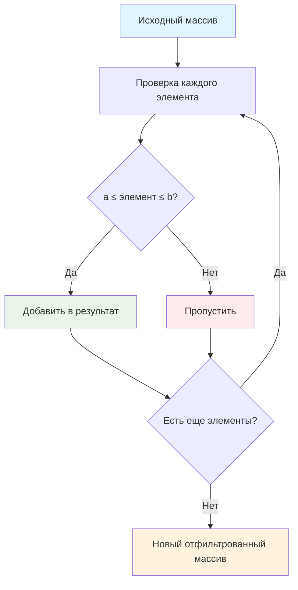

# 🎯 Фильтрация по диапазону

> **Изучаем метод filter() и работу с диапазонами!** 📊  
> Эта задача научит вас отбирать элементы по условиям и создавать новые массивы без изменения исходных данных.

## 🎯 Задача

Создайте функцию `filterRange(arr, a, b)`, которая находит все числа в диапазоне от `a` до `b` включительно и возвращает
их в новом массиве.

```js
let arr = [5, 3, 8, 1];
let filtered = filterRange(arr, 1, 4);

console.log(filtered); // [3, 1] (числа в диапазоне 1-4)
console.log(arr);      // [5, 3, 8, 1] (исходный не изменился)
```

## 🔍 Алгоритм фильтрации



## 📋 Параметры функции

| Параметр | Тип             | Описание                        |
|----------|-----------------|---------------------------------|
| `arr`    | `Array<number>` | Исходный массив чисел           |
| `a`      | `number`        | Минимальное значение диапазона  |
| `b`      | `number`        | Максимальное значение диапазона |

**Возвращает:** Новый массив с числами в диапазоне `[a, b]`

## ✅ Примеры работы

### 📊 Основные примеры

| Массив            | Диапазон | Результат   | Пояснение                    |
|-------------------|----------|-------------|------------------------------|
| `[5, 3, 8, 1]`    | `1, 4`   | `[3, 1]`    | 3 и 1 в диапазоне [1, 4]     |
| `[1, 2, 3, 4, 5]` | `2, 4`   | `[2, 3, 4]` | Границы включаются           |
| `[10, 20, 30]`    | `5, 15`  | `[10]`      | Только 10 попадает в [5, 15] |
| `[1, 2, 3]`       | `5, 10`  | `[]`        | Нет чисел в диапазоне        |
| `[]`              | `1, 5`   | `[]`        | Пустой массив                |

### 🧪 Расширенные примеры

```js
// Отрицательные числа
filterRange([-5, -2, 0, 3, 7], -3, 2);
// [-2, 0] (только -2 и 0 в диапазоне [-3, 2])

// Десятичные числа
filterRange([1.5, 2.7, 3.2, 4.8], 2, 4);
// [2.7, 3.2] (только эти числа в диапазоне [2, 4])

// Одинаковые границы
filterRange([1, 2, 3, 2, 4], 2, 2);
// [2, 2] (точное совпадение с границей)

// Обратный порядок границ
filterRange([1, 2, 3, 4, 5], 4, 2);
// [] (некорректный диапазон)
```

## 🛠️ Что нужно реализовать

```js
function filterRange(arr, a, b) {
  // Ваш код здесь
}

export default filterRange;
```

⚠️ **Важно:** Функция должна возвращать **новый массив** и **не изменять исходный**!

## 💡 Концепции, которые вы изучите

- **Метод filter()**: отбор элементов по условию
- **Логические операторы**: `&&` для объединения условий
- **Иммутабельность**: неизменность исходных данных
- **Диапазоны чисел**: включительные границы
- **Функциональное программирование**: декларативный стиль

## 🎓 Для новичков

**Что такое filter()?**  
`filter()` создает новый массив только с элементами, которые прошли проверку:

```js
[1, 2, 3, 4, 5].filter(x => x > 3)  // [4, 5]
  [true, false, true].filter(x => x)  // [true, true]
```

**Что значит "включительно"?**  
Границы диапазона тоже считаются частью диапазона:

- `[a, b]` — включает и `a`, и `b`
- Условие: `a ≤ элемент ≤ b`

**Почему важна иммутабельность?**  
Исходные данные не должны изменяться — это предотвращает ошибки и делает код предсказуемым.

## ⚡ Частые ошибки

❌ **Изменение исходного массива**

```js
function filterRange(arr, a, b) {
  for (let i = arr.length - 1; i >= 0; i--) {
    if (arr[i] < a || arr[i] > b) {
      arr.splice(i, 1); // ❌ Изменяет исходный массив!
    }
  }
  return arr;
}
```

✅ **Создание нового массива**

```js
function filterRange(arr, a, b) {
  return arr.filter(elem => elem >= a && elem <= b); // ✅ Новый массив
}
```

❌ **Неправильное условие**

```js
return arr.filter(elem => elem > a && elem < b); // ❌ Исключает границы!
```

✅ **Правильное условие**

```js
return arr.filter(elem => elem >= a && elem <= b); // ✅ Включает границы
```

❌ **Не учитывать порядок границ**

```js
function filterRange(arr, a, b) {
  return arr.filter(elem => elem >= a && elem <= b); // ❌ Что если a > b?
}
```

✅ **Обработка некорректного порядка**

```js
function filterRange(arr, a, b) {
  const min = Math.min(a, b);
  const max = Math.max(a, b);
  return arr.filter(elem => elem >= min && elem <= max);
}
```

## 🧪 Пошаговый пример

Массив: `[7, 2, 9, 1, 5]`, диапазон: `[2, 6]`

| Шаг | Элемент | Проверка    | 2 ≤ элемент ≤ 6? | Результат  |
|-----|---------|-------------|------------------|------------|
| 1   | `7`     | `2 ≤ 7 ≤ 6` | `false`          | Пропустить |
| 2   | `2`     | `2 ≤ 2 ≤ 6` | `true`           | Добавить   |
| 3   | `9`     | `2 ≤ 9 ≤ 6` | `false`          | Пропустить |
| 4   | `1`     | `2 ≤ 1 ≤ 6` | `false`          | Пропустить |
| 5   | `5`     | `2 ≤ 5 ≤ 6` | `true`           | Добавить   |

**Результат:** `[2, 5]`

## 🔧 Различные подходы к решению

### 🎯 Через filter() (рекомендуемый)

```js
function filterRange(arr, a, b) {
  return arr.filter(elem => elem >= a && elem <= b);
}
```

### 🔄 Через цикл for

```js
function filterRange(arr, a, b) {
  const result = [];
  for (let i = 0; i < arr.length; i++) {
    if (arr[i] >= a && arr[i] <= b) {
      result.push(arr[i]);
    }
  }
  return result;
}
```

### 🎪 Через цикл for...of

```js
function filterRange(arr, a, b) {
  const result = [];
  for (const elem of arr) {
    if (elem >= a && elem <= b) {
      result.push(elem);
    }
  }
  return result;
}
```

### 🛡️ С валидацией границ

```js
function filterRange(arr, a, b) {
  // Убеждаемся, что a ≤ b
  const min = Math.min(a, b);
  const max = Math.max(a, b);

  return arr.filter(elem =>
    typeof elem === 'number' &&
    elem >= min &&
    elem <= max
  );
}
```

### ⚡ Функциональный подход с деструктуризацией

```js
const filterRange = (arr, a, b) =>
  arr.filter(elem => elem >= a && elem <= b);
```

## 🌟 Расширенные версии

### 📊 С подсчетом статистики

```js
function filterRangeWithStats(arr, a, b) {
  const filtered = arr.filter(elem => elem >= a && elem <= b);

  return {
    values: filtered,
    count: filtered.length,
    percentage: (filtered.length / arr.length * 100).toFixed(1) + '%',
    excluded: arr.length - filtered.length
  };
}

// filterRangeWithStats([1, 2, 3, 4, 5], 2, 4)
// {values: [2, 3, 4], count: 3, percentage: '60.0%', excluded: 2}
```

### 🎯 Множественные диапазоны

```js
function filterMultipleRanges(arr, ranges) {
  return arr.filter(elem =>
    ranges.some(([a, b]) => elem >= a && elem <= b)
  );
}

// filterMultipleRanges([1, 2, 3, 4, 5], [[1, 2], [4, 5]])
// [1, 2, 4, 5] (числа в любом из диапазонов)
```

### 🔍 С поиском индексов

```js
function filterRangeWithIndexes(arr, a, b) {
  const result = [];
  arr.forEach((elem, index) => {
    if (elem >= a && elem <= b) {
      result.push({value: elem, index});
    }
  });
  return result;
}

// filterRangeWithIndexes([5, 3, 8, 1], 1, 4)
// [{value: 3, index: 1}, {value: 1, index: 3}]
```

## 🎨 Практическое применение

### 📈 Фильтрация данных для графиков

```js
function getDataInRange(dataset, minValue, maxValue) {
  return filterRange(dataset.values, minValue, maxValue);
}
```

### 🎮 Игровая механика

```js
function findEnemiesInRange(enemies, minLevel, maxLevel) {
  return filterRange(enemies.map(e => e.level), minLevel, maxLevel);
}
```

### 💰 Финансовая аналитика

```js
function filterTransactionsByAmount(transactions, minAmount, maxAmount) {
  return filterRange(
    transactions.map(t => t.amount),
    minAmount,
    maxAmount
  );
}
```

## 🔄 Сравнение с другими методами

| Метод      | Назначение               | Изменяет исходный? |
|------------|--------------------------|--------------------|
| `filter()` | Отбор по условию         | ❌ Нет              |
| `map()`    | Преобразование элементов | ❌ Нет              |
| `splice()` | Удаление/вставка         | ✅ Да               |
| `slice()`  | Извлечение части         | ❌ Нет              |

## 🧪 Тестирование

```bash
npm test
```

Проверьте: обычные числа, границы диапазона, пустые массивы, отрицательные числа!

## 🚀 Что дальше?

Эта задача подготовила вас к более сложной работе с данными: многоуровневая фильтрация, сортировка, агрегация, работа с
большими массивами!

---
📚 **Полезные ссылки:**

- [MDN: Array.filter()](https://developer.mozilla.org/ru/docs/Web/JavaScript/Reference/Global_Objects/Array/filter)
- [MDN: Логические операторы](https://developer.mozilla.org/ru/docs/Web/JavaScript/Reference/Operators/Logical_Operators)
- [MDN: Math.min() и Math.max()](https://developer.mozilla.org/ru/docs/Web/JavaScript/Reference/Global_Objects/Math/min)
