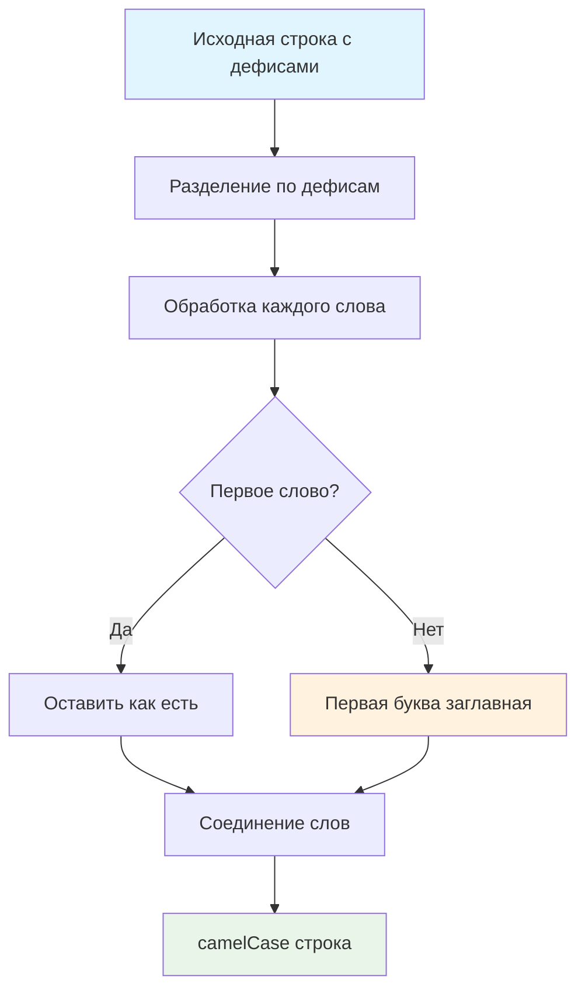

# 🐪 Переведите текст в camelCase

> **Изучаем обработку строк и функциональное программирование!** 🔄  
> Эта задача научит вас преобразовывать CSS-стили в JavaScript свойства и работать с различными форматами именования.

## 🎯 Задача

Создайте функцию `camelize(str)`, которая преобразует строки с дефисами в **camelCase** формат.

```js
camelize('background-color') === 'backgroundColor'
camelize('list-style-image') === 'listStyleImage'
camelize('-webkit-transition') === 'WebkitTransition'
```

## 🔍 Алгоритм преобразования



## 📋 Правила преобразования

1. **Разделить строку** по символу `-`
2. **Первое слово** — оставить в нижнем регистре
3. **Остальные слова** — первая буква заглавная
4. **Пустые части** (при `--`) — игнорировать
5. **Объединить** все части без разделителей

## ✅ Примеры работы

### 🎨 CSS свойства

| Входная строка        | Результат           | Применение        |
|-----------------------|---------------------|-------------------|
| `'background-color'`  | `'backgroundColor'` | CSS → JS свойство |
| `'border-left-width'` | `'borderLeftWidth'` | CSS → JS свойство |
| `'list-style-image'`  | `'listStyleImage'`  | CSS → JS свойство |
| `'margin-top'`        | `'marginTop'`       | CSS → JS свойство |

### 🌐 Префиксы браузеров

| Входная строка         | Результат            | Пояснение         |
|------------------------|----------------------|-------------------|
| `'-webkit-transition'` | `'WebkitTransition'` | Webkit префикс    |
| `'-moz-appearance'`    | `'MozAppearance'`    | Mozilla префикс   |
| `'-ms-filter'`         | `'MsFilter'`         | Microsoft префикс |

### 🧪 Специальные случаи

| Входная строка | Результат    | Особенность                             |
|----------------|--------------|-----------------------------------------|
| `'font-size'`  | `'fontSize'` | Стандартное преобразование              |
| `'my--string'` | `'myString'` | Двойной дефис → игнорируем пустую часть |
| `'single'`     | `'single'`   | Без дефисов → без изменений             |
| `''`           | `''`         | Пустая строка                           |
| `'-'`          | `''`         | Только дефис                            |

## 🛠️ Что нужно реализовать

```js
function camelize(str) {
  // Ваш код здесь
}

export default camelize;
```

💡 **Подсказка:** Используйте `split()` → обработка → `join()`

## 💡 Концепции, которые вы изучите

- **Метод split()**: разделение строк
- **Метод join()**: объединение массивов
- **Метод map()**: преобразование элементов
- **Условная логика**: обработка первого элемента
- **Форматы именования**: kebab-case → camelCase

## 🎓 Для новичков

**Что такое camelCase?**  
Стиль написания, где первое слово строчное, а каждое следующее начинается с заглавной буквы: `backgroundColor`,
`fontSize`.

**Зачем нужно преобразование CSS → JS?**  
В CSS: `background-color`, в JavaScript: `element.style.backgroundColor`

**Как работает цепочка методов?**

```js
'hello-world'
  .split('-')        // ['hello', 'world']  
  .map(transform)    // ['hello', 'World']
  .join('')          // 'helloWorld'
```

## ⚡ Частые ошибки

❌ **Не учитывать первое слово**

```js
function camelize(str) {
  return str.split('-')
    .map(word => word.charAt(0).toUpperCase() + word.slice(1)) // ❌ Все слова!
    .join('');
}

// camelize('font-size') → 'FontSize' (неправильно)
```

✅ **Правильная обработка первого слова**

```js
function camelize(str) {
  return str.split('-')
    .map((word, index) =>
      index === 0 ? word : word.charAt(0).toUpperCase() + word.slice(1)
    )
    .join('');
}
```

❌ **Не обрабатывать пустые части**

```js
camelize('my--string') // может дать 'myString' или ошибку
```

✅ **Фильтрация пустых частей**

```js
function camelize(str) {
  return str.split('-')
    .filter(word => word !== '') // ✅ Убираем пустые части
    .map((word, index) =>
      index === 0 ? word : word.charAt(0).toUpperCase() + word.slice(1)
    )
    .join('');
}
```

❌ **Ошибка с пустыми строками**

```js
''.charAt(0).toUpperCase() // ❌ Ошибка для пустой строки!
```

✅ **Безопасная обработка**

```js
word && word.charAt(0).toUpperCase() + word.slice(1)
```

## 🧪 Пошаговый пример: camelize('border-left-width')

| Шаг | Операция                       | Результат                     |
|-----|--------------------------------|-------------------------------|
| 1   | `split('-')`                   | `['border', 'left', 'width']` |
| 2   | Обработка `'border'` (index=0) | `'border'` (без изменений)    |
| 3   | Обработка `'left'` (index=1)   | `'Left'` (первая заглавная)   |
| 4   | Обработка `'width'` (index=2)  | `'Width'` (первая заглавная)  |
| 5   | `join('')`                     | `'borderLeftWidth'`           |

**Результат:** `'borderLeftWidth'`

## 🔧 Различные подходы к решению

### 🎯 Функциональный подход (рекомендуемый)

```js
function camelize(str) {
  return str.split('-')
    .map((word, index) =>
      index === 0 ? word : word.charAt(0).toUpperCase() + word.slice(1)
    )
    .join('');
}
```

### 🔄 Цикл for (императивный)

```js
function camelize(str) {
  const words = str.split('-');
  let result = '';

  for (let i = 0; i < words.length; i++) {
    if (i === 0) {
      result += words[i];
    } else {
      result += words[i].charAt(0).toUpperCase() + words[i].slice(1);
    }
  }

  return result;
}
```

### 🛡️ С обработкой пустых частей

```js
function camelize(str) {
  return str.split('-')
    .filter(word => word !== '')
    .map((word, index) =>
      index === 0 ? word : word.charAt(0).toUpperCase() + word.slice(1)
    )
    .join('');
}
```

### ⚡ Через reduce

```js
function camelize(str) {
  return str.split('-')
    .reduce((result, word, index) => {
      if (word === '') return result;
      return result + (index === 0 ? word :
        word.charAt(0).toUpperCase() + word.slice(1));
    }, '');
}
```

### 🔍 Через регулярные выражения

```js
function camelize(str) {
  return str.replace(/-([a-z])/g, (match, letter) => letter.toUpperCase());
}
```

## 🌟 Расширенные версии

### 🛡️ С валидацией

```js
function camelize(str) {
  if (typeof str !== 'string') return '';

  return str.split('-')
    .filter(word => word !== '')
    .map((word, index) => {
      if (index === 0) return word.toLowerCase();
      return word.charAt(0).toUpperCase() + word.slice(1).toLowerCase();
    })
    .join('');
}
```

### 🔄 Обратное преобразование

```js
function kebabize(str) {
  return str.replace(/[A-Z]/g, letter => `-${letter.toLowerCase()}`);
}

// kebabize('backgroundColor') → 'background-color'
```

### 🎯 Универсальный конвертер

```js
const caseConverter = {
  toCamel(str) {
    return str.split('-').map((word, i) =>
      i === 0 ? word : word.charAt(0).toUpperCase() + word.slice(1)
    ).join('');
  },

  toKebab(str) {
    return str.replace(/[A-Z]/g, letter => `-${letter.toLowerCase()}`);
  },

  toPascal(str) {
    return this.toCamel(str).charAt(0).toUpperCase() + this.toCamel(str).slice(1);
  }
};
```

## 🎨 Практическое применение

### 🌐 CSS-in-JS библиотеки

```js
function createStyles(cssObject) {
  const jsObject = {};
  for (const [key, value] of Object.entries(cssObject)) {
    jsObject[camelize(key)] = value;
  }
  return jsObject;
}

// createStyles({'background-color': 'red'}) → {backgroundColor: 'red'}
```

### 🎮 Работа с DOM стилями

```js
function setStyles(element, styles) {
  for (const [property, value] of Object.entries(styles)) {
    element.style[camelize(property)] = value;
  }
}

// setStyles(div, {'border-radius': '10px'})
```

### 📊 Конвертация API данных

```js
function normalizeApiResponse(data) {
  const normalized = {};
  for (const [key, value] of Object.entries(data)) {
    normalized[camelize(key)] = value;
  }
  return normalized;
}
```

## 🔄 Сравнение форматов именования

| Формат         | Пример             | Применение                  |
|----------------|--------------------|-----------------------------|
| **camelCase**  | `backgroundColor`  | JavaScript переменные       |
| **kebab-case** | `background-color` | CSS свойства, HTML атрибуты |
| **PascalCase** | `BackgroundColor`  | Классы, компоненты          |
| **snake_case** | `background_color` | Python, базы данных         |

## 🧪 Тестирование

```bash
npm test
```

Проверьте: CSS свойства, префиксы браузеров, двойные дефисы, пустые строки!

## 🚀 Что дальше?

Эта задача подготовила вас к работе с различными форматами данных: API нормализация, работа с CSS-in-JS, обработка
конфигураций!

---
📚 **Полезные ссылки:**

- [MDN: String.split()](https://developer.mozilla.org/ru/docs/Web/JavaScript/Reference/Global_Objects/String/split)
- [MDN: Array.join()](https://developer.mozilla.org/ru/docs/Web/JavaScript/Reference/Global_Objects/Array/join)
- [MDN: String.replace()](https://developer.mozilla.org/ru/docs/Web/JavaScript/Reference/Global_Objects/String/replace)
