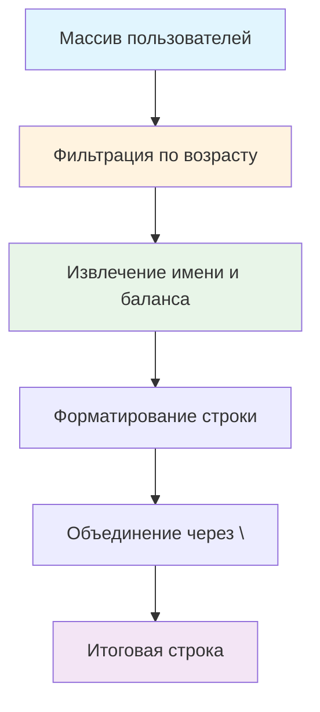

# 👥 Функция отображения зарплат по возрасту

> **Изучаем комбинацию filter + map и форматирование вывода!** 📋  
> Эта задача научит вас обрабатывать сложные структуры данных и создавать отчеты.

## 🎯 Задача

Создайте функцию `showSalary(users, age)`, которая отбирает пользователей по возрасту и формирует строку с их именами и
балансами.

```js
showSalary(users, 25);
// 'Golden Branch, $1,825.65\nDuncan Randall, $1,490.15'
```

## 🔍 Алгоритм обработки



## 📋 Параметры функции

| Параметр | Тип             | Описание                            |
|----------|-----------------|-------------------------------------|
| `users`  | `Array<Object>` | Массив объектов пользователей       |
| `age`    | `number`        | Максимальный возраст (включительно) |

**Возвращает:** Строка с именами и балансами через перевод строки

## 👤 Структура объекта пользователя

```js
let user = {
  "balance": "$1,825.65",     // Баланс (строка с $)
  "picture": "https://...",   // URL картинки
  "age": 21,                  // Возраст (число)
  "name": "Golden Branch",    // Имя (строка)
  "gender": "male",           // Пол
  "greeting": "Hello...",     // Приветствие
  "favouriteFruit": "banana"  // Любимый фрукт
};
```

**Используемые поля:** `name`, `balance`, `age`

## ✅ Примеры работы

### 👥 Основной пример

```js
let users = [
  {name: "Golden Branch", age: 21, balance: "$1,825.65"},
  {name: "Duncan Randall", age: 30, balance: "$1,490.15"},
  {name: "Alice Cooper", age: 19, balance: "$2,150.30"}
];

showSalary(users, 25);
// Результат:
// 'Golden Branch, $1,825.65\nAlice Cooper, $2,150.30'
```

### 📊 Различные сценарии

| Массив пользователей                           | Возраст | Результат            | Пояснение         |
|------------------------------------------------|---------|----------------------|-------------------|
| `[{name: "John", age: 20, balance: "$100"}]`   | `25`    | `"John, $100"`       | Один пользователь |
| `[{name: "A", age: 30}, {name: "B", age: 25}]` | `20`    | `""`                 | Никто не подходит |
| `[]`                                           | `30`    | `""`                 | Пустой массив     |
| `[{name: "X", age: 25}, {name: "Y", age: 25}]` | `25`    | `"X, $...\nY, $..."` | Точное совпадение |

### 🧪 Расширенные примеры

```js
// Смешанные возрасты
let users = [
  {name: "Анна", age: 18, balance: "$500.00"},
  {name: "Борис", age: 35, balance: "$2,300.50"},
  {name: "Вера", age: 22, balance: "$1,200.75"},
  {name: "Глеб", age: 45, balance: "$3,100.25"}
];

showSalary(users, 25);
// 'Анна, $500.00\nВера, $1,200.75'

showSalary(users, 50);
// 'Анна, $500.00\nБорис, $2,300.50\nВера, $1,200.75\nГлеб, $3,100.25'

showSalary(users, 15);
// '' (пустая строка)
```

## 🛠️ Что нужно реализовать

```js
function showSalary(users, age) {
  // Ваш код здесь
}

export default showSalary;
```

⚠️ **Важно:**

- Каждый пользователь на **новой строке** (`\n`)
- **Без перевода строки** после последнего пользователя
- Формат: `"Имя, Баланс"`

## 💡 Концепции, которые вы изучите

- **Цепочка методов**: filter → map → join
- **Деструктуризация объектов**: извлечение нужных полей
- **Шаблонные литералы**: форматирование строк
- **Перевод строки**: символ `\n`
- **Фильтрация + трансформация**: комбинированная обработка

## 🎓 Для новичков

**Что такое цепочка методов?**  
Последовательное применение методов к результату предыдущего:

```js
array
  .filter(условие)    // Отбираем нужные
  .map(преобразование) // Изменяем формат
  .join(разделитель)   // Объединяем в строку
```

**Что такое деструктуризация?**

```js
const user = {name: "John", age: 25, balance: "$100"};

// Обычный способ
const name = user.name;
const balance = user.balance;

// Деструктуризация
const {name, balance} = user;
```

**Как работает \\n?**  
`\n` — символ перевода строки. Когда строка отображается, каждый `\n` создает новую строку.

## ⚡ Частые ошибки

❌ **Лишний перевод строки в конце**

```js
function showSalary(users, age) {
  return users
    .filter(user => user.age <= age)
    .map(user => `${user.name}, ${user.balance}\n`) // ❌ \n в каждой строке!
    .join('');
}

// Результат: "John, $100\nJane, $200\n" (лишний \n в конце)
```

✅ **Правильный перевод строки**

```js
function showSalary(users, age) {
  return users
    .filter(user => user.age <= age)
    .map(user => `${user.name}, ${user.balance}`)
    .join('\n'); // ✅ \n только между строками
}
```

❌ **Неправильное условие фильтрации**

```js
.filter(user => user.age < age) // ❌ Исключает точное совпадение!
```

✅ **Правильное условие**

```js
.filter(user => user.age <= age) // ✅ Включает равный возраст
```

❌ **Забыть обработать пустой результат**

```js
// Некоторые решения могут дать undefined вместо пустой строки
```

✅ **join() корректно обрабатывает пустые массивы**

```js
[].join('\n') // '' - пустая строка (правильно)
```

## 🧪 Пошаговый пример

Данные:

```js
let users = [
  {name: "Alice", age: 20, balance: "$1,000"},
  {name: "Bob", age: 30, balance: "$2,000"},
  {name: "Carol", age: 18, balance: "$500"}
];
```

Вызов: `showSalary(users, 25)`

| Шаг | Операция                         | Результат                          |
|-----|----------------------------------|------------------------------------|
| 1   | `filter(user => user.age <= 25)` | `[{Alice, 20}, {Carol, 18}]`       |
| 2   | `map(user => name, balance)`     | `["Alice, $1,000", "Carol, $500"]` |
| 3   | `join('\n')`                     | `"Alice, $1,000\nCarol, $500"`     |

**Итоговый результат:** `"Alice, $1,000\nCarol, $500"`

## 🔧 Различные подходы к решению

### 🎯 Функциональный подход (рекомендуемый)

```js
function showSalary(users, age) {
  return users
    .filter(user => user.age <= age)
    .map(({name, balance}) => `${name}, ${balance}`)
    .join('\n');
}
```

### 📝 Без деструктуризации

```js
function showSalary(users, age) {
  return users
    .filter(user => user.age <= age)
    .map(user => `${user.name}, ${user.balance}`)
    .join('\n');
}
```

### 🔄 Императивный подход (цикл)

```js
function showSalary(users, age) {
  const result = [];

  for (const user of users) {
    if (user.age <= age) {
      result.push(`${user.name}, ${user.balance}`);
    }
  }

  return result.join('\n');
}
```

### 🛡️ С валидацией данных

```js
function showSalary(users, age) {
  if (!Array.isArray(users)) return '';

  return users
    .filter(user => user && typeof user.age === 'number' && user.age <= age)
    .filter(user => user.name && user.balance)
    .map(({name, balance}) => `${name}, ${balance}`)
    .join('\n');
}
```

### ⚡ Через reduce

```js
function showSalary(users, age) {
  return users
    .filter(user => user.age <= age)
    .reduce((acc, {name, balance}, index) => {
      const line = `${name}, ${balance}`;
      return index === 0 ? line : `${acc}\n${line}`;
    }, '');
}
```

## 🌟 Расширенные версии

### 📊 С сортировкой по возрасту

```js
function showSalarySorted(users, age) {
  return users
    .filter(user => user.age <= age)
    .sort((a, b) => a.age - b.age)
    .map(({name, balance, age}) => `${name} (${age}), ${balance}`)
    .join('\n');
}
```

### 💰 С подсчетом статистики

```js
function showSalaryWithStats(users, age) {
  const filtered = users.filter(user => user.age <= age);
  const lines = filtered.map(({name, balance}) => `${name}, ${balance}`);

  if (lines.length === 0) return 'Пользователи не найдены';

  const stats = `\n\nВсего пользователей: ${lines.length}`;
  return lines.join('\n') + stats;
}
```

### 🎨 С настраиваемым форматом

```js
function formatUsers(users, age, options = {}) {
  const {
    separator = ', ',
    lineBreak = '\n',
    includeAge = false
  } = options;

  return users
    .filter(user => user.age <= age)
    .map(({name, balance, age: userAge}) => {
      const parts = [name];
      if (includeAge) parts.push(`(${userAge})`);
      parts.push(balance);
      return parts.join(separator);
    })
    .join(lineBreak);
}
```

## 🎨 Практическое применение

### 📋 Отчеты для HR

```js
function generateAgeReport(employees, maxAge) {
  const report = showSalary(employees, maxAge);
  return `Сотрудники до ${maxAge} лет:\n${report}`;
}
```

### 💼 Финансовая аналитика

```js
function getYoungEmployeesReport(data) {
  return {
    under25: showSalary(data, 25),
    under30: showSalary(data, 30),
    under35: showSalary(data, 35)
  };
}
```

### 📊 Экспорт данных

```js
function exportToCSV(users, age) {
  const header = 'Name,Balance';
  const rows = users
    .filter(user => user.age <= age)
    .map(({name, balance}) => `${name},${balance}`)
    .join('\n');

  return header + '\n' + rows;
}
```

## 🔄 Связанные методы массивов

| Метод      | Назначение       | В этой задаче                     |
|------------|------------------|-----------------------------------|
| `filter()` | Отбор по условию | Фильтрация по возрасту            |
| `map()`    | Преобразование   | Форматирование строк              |
| `join()`   | Объединение      | Создание итоговой строки          |
| `sort()`   | Сортировка       | Можно добавить для упорядочивания |

## 🧪 Тестирование

```bash
npm test
```

Проверьте: разные возрасты, пустые массивы, граничные значения, форматирование вывода!

## 🚀 Что дальше?

Эта задача подготовила вас к созданию сложных отчетов: группировка данных, агрегация, экспорт в различные форматы!

---
📚 **Полезные ссылки:**

- [MDN: Array.filter()](https://developer.mozilla.org/ru/docs/Web/JavaScript/Reference/Global_Objects/Array/filter)
- [MDN: Array.map()](https://developer.mozilla.org/ru/docs/Web/JavaScript/Reference/Global_Objects/Array/map)
- [MDN: Array.join()](https://developer.mozilla.org/ru/docs/Web/JavaScript/Reference/Global_Objects/Array/join)
- [Learn.javascript.ru: Спецсимволы в строках](https://learn.javascript.ru/string#spetssimvoly)
