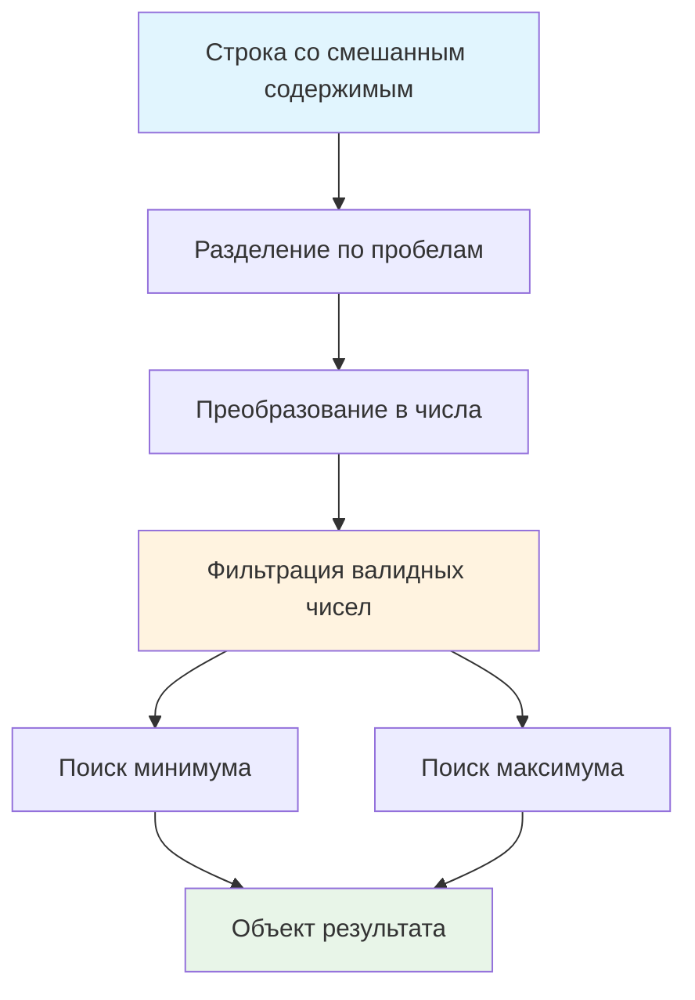

# 📊 Найти min/max в строке

> **Изучаем извлечение и анализ числовых данных!** 🔢  
> Эта задача научит вас парсить смешанный текст, фильтровать числа и находить экстремальные значения.

## 🎯 Задача

Создайте функцию `getMinMax(str)`, которая извлекает все числа из строки и возвращает объект с минимальным и
максимальным значениями.

```js
const inputData = '1 и -5.8 или 10 хотя 34 + -5.3 и 73';
getMinMax(inputData); // { min: -5.8, max: 73 }
```

## 🔍 Алгоритм обработки



## 📋 Параметры функции

| Параметр | Тип      | Описание                                           |
|----------|----------|----------------------------------------------------|
| `str`    | `string` | Строка с числами и текстом, разделенными пробелами |

**Возвращает:** `{min: number, max: number}` — объект с экстремальными значениями

## ✅ Примеры работы

### 📊 Основной пример

```js
const input = '1 и -5.8 или 10 хотя 34 + -5.3 и 73';
// Найденные числа: [1, -5.8, 10, 34, -5.3, 73]
// Результат: { min: -5.8, max: 73 }
```

### 🧪 Различные форматы чисел

| Входная строка           | Найденные числа    | Результат                         |
|--------------------------|--------------------|-----------------------------------|
| `'5 abc 10 def 2'`       | `[5, 10, 2]`       | `{min: 2, max: 10}`               |
| `'-3.14 и 2.71 или 0'`   | `[-3.14, 2.71, 0]` | `{min: -3.14, max: 2.71}`         |
| `'100 word -50 text 25'` | `[100, -50, 25]`   | `{min: -50, max: 100}`            |
| `'hello world'`          | `[]`               | `{min: Infinity, max: -Infinity}` |
| `'42'`                   | `[42]`             | `{min: 42, max: 42}`              |

### 🔢 Специальные случаи

```js
// Десятичные числа
getMinMax('3.14 и 2.71');        // {min: 2.71, max: 3.14}

// Отрицательные числа  
getMinMax('-10 text -20 word');  // {min: -20, max: -10}

// Ноль
getMinMax('0 и -5 и 5');         // {min: -5, max: 5}

// Большие числа
getMinMax('1000000 и 0.001');    // {min: 0.001, max: 1000000}

// Только текст
getMinMax('hello world test');   // {min: Infinity, max: -Infinity}
```

## 🛠️ Что нужно реализовать

```js
function getMinMax(str) {
  // Ваш код здесь
}

export default getMinMax;
```

💡 **Подсказка:** Используйте `split(' ')` → `Number()` → `Math.min/max()`

## 💡 Концепции, которые вы изучите

- **Метод split()**: разделение строк
- **Преобразование типов**: `Number()`, `parseFloat()`
- **Фильтрация данных**: `isNaN()` для проверки чисел
- **Spread оператор**: `...` для передачи массива в функцию
- **Math.min/max()**: поиск экстремальных значений

## 🎓 Для новичков

**Как работает Number()?**

```js
Number('42')     // 42
Number('3.14')   // 3.14
Number('-5')     // -5
Number('abc')    // NaN
```

**Что такое isNaN()?**  
Проверяет, является ли значение "не числом":

```js
isNaN(42)     // false (это число)
isNaN('abc')  // true (не число)
isNaN(NaN)    // true (NaN это "не число")
```

**Как работает spread с Math.min/max?**

```js
const numbers = [1, 2, 3];
Math.min(...numbers)  // Math.min(1, 2, 3) → 1
Math.max(...numbers)  // Math.max(1, 2, 3) → 3
```

## ⚡ Частые ошибки

❌ **Не фильтровать NaN значения**

```js
function getMinMax(str) {
  const numbers = str.split(' ').map(Number); // ❌ Включает NaN!
  return {
    min: Math.min(...numbers), // NaN испортит результат
    max: Math.max(...numbers)
  };
}
```

✅ **Правильная фильтрация**

```js
function getMinMax(str) {
  const numbers = str.split(' ')
    .map(Number)
    .filter(num => !isNaN(num)); // ✅ Только числа

  return {
    min: Math.min(...numbers),
    max: Math.max(...numbers)
  };
}
```

❌ **Не обрабатывать пустой результат**

```js
Math.min(...[])  // Infinity
Math.max(...[])  // -Infinity
```

✅ **Обработка отсутствия чисел**

```js
function getMinMax(str) {
  const numbers = str.split(' ').map(Number).filter(num => !isNaN(num));

  if (numbers.length === 0) {
    return {min: null, max: null}; // или другая логика
  }

  return {
    min: Math.min(...numbers),
    max: Math.max(...numbers)
  };
}
```

❌ **Путать split разделители**

```js
str.split('')   // ❌ По символам
str.split(' ')  // ✅ По пробелам
```

## 🧪 Пошаговый пример

Строка: `'abc 5 def -2.5 ghi 10'`

| Шаг | Операция         | Результат                                  |
|-----|------------------|--------------------------------------------|
| 1   | `split(' ')`     | `['abc', '5', 'def', '-2.5', 'ghi', '10']` |
| 2   | `map(Number)`    | `[NaN, 5, NaN, -2.5, NaN, 10]`             |
| 3   | `filter(!isNaN)` | `[5, -2.5, 10]`                            |
| 4   | `Math.min(...)`  | `-2.5`                                     |
| 5   | `Math.max(...)`  | `10`                                       |
| 6   | Объект           | `{min: -2.5, max: 10}`                     |

## 🔧 Различные подходы к решению

### 🎯 Функциональный подход (рекомендуемый)

```js
function getMinMax(str) {
  const numbers = str.split(' ')
    .map(Number)
    .filter(num => !isNaN(num));

  return {
    min: Math.min(...numbers),
    max: Math.max(...numbers)
  };
}
```

### 📝 Через parseFloat

```js
function getMinMax(str) {
  const numbers = str.split(' ')
    .map(parseFloat)
    .filter(num => !isNaN(num));

  return {
    min: Math.min(...numbers),
    max: Math.max(...numbers)
  };
}
```

### 🔄 Императивный подход

```js
function getMinMax(str) {
  const parts = str.split(' ');
  const numbers = [];

  for (const part of parts) {
    const num = Number(part);
    if (!isNaN(num)) {
      numbers.push(num);
    }
  }

  return {
    min: Math.min(...numbers),
    max: Math.max(...numbers)
  };
}
```

### 🛡️ С обработкой пустого результата

```js
function getMinMax(str) {
  const numbers = str.split(' ')
    .map(Number)
    .filter(num => !isNaN(num));

  if (numbers.length === 0) {
    return {min: null, max: null};
  }

  return {
    min: Math.min(...numbers),
    max: Math.max(...numbers)
  };
}
```

### ⚡ Через reduce (без Math.min/max)

```js
function getMinMax(str) {
  const numbers = str.split(' ')
    .map(Number)
    .filter(num => !isNaN(num));

  if (numbers.length === 0) {
    return {min: null, max: null};
  }

  const result = numbers.reduce(
    (acc, num) => ({
      min: Math.min(acc.min, num),
      max: Math.max(acc.max, num)
    }),
    {min: numbers[0], max: numbers[0]}
  );

  return result;
}
```

## 🌟 Расширенные версии

### 📊 С подробной статистикой

```js
function analyzeNumbers(str) {
  const numbers = str.split(' ')
    .map(Number)
    .filter(num => !isNaN(num));

  if (numbers.length === 0) {
    return {count: 0, numbers: []};
  }

  return {
    min: Math.min(...numbers),
    max: Math.max(...numbers),
    count: numbers.length,
    numbers: numbers,
    sum: numbers.reduce((a, b) => a + b, 0),
    average: numbers.reduce((a, b) => a + b, 0) / numbers.length
  };
}
```

### 🎯 С регулярными выражениями

```js
function getMinMaxRegex(str) {
  const matches = str.match(/-?\d+\.?\d*/g) || [];
  const numbers = matches.map(Number);

  return {
    min: Math.min(...numbers),
    max: Math.max(...numbers)
  };
}
```

### 🔍 С валидацией и индексами

```js
function getMinMaxWithPositions(str) {
  const parts = str.split(' ');
  const results = [];

  parts.forEach((part, index) => {
    const num = Number(part);
    if (!isNaN(num)) {
      results.push({value: num, position: index, text: part});
    }
  });

  if (results.length === 0) {
    return {min: null, max: null, positions: []};
  }

  const values = results.map(r => r.value);
  const minValue = Math.min(...values);
  const maxValue = Math.max(...values);

  return {
    min: minValue,
    max: maxValue,
    minPosition: results.find(r => r.value === minValue),
    maxPosition: results.find(r => r.value === maxValue),
    allNumbers: results
  };
}
```

## 🎨 Практическое применение

### 📈 Анализ данных из текста

```js
function parseDataReport(report) {
  const stats = getMinMax(report);
  return `Диапазон значений: от ${stats.min} до ${stats.max}`;
}
```

### 🎮 Парсинг игровой статистики

```js
function parseGameStats(logString) {
  const result = getMinMax(logString);
  return {
    minScore: result.min,
    maxScore: result.max,
    range: result.max - result.min
  };
}
```

### 💰 Финансовый анализ

```js
function extractPrices(productDescription) {
  const prices = getMinMax(productDescription);
  return {
    cheapest: prices.min,
    mostExpensive: prices.max
  };
}
```

## 🔄 Альтернативы Math.min/max

| Подход                  | Преимущества              | Недостатки                    |
|-------------------------|---------------------------|-------------------------------|
| `Math.min/max + spread` | Простота, читаемость      | Ограничение на размер массива |
| `reduce`                | Работает с любым размером | Больше кода                   |
| `sort + индексы`        | Универсальность           | Медленнее для больших данных  |

## 🧪 Тестирование

```bash
npm test
```

Проверьте: смешанный текст, только числа, только текст, десятичные числа, отрицательные значения!

## 🚀 Что дальше?

Эта задача подготовила вас к более сложному парсингу данных: регулярные выражения, обработка CSV, извлечение данных из
API!

---
📚 **Полезные ссылки:**

- [MDN: String.split()](https://developer.mozilla.org/ru/docs/Web/JavaScript/Reference/Global_Objects/String/split)
- [MDN: Number()](https://developer.mozilla.org/ru/docs/Web/JavaScript/Reference/Global_Objects/Number)
- [MDN: Math.min() и Math.max()](https://developer.mozilla.org/ru/docs/Web/JavaScript/Reference/Global_Objects/Math/min)
- [Learn.javascript.ru: split и join](https://learn.javascript.ru/array-methods#split-i-join)
