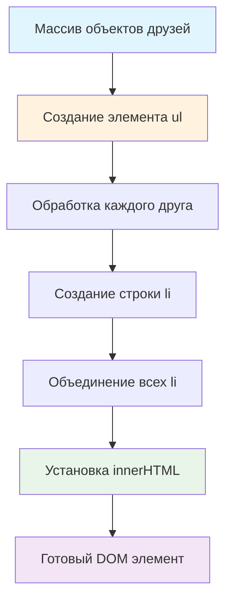

# 👥 Функция создания списка друзей

> **Изучаем создание DOM элементов и работу с HTML!** 🌐  
> Эта задача научит вас генерировать HTML структуры из JavaScript данных и работать с DOM API.

## 🎯 Задача

Создайте функцию `makeFriendList(friends)`, которая преобразует массив объектов друзей в **DOM элемент** — HTML список
`<ul>`.

```js
let friends = [
  {firstName: 'Artyom', lastName: 'Mazepin'},
  {firstName: 'Ilya', lastName: 'Thorik'}
];

const listElement = makeFriendList(friends);
// Возвращает DOM элемент <ul> с элементами <li>
```

## 🔍 Процесс генерации DOM



## 📋 Параметры функции

| Параметр  | Тип             | Описание                                   |
|-----------|-----------------|--------------------------------------------|
| `friends` | `Array<Object>` | Массив объектов с `firstName` и `lastName` |

**Возвращает:** DOM элемент `<ul>` с вложенными `<li>`

## 👤 Структура объекта друга

```js
let friend = {
  firstName: 'Artyom',  // Имя (строка)
  lastName: 'Mazepin'     // Фамилия (строка)
};
```

## ✅ Примеры работы

### 👥 Основной пример

**Входные данные:**

```js
let friends = [
  {firstName: 'Artyom', lastName: 'Mazepin'},
  {firstName: 'Ilya', lastName: 'Thorik'},
  {firstName: 'Christopher', lastName: 'Michael'}
];
```

**Результат (DOM структура):**

```html

<ul>
  <li>
    <span>Artyom</span>
    <span>Mazepin</span>
  </li>
  <li>
    <span>Ilya</span>
    <span>Thorik</span>
  </li>
  <li>
    <span>Christopher</span>
    <span>Michael</span>
  </li>
</ul>
```

### 🧪 Различные сценарии

| Входной массив                               | Результат                        | Пояснение     |
|----------------------------------------------|----------------------------------|---------------|
| `[{firstName: 'John', lastName: 'Doe'}]`     | `<ul><li>John Doe</li></ul>`     | Один друг     |
| `[]`                                         | `<ul></ul>`                      | Пустой список |
| `[{firstName: 'Анна', lastName: 'Иванова'}]` | `<ul><li>Анна Иванова</li></ul>` | Кириллица     |

### 🌍 Международные имена

```js
let internationalFriends = [
  {firstName: 'José', lastName: 'García'},
  {firstName: '田中', lastName: '太郎'},
  {firstName: 'Владимир', lastName: 'Петров'}
];

// Результат будет корректно отображать все символы
```

## 🛠️ Что нужно реализовать

```js
function makeFriendList(friends) {
  // Ваш код здесь
}

export default makeFriendList;
```

⚠️ **Важно:** Функция должна возвращать **DOM элемент**, а не строку!

## 💡 Концепции, которые вы изучите

- **DOM API**: `document.createElement()`
- **Свойство innerHTML**: установка HTML содержимого
- **Деструктуризация**: извлечение свойств объектов
- **Шаблонные литералы**: создание HTML строк
- **Методы массивов**: `.map()` и `.join()`

## 🎓 Для новичков

**Что такое DOM элемент?**  
DOM (Document Object Model) элемент — это объект, представляющий HTML тег. Его можно добавить на страницу, стилизовать,
обрабатывать события.

**Разница между DOM элементом и строкой:**

```js
// Строка (неправильно для этой задачи)
const htmlString = '<ul><li>Имя</li></ul>';

// DOM элемент (правильно)
const domElement = document.createElement('ul');
```

**Как работает innerHTML?**

```js
const ul = document.createElement('ul');
ul.innerHTML = '<li>Содержимое</li>';
// Теперь ul содержит реальный HTML
```

## ⚡ Частые ошибки

❌ **Возврат строки вместо DOM элемента**

```js
function makeFriendList(friends) {
  return '<ul>...</ul>'; // ❌ Строка, а не DOM!
}
```

✅ **Правильный возврат DOM элемента**

```js
function makeFriendList(friends) {
  const ul = document.createElement('ul');
  ul.innerHTML = '...';
  return ul; // ✅ DOM элемент
}
```

❌ **Неправильная деструктуризация**

```js
friends.map(friend => `<li>${friend.name}</li>`) // ❌ Нет свойства name!
```

✅ **Правильная деструктуризация**

```js
friends.map(({firstName, lastName}) => `<li>${firstName} ${lastName}</li>`)
```

❌ **Забыть обработать пустой массив**

```js
// Функция должна корректно работать с пустым массивом
makeFriendList([]) // Должна вернуть пустой <ul>
```

❌ **XSS уязвимость**

```js
// Если имена содержат HTML теги, нужна дополнительная защита
const name = '<script>alert("hack")</script>';
```

## 🧪 Пошаговый пример

Данные: `[{firstName: 'John', lastName: 'Doe'}, {firstName: 'Jane', lastName: 'Smith'}]`

| Шаг | Операция                       | Результат                                       |
|-----|--------------------------------|-------------------------------------------------|
| 1   | `document.createElement('ul')` | `<ul></ul>`                                     |
| 2   | `map()` для каждого друга      | `['<li>John Doe</li>', '<li>Jane Smith</li>']`  |
| 3   | `join('')`                     | `'<li>John Doe</li><li>Jane Smith</li>'`        |
| 4   | `ul.innerHTML = ...`           | `<ul><li>John Doe</li><li>Jane Smith</li></ul>` |
| 5   | `return ul`                    | DOM элемент готов                               |

## 🔧 Различные подходы к решению

### 🎯 Через innerHTML (в задаче)

```js
function makeFriendList(friends) {
  const ul = document.createElement('ul');

  ul.innerHTML = friends
    .map(({firstName, lastName}) => `
      <li>
        <span>${firstName}</span>
        <span>${lastName}</span>
      </li>
    `)
    .join('');

  return ul;
}
```

### 📝 Простая версия (без span)

```js
function makeFriendList(friends) {
  const ul = document.createElement('ul');

  ul.innerHTML = friends
    .map(({firstName, lastName}) => `<li>${firstName} ${lastName}</li>`)
    .join('');

  return ul;
}
```

### 🔧 Через createElement (без innerHTML)

```js
function makeFriendList(friends) {
  const ul = document.createElement('ul');

  friends.forEach(({firstName, lastName}) => {
    const li = document.createElement('li');

    const firstNameSpan = document.createElement('span');
    firstNameSpan.textContent = firstName;

    const lastNameSpan = document.createElement('span');
    lastNameSpan.textContent = lastName;

    li.appendChild(firstNameSpan);
    li.appendChild(lastNameSpan);
    ul.appendChild(li);
  });

  return ul;
}
```

### 🛡️ С XSS защитой

```js
function makeFriendList(friends) {
  const ul = document.createElement('ul');

  friends.forEach(({firstName, lastName}) => {
    const li = document.createElement('li');

    const firstSpan = document.createElement('span');
    firstSpan.textContent = firstName; // textContent безопасен

    const lastSpan = document.createElement('span');
    lastSpan.textContent = lastName;

    li.appendChild(firstSpan);
    li.appendChild(lastSpan);
    ul.appendChild(li);
  });

  return ul;
}
```

### ⚡ С CSS классами

```js
function makeFriendList(friends) {
  const ul = document.createElement('ul');
  ul.className = 'friend-list';

  ul.innerHTML = friends
    .map(({firstName, lastName}) => `
      <li class="friend-item">
        <span class="first-name">${firstName}</span>
        <span class="last-name">${lastName}</span>
      </li>
    `)
    .join('');

  return ul;
}
```

## 🌟 Расширенные версии

### 📱 С дополнительными данными

```js
function makeFriendListExtended(friends) {
  const ul = document.createElement('ul');

  ul.innerHTML = friends
    .map(({firstName, lastName, age, avatar}) => `
      <li class="friend">
        ${avatar ? `` : ''}
        <div class="info">
          <span class="name">${firstName} ${lastName}</span>
          ${age ? `<span class="age">${age} лет</span>` : ''}
        </div>
      </li>
    `)
    .join('');

  return ul;
}
```

### 🎨 С настраиваемым форматом

```js
function makeFriendList(friends, options = {}) {
  const {
    showLastNameFirst = false,
    separator = ' ',
    cssClass = 'friend-list'
  } = options;

  const ul = document.createElement('ul');
  ul.className = cssClass;

  ul.innerHTML = friends
    .map(({firstName, lastName}) => {
      const fullName = showLastNameFirst
        ? `${lastName}${separator}${firstName}`
        : `${firstName}${separator}${lastName}`;

      return `<li>${fullName}</li>`;
    })
    .join('');

  return ul;
}
```

### 🔍 С поиском и фильтрацией

```js
function makeFriendListWithSearch(friends, searchTerm = '') {
  const filteredFriends = friends.filter(({firstName, lastName}) =>
    firstName.toLowerCase().includes(searchTerm.toLowerCase()) ||
    lastName.toLowerCase().includes(searchTerm.toLowerCase())
  );

  return makeFriendList(filteredFriends);
}
```

## 🎨 Практическое применение

### 📱 Добавление на страницу

```js
const friends = [/* ... */];
const friendList = makeFriendList(friends);

// Добавляем в DOM
document.body.appendChild(friendList);

// Или в конкретный контейнер
document.getElementById('friends-container').appendChild(friendList);
```

### 🎮 Интерактивный список

```js
function createInteractiveFriendList(friends) {
  const ul = makeFriendList(friends);

  // Добавляем обработчики событий
  ul.addEventListener('click', (event) => {
    if (event.target.tagName === 'LI') {
      console.log('Выбран друг:', event.target.textContent);
    }
  });

  return ul;
}
```

### 📊 Динамическое обновление

```js
class FriendListManager {
  constructor(containerSelector) {
    this.container = document.querySelector(containerSelector);
    this.friends = [];
  }

  setFriends(friends) {
    this.friends = friends;
    this.render();
  }

  addFriend(friend) {
    this.friends.push(friend);
    this.render();
  }

  render() {
    this.container.innerHTML = '';
    this.container.appendChild(makeFriendList(this.friends));
  }
}
```

## 🔄 Сравнение подходов

| Подход          | Преимущества           | Недостатки                 |
|-----------------|------------------------|----------------------------|
| `innerHTML`     | Простота, читаемость   | Возможны XSS уязвимости    |
| `createElement` | Безопасность, контроль | Больше кода                |
| Шаблонизаторы   | Мощные возможности     | Дополнительные зависимости |

## 🧪 Тестирование

```bash
npm test
```

Проверьте: обычные имена, пустой массив, специальные символы, международные имена!

**Пример теста:**

```js
const friends = [{firstName: 'John', lastName: 'Doe'}];
const result = makeFriendList(friends);

// Проверяем, что результат - DOM элемент
expect(result.tagName).toBe('UL');
expect(result.children.length).toBe(1);
expect(result.textContent).toContain('John Doe');
```

## 🚀 Что дальше?

Эта задача подготовила вас к более сложной работе с DOM: компоненты, реактивность, виртуальный DOM, фреймворки!

---
📚 **Полезные ссылки:**

- [MDN: document.createElement()](https://developer.mozilla.org/ru/docs/Web/API/Document/createElement)
- [MDN: Element.innerHTML](https://developer.mozilla.org/ru/docs/Web/API/Element/innerHTML)
- [MDN: Node.appendChild()](https://developer.mozilla.org/ru/docs/Web/API/Node/appendChild)
- [MDN: XSS предотвращение](https://developer.mozilla.org/ru/docs/Web/Security/Types_of_attacks#cross-site_scripting_xss)
