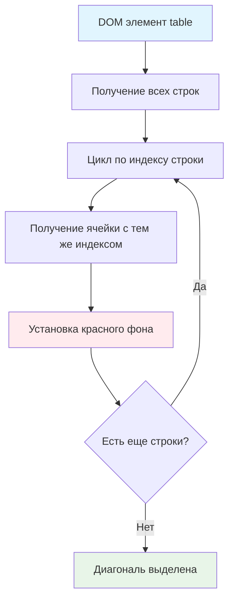

# 🎨 Выделите ячейки по диагонали

> **Изучаем навигацию по DOM и стилизацию элементов!** 📋  
> Эта задача научит вас работать с таблицами HTML и динамически изменять стили элементов.

## 🎯 Задача

Создайте функцию `colorDiagonal(table)`, которая выделяет **красным цветом** все ячейки главной диагонали таблицы (слева
направо).

```js
colorDiagonal(table);
// Результат: ячейки [0,0], [1,1], [2,2]... становятся красными
```

## 🔍 Алгоритм выделения



## 📊 Визуализация диагонали

**Таблица 4×4:**

```
┌─────┬─────┬─────┬─────┐
│  🔴 │     │     │     │ ← строка 0, ячейка 0
├─────┼─────┼─────┼─────┤
│     │  🔴 │     │     │ ← строка 1, ячейка 1
├─────┼─────┼─────┼─────┤
│     │     │  🔴 │     │ ← строка 2, ячейка 2
├─────┼─────┼─────┼─────┤
│     │     │     │  🔴 │ ← строка 3, ячейка 3
└─────┴─────┴─────┴─────┘
```

**Общий принцип:** Для строки с индексом `i` выделяем ячейку с индексом `i`

## 📋 Параметры функции

| Параметр | Тип                | Описание              |
|----------|--------------------|-----------------------|
| `table`  | `HTMLTableElement` | DOM элемент `<table>` |

**Эффект:** Изменяет стили ячеек, добавляя красный фон

## ✅ Примеры работы

### 📊 Различные размеры таблиц

| Размер таблицы | Выделенные ячейки | Координаты                        |
|----------------|-------------------|-----------------------------------|
| 2×2            | 2 ячейки          | [0,0], [1,1]                      |
| 3×3            | 3 ячейки          | [0,0], [1,1], [2,2]               |
| 5×5            | 5 ячеек           | [0,0], [1,1], [2,2], [3,3], [4,4] |
| 1×1            | 1 ячейка          | [0,0]                             |

### 🧪 Особые случаи

```html
<!-- Прямоугольная таблица 3×5 -->
<table>
  <tr>
    <td>🔴</td>
    <td></td>
    <td></td>
    <td></td>
    <td></td>
  </tr>
  <tr>
    <td></td>
    <td>🔴</td>
    <td></td>
    <td></td>
    <td></td>
  </tr>
  <tr>
    <td></td>
    <td></td>
    <td>🔴</td>
    <td></td>
    <td></td>
  </tr>
</table>
<!-- Выделены только 3 ячейки (по количеству строк) -->
```

## 🛠️ Что нужно реализовать

```js
function colorDiagonal(table) {
  // Ваш код здесь
}

export default colorDiagonal;
```

💡 **Подсказки:**

- Используйте `table.rows` для получения строк
- Используйте `row.cells` для получения ячеек строки
- Используйте `cell.style.background` для установки цвета

## 💡 Концепции, которые вы изучите

- **DOM навигация**: свойства `rows` и `cells`
- **HTMLTableElement**: специальные свойства таблиц
- **Динамическая стилизация**: изменение `style` свойств
- **Циклы с индексами**: использование `i` для доступа к элементам
- **Координатная система**: понимание строк и столбцов

## 🎓 Для новичков

**Структура HTML таблицы:**

```html

<table>           <!-- table.rows[0], table.rows[1]... -->
  <tr>            <!-- row.cells[0], row.cells[1]... -->
    <td>Ячейка 1</td>
    <td>Ячейка 2</td>
  </tr>
  <tr>
    <td>Ячейка 3</td>
    <td>Ячейка 4</td>
  </tr>
</table>
```

**Доступ к ячейкам:**

```js
const table = document.querySelector('table');
const firstRow = table.rows[0];        // Первая строка
const firstCell = firstRow.cells[0];   // Первая ячейка первой строки

// Или напрямую:
const cell = table.rows[0].cells[0];   // Ячейка [0,0]
```

**Установка стилей:**

```js
cell.style.background = 'red';         // Красный фон
cell.style.backgroundColor = 'blue';   // Альтернативный способ
cell.style.color = 'white';           // Цвет текста
```

## ⚡ Частые ошибки

❌ **Неправильный доступ к ячейкам**

```js
for (let i = 0; i < table.rows.length; i++) {
  table.rows[i].cells[0].style.background = 'red'; // ❌ Всегда первая колонка!
}
```

✅ **Правильный доступ к диагонали**

```js
for (let i = 0; i < table.rows.length; i++) {
  table.rows[i].cells[i].style.background = 'red'; // ✅ Индекс совпадает
}
```

❌ **Не проверить существование ячейки**

```js
// Если таблица не квадратная, может быть ошибка
table.rows[i].cells[i] // ❌ Может быть undefined!
```

✅ **Безопасный доступ**

```js
for (let i = 0; i < table.rows.length; i++) {
  const cell = table.rows[i].cells[i];
  if (cell) { // ✅ Проверяем существование
    cell.style.background = 'red';
  }
}
```

❌ **Неправильное CSS свойство**

```js
cell.style.backgroundColor = '#ff0000'; // ✅ Работает
cell.style.background = '#ff0000';      // ✅ Работает
cell.style.bg = 'red';                  // ❌ Нет такого свойства
```

## 🧪 Пошаговый пример

**Таблица 3×3:**

| Шаг | i | Строка    | Ячейка     | Действие    |
|-----|---|-----------|------------|-------------|
| 1   | 0 | `rows[0]` | `cells[0]` | Красный фон |
| 2   | 1 | `rows[1]` | `cells[1]` | Красный фон |
| 3   | 2 | `rows[2]` | `cells[2]` | Красный фон |

**Результат:** Главная диагональ выделена красным

## 🔧 Различные подходы к решению

### 🎯 Базовое решение (в задаче)

```js
function colorDiagonal(table) {
  for (let i = 0; i < table.rows.length; i++) {
    const cell = table.rows[i].cells[i];
    cell.style.background = 'red';
  }
}
```

### 🛡️ С проверкой существования

```js
function colorDiagonal(table) {
  for (let i = 0; i < table.rows.length; i++) {
    const row = table.rows[i];
    const cell = row.cells[i];

    if (cell) {
      cell.style.background = 'red';
    }
  }
}
```

### ⚡ Через forEach

```js
function colorDiagonal(table) {
  Array.from(table.rows).forEach((row, i) => {
    const cell = row.cells[i];
    if (cell) {
      cell.style.background = 'red';
    }
  });
}
```

### 🎨 С настраиваемым цветом

```js
function colorDiagonal(table, color = 'red') {
  for (let i = 0; i < table.rows.length; i++) {
    const cell = table.rows[i].cells[i];
    if (cell) {
      cell.style.background = color;
    }
  }
}

// Использование:
colorDiagonal(table, 'blue');
colorDiagonal(table, '#ff6600');
```

### 🔄 С возможностью отмены

```js
function colorDiagonal(table, color = 'red') {
  const originalColors = [];

  for (let i = 0; i < table.rows.length; i++) {
    const cell = table.rows[i].cells[i];
    if (cell) {
      originalColors.push(cell.style.background);
      cell.style.background = color;
    }
  }

  // Возвращаем функцию для отмены
  return function undo() {
    for (let i = 0; i < table.rows.length; i++) {
      const cell = table.rows[i].cells[i];
      if (cell) {
        cell.style.background = originalColors[i] || '';
      }
    }
  };
}

// Использование:
const undo = colorDiagonal(table);
// ... позже ...
undo(); // Отменяем изменения
```

## 🌟 Расширенные версии

### 🎯 Обе диагонали

```js
function colorBothDiagonals(table) {
  const rowCount = table.rows.length;

  for (let i = 0; i < rowCount; i++) {
    // Главная диагональ
    const mainCell = table.rows[i].cells[i];
    if (mainCell) {
      mainCell.style.background = 'red';
    }

    // Побочная диагональ
    const antiCell = table.rows[i].cells[rowCount - 1 - i];
    if (antiCell) {
      antiCell.style.background = 'blue';
    }
  }
}
```

### 📊 С CSS классами

```js
function highlightDiagonal(table, className = 'diagonal-cell') {
  for (let i = 0; i < table.rows.length; i++) {
    const cell = table.rows[i].cells[i];
    if (cell) {
      cell.classList.add(className);
    }
  }
}

// CSS:
// .diagonal-cell { background: red; }
```

### 🎮 Интерактивная версия

```js
function createInteractiveDiagonal(table) {
  let isHighlighted = false;

  const toggle = () => {
    const color = isHighlighted ? '' : 'red';

    for (let i = 0; i < table.rows.length; i++) {
      const cell = table.rows[i].cells[i];
      if (cell) {
        cell.style.background = color;
      }
    }

    isHighlighted = !isHighlighted;
  };

  return {toggle, isHighlighted: () => isHighlighted};
}
```

## 🎨 Практическое применение

### 🎲 Игровые поля

```js
function highlightWinningLine(gameBoard, type = 'diagonal') {
  if (type === 'diagonal') {
    colorDiagonal(gameBoard);
  }
  // Можно добавить другие типы линий
}
```

### 📊 Выделение в таблицах данных

```js
function emphasizeMainDiagonal(dataTable) {
  colorDiagonal(dataTable);

  // Добавляем подпись
  const caption = dataTable.createCaption();
  caption.textContent = 'Главная диагональ выделена красным';
}
```

### 🎨 Анимированное выделение

```js
function animateColorDiagonal(table) {
  for (let i = 0; i < table.rows.length; i++) {
    setTimeout(() => {
      const cell = table.rows[i].cells[i];
      if (cell) {
        cell.style.background = 'red';
        cell.style.transition = 'background 0.3s ease';
      }
    }, i * 200); // Задержка для каждой ячейки
  }
}
```

## 🧪 Тестирование

```bash
npm test
```

**Пример HTML для тестирования:**

```html

<table id="test-table">
  <tr>
    <td>1,1</td>
    <td>1,2</td>
    <td>1,3</td>
  </tr>
  <tr>
    <td>2,1</td>
    <td>2,2</td>
    <td>2,3</td>
  </tr>
  <tr>
    <td>3,1</td>
    <td>3,2</td>
    <td>3,3</td>
  </tr>
</table>
```

Проверьте: квадратные таблицы, прямоугольные, одиночные ячейки!

## 🚀 Что дальше?

Эта задача подготовила вас к более сложной работе с DOM: манипуляции таблицами, интерактивные элементы, игровые поля!

---
📚 **Полезные ссылки:**

- [Learn.javascript.ru: DOM навигация по таблицам](https://learn.javascript.ru/dom-navigation#dom-navigation-tables)
- [Learn.javascript.ru: Стили и классы](https://learn.javascript.ru/styles-and-classes#element-style)
- [MDN: HTMLTableElement](https://developer.mozilla.org/en-US/docs/Web/API/HTMLTableElement)
- [MDN: HTMLElement.style](https://developer.mozilla.org/ru/docs/Web/API/HTMLElement/style)
