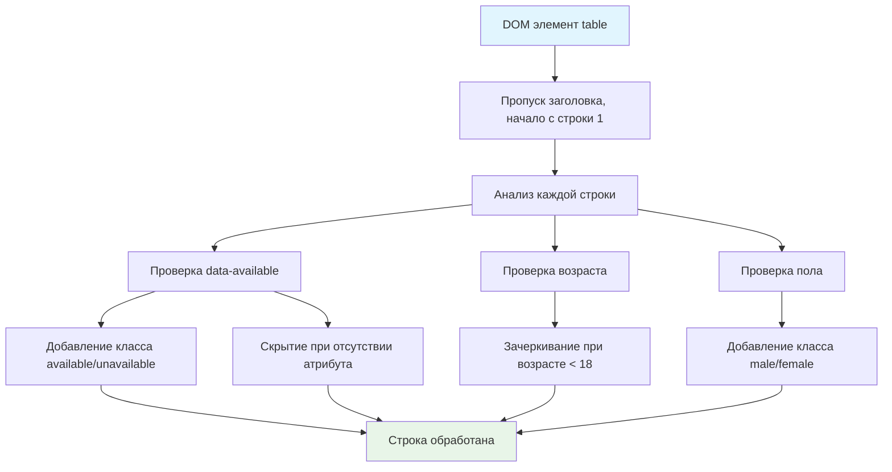

# ✨ Функция highlight - выделение строк таблицы

> **Изучаем сложную обработку таблиц и условную стилизацию!** 📊  
> Эта задача научит вас анализировать данные в ячейках и применять стили к строкам на основе различных условий.

## 🎯 Задача

Создайте функцию `highlight(table)`, которая анализирует данные в ячейках таблицы и применяет **различные стили и классы
к строкам** в зависимости от содержимого.

```js
highlight(table);
// Результат: строки получают классы и стили на основе данных
```

## 🔍 Алгоритм обработки



## 📋 Структура данных

### 🏗️ HTML структура

```html

<table>
  <thead>
  <tr>
    <td>Name</td>
    <td>Age</td>
    <td>Gender</td>
    <td>Status</td>
  </tr>
  </thead>
  <tbody>
  <tr>
    <td>Ilia</td>
    <td>30</td>           <!-- Возраст -->
    <td>m</td>             <!-- Пол: m/f -->
    <td data-available="true">Free</td>  <!-- Статус -->
  </tr>
  </tbody>
</table>
```

### 📊 Колонки таблицы

| Индекс | Название | Содержимое               | Использование                   |
|--------|----------|--------------------------|---------------------------------|
| 0      | Name     | Имя                      | Не используется в логике        |
| 1      | Age      | Число                    | Проверка < 18 для зачеркивания  |
| 2      | Gender   | `'m'` или `'f'`          | Класс `male`/`female`           |
| 3      | Status   | Текст + `data-available` | Класс `available`/`unavailable` |

## ✅ Правила обработки

### 🎨 Классы доступности

```js
 data-available="true"  → класс "available"
 data-available="false" → класс "unavailable"  
 нет data-available     → строка скрыта (hidden=true)
```

### 👤 Классы пола

```js
Gender = "m" → класс "male"
Gender = "f" → класс "female"
```

### 🔞 Стиль зачеркивания

```js
Age < 18 → style="text-decoration: line-through"
```

## 🧪 Примеры обработки

| Имя   | Возраст | Пол | data-available | Результат                                                          |
|-------|---------|-----|----------------|--------------------------------------------------------------------|
| John  | 25      | m   | true           | `class="available male"`                                           |
| Alice | 16      | f   | false          | `class="unavailable female" style="text-decoration: line-through"` |
| Bob   | 30      | m   | (нет)          | `hidden="true" class="male"`                                       |
| Emma  | 17      | f   | true           | `class="available female" style="text-decoration: line-through"`   |

## 🛠️ Что нужно реализовать

```js
function highlight(table) {
  // Ваш код здесь
}

export default highlight;
```

⚠️ **Важно:** Применяйте изменения к **строкам** (`<tr>`), а не к ячейкам (`<td>`)!

## 💡 Концепции, которые вы изучите

- **Навигация по таблицам**: `table.rows`, `row.cells`
- **Data-атрибуты**: `dataset`, `hasAttribute()`
- **Условная стилизация**: различные классы на основе данных
- **CSS классы**: `classList.add()`, множественные классы
- **Скрытие элементов**: свойство `hidden`

## 🎓 Для новичков

**Почему начинаем с индекса 1?**  
Индекс 0 — это заголовок (`<thead>`), данные начинаются с индекса 1.

**Работа с data-атрибутами:**

```js
const cell = row.cells[3]; // Ячейка Status
const available = cell.dataset.available;  // "true", "false", или undefined
const hasAttribute = cell.hasAttribute('data-available'); // true/false
```

**Добавление нескольких классов:**

```js
row.classList.add('available');
row.classList.add('male');
// Результат: class="available male"
```

**Скрытие элементов:**

```js
row.hidden = true;  // Элемент не отображается
row.hidden = false; // Элемент видим
```

## ⚡ Частые ошибки

❌ **Изменение ячеек вместо строк**

```js
for (let j = 0; j < row.cells.length; j++) {
  const cell = row.cells[j];
  cell.classList.add('available'); // ❌ Изменяем ячейку!
}
```

✅ **Правильно - изменение строк**

```js
for (let j = 0; j < row.cells.length; j++) {
  const cell = row.cells[j];
  // Анализируем ячейку, но изменяем строку
  row.classList.add('available'); // ✅ Изменяем строку!
}
```

❌ **Начинать с индекса 0**

```js
for (let i = 0; i < table.rows.length; i++) {} // ❌ Включает заголовок!
```

✅ **Начинать с индекса 1**

```js
for (let i = 1; i < table.rows.length; i++) {}// ✅ Пропускаем заголовок
```

❌ **Неправильная проверка data-атрибута**

```js
if (cell.dataset.available) {} // ❌ "false" тоже truthy!
```

✅ **Правильная проверка**

```js
if (cell.hasAttribute('data-available')) {
  if (cell.dataset.available === 'true') {
    // available
  } else {
    // unavailable  
  }
} else {
  // скрыть строку
}
```

## 🧪 Пошаговый пример

**Строка:** `<tr><td>John</td><td>16</td><td>m</td><td data-available="true">Free</td></tr>`

| Шаг | Проверка         | Значение  | Действие                                    |
|-----|------------------|-----------|---------------------------------------------|
| 1   | `data-available` | `"true"`  | `row.classList.add('available')`            |
| 2   | `hasAttribute`   | `true`    | `row.hidden = false`                        |
| 3   | Возраст          | `16 < 18` | `row.style.textDecoration = 'line-through'` |
| 4   | Пол              | `"m"`     | `row.classList.add('male')`                 |

**Результат:** `class="available male" style="text-decoration: line-through"`

## 🔧 Различные подходы к решению

### 🎯 Базовое решение (в задаче)

```js
function highlight(table) {
  for (let i = 1; i < table.rows.length; i++) {
    let row = table.rows[i];

    // Данные из конкретных ячеек
    const age = parseInt(row.cells[1].textContent);
    const gender = row.cells[2].textContent;
    const statusCell = row.cells[3];
    console.log(statusCell.dataset);

    const {available} = statusCell.dataset;
    row.hidden = !statusCell.hasAttribute('data-available');
    row.classList.add(available === 'true' ? 'available' : 'unavailable');
    row.classList.add(gender === 'm' ? 'male' : 'female');

    if (age <= 18) {
      row.style.textDecoration = 'line-through';
    }
  }
}
```

### 🛡️ С валидацией данных

```js
function highlight(table) {
  for (let i = 1; i < table.rows.length; i++) {
    const row = table.rows[i];

    // Проверяем наличие достаточного количества ячеек
    if (row.cells.length < 4) continue;

    const ageText = row.cells[1].textContent;
    const gender = row.cells[2].textContent.trim();
    const statusCell = row.cells[3];

    // Безопасная обработка data-available
    if (statusCell.hasAttribute('data-available')) {
      const available = statusCell.dataset.available;
      if (available === 'true') {
        row.classList.add('available');
      } else if (available === 'false') {
        row.classList.add('unavailable');
      }
    } else {
      row.hidden = true;
    }

    // Безопасная обработка возраста
    const age = parseInt(ageText);
    if (!isNaN(age) && age < 18) {
      row.style.textDecoration = 'line-through';
    }

    // Обработка пола
    if (gender === 'm') {
      row.classList.add('male');
    } else if (gender === 'f') {
      row.classList.add('female');
    }
  }
}
```

### ⚡ Функциональный подход

```js
function highlight(table) {
  Array.from(table.rows)
    .slice(1) // Пропускаем заголовок
    .forEach(row => {
      const [nameCell, ageCell, genderCell, statusCell] = row.cells;

      // Деструктуризация данных
      const age = parseInt(ageCell.textContent);
      const gender = genderCell.textContent.trim();
      const {available} = statusCell.dataset;

      // Применение стилей
      applyAvailabilityStyle(row, statusCell, available);
      applyAgeStyle(row, age);
      applyGenderStyle(row, gender);
    });
}

function applyAvailabilityStyle(row, cell, available) {
  if (cell.hasAttribute('data-available')) {
    row.classList.add(available === 'true' ? 'available' : 'unavailable');
  } else {
    row.hidden = true;
  }
}

function applyAgeStyle(row, age) {
  if (!isNaN(age) && age < 18) {
    row.style.textDecoration = 'line-through';
  }
}

function applyGenderStyle(row, gender) {
  const genderClass = gender === 'm' ? 'male' : gender === 'f' ? 'female' : null;
  if (genderClass) {
    row.classList.add(genderClass);
  }
}
```

## 🌟 Расширенные версии

### 🎨 С настраиваемыми стилями

```js
function highlight(table, options = {}) {
  const {
    availableClass = 'available',
    unavailableClass = 'unavailable',
    maleClass = 'male',
    femaleClass = 'female',
    underageStyle = 'line-through'
  } = options;

  // Применяем настройки...
}
```

### 📊 С подсчетом статистики

```js
function highlightWithStats(table) {
  const stats = {
    total: 0,
    available: 0,
    underage: 0,
    male: 0,
    female: 0,
    hidden: 0
  };

  for (let i = 1; i < table.rows.length; i++) {
    stats.total++;
    // ... логика подсчета ...
  }

  highlight(table);
  return stats;
}
```

## 🎨 Практическое применение

### 👩‍🏫 HR система

```js
function highlightEmployees(employeeTable) {
  highlight(employeeTable);

  // Добавляем легенду
  const legend = createLegend();
  employeeTable.parentNode.insertBefore(legend, employeeTable.nextSibling);
}
```

### 📋 Фильтрация данных

```js
function createFilterableTable(table) {
  highlight(table);

  // Добавляем кнопки фильтрации
  const controls = createFilterControls();
  controls.addEventListener('click', (e) => {
    if (e.target.dataset.filter) {
      filterByClass(table, e.target.dataset.filter);
    }
  });
}
```

## 🧪 Тестирование

```bash
npm test
```

**Проверьте различные сценарии:**

- ✅ Все условия одновременно
- ✅ Отсутствие data-атрибута
- ✅ Граничные случаи возраста (17, 18, 19)
- ✅ Различные значения пола

## 🚀 Что дальше?

Эта задача подготовила вас к созданию сложных интерактивных таблиц: сортировка, фильтрация, динамическое обновление
данных!

---
📚 **Полезные ссылки:**

- [MDN: HTMLElement.dataset](https://developer.mozilla.org/ru/docs/Web/API/HTMLElement/dataset)
- [MDN: Element.classList](https://developer.mozilla.org/ru/docs/Web/API/Element/classList)
- [MDN: Element.hasAttribute()](https://developer.mozilla.org/ru/docs/Web/API/Element/hasAttribute)
- [Learn.javascript.ru: Атрибуты и свойства](https://learn.javascript.ru/dom-attributes-and-properties)
