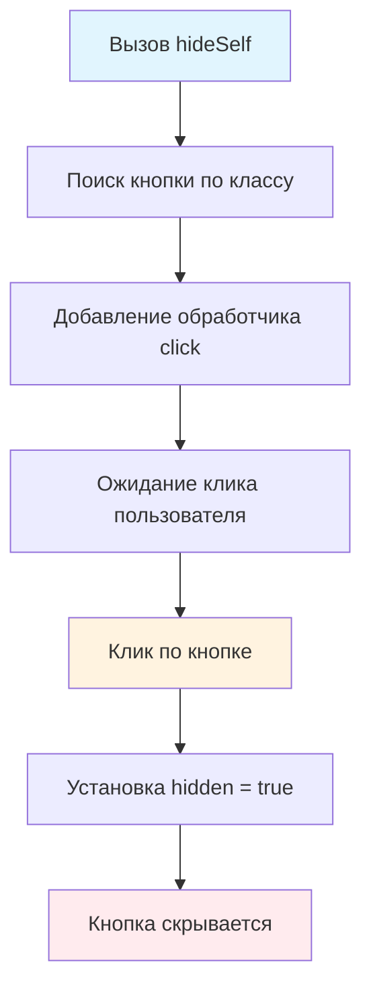

# 🙈 Скрыть кнопку

> **Изучаем обработку событий и управление видимостью элементов!** 👆  
> Эта задача научит вас создавать интерактивные элементы и работать с атрибутом `hidden`.

## 🎯 Задача

Создайте функцию `hideSelf()`, которая находит кнопку с классом `hide-self-button` и **скрывает её при клике**.

```js
hideSelf();
// Результат: кнопка исчезает при нажатии на неё
```

## 🔍 Алгоритм работы



## 📋 Требования

### 🔍 Поиск элемента

- Найти кнопку с классом `hide-self-button`
- Использовать `document.querySelector()`

### 👆 Обработка события

- Добавить обработчик события `click`
- Использовать `addEventListener()`

### 🙈 Скрытие элемента

- Установить свойство `hidden = true`
- Кнопка должна исчезнуть из DOM

## ✅ HTML структура

```html

<button class="hide-self-button">Нажмите, чтобы скрыть</button>
```

**После клика:**

```html

<button class="hide-self-button" hidden>Нажмите, чтобы скрыть</button>
```

## 🛠️ Что нужно реализовать

```js
function hideSelf() {
  // Ваш код здесь
}

export default hideSelf;
```

💡 **Подсказка:** `button.hidden = true` скрывает элемент

## 💡 Концепции, которые вы изучите

- **DOM поиск**: `document.querySelector()`
- **Обработка событий**: `addEventListener('click')`
- **Атрибут hidden**: свойство для скрытия элементов
- **Интерактивность**: реакция на действия пользователя
- **Самоуничтожающиеся элементы**: элементы, которые скрывают сами себя

## 🎓 Для новичков

**Что такое querySelector?**  
Метод для поиска элементов по CSS селектору:

```js
document.querySelector('.my-class')    // По классу
document.querySelector('#my-id')       // По ID
document.querySelector('button')       // По тегу
```

**Как работает addEventListener?**

```js
element.addEventListener('событие', функция);
element.addEventListener('click', () => {
  console.log('Клик!');
});
```

**Что такое hidden атрибут?**  
`hidden` — стандартный HTML атрибут, который полностью скрывает элемент:

```js
element.hidden = true;   // Скрыть
element.hidden = false;  // Показать
```

## ⚡ Частые ошибки

❌ **Неправильный селектор**

```js
const btn = document.querySelector('hide-self-button'); // ❌ Нет точки для класса!
```

✅ **Правильный селектор**

```js
const btn = document.querySelector('.hide-self-button'); // ✅ С точкой для класса
```

❌ **Неправильная установка hidden**

```js
btn.setAttribute('hidden', 'true'); // ❌ Работает, но не оптимально
btn.style.display = 'none';         // ❌ Другой способ, но не по заданию
```

✅ **Правильная установка hidden**

```js
btn.hidden = true; // ✅ Простое и правильное решение
```

❌ **Забыть проверить существование элемента**

```js
const btn = document.querySelector('.hide-self-button');
btn.addEventListener('click', ...); // ❌ Ошибка, если кнопки нет!
```

✅ **Безопасное обращение**

```js
const btn = document.querySelector('.hide-self-button');
if (btn) { // ✅ Проверяем существование
  btn.addEventListener('click', ...);
}
```

## 🔧 Различные подходы к решению

### 🎯 Базовое решение (в задаче)

```js
function hideSelf() {
  const btn = document.querySelector('.hide-self-button');
  btn.addEventListener('click', () => {
    btn.hidden = true; // ✅ Просто скрываем
  });
}
```

### 🛡️ С проверкой существования

```js
function hideSelf() {
  const btn = document.querySelector('.hide-self-button');

  if (btn) {
    btn.addEventListener('click', () => {
      btn.hidden = true;
    });
  }
}
```

### ⚡ Краткая запись

```js
function hideSelf() {
  const btn = document.querySelector('.hide-self-button');
  btn?.addEventListener('click', () => btn.hidden = true);
}
```

### 📝 С логированием (для отладки)

```js
function hideSelf() {
  const btn = document.querySelector('.hide-self-button');

  if (btn) {
    btn.addEventListener('click', () => {
      console.log('Кнопка скрывается...');
      btn.hidden = true;
      console.log('Кнопка скрыта!');
    });
  } else {
    console.warn('Кнопка с классом .hide-self-button не найдена');
  }
}
```

### 🔄 Универсальная версия

```js
function hideSelf(selector = '.hide-self-button') {
  const btn = document.querySelector(selector);

  if (btn) {
    btn.addEventListener('click', function () {
      this.hidden = true; // this указывает на кнопку
    });
  }
}

// Использование:
hideSelf(); // Стандартный селектор
hideSelf('#my-button'); // Кастомный селектор
```

## 🌟 Расширенные версии

### 🔄 С возможностью восстановления

```js
function hideSelfWithRestore() {
  const btn = document.querySelector('.hide-self-button');

  if (btn) {
    btn.addEventListener('click', () => {
      btn.hidden = true;

      // Восстанавливаем через 3 секунды
      setTimeout(() => {
        btn.hidden = false;
        btn.textContent = 'Я вернулся! Нажми снова';
      }, 3000);
    });
  }
}
```

### 🎨 С анимацией

```js
function hideSelfAnimated() {
  const btn = document.querySelector('.hide-self-button');

  if (btn) {
    btn.addEventListener('click', () => {
      // Добавляем плавное исчезновение
      btn.style.transition = 'opacity 0.5s ease';
      btn.style.opacity = '0';

      // Скрываем после анимации
      setTimeout(() => {
        btn.hidden = true;
        btn.style.opacity = ''; // Сбрасываем стиль
      }, 500);
    });
  }
}
```

### 📊 Множественные кнопки

```js
function hideAllSelfButtons() {
  const buttons = document.querySelectorAll('.hide-self-button');

  buttons.forEach(btn => {
    btn.addEventListener('click', () => {
      btn.hidden = true;
    });
  });
}
```

### 🎮 С подтверждением

```js
function hideSelfWithConfirm() {
  const btn = document.querySelector('.hide-self-button');

  if (btn) {
    btn.addEventListener('click', () => {
      const confirmed = confirm('Вы уверены, что хотите скрыть кнопку?');
      if (confirmed) {
        btn.hidden = true;
      }
    });
  }
}
```

## 🎨 Практическое применение

### 🍪 Cookie баннеры

```js
function initCookieBanner() {
  const banner = document.querySelector('.cookie-banner');
  const closeBtn = banner?.querySelector('.close-button');

  closeBtn?.addEventListener('click', () => {
    banner.hidden = true;
    localStorage.setItem('cookieAccepted', 'true');
  });
}
```

### 📢 Уведомления

```js
function createDismissibleNotification(message) {
  const notification = document.createElement('div');
  notification.className = 'notification';
  notification.innerHTML = `
    <span>${message}</span>
    <button class="close-btn">×</button>
  `;

  notification.querySelector('.close-btn').addEventListener('click', () => {
    notification.hidden = true;
  });

  document.body.appendChild(notification);
}
```

### 🎯 Одноразовые подсказки

```js
function initTooltips() {
  const tooltips = document.querySelectorAll('.tooltip-trigger');

  tooltips.forEach(trigger => {
    trigger.addEventListener('click', function () {
      const tooltip = this.querySelector('.tooltip');
      if (tooltip) {
        tooltip.hidden = true;
        this.dataset.tooltipShown = 'true';
      }
    });
  });
}
```

## 🔄 Альтернативы скрытию

| Метод                         | CSS                  | Описание                  |
|-------------------------------|----------------------|---------------------------|
| `hidden = true`               | `display: none`      | Полное удаление из потока |
| `style.visibility = 'hidden'` | `visibility: hidden` | Скрыто, но занимает место |
| `style.opacity = '0'`         | `opacity: 0`         | Прозрачно, но кликабельно |
| `remove()`                    | —                    | Удаление из DOM           |

## 🧪 Тестирование

```bash
npm test
```

**Проверьте:**

- ✅ Кнопка скрывается при клике
- ✅ Функция работает без ошибок
- ✅ Обработчик добавляется корректно

**Пример теста:**

```js
// Создаем кнопку для теста
document.body.innerHTML = '<button class="hide-self-button">Test</button>';

hideSelf();

const btn = document.querySelector('.hide-self-button');
btn.click(); // Симуляция клика

expect(btn.hidden).toBe(true); // Проверяем, что кнопка скрыта
```

## 🚀 Что дальше?

Эта задача подготовила вас к созданию более сложных интерактивных элементов: модальные окна, выпадающие меню,
интерактивные формы!

---
📚 **Полезные ссылки:**

- [Learn.javascript.ru: Свойство hidden](https://learn.javascript.ru/basic-dom-node-properties#svoystvo-hidden)
- [MDN: addEventListener](https://developer.mozilla.org/ru/docs/Web/API/EventTarget/addEventListener)
- [MDN: querySelector](https://developer.mozilla.org/ru/docs/Web/API/Document/querySelector)
- [MDN: hidden атрибут](https://developer.mozilla.org/en-US/docs/Web/HTML/Global_attributes/hidden)
