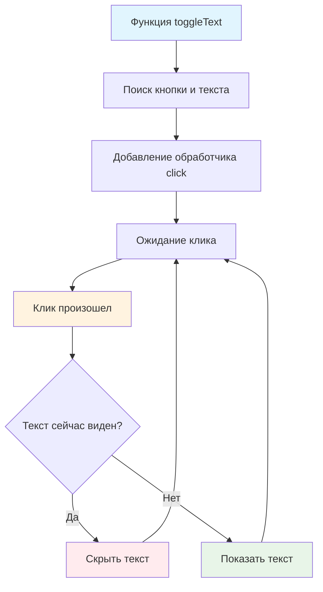

# 🔄 Скрыть элемент по нажатию кнопки

> **Изучаем переключение состояний элементов!** ⚡  
> Эта задача научит вас создавать интерактивные элементы с изменяющимся поведением.

## 🎯 Задача

Создайте функцию `toggleText()`, которая добавляет кнопке возможность **переключать видимость** текстового элемента:
скрывать при первом клике, показывать при втором, и так далее.

```js
toggleText();
// Клик 1 → текст скрывается
// Клик 2 → текст появляется  
// Клик 3 → текст скрывается...
```

## 🔍 Алгоритм переключения



## 📋 Компоненты задачи

### 🎨 HTML разметка

```html

<button class="toggle-text-button">Нажмите, чтобы спрятать/показать текст</button>
<div class="text-container">Текст</div>
```

### ⚡ Поведение

- **1-й клик:** Текст скрывается (`hidden=true`)
- **2-й клик:** Текст появляется (`hidden=false`)
- **3-й клик:** Текст скрывается снова...

## ✅ Состояния системы

| Состояние     | Текст    | Атрибут hidden | После клика |
|---------------|----------|----------------|-------------|
| **Начальное** | Виден    | `false`        | Скрыется    |
| **Скрыт**     | Не виден | `true`         | Появится    |
| **Показан**   | Виден    | `false`        | Скроется    |

## 🛠️ Что нужно реализовать

```js
function toggleText() {
  // Ваш код здесь
}

export default toggleText;
```

💡 **Ключевая логика:** `element.hidden = !element.hidden`

## 💡 Концепции, которые вы изучите

- **Toggle паттерн**: переключение между двумя состояниями
- **Булева логика**: использование `!` для инверсии
- **Состояние интерфейса**: отслеживание текущего состояния элемента
- **Пользовательский опыт**: предсказуемое поведение кнопок
- **DOM селекторы**: поиск элементов по классу и ID

## 🎓 Для новичков

**Что такое toggle?**  
Toggle (переключение) — это смена состояния между двумя вариантами:

```js
// Было: true → Стало: false
// Было: false → Стало: true
element.hidden = !element.hidden;
```

**Как работает логический оператор !?**

```js
!true   // false
!false  // true
!0      // true (0 считается false)
!1      // false (1 считается true)
```

**Разница между ID и class селекторами:**

```js
document.querySelector('#text')               // Поиск по ID
document.querySelector('.toggle-text-button') // Поиск по классу
```

## ⚡ Частые ошибки

❌ **Неправильные селекторы**

```js
const text = document.querySelector('#text-container');  // ❌ Неправильный ID!
const button = document.querySelector('.toggle-button'); // ❌ Неправильный класс!
```

✅ **Правильные селекторы**

```js
const text = document.querySelector('#text');                 // ✅ По ID из разметки
const button = document.querySelector('.toggle-text-button'); // ✅ По классу из разметки
```

❌ **Забыть инверсию**

```js
button.addEventListener('click', () => {
  text.hidden = true; // ❌ Всегда только скрывает!
});
```

✅ **Правильное переключение**

```js
button.addEventListener('click', () => {
  text.hidden = !text.hidden; // ✅ Переключает состояние
});
```

❌ **Не проверить существование элементов**

```js
function toggleText() {
  const button = document.querySelector('.toggle-text-button');
  const text = document.querySelector('#text');

  button.addEventListener('click', () => { // ❌ Ошибка если elements null!
    text.hidden = !text.hidden;
  });
}
```

✅ **С проверкой существования**

```js
function toggleText() {
  const button = document.querySelector('.toggle-text-button');
  const text = document.querySelector('#text');

  if (button && text) { // ✅ Проверяем оба элемента
    button.addEventListener('click', () => {
      text.hidden = !text.hidden;
    });
  }
}
```

## 🔧 Различные подходы к решению

### 🎯 Базовое решение (в задаче)

```js
function toggleText() {
  const button = document.querySelector('.toggle-text-button');
  const text = document.querySelector('.text-container');

  if (button && text) {
    button.addEventListener('click', () => {
      text.hidden = !text.hidden;
    });
  }
}
```

### 🛡️ С обработкой ошибок

```js
function toggleText() {
  try {
    const button = document.querySelector('.toggle-text-button');
    const text = document.querySelector('.text-container');

    if (!button) {
      console.warn('Кнопка с классом .toggle-text-button не найдена');
      return;
    }

    if (!text) {
      console.warn('Элемент с классом .text-container не найден');
      return;
    }

    button.addEventListener('click', () => {
      text.hidden = !text.hidden;
      console.log(`Текст ${text.hidden ? 'скрыт' : 'показан'}`);
    });

  } catch (error) {
    console.error('Ошибка в toggleText:', error);
  }
}
```

### 🎨 С обновлением текста кнопки

```js
function toggleText() {
  const button = document.querySelector('.toggle-text-button');
  const text = document.querySelector('.text-container');

  if (button && text) {
    const updateButtonText = () => {
      button.textContent = text.hidden
        ? 'Показать текст'
        : 'Скрыть текст';
    };

    button.addEventListener('click', () => {
      text.hidden = !text.hidden;
      updateButtonText();
    });

    // Установить правильный текст изначально
    updateButtonText();
  }
}
```

### ⚡ Универсальная версия

```js
function createToggle(buttonSelector, targetSelector) {
  const button = document.querySelector(buttonSelector);
  const target = document.querySelector(targetSelector);

  if (!button || !target) {
    console.warn(`Не удалось найти элементы: ${buttonSelector}, ${targetSelector}`);
    return false;
  }

  button.addEventListener('click', () => {
    target.hidden = !target.hidden;

    // Добавляем атрибут aria для доступности
    button.setAttribute('aria-expanded', !target.hidden);
  });

  return true;
}

// Использование:
function toggleText() {
  createToggle('.toggle-text-button', '.text-container');
}
```

### 🎯 С CSS классами (альтернатива)

```js
function toggleText() {
  const button = document.querySelector('.toggle-text-button');
  const text = document.querySelector('.text-container');

  if (button && text) {
    button.addEventListener('click', () => {
      text.classList.toggle('hidden'); // Используем CSS класс
    });
  }
}

// CSS:
// .hidden { display: none; }
```

## 🌟 Расширенные версии

### 🎬 С анимацией

```js
function toggleTextAnimated() {
  const button = document.querySelector('.toggle-text-button');
  const text = document.querySelector('.text-container');

  if (button && text) {
    button.addEventListener('click', () => {
      if (text.hidden) {
        // Показываем с анимацией
        text.hidden = false;
        text.style.opacity = '0';
        text.style.transition = 'opacity 0.3s ease';

        requestAnimationFrame(() => {
          text.style.opacity = '1';
        });
      } else {
        // Скрываем с анимацией
        text.style.opacity = '0';

        setTimeout(() => {
          text.hidden = true;
          text.style.opacity = '';
        }, 300);
      }
    });
  }
}
```

### 📊 С подсчетом кликов

```js
function toggleTextWithStats() {
  const button = document.querySelector('.toggle-text-button');
  const text = document.querySelector('.text-container');

  if (!button || !text) return;

  let clickCount = 0;

  button.addEventListener('click', () => {
    clickCount++;
    text.hidden = !text.hidden;

    console.log(`Клик #${clickCount}: текст ${text.hidden ? 'скрыт' : 'показан'}`);

    // Обновляем счетчик в кнопке
    const action = text.hidden ? 'Показать' : 'Скрыть';
    button.textContent = `${action} текст (кликов: ${clickCount})`;
  });
}
```

### 🎮 Множественные элементы

```js
function toggleMultipleTexts() {
  const button = document.querySelector('.toggle-text-button');
  const texts = document.querySelectorAll('.toggleable-text');

  if (button && texts.length > 0) {
    button.addEventListener('click', () => {
      texts.forEach(text => {
        text.hidden = !text.hidden;
      });

      const hiddenCount = Array.from(texts).filter(t => t.hidden).length;
      button.textContent = `${hiddenCount === texts.length ? 'Показать' : 'Скрыть'} все тексты`;
    });
  }
}
```

## 🎨 Практическое применение

### 📄 Аккордеон/FAQ

```js
function createAccordion() {
  const headers = document.querySelectorAll('.accordion-header');

  headers.forEach(header => {
    header.addEventListener('click', () => {
      const content = header.nextElementSibling;
      if (content) {
        content.hidden = !content.hidden;
        header.classList.toggle('expanded');
      }
    });
  });
}
```

### 🔍 Показать/скрыть детали

```js
function createDetailsToggle() {
  const toggleButtons = document.querySelectorAll('[data-toggle-target]');

  toggleButtons.forEach(button => {
    const targetSelector = button.dataset.toggleTarget;
    const target = document.querySelector(targetSelector);

    if (target) {
      button.addEventListener('click', () => {
        target.hidden = !target.hidden;
        button.textContent = target.hidden ? 'Показать детали' : 'Скрыть детали';
      });
    }
  });
}
```

### 🌙 Переключение темы

```js
function createThemeToggle() {
  const toggleButton = document.querySelector('.theme-toggle');
  const body = document.body;

  if (toggleButton) {
    toggleButton.addEventListener('click', () => {
      const isDark = body.classList.toggle('dark-theme');
      toggleButton.textContent = isDark ? '☀️ Светлая тема' : '🌙 Темная тема';
    });
  }
}
```

## 🔄 Альтернативные подходы

| Метод        | Код                                  | Особенности                |
|--------------|--------------------------------------|----------------------------|
| `hidden`     | `element.hidden = !element.hidden`   | Полное скрытие, семантично |
| CSS класс    | `element.classList.toggle('hidden')` | Гибкость стилизации        |
| `display`    | `element.style.display = '...'`      | Прямое управление CSS      |
| `visibility` | `element.style.visibility = '...'`   | Элемент занимает место     |

## 🧪 Тестирование

```bash
npm test
```

**Проверьте:**

- ✅ Элементы существуют на странице
- ✅ Первый клик скрывает текст
- ✅ Второй клик показывает текст
- ✅ Атрибут `hidden` изменяется корректно
- ✅ Функция не падает при отсутствии элементов

## 🚀 Что дальше?

Эта задача подготовила вас к созданию сложных интерактивных элементов: модальные окна, вкладки, аккордеоны, выпадающие
меню!

---
📚 **Полезные ссылки:**

- [MDN: HTMLElement.hidden](https://developer.mozilla.org/ru/docs/Web/API/HTMLElement/hidden)
- [MDN: Element.classList.toggle()](https://developer.mozilla.org/ru/docs/Web/API/DOMTokenList/toggle)
- [MDN: Logical NOT (!)](https://developer.mozilla.org/ru/docs/Web/JavaScript/Reference/Operators/Logical_NOT)
- [Learn.javascript.ru: Введение в события](https://learn.javascript.ru/introduction-browser-events)
