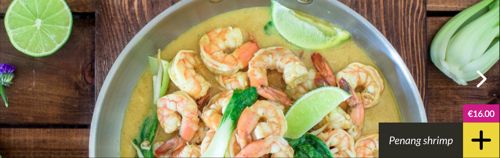
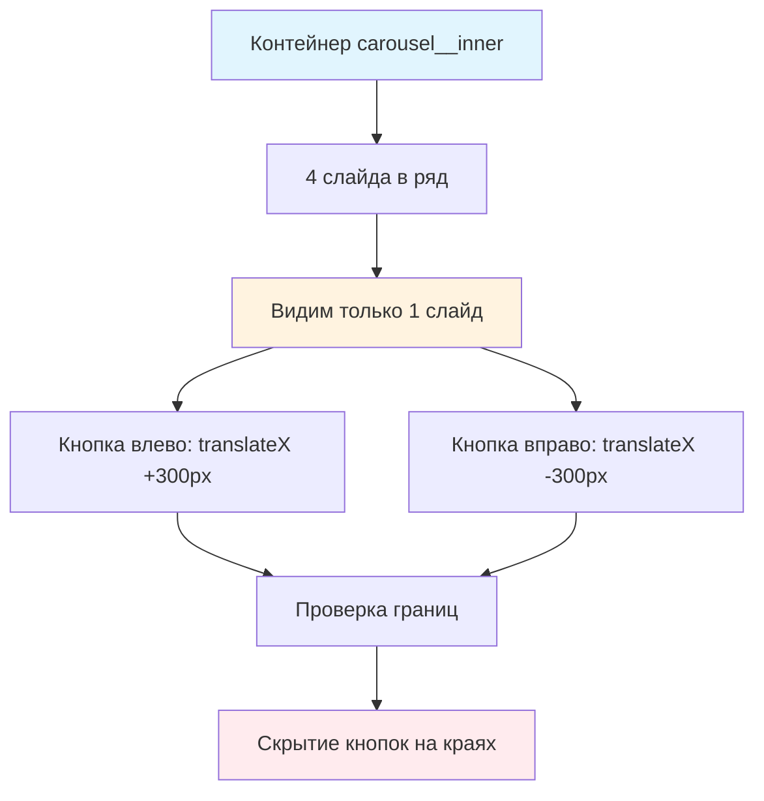

# 🎠 Учебный проект: Карусель

> **Создаем интерактивный компонент интерфейса!** ✨  
> Эта задача научит вас работать с CSS трансформациями, событиями и создавать переиспользуемые компоненты.



## 🎯 Задача

Создайте функцию `initCarousel()`, которая **оживляет** статичную карусель: добавляет переключение слайдов по кнопкам и
логику скрытия кнопок на краях.

```js
initCarousel();
// Карусель становится интерактивной:
// ← Назад | 🖼️ Слайды | Вперед →
```

## 🔍 Механика работы карусели



## 📊 Структура компонента

### 🏗️ HTML элементы

```html

<div class="container">
  <div class="carousel__inner">    <!-- Лента слайдов -->
    <div class="carousel__slide">1</div>
    <div class="carousel__slide">2</div>
    <div class="carousel__slide">3</div>
    <div class="carousel__slide">4</div>
  </div>
  <div class="carousel__arrow_left">←</div>   <!-- Кнопки -->
  <div class="carousel__arrow_right">→</div>
</div>
```
>Структура карусели состоит из внешнего элемента ("контейнер"), в котором находится "лента" из нескольких слайдов.
Внешний элемент имеет фиксированную ширину, поэтому видна только часть ленты (один слайд).
Для переключения слайдов мы будем сдвигать этот элемент на ширину одного слайда.

### ⚙️ Ключевые CSS классы

| Класс                    | Назначение                |
|--------------------------|---------------------------|
| `.carousel__inner`       | Лента слайдов (двигается) |
| `.carousel__arrow_left`  | Кнопка "назад"            |
| `.carousel__arrow_right` | Кнопка "вперед"           |
| `.carousel__slide`       | Отдельный слайд           |

## 🔧 Алгоритм реализации

### 1️⃣ Получение элементов

```js
const container = document.querySelector('.container');
const carouselInner = container.querySelector('.carousel__inner');
const btnPrev = container.querySelector('.carousel__arrow_left');
const btnNext = container.querySelector('.carousel__arrow_right');
```

### 2️⃣ Вычисление ширины слайда

```js
const slideWidth = carouselInner.offsetWidth; // Ширина видимой области
```

### 3️⃣ Движение слайдов

```js
// Переход к слайду по индексу
function moveToSlide(slideIndex) {
  const offset = -slideIndex * slideWidth;
  carouselInner.style.transform = `translateX(${offset}px)`;
}
```

### 4️⃣ Управление кнопками

```js
// Скрытие кнопок на краях
function updateButtons(currentSlide) {
  btnPrev.style.display = currentSlide === 0 ? 'none' : '';
  btnNext.style.display = currentSlide === 3 ? 'none' : ''; // 4 слайда (0-3)
}
```

## ✅ Логика переключения

| Текущий слайд | Позиция translateX | Видимые кнопки |
|---------------|--------------------|----------------|
| 0 (первый)    | `0px`              | Только →       |
| 1             | `-300px`           | ← и →          |
| 2             | `-600px`           | ← и →          |
| 3 (последний) | `-900px`           | Только ←       |

*Примечание: ширина 300px условная, реальная берется из `offsetWidth`*

## 🛠️ Что нужно реализовать

```js
function initCarousel() {
  // Ваш код здесь
}

export default initCarousel;
```

## 💡 Концепции, которые вы изучите

- **CSS Transform**: `translateX()` для горизонтального движения
- **offsetWidth**: получение реальных размеров элементов
- **Делегирование событий**: один обработчик для нескольких кнопок
- **Состояние компонента**: отслеживание текущего слайда
- **Граничные условия**: обработка первого/последнего слайда

## 🎓 Для новичков

**Как работает translateX?**

```js
// Движение влево (отрицательные значения)
element.style.transform = 'translateX(-300px)'; // Влево на 300px
element.style.transform = 'translateX(-600px)'; // Влево на 600px

// Движение вправо (положительные значения)  
element.style.transform = 'translateX(300px)';  // Вправо на 300px
```

**Почему используем offsetWidth?**  
`offsetWidth` дает реальную ширину элемента независимо от CSS:

```js
const width = element.offsetWidth; // Число без 'px'
```

**Делегирование событий:**

```js
container.addEventListener('click', (event) => {
  if (event.target.matches('.carousel__arrow_left')) {
    // Клик по левой кнопке
  }
});
```

## ⚡ Частые ошибки

❌ **Жестко заданная ширина**

```js
const slideWidth = 300; // ❌ Может не соответствовать CSS!
```

✅ **Динамическое получение ширины**

```js
const slideWidth = carouselInner.offsetWidth; // ✅ Реальная ширина
```

❌ **Забыть обновить кнопки**

```js
function nextSlide() {
  currentSlide++;
  moveToSlide(currentSlide);
  // ❌ Забыли вызвать updateButtons()!
}
```

✅ **Полная обработка**

```js
function nextSlide() {
  currentSlide++;
  moveToSlide(currentSlide);
  updateButtons(); // ✅ Обновляем состояние кнопок
}
```

❌ **Выход за границы**

```js
function nextSlide() {
  currentSlide++; // ❌ Может стать больше максимума!
  moveToSlide(currentSlide);
}
```

## 🧪 Пошаговый пример

**Начальное состояние:** Слайд 0, translateX = 0px

| Действие | currentSlide | translateX    | Кнопки   |
|----------|--------------|---------------|----------|
| Клик →   | 0 → 1        | 0 → -300px    | ← ✅, → ✅ |
| Клик →   | 1 → 2        | -300 → -600px | ← ✅, → ✅ |  
| Клик →   | 2 → 3        | -600 → -900px | ← ✅, → ❌ |
| Клик ←   | 3 → 2        | -900 → -600px | ← ✅, → ✅ |


## 🎨 Практическое применение

### 🖼️ Галерея изображений

```js
function createImageGallery(images) {
  // Генерируем слайды из массива изображений
  const slides = images.map(src =>
    `<div class="carousel__slide"></div>`
  ).join('');

  carouselInner.innerHTML = slides;
  initCarousel();
}
```

### 📊 Слайдер контента

```js
function createContentSlider(contentBlocks) {
  // Адаптируем для любого контента
  const slides = contentBlocks.map(content =>
    `<div class="carousel__slide">${content}</div>`
  ).join('');

  carouselInner.innerHTML = slides;
  initCarousel();
}
```

## 🧪 Тестирование

**Проверьте:**

- ✅ Слайды переключаются при клике на кнопки
- ✅ Кнопка ← скрыта на первом слайде
- ✅ Кнопка → скрыта на последнем слайде
- ✅ Позиция `translateX` рассчитывается правильно
- ✅ Компонент работает при разных размерах экрана

## 🚀 Что дальше?

Эта задача подготовила вас к созданию сложных интерактивных компонентов: модальные окна, табы, аккордеоны, слайдеры!

---
📚 **Полезные ссылки:**

- [Learn.javascript.ru: offsetWidth](https://learn.javascript.ru/size-and-scroll#offsetwidth-height)
- [Learn.javascript.ru: Стили элементов](https://learn.javascript.ru/styles-and-classes#element-style)
- [MDN: CSS Transform](https://developer.mozilla.org/ru/docs/Web/CSS/transform)
- [MDN: Element.offsetWidth](https://developer.mozilla.org/ru/docs/Web/API/HTMLElement/offsetWidth)
