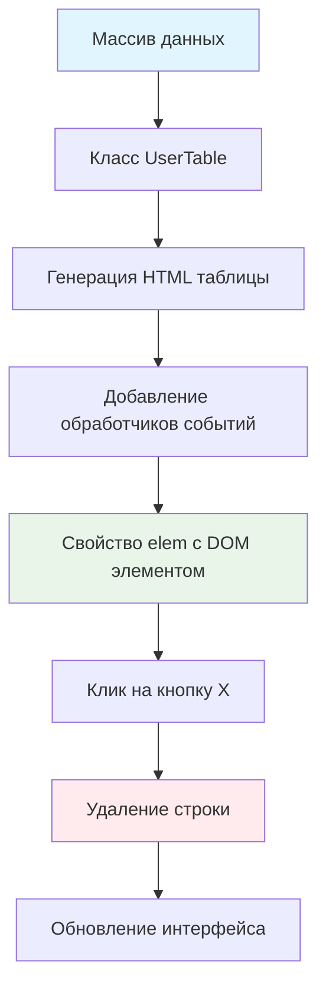

# 🗂️ Таблица с удаляемыми строками

> **Изучаем классы и интерактивные компоненты!** 🎯  
> Эта задача научит вас создавать переиспользуемые компоненты с управлением состоянием и обработкой событий.

## 🎯 Задача

Создайте класс `UserTable`, который генерирует **интерактивную таблицу** из массива данных с возможностью удаления строк
по кнопке `[X]`.

```js
const rows = [
  {name: 'Вася', age: 25, salary: 1000, city: 'Самара'},
  {name: 'Петя', age: 30, salary: 1500, city: 'Москва'}
];

const table = new UserTable(rows);
document.body.appendChild(table.elem);
```

## 🔍 Архитектура компонента



## 📋 Структура данных

### 📊 Входные данные

```js
let rows = [
  {
    name: 'Вася',      // Имя пользователя
    age: 25,           // Возраст
    salary: 1000,      // Зарплата  
    city: 'Самара'     // Город
  }
  // ... другие записи
];
```

### 🏗️ Результирующая HTML структура

```html

<table>
  <thead>
  <tr>
    <th>Имя</th>
    <th>Возраст</th>
    <th>Зарплата</th>
    <th>Город</th>
    <th></th>  <!-- Колонка для кнопок -->
  </tr>
  </thead>
  <tbody>
  <tr>
    <td>Вася</td>
    <td>25</td>
    <td>1000</td>
    <td>Самара</td>
    <td>
      <button>X</button>
    </td>
  </tr>
  </tbody>
</table>
```

## ✅ Требования к классу

| Компонент            | Требование                                 |
|----------------------|--------------------------------------------|
| **Конструктор**      | Принимает массив данных `rows`             |
| **Свойство elem**    | Ссылка на DOM элемент `<table>`            |
| **Кнопки удаления**  | В каждой строке кнопка `[X]`               |
| **Обработка кликов** | Удаление строки при клике на `[X]`         |
| **Структура**        | Точное соответствие заданной HTML разметке |

## 🛠️ Что нужно реализовать

```js
export default class UserTable {
  elem = null;

  constructor(rows) {
    // Инициализация компонента
  }

  // Методы класса...
}
```

⚠️ **Важно:** `elem` не должен быть геттером, создающим новые DOM элементы при каждом вызове!

## 💡 Концепции, которые вы изучите

- **ES6 классы**: современный синтаксис ООП
- **DOM генерация**: создание сложных структур из данных
- **Делегирование событий**: один обработчик для множества кнопок
- **Инкапсуляция**: скрытие внутренней логики компонента
- **Компонентный подход**: переиспользуемые элементы интерфейса

## 🎓 Для новичков

**Что такое класс-компонент?**  
Это шаблон, который создает готовые к использованию элементы интерфейса:

```js
const table1 = new UserTable(data1); // Таблица для первого набора данных
const table2 = new UserTable(data2); // Таблица для второго набора данных
```

**Зачем свойство elem?**  
Это стандартный паттерн — предоставить доступ к корневому DOM элементу:

```js
const table = new UserTable(data);
document.body.appendChild(table.elem); // Добавляем в DOM
```

**Делегирование событий:**  
Вместо добавления обработчика каждой кнопке, добавляем один на всю таблицу:

```js
table.addEventListener('click', (event) => {
  if (event.target.tagName === 'BUTTON') {
    // Обрабатываем клик по любой кнопке
  }
});
```

## ⚡ Частые ошибки

❌ **elem как геттер, создающий новые элементы**

```js
class UserTable {
  get elem() {
    return document.createElement('table'); // ❌ Новый элемент каждый раз!
  }
}
```

✅ **elem как свойство или геттер-ссылка**

```js
class UserTable {
  elem = null;

  constructor(rows) {
    this.elem = this.createTable(rows); // ✅ Создаем один раз
  }

  // Или геттер, возвращающий ссылку:
  get elem() {
    return this._elem; // ✅ Просто возвращает существующий
  }
}
```

❌ **Неправильная структура (div вокруг table)**

```js
render()
{
  return `<div><table>...</table></div>`; // ❌ Лишний div!
}
```

✅ **Правильная структура**

```js
render()
{
  return `<table>...</table>`; // ✅ Корневой элемент — table
}
```

❌ **Обработчик на каждой кнопке**

```js
buttons.forEach(btn => {
  btn.addEventListener('click', handler); // ❌ Много обработчиков
});
```

✅ **Делегирование событий**

```js
table.addEventListener('click', (event) => {
  if (event.target.matches('button')) { // ✅ Один обработчик
    // Удаляем строку
  }
});
```

## 🔧 Различные подходы к решению

### 🎯 Базовое решение (в задаче)

```js
export default class UserTable {
  elem = null;

  constructor(rows = []) {
    this.data = rows;
    this.render();
  }

  template() {
    return `
      <table>
        <thead>
          <tr>
            <th>Имя</th>
            <th>Возраст</th>
            <th>Зарплата</th>
            <th>Город</th>
            <th></th>
          </tr>
        </thead>
        <tbody>
          ${this.data.map(item => this.getTableRow(item)).join('')}
        </tbody>
      </table>
    `;
  }

  getTableRow({name, age, salary, city}) {
    return `
      <tr>
        <td>${name}</td>
        <td>${age}</td>
        <td>${salary}</td>
        <td>${city}</td>
        <td><button data-action="remove">X</button></td>
      </tr>
    `;
  }

  render() {
    const wrapper = document.createElement('div');
    wrapper.innerHTML = this.template();
    this.elem = wrapper.firstElementChild; // Получаем table
    this.elem.addEventListener('click', this.onDeleteBtnClick);
  }

  onDeleteBtnClick = (event) => {
    const {target} = event;

    if (target.dataset.action !== 'remove') return;

    const row = target.closest('tr');
    if (row) {
      row.remove();
    }
  };
}
```

### 🛡️ С безопасностью и валидацией

```js
export default class UserTable {
  elem = null;

  constructor(rows = []) {
    this.validateData(rows);
    this.data = rows;
    this.render();
  }

  validateData(rows) {
    if (!Array.isArray(rows)) {
      throw new Error('UserTable: данные должны быть массивом');
    }
  }

  template() {
    return `
      <table>
        <thead>
          <tr>
            <th>Имя</th>
            <th>Возраст</th>
            <th>Зарплата</th>
            <th>Город</th>
            <th></th>
          </tr>
        </thead>
        <tbody>
          ${this.data.map(item => this.getTableRow(item)).join('')}
        </tbody>
      </table>
    `;
  }

  getTableRow({name = '', age = '', salary = '', city = ''}) {
    return `
      <tr>
        <td>${this.escapeHtml(name)}</td>
        <td>${this.escapeHtml(age)}</td>
        <td>${this.escapeHtml(salary)}</td>
        <td>${this.escapeHtml(city)}</td>
        <td><button data-action="remove">X</button></td>
      </tr>
    `;
  }

  escapeHtml(text) {
    const div = document.createElement('div');
    div.textContent = text;
    return div.innerHTML;
  }

  render() {
    const wrapper = document.createElement('div');
    wrapper.innerHTML = this.template();
    this.elem = wrapper.firstElementChild;
    this.elem.addEventListener('click', this.onDeleteBtnClick);
  }

  onDeleteBtnClick = (event) => {
    const {target} = event;

    if (target.dataset.action !== 'remove') return;

    const row = target.closest('tr');
    if (row && row.parentElement.tagName === 'TBODY') {
      row.remove();
    }
  };
}
```

### ⚡ Альтернативный подход с createElement

```js
export default class UserTable {
  constructor(rows = []) {
    this.data = rows;
    this.elem = this.createElement();
  }

  createElement() {
    const table = document.createElement('table');

    // Создаем заголовок
    const thead = table.createTHead();
    const headerRow = thead.insertRow();
    ['Имя', 'Возраст', 'Зарплата', 'Город', ''].forEach(text => {
      const th = document.createElement('th');
      th.textContent = text;
      headerRow.appendChild(th);
    });

    // Создаем тело таблицы
    const tbody = table.createTBody();
    this.data.forEach(rowData => {
      const row = tbody.insertRow();
      Object.values(rowData).forEach(value => {
        const cell = row.insertCell();
        cell.textContent = value;
      });

      // Добавляем кнопку удаления
      const deleteCell = row.insertCell();
      const deleteBtn = document.createElement('button');
      deleteBtn.textContent = 'X';
      deleteBtn.addEventListener('click', () => row.remove());
      deleteCell.appendChild(deleteBtn);
    });

    return table;
  }
}
```

## 🌟 Расширенные возможности

### 📊 С подсчетом строк

```js
class UserTable {
  constructor(rows = []) {
    this.data = rows;
    this.render();
    this.updateCounter();
  }

  onDeleteBtnClick = (event) => {
    // ... логика удаления ...
    this.updateCounter();
  };

  updateCounter() {
    const count = this.elem.querySelectorAll('tbody tr').length;
    console.log(`Осталось строк: ${count}`);
  }
}
```

### 🎨 С кастомными стилями

```js
class UserTable {
  constructor(rows = [], options = {}) {
    this.data = rows;
    this.options = {className: '', ...options};
    this.render();
  }

  render() {
    // ... создание таблицы ...
    if (this.options.className) {
      this.elem.className = this.options.className;
    }
  }
}

// Использование:
const table = new UserTable(data, {className: 'styled-table'});
```

### 🔄 С методами управления данными

```js
class UserTable {
  // ... существующий код ...

  addRow(rowData) {
    this.data.push(rowData);
    this.rerender();
  }

  clearAll() {
    this.data = [];
    this.rerender();
  }

  rerender() {
    const wrapper = document.createElement('div');
    wrapper.innerHTML = this.template();
    const newTable = wrapper.firstElementChild;

    this.elem.parentNode.replaceChild(newTable, this.elem);
    this.elem = newTable;
    this.elem.addEventListener('click', this.onDeleteBtnClick);
  }
}
```

## 🎨 Практическое применение

### 👥 Управление пользователями

```js
const users = [
  {name: 'Админ', age: 30, salary: 50000, city: 'Москва'},
  {name: 'Модератор', age: 25, salary: 30000, city: 'СПб'}
];

const userTable = new UserTable(users);
document.getElementById('users-container').appendChild(userTable.elem);
```

### 📋 Таблица задач

```js
const tasks = [
  {name: 'Задача 1', age: '2 дня', salary: 'Высокий', city: 'В работе'},
  {name: 'Задача 2', age: '1 день', salary: 'Средний', city: 'Готово'}
];

const taskTable = new UserTable(tasks);
```

## 🧪 Тестирование

```bash
npm test
```

**Проверьте:**

- ✅ Таблица создается с правильной структурой
- ✅ Строки удаляются при клике на кнопку X
- ✅ `elem` возвращает элемент `<table>`
- ✅ Обработчики событий работают корректно
- ✅ Компонент можно использовать многократно

## 🚀 Что дальше?

Эта задача подготовила вас к созданию сложных компонентов: формы, модальные окна, интерактивные виджеты!

---
📚 **Полезные ссылки:**

- [MDN: ES6 Classes](https://developer.mozilla.org/ru/docs/Web/JavaScript/Reference/Classes)
- [MDN: Event delegation](https://developer.mozilla.org/ru/docs/Learn/JavaScript/Building_blocks/Events#event_delegation)
- [MDN: HTMLTableElement](https://developer.mozilla.org/en-US/docs/Web/API/HTMLTableElement)
- [Learn.javascript.ru: Классы](https://learn.javascript.ru/classes)
