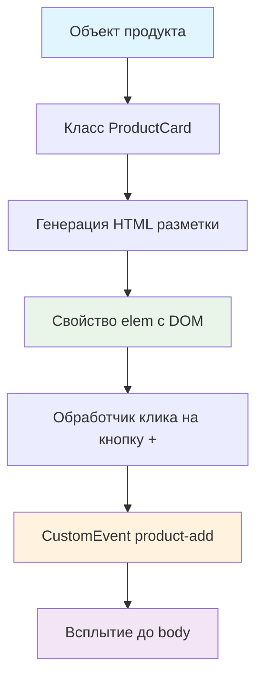

# 🍽️ Учебный проект: Карточка блюда

> **Создаем интерактивную карточку товара!** 🎨  
> Эта задача научит вас создавать компоненты с событиями и работать с пользовательскими событиями.

## 🎯 Задача

Создайте класс `ProductCard`, который генерирует **интерактивную карточку блюда** с возможностью добавления в корзину
через пользовательское событие.

```js
const product = {
  name: "Laab kai chicken salad",
  price: 10,
  category: "salads",
  image: "laab_kai_chicken_salad.png",
  id: "laab-kai-chicken-salad"
};

const productCard = new ProductCard(product);
document.body.appendChild(productCard.elem);
```

## 🔍 Архитектура компонента



## 📋 Структура данных продукта

```js
let product = {
  name: "Laab kai chicken salad",      // Название блюда
  price: 10,                          // Цена (число)
  category: "salads",                 // Категория
  image: "laab_kai_chicken_salad.png", // Имя файла изображения
  id: "laab-kai-chicken-salad"        // Уникальный ID для корзины
};
```

## 🏗️ Результирующая HTML структура

```html

<div class="card">
  <div class="card__top">
    
    <span class="card__price">€10.00</span>
  </div>
  <div class="card__body">
    <div class="card__title">Laab kai chicken salad</div>
    <button type="button" class="card__button">
      
    </button>
  </div>
</div>
```

## ✅ Требования к классу

| Компонент               | Требование                          |
|-------------------------|-------------------------------------|
| **Конструктор**         | Принимает объект с данными продукта |
| **Свойство elem**       | DOM элемент карточки                |
| **Форматирование цены** | `€10.00` (два знака после запятой)  |
| **Путь к изображению**  | `/assets/images/products/${image}`  |
| **Событие product-add** | При клике на кнопку `+`             |
| **Всплытие события**    | `bubbles: true`                     |

## 🛠️ Что нужно реализовать

```js
export default class ProductCard {
  elem = null;

  constructor(product) {
    // Инициализация компонента
  }

  // Методы класса...
}
```

💡 **Используйте:** `createElement` хелпер для создания DOM элементов

## 💡 Концепции, которые вы изучите

- **Классы-компоненты**: создание переиспользуемых элементов
- **CustomEvent**: генерация пользовательских событий
- **Event bubbling**: всплытие событий до родительских элементов
- **Форматирование данных**: цены, изображения, текст
- **Делегирование событий**: обработка кликов на кнопках

## 🎓 Для новичков

**Что такое createElement хелпер?**  
Удобная функция для создания DOM элементов из HTML строки:

```js
import {createElement} from "../../assets/lib/create-element.js";

const card = createElement(`
  <div class="card">
    <h2>Заголовок</h2>
    <p>Текст</p>
  </div>
`);
```

**Форматирование цены:**

```js
const price = 10;
const formatted = `€${parseFloat(price).toFixed(2)}`; // "€10.00"
```

**Пользовательские события:**

```js
const event = new CustomEvent('my-event', {
  detail: {data: 'some data'},  // Данные события
  bubbles: true                   // Событие всплывает
});
element.dispatchEvent(event);      // Запускаем событие
```

**Зачем нужно всплытие?**  
Чтобы событие можно было поймать на родительских элементах:

```js
document.body.addEventListener('product-add', (event) => {
  console.log('Добавлен продукт:', event.detail); // ID продукта
});
```

## ⚡ Частые ошибки

❌ **elem как геттер, создающий новые элементы**

```js
get
elem()
{
  return createElement(this.getCard()); // ❌ Новый элемент каждый раз!
}
```

✅ **elem создается один раз**

```js
constructor(product)
{
  this.product = product;
  this.elem = createElement(this.getCard()); // ✅ Создаем один раз
}
```

❌ **Неправильное форматирование цены**

```js
const price = `€${this.price}`; // ❌ Может быть "€10" вместо "€10.00"
```

✅ **Правильное форматирование**

```js
const price = `€${parseFloat(this.price).toFixed(2)}`; // ✅ "€10.00"
```

❌ **Забыть про всплытие события**

```js
const event = new CustomEvent('product-add', {
  detail: this.id
  // ❌ Нет bubbles: true!
});
```

✅ **С правильным всплытием**

```js
const event = new CustomEvent('product-add', {
  detail: this.id,
  bubbles: true // ✅ Событие всплывает
});
```

❌ **Неправильный путь к изображению**

```js
// ❌ Неполный путь
```

✅ **Правильный путь**

```js
// ✅ Полный путь
```

## 🔧 Различные подходы к реализации

### 🎯 Базовая реализация (в задаче)

```js
export default class ProductCard {
  elem = null;

  constructor({name, price, category, image, id} = {}) {
    this.name = name;
    this.price = price;
    this.category = category;
    this.image = image;
    this.productID = id;
    this.render();
    this.addEventListeners();
  }

  render() {
    this.elem = createElement(this.getCard());
  }

  getCard() {
    return `
      <div class="card">
        <div class="card__top">
          
          <span class="card__price">${this.formatPrice(this.price)}</span>
        </div>
        <div class="card__body">
          <div class="card__title">${this.name}</div>
          <button type="button" class="card__button">
            
          </button>
        </div>
      </div>
    `;
  }

  formatPrice(price) {
    return `€${parseFloat(price).toFixed(2)}`;
  }

  addEventListeners() {
    this.elem.addEventListener('click', this.onAddBtnClick);
  }

  onAddBtnClick = (event) => {
    const addBtn = event.target.closest('.card__button');
    if (!addBtn) return;

    const customEvent = new CustomEvent('product-add', {
      detail: this.productID,
      bubbles: true
    });
    this.elem.dispatchEvent(customEvent);
  };
}
```

### 🛡️ С валидацией и защитой

```js
export default class ProductCard {
  elem = null;

  constructor(product = {}) {
    this.validateProduct(product);
    this.product = product;
    this.render();
    this.addEventListeners();
  }

  validateProduct({name, price, image, id}) {
    const required = {name, price, image, id};
    const missing = Object.entries(required)
      .filter(([key, value]) => !value)
      .map(([key]) => key);

    if (missing.length > 0) {
      throw new Error(`ProductCard: отсутствуют поля: ${missing.join(', ')}`);
    }
  }

  render() {
    this.elem = createElement(this.getCard());
  }

  getCard() {
    const {name, price, image} = this.product;

    return `
      <div class="card">
        <div class="card__top">
          
          <span class="card__price">${this.formatPrice(price)}</span>
        </div>
        <div class="card__body">
          <div class="card__title">${this.escapeHtml(name)}</div>
          <button type="button" class="card__button">
            
          </button>
        </div>
      </div>
    `;
  }

  escapeHtml(text) {
    const div = document.createElement('div');
    div.textContent = text;
    return div.innerHTML;
  }

  formatPrice(price) {
    const numPrice = parseFloat(price);
    if (isNaN(numPrice)) return '€0.00';
    return `€${numPrice.toFixed(2)}`;
  }

  addEventListeners() {
    this.elem.addEventListener('click', this.onAddBtnClick);
  }

  onAddBtnClick = (event) => {
    const addBtn = event.target.closest('.card__button');
    if (!addBtn) return;

    this.dispatchAddEvent();
  };

  dispatchAddEvent() {
    const event = new CustomEvent('product-add', {
      detail: this.product.id,
      bubbles: true
    });
    this.elem.dispatchEvent(event);
  }
}
```

### ⚡ Альтернативный подход без createElement

```js
export default class ProductCard {
  constructor(product) {
    this.product = product;
    this.elem = this.createCard();
    this.addEventListeners();
  }

  createCard() {
    const card = document.createElement('div');
    card.className = 'card';

    const top = document.createElement('div');
    top.className = 'card__top';

    const image = document.createElement('img');
    image.src = `/assets/images/products/${this.product.image}`;
    image.className = 'card__image';
    image.alt = 'product';

    const price = document.createElement('span');
    price.className = 'card__price';
    price.textContent = this.formatPrice(this.product.price);

    const body = document.createElement('div');
    body.className = 'card__body';

    const title = document.createElement('div');
    title.className = 'card__title';
    title.textContent = this.product.name;

    const button = document.createElement('button');
    button.type = 'button';
    button.className = 'card__button';
    button.innerHTML = '';

    top.append(image, price);
    body.append(title, button);
    card.append(top, body);

    return card;
  }

  formatPrice(price) {
    return `€${parseFloat(price).toFixed(2)}`;
  }

  addEventListeners() {
    this.elem.addEventListener('click', (event) => {
      if (event.target.closest('.card__button')) {
        const customEvent = new CustomEvent('product-add', {
          detail: this.product.id,
          bubbles: true
        });
        this.elem.dispatchEvent(customEvent);
      }
    });
  }
}
```

## 🌟 Расширенные возможности

### 🎨 С анимацией при добавлении

```js
onAddBtnClick = (event) => {
  const addBtn = event.target.closest('.card__button');
  if (!addBtn) return;

  // Анимация кнопки
  addBtn.style.transform = 'scale(0.95)';
  setTimeout(() => {
    addBtn.style.transform = '';
  }, 150);

  this.dispatchAddEvent();
};
```

### 📊 С отслеживанием кликов

```js
constructor(product)
{
  this.product = product;
  this.clickCount = 0;
  this.render();
  this.addEventListeners();
}

onAddBtnClick = (event) => {
  // ... логика клика ...
  this.clickCount++;
  console.log(`Продукт ${this.product.name} добавлен ${this.clickCount} раз`);
};
```

### 🔄 С состояниями (в корзине/не в корзине)

```js
constructor(product, options = {})
{
  this.product = product;
  this.inCart = options.inCart || false;
  this.render();
  this.addEventListeners();
}

updateCartState(inCart)
{
  this.inCart = inCart;
  const button = this.elem.querySelector('.card__button');
  button.disabled = inCart;
  button.textContent = inCart ? 'В корзине' : '+';
}
```

## 🎨 Практическое применение

### 🛒 Интеграция с корзиной

```js
// Создание карточек
const products = [/* массив продуктов */];
const cards = products.map(product => new ProductCard(product));

// Обработка добавления в корзину
document.body.addEventListener('product-add', (event) => {
  const productId = event.detail;
  cart.addProduct(productId);
  showNotification(`Продукт добавлен в корзину!`);
});
```

### 📱 Адаптивная сетка

```js
class ProductGrid {
  constructor(products) {
    this.products = products;
    this.elem = createElement('<div class="product-grid"></div>');
    this.render();
  }

  render() {
    const cards = this.products.map(product => {
      const card = new ProductCard(product);
      return card.elem;
    });

    this.elem.append(...cards);
  }
}
```

## 🧪 Тестирование

```bash
npm test
```

**Проверьте:**

- ✅ Карточка создается с правильной структурой
- ✅ Цена форматируется как `€10.00`
- ✅ Путь к изображению корректный
- ✅ Событие `product-add` генерируется при клике
- ✅ Событие всплывает (`bubbles: true`)
- ✅ В `event.detail` передается правильный ID

## 🚀 Что дальше?

Эта задача подготовила вас к созданию сложных интерактивных каталогов: фильтрация, сортировка, корзина, избранное!

---
📚 **Полезные ссылки:**

- [Learn.javascript.ru: Генерация пользовательских событий](https://learn.javascript.ru/dispatch-events)
- [Learn.javascript.ru: Округление чисел](https://learn.javascript.ru/number#okruglenie)
- [MDN: CustomEvent](https://developer.mozilla.org/ru/docs/Web/API/CustomEvent)
- [MDN: Event.bubbles](https://developer.mozilla.org/ru/docs/Web/API/Event/bubbles)
