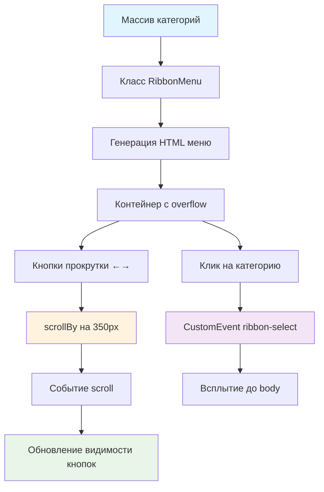

# 🎯 Учебный проект: Лента-Меню

> **Создаем горизонтальное меню с прокруткой!** 🎨  
> Эта задача научит вас работать со скроллом, динамическим управлением видимостью элементов и пользовательскими
> событиями.

## 🎯 Задача

Создайте класс `RibbonMenu`, который генерирует **горизонтальное меню категорий** с прокруткой и возможностью выбора
категории через пользовательское событие.

```js
const categories = [
  {id: '', name: 'All'},
  {id: 'salads', name: 'Salads'},
  {id: 'soups', name: 'Soups'}
];

const ribbonMenu = new RibbonMenu(categories);
document.body.appendChild(ribbonMenu.elem);
// Результат: интерактивное меню с прокруткой
```

## 🔍 Архитектура компонента



## 📋 Структура данных

### 📊 Входные данные

```js
let categories = [
  {
    id: '',          // Уникальный идентификатор
    name: 'All'      // Название категории
  },
  {
    id: 'salads',
    name: 'Salads'
  }
  // ... другие категории
];
```

### 🏗️ Результирующая HTML структура

```html

<div class="ribbon">
  <!-- Кнопка назад -->
  <button class="ribbon__arrow ribbon__arrow_left">
    
  </button>

  <!-- Контейнер с категориями -->
  <nav class="ribbon__inner">
    <a href="#" class="ribbon__item" data-id="">All</a>
    <a href="#" class="ribbon__item" data-id="salads">Salads</a>
    <a href="#" class="ribbon__item" data-id="soups">Soups</a>
  </nav>

  <!-- Кнопка вперед -->
  <button class="ribbon__arrow ribbon__arrow_right ribbon__arrow_visible">
    
  </button>
</div>
```

## ✅ Требования к классу

| Компонент                 | Требование                    |
|---------------------------|-------------------------------|
| **Конструктор**           | Принимает массив категорий    |
| **Свойство elem**         | DOM элемент меню              |
| **Прокрутка**             | По 350px при клике на стрелки |
| **Видимость кнопок**      | Класс `ribbon__arrow_visible` |
| **Активная категория**    | Класс `ribbon__item_active`   |
| **Событие ribbon-select** | При выборе категории          |
| **Всплытие события**      | `bubbles: true`               |

## 🛠️ Что нужно реализовать

```js
export default class RibbonMenu {
  elem = null;

  constructor(categories) {
    // Инициализация компонента
  }

  // Методы класса...
}
```

💡 **Используйте:** `createElement` хелпер и метод `scrollBy` для прокрутки

## 💡 Концепции, которые вы изучите

- **Горизонтальный скролл**: `scrollBy()`, `scrollLeft`, `scrollWidth`
- **Вычисление границ прокрутки**: определение начала и конца
- **Асинхронность скролла**: обработка события `scroll`
- **Управление видимостью**: динамическое скрытие/показ кнопок
- **CustomEvent**: передача ID выбранной категории
- **Отмена действий по умолчанию**: `preventDefault()`

## 🎓 Для новичков

**Как работает scrollBy?**  
Метод сдвигает элемент на указанное количество пикселей:

```js
element.scrollBy(350, 0);  // Вправо на 350px
element.scrollBy(-350, 0); // Влево на 350px
```

**Определение положения прокрутки:**

```js
// Скрыто слева
const scrollLeft = element.scrollLeft; // 0 = в начале

// Скрыто справа  
const scrollRight = element.scrollWidth - element.scrollLeft - element.clientWidth;
// 0 = в конце
```

**Почему событие scroll асинхронное?**  
Прокрутка анимируется браузером и занимает время. Обновлять UI нужно после завершения:

```js
element.scrollBy(350, 0);
// ❌ Здесь scrollLeft еще не изменился!

element.addEventListener('scroll', () => {
  // ✅ Здесь scrollLeft уже обновлен
});
```

## ⚡ Частые ошибки

❌ **Обновление кнопок сразу после scrollBy**

```js
ribbonInner.scrollBy(350, 0);
updateArrows(); // ❌ Прокрутка еще не завершилась!
```

✅ **Обновление в обработчике scroll**

```js
ribbonInner.addEventListener('scroll', () => {
  updateArrows(); // ✅ Прокрутка завершена
});

ribbonInner.scrollBy(350, 0);
```

❌ **Неточное сравнение с нулем**

```js
if (scrollRight === 0) { // ❌ Может быть 0.5 из-за погрешности
  hideButton();
}
```

✅ **Учет погрешности**

```js
if (scrollRight < 1) { // ✅ Значения < 1 считаем нулем
  hideButton();
}
```

❌ **Забыть preventDefault**

```js
link.addEventListener('click', (event) => {
  // ❌ Страница перейдет по href="#"
  selectCategory(link);
});
```

✅ **Отмена действия по умолчанию**

```js
link.addEventListener('click', (event) => {
  event.preventDefault(); // ✅ Отменяем переход
  selectCategory(link);
});
```

## 🔧 Различные подходы к решению

### 🎯 Базовое решение (в задаче)

```js
export default class RibbonMenu {
  elem = null;
  selectedCategory = null;

  constructor(categories) {
    this.categories = categories;
    this.render();
    this.addEventListeners();
  }

  render() {
    this.elem = createElement(this.getTemplate());
  }

  getTemplate() {
    return `
      <div class="ribbon">
        <button class="ribbon__arrow ribbon__arrow_left">
          
        </button>
        <nav class="ribbon__inner">
          ${this.categories.map(cat => `
            <a href="#" class="ribbon__item" data-id="${cat.id}">${cat.name}</a>
          `).join('')}
        </nav>
        <button class="ribbon__arrow ribbon__arrow_right ribbon__arrow_visible">
          
        </button>
      </div>
    `;
  }

  addEventListeners() {
    const ribbonInner = this.elem.querySelector('.ribbon__inner');

    // Прокрутка
    this.elem.addEventListener('click', (event) => {
      const leftBtn = event.target.closest('.ribbon__arrow_left');
      const rightBtn = event.target.closest('.ribbon__arrow_right');

      if (leftBtn) {
        ribbonInner.scrollBy(-350, 0);
      } else if (rightBtn) {
        ribbonInner.scrollBy(350, 0);
      }
    });

    // Обновление кнопок при скролле
    ribbonInner.addEventListener('scroll', () => {
      this.updateArrows();
    });

    // Выбор категории
    this.elem.addEventListener('click', (event) => {
      const item = event.target.closest('.ribbon__item');
      if (!item) return;

      event.preventDefault();
      this.selectCategory(item);
    });
  }

  updateArrows() {
    const ribbonInner = this.elem.querySelector('.ribbon__inner');
    const leftBtn = this.elem.querySelector('.ribbon__arrow_left');
    const rightBtn = this.elem.querySelector('.ribbon__arrow_right');

    const scrollLeft = ribbonInner.scrollLeft;
    const scrollRight = ribbonInner.scrollWidth - scrollLeft - ribbonInner.clientWidth;

    // Показ/скрытие левой кнопки
    leftBtn.classList.toggle('ribbon__arrow_visible', scrollLeft > 0);

    // Показ/скрытие правой кнопки (с учетом погрешности)
    rightBtn.classList.toggle('ribbon__arrow_visible', scrollRight >= 1);
  }

  selectCategory(item) {
    // Убираем активный класс с предыдущей категории
    if (this.selectedCategory) {
      this.selectedCategory.classList.remove('ribbon__item_active');
    }

    // Добавляем активный класс
    item.classList.add('ribbon__item_active');
    this.selectedCategory = item;

    // Генерируем событие
    const event = new CustomEvent('ribbon-select', {
      detail: item.dataset.id,
      bubbles: true
    });
    this.elem.dispatchEvent(event);
  }
}
```

### 🛡️ С плавной прокруткой

```js
addEventListeners()
{
  const ribbonInner = this.elem.querySelector('.ribbon__inner');

  // Плавная прокрутка
  this.elem.addEventListener('click', (event) => {
    const button = event.target.closest('.ribbon__arrow');
    if (!button) return;

    const direction = button.classList.contains('ribbon__arrow_left') ? -1 : 1;

    ribbonInner.scrollBy({
      left: 350 * direction,
      behavior: 'smooth' // Плавная анимация
    });
  });

  // ... остальные обработчики
}
```

### ⚡ С оптимизацией обновления кнопок

```js
updateArrows()
{
  if (this._updateTimeout) {
    clearTimeout(this._updateTimeout);
  }

  // Дебаунс для оптимизации
  this._updateTimeout = setTimeout(() => {
    const ribbonInner = this.elem.querySelector('.ribbon__inner');
    const leftBtn = this.elem.querySelector('.ribbon__arrow_left');
    const rightBtn = this.elem.querySelector('.ribbon__arrow_right');

    const scrollLeft = ribbonInner.scrollLeft;
    const maxScroll = ribbonInner.scrollWidth - ribbonInner.clientWidth;
    const scrollRight = maxScroll - scrollLeft;

    // Обновляем видимость кнопок
    leftBtn.classList.toggle('ribbon__arrow_visible', scrollLeft > 0);
    rightBtn.classList.toggle('ribbon__arrow_visible', scrollRight >= 1);
  }, 50);
}
```

## 🌟 Расширенные версии

### 🎨 С индикацией положения

```js
renderScrollIndicator()
{
  const indicator = createElement(`
    <div class="ribbon__indicator">
      <div class="ribbon__indicator-track">
        <div class="ribbon__indicator-thumb"></div>
      </div>
    </div>
  `);

  this.elem.appendChild(indicator);
  this.updateIndicator();
}

updateIndicator()
{
  const ribbonInner = this.elem.querySelector('.ribbon__inner');
  const thumb = this.elem.querySelector('.ribbon__indicator-thumb');

  const scrollPercent = ribbonInner.scrollLeft /
    (ribbonInner.scrollWidth - ribbonInner.clientWidth);

  thumb.style.left = `${scrollPercent * 100}%`;
}
```

### 📱 С адаптивной прокруткой

```js
getScrollOffset()
{
  const viewportWidth = this.elem.querySelector('.ribbon__inner').clientWidth;

  // Адаптивный шаг прокрутки
  if (viewportWidth < 400) return 200;
  if (viewportWidth < 600) return 300;
  return 350;
}

scrollBy(direction)
{
  const offset = this.getScrollOffset();
  const ribbonInner = this.elem.querySelector('.ribbon__inner');
  ribbonInner.scrollBy(offset * direction, 0);
}
```

### 🔄 С клавиатурной навигацией

```js
addKeyboardNavigation()
{
  this.elem.addEventListener('keydown', (event) => {
    const ribbonInner = this.elem.querySelector('.ribbon__inner');

    switch (event.key) {
    case 'ArrowLeft':
      ribbonInner.scrollBy(-350, 0);
      break;
    case 'ArrowRight':
      ribbonInner.scrollBy(350, 0);
      break;
    case 'Home':
      ribbonInner.scrollTo(0, 0);
      break;
    case 'End':
      ribbonInner.scrollTo(ribbonInner.scrollWidth, 0);
      break;
    }
  });
}
```

## 🎨 Практическое применение

### 🛒 Интеграция с каталогом

```js
// Создание меню категорий
const categories = await fetchCategories();
const ribbonMenu = new RibbonMenu(categories);

// Фильтрация товаров при выборе категории
document.body.addEventListener('ribbon-select', (event) => {
  const categoryId = event.detail;
  filterProducts(categoryId);
  updateURL(`/category/${categoryId}`);
});
```

### 📊 Табы контента

```js
class ContentTabs extends RibbonMenu {
  constructor(tabs) {
    super(tabs);
    this.loadContent(tabs[0].id);
  }

  selectCategory(item) {
    super.selectCategory(item);
    this.loadContent(item.dataset.id);
  }

  loadContent(tabId) {
    // Загрузка контента для выбранной вкладки
    document.querySelector('.content').innerHTML =
      this.getContentForTab(tabId);
  }
}
```

## 🧪 Тестирование

```bash
npm test
```

**Проверьте:**

- ✅ Меню создается с правильной структурой
- ✅ Прокрутка работает в обе стороны
- ✅ Кнопки скрываются на краях
- ✅ Категория выделяется при клике
- ✅ Событие `ribbon-select` генерируется
- ✅ Событие всплывает с правильным ID

## 🚀 Что дальше?

Эта задача подготовила вас к созданию сложных навигационных компонентов: мега-меню, breadcrumbs, табы с динамической
загрузкой!

---
📚 **Полезные ссылки:**

- [Learn.javascript.ru: Размеры и прокрутка окна](https://learn.javascript.ru/size-and-scroll-window)
- [Learn.javascript.ru: Генерация пользовательских событий](https://learn.javascript.ru/dispatch-events)
- [MDN: Element.scrollBy()](https://developer.mozilla.org/ru/docs/Web/API/Element/scrollBy)
- [MDN: Element.scrollLeft](https://developer.mozilla.org/ru/docs/Web/API/Element/scrollLeft)
