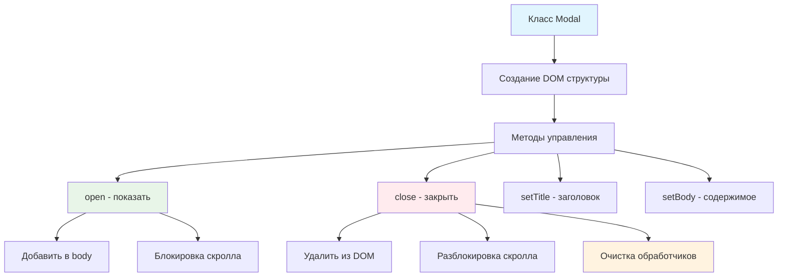

# 🪟 Учебный проект: Модальное окно

> **Создаем универсальное модальное окно!** ✨  
> Эта задача научит вас создавать переиспользуемые UI-компоненты, управлять состоянием интерфейса и правильно работать с
> событиями.

## 🎯 Задача

Создайте класс `Modal`, который генерирует **универсальное модальное окно** с возможностью динамического изменения
заголовка и содержимого, а также множественными способами закрытия.

```js
const modal = new Modal();
modal.setTitle('Заголовок окна');
modal.setBody(contentNode);
modal.open();
// Результат: модальное окно блокирует основной интерфейс
```

## 🔍 Архитектура компонента



## 📋 Структура компонента

### 🏗️ HTML структура модального окна

```html

<div class="modal">
  <!-- Затемняющий фон -->
  <div class="modal__overlay"></div>

  <!-- Контент модального окна -->
  <div class="modal__inner">
    <!-- Заголовок с кнопкой закрытия -->
    <div class="modal__header">
      <button type="button" class="modal__close">
        
      </button>
      <h3 class="modal__title">
        <!-- Заголовок устанавливается через setTitle() -->
      </h3>
    </div>

    <!-- Тело модального окна -->
    <div class="modal__body">
      <!-- Содержимое устанавливается через setBody() -->
    </div>
  </div>
</div>
```

### 📊 Методы класса

| Метод              | Назначение              | Пример использования              |
|--------------------|-------------------------|-----------------------------------|
| `open()`           | Показать модальное окно | `modal.open()`                    |
| `close()`          | Закрыть модальное окно  | `modal.close()`                   |
| `setTitle(string)` | Установить заголовок    | `modal.setTitle('Подтверждение')` |
| `setBody(node)`    | Установить содержимое   | `modal.setBody(formElement)`      |

## ✅ Требования к классу

| Компонент              | Требование                                      |
|------------------------|-------------------------------------------------|
| **Конструктор**        | Создает DOM структуру окна                      |
| **Метод open()**       | Добавляет окно в `body` и класс `is-modal-open` |
| **Метод close()**      | Удаляет окно из DOM и класс `is-modal-open`     |
| **Закрытие по [X]**    | Клик на кнопку с классом `modal__close`         |
| **Закрытие по ESC**    | Обработка `keydown` события                     |
| **Очистка событий**    | Удаление обработчиков при закрытии              |
| **Блокировка скролла** | Класс `is-modal-open` на `body`                 |

## 🛠️ Что нужно реализовать

```js
export default class Modal {
  constructor() {
    // Инициализация компонента
  }

  open() {
    // Показать модальное окно
  }

  close() {
    // Закрыть модальное окно
  }

  setTitle(title) {
    // Установить заголовок
  }

  setBody(node) {
    // Установить содержимое
  }
}
```

⚠️ **Важно:** При закрытии обязательно удалять обработчик `keydown`!

## 💡 Концепции, которые вы изучите

- **Управление DOM**: динамическое добавление/удаление элементов
- **Блокировка интерфейса**: предотвращение скролла основного контента
- **Множественные способы закрытия**: кнопка, клавиатура, программно
- **Очистка ресурсов**: удаление обработчиков событий
- **Инкапсуляция**: скрытие внутренней логики компонента
- **API компонента**: публичные методы для внешнего использования

## 🎓 Для новичков

**Зачем класс `is-modal-open` на `body`?**  
Этот класс блокирует прокрутку основного контента:

```css
body.is-modal-open {
  overflow: hidden;
}
```

**Как определить нажатие ESC?**

```js
document.addEventListener('keydown', (event) => {
  if (event.code === 'Escape') {
    // Нажата клавиша ESC
  }
});
```

**Почему важно удалять обработчики?**  
Неудаленные обработчики продолжают работать и могут вызвать утечки памяти:

```js
// ❌ Плохо: обработчик остается после закрытия
open()
{
  document.addEventListener('keydown', this.handleEsc);
}

// ✅ Хорошо: обработчик удаляется
close()
{
  document.removeEventListener('keydown', this.handleEsc);
}
```

## ⚡ Частые ошибки

❌ **Забыть удалить обработчик ESC**

```js
close()
{
  this.elem.remove();
  // ❌ Обработчик keydown продолжает работать!
}
```

✅ **Правильная очистка**

```js
close()
{
  this.elem.remove();
  document.removeEventListener('keydown', this.onEscPress); // ✅
  document.body.classList.remove('is-modal-open');
}
```

❌ **Добавлять обработчик в конструкторе**

```js
constructor()
{
  // ❌ ESC будет работать даже когда окно закрыто
  document.addEventListener('keydown', this.onEscPress);
}
```

✅ **Добавлять при открытии**

```js
open()
{
  document.body.append(this.elem);
  document.addEventListener('keydown', this.onEscPress); // ✅
}
```

❌ **Не очищать содержимое в setBody**

```js
setBody(node)
{
  const body = this.elem.querySelector('.modal__body');
  body.append(node); // ❌ Добавляет к существующему содержимому
}
```

✅ **Заменять содержимое**

```js
setBody(node)
{
  const body = this.elem.querySelector('.modal__body');
  body.innerHTML = ''; // ✅ Очищаем
  body.append(node);
}
```

## 🔧 Различные подходы к решению

### 🎯 Базовое решение (в задаче)

```js
export default class Modal {
  constructor() {
    this.elem = createElement(this.getTemplate());
    this.addEventListeners();
  }

  getTemplate() {
    return `
      <div class="modal">
        <div class="modal__overlay"></div>
        <div class="modal__inner">
          <div class="modal__header">
            <button type="button" class="modal__close">
              
            </button>
            <h3 class="modal__title"></h3>
          </div>
          <div class="modal__body"></div>
        </div>
      </div>
    `;
  }

  addEventListeners() {
    // Закрытие по кнопке
    this.elem.addEventListener('click', (event) => {
      if (event.target.closest('.modal__close')) {
        this.close();
      }
    });
  }

  open() {
    document.body.classList.add('is-modal-open');
    document.body.append(this.elem);

    // Добавляем обработчик ESC при открытии
    this.escHandler = (event) => {
      if (event.code === 'Escape') {
        this.close();
      }
    };
    document.addEventListener('keydown', this.escHandler);
  }

  close() {
    document.body.classList.remove('is-modal-open');
    this.elem.remove();

    // Удаляем обработчик ESC при закрытии
    document.removeEventListener('keydown', this.escHandler);
  }

  setTitle(title) {
    this.elem.querySelector('.modal__title').textContent = title;
  }

  setBody(node) {
    const modalBody = this.elem.querySelector('.modal__body');
    modalBody.innerHTML = '';
    modalBody.append(node);
  }
}
```

### 🛡️ С дополнительными возможностями

```js
export default class Modal {
  constructor(options = {}) {
    this.options = {
      closeOnOverlay: true,
      closeOnEsc: true,
      ...options
    };

    this.elem = createElement(this.getTemplate());
    this.addEventListeners();
  }

  addEventListeners() {
    // Закрытие по кнопке
    this.elem.addEventListener('click', (event) => {
      if (event.target.closest('.modal__close')) {
        this.close();
      }

      // Закрытие по клику на overlay (опционально)
      if (this.options.closeOnOverlay &&
        event.target.classList.contains('modal__overlay')) {
        this.close();
      }
    });
  }

  open() {
    // Сохраняем позицию скролла
    this.scrollPosition = window.pageYOffset;

    document.body.classList.add('is-modal-open');
    document.body.style.top = `-${this.scrollPosition}px`;
    document.body.append(this.elem);

    // Анимация появления
    requestAnimationFrame(() => {
      this.elem.classList.add('modal_visible');
    });

    if (this.options.closeOnEsc) {
      this.escHandler = (event) => {
        if (event.code === 'Escape') {
          this.close();
        }
      };
      document.addEventListener('keydown', this.escHandler);
    }
  }

  close() {
    this.elem.classList.remove('modal_visible');

    // Ждем окончания анимации
    setTimeout(() => {
      document.body.classList.remove('is-modal-open');
      document.body.style.top = '';
      window.scrollTo(0, this.scrollPosition);

      this.elem.remove();

      if (this.escHandler) {
        document.removeEventListener('keydown', this.escHandler);
      }
    }, 300);
  }
}
```

### ⚡ С поддержкой Promise

```js
export default class Modal {
  // ... базовые методы ...

  confirm(title, message) {
    return new Promise((resolve) => {
      this.setTitle(title);

      const body = createElement(`
        <div class="modal-confirm">
          <p>${message}</p>
          <div class="modal-confirm__buttons">
            <button class="button button_primary" data-action="confirm">
              Подтвердить
            </button>
            <button class="button" data-action="cancel">
              Отмена
            </button>
          </div>
        </div>
      `);

      body.addEventListener('click', (event) => {
        const action = event.target.dataset.action;
        if (action === 'confirm') {
          resolve(true);
          this.close();
        } else if (action === 'cancel') {
          resolve(false);
          this.close();
        }
      });

      this.setBody(body);
      this.open();
    });
  }
}

// Использование:
const modal = new Modal();
const confirmed = await modal.confirm('Удаление', 'Вы уверены?');
if (confirmed) {
  // Пользователь подтвердил
}
```

## 🌟 Расширенные версии

### 🎨 С анимациями

```js
open()
{
  document.body.append(this.elem);
  document.body.classList.add('is-modal-open');

  // Плавное появление
  this.elem.style.opacity = '0';
  this.elem.style.transition = 'opacity 0.3s ease';

  requestAnimationFrame(() => {
    this.elem.style.opacity = '1';
  });
}

close()
{
  this.elem.style.opacity = '0';

  this.elem.addEventListener('transitionend', () => {
    this.elem.remove();
    document.body.classList.remove('is-modal-open');
  }, {once: true});
}
```

### 📱 С фокус-трапом

```js
trapFocus()
{
  const focusableElements = this.elem.querySelectorAll(
    'button, [href], input, select, textarea, [tabindex]:not([tabindex="-1"])'
  );

  const firstElement = focusableElements[0];
  const lastElement = focusableElements[focusableElements.length - 1];

  this.elem.addEventListener('keydown', (e) => {
    if (e.key !== 'Tab') return;

    if (e.shiftKey && document.activeElement === firstElement) {
      lastElement.focus();
      e.preventDefault();
    } else if (!e.shiftKey && document.activeElement === lastElement) {
      firstElement.focus();
      e.preventDefault();
    }
  });

  firstElement.focus();
}
```

### 🔄 Стек модальных окон

```js
class ModalManager {
  static stack = [];

  static open(modal) {
    if (this.stack.length > 0) {
      // Скрываем предыдущее окно
      const prev = this.stack[this.stack.length - 1];
      prev.elem.style.display = 'none';
    }

    this.stack.push(modal);
    modal.open();
  }

  static close(modal) {
    const index = this.stack.indexOf(modal);
    if (index > -1) {
      this.stack.splice(index, 1);
      modal.close();

      // Показываем предыдущее окно
      if (this.stack.length > 0) {
        const prev = this.stack[this.stack.length - 1];
        prev.elem.style.display = '';
      }
    }
  }
}
```

## 🎨 Практическое применение

### 🛒 Форма добавления в корзину

```js
class CartModal extends Modal {
  constructor(product) {
    super();
    this.product = product;
    this.render();
  }

  render() {
    this.setTitle(`Добавить ${this.product.name} в корзину?`);

    const body = createElement(`
      <form class="cart-form">
        <div class="cart-form__product">
          
          <div class="cart-form__price">${this.product.price}€</div>
        </div>
        <input type="number" value="1" min="1" class="cart-form__count">
        <button type="submit" class="button button_primary">
          Добавить в корзину
        </button>
      </form>
    `);

    body.addEventListener('submit', (e) => {
      e.preventDefault();
      const count = body.querySelector('.cart-form__count').value;
      this.addToCart(this.product, count);
      this.close();
    });

    this.setBody(body);
  }
}
```

### 📸 Галерея изображений

```js
class ImageModal extends Modal {
  constructor(images) {
    super();
    this.images = images;
    this.currentIndex = 0;
  }

  showImage(index) {
    this.currentIndex = index;
    const image = this.images[index];

    this.setTitle(image.title);
    this.setBody(createElement(`
      <div class="image-viewer">
        
        <div class="image-viewer__nav">
          <button data-action="prev">←</button>
          <span>${index + 1} / ${this.images.length}</span>
          <button data-action="next">→</button>
        </div>
      </div>
    `));

    this.elem.querySelector('.image-viewer__nav').addEventListener('click', (e) => {
      if (e.target.dataset.action === 'prev') {
        this.showImage(Math.max(0, this.currentIndex - 1));
      } else if (e.target.dataset.action === 'next') {
        this.showImage(Math.min(this.images.length - 1, this.currentIndex + 1));
      }
    });
  }
}
```

## 🧪 Тестирование

```bash
npm test
```

**Проверьте:**

- ✅ Модальное окно открывается и закрывается
- ✅ Класс `is-modal-open` добавляется/удаляется
- ✅ Закрытие работает по кнопке [X]
- ✅ Закрытие работает по ESC
- ✅ Обработчики событий удаляются при закрытии
- ✅ `setTitle` и `setBody` работают корректно

## 🚀 Что дальше?

Эта задача подготовила вас к созданию сложных оверлеев: выпадающие меню, тултипы, галереи, формы обратной связи!

---
📚 **Полезные ссылки:**

- [Learn.javascript.ru: Клавиатура: keydown и keyup](https://learn.javascript.ru/keyboard-events)
- [MDN: Element.remove()](https://developer.mozilla.org/ru/docs/Web/API/Element/remove)
- [MDN: EventTarget.removeEventListener()](https://developer.mozilla.org/ru/docs/Web/API/EventTarget/removeEventListener)
- [WAI-ARIA: Modal Dialog](https://www.w3.org/TR/wai-aria-practices-1.1/examples/dialog-modal/dialog.html)
