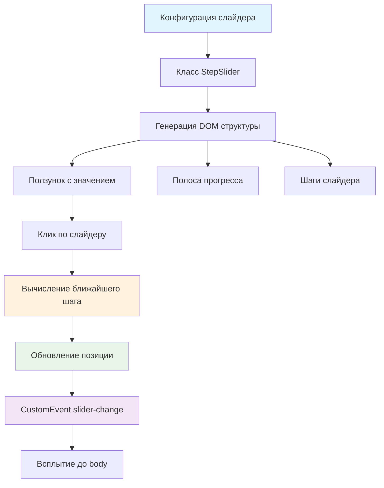

# 🎚️ Учебный проект: Пошаговый слайдер, часть 1

> **Создаем кастомный слайдер для выбора остроты блюд!** 🌶️  
> Эта задача научит вас создавать интерактивные компоненты управления, работать с координатами и вычислять относительные
> позиции элементов.

## 🎯 Задача

Создайте класс `StepSlider`, который генерирует **пошаговый слайдер** с фиксированными значениями и возможностью выбора
значения кликом по шкале.

```js
const config = {
  steps: 5,  // Количество шагов (0-1-2-3-4)
  value: 0   // Начальное значение
};

const stepSlider = new StepSlider(config);
document.body.appendChild(stepSlider.elem);
// Результат: интерактивный слайдер для выбора остроты
```

## 🔍 Архитектура компонента



## 📋 Структура компонента

### 🏗️ HTML структура слайдера

```html
<!-- Корневой элемент слайдера -->
<div class="slider">

  <!-- Ползунок слайдера с текущим значением -->
  <div class="slider__thumb">
    <span class="slider__value">0</span>
  </div>

  <!-- Заполненная область слайдера -->
  <div class="slider__progress"></div>

  <!-- Шаги слайдера (вертикальные разделители) -->
  <div class="slider__steps">
    <span class="slider__step-active"></span> <!-- Активный шаг -->
    <span></span>
    <span></span>
    <span></span>
    <span></span>
  </div>
</div>
```

### 📊 Параметры конфигурации

| Параметр | Тип      | Описание           | Пример                |
|----------|----------|--------------------|-----------------------|
| `steps`  | `number` | Количество шагов   | `5` → шаги: 0,1,2,3,4 |
| `value`  | `number` | Начальное значение | `0`                   |

### 🎯 Понятия и термины

| Термин                    | Описание                        | Пример для 5 шагов     |
|---------------------------|---------------------------------|------------------------|
| **Шаг**                   | Фиксированное значение слайдера | 0, 1, 2, 3, 4          |
| **Сегмент**               | Промежуток между шагами         | 4 сегмента (steps - 1) |
| **Относительная позиция** | Позиция клика от 0 до 1         | 0.5 = середина         |

## ✅ Требования к классу

| Компонент                 | Требование                    |
|---------------------------|-------------------------------|
| **Конструктор**           | Принимает объект конфигурации |
| **Свойство elem**         | DOM элемент слайдера          |
| **Диапазон значений**     | От 0 до (steps - 1)           |
| **Изменение по клику**    | Выбор ближайшего шага         |
| **Визуальное обновление** | Позиция ползунка и прогресс   |
| **Событие slider-change** | При изменении значения        |
| **Всплытие события**      | `bubbles: true`               |

## 🛠️ Что нужно реализовать

```js
export default class StepSlider {
  constructor({steps, value}) {
    // Инициализация компонента
  }

  // Методы класса...
}
```

💡 **Главная задача:** Определить ближайший шаг при клике и обновить визуальное состояние

## 💡 Концепции, которые вы изучите

- **Работа с координатами**: `clientX`, `getBoundingClientRect()`
- **Относительные позиции**: преобразование пикселей в проценты
- **Математические вычисления**: округление до ближайшего шага
- **Динамическая стилизация**: изменение `left` и `width` через JS
- **CustomEvent**: передача значения слайдера
- **Обработка кликов**: определение позиции клика внутри элемента

## 🎓 Для новичков

**Как определить позицию клика внутри элемента?**

```js
// Получаем расстояние от левого края слайдера до точки клика
let left = event.clientX - this.elem.getBoundingClientRect().left;

// Преобразуем в относительное значение (0 до 1)
let leftRelative = left / this.elem.offsetWidth;
```

**Как найти ближайший шаг?**

```js
// Умножаем относительную позицию на количество сегментов
let segments = steps - 1;
let approximateValue = leftRelative * segments;

// Округляем до ближайшего целого
let value = Math.round(approximateValue);
```

**Как перевести шаг в проценты для позиционирования?**

```js
// Делим номер шага на количество сегментов и умножаем на 100
let valuePercents = value / segments * 100;

// Применяем к элементам
thumb.style.left = `${valuePercents}%`;
progress.style.width = `${valuePercents}%`;
```

## ⚡ Частые ошибки

❌ **Забыть про отсчет с нуля**

```js
// ❌ Неправильно: steps = 5, значит значения 1-5
let value = Math.round(leftRelative * steps);
```

✅ **Правильно: учитываем сегменты**

```js
// ✅ steps = 5, сегментов = 4, значения 0-4
let segments = steps - 1;
let value = Math.round(leftRelative * segments);
```

❌ **Позиционирование в пикселях**

```js
thumb.style.left = leftPixels + 'px'; // ❌ Не адаптивно!
```

✅ **Позиционирование в процентах**

```js
thumb.style.left = `${leftPercents}%`; // ✅ Адаптивно
```

❌ **Неправильный активный шаг**

```js
// ❌ Забыли убрать класс с предыдущего шага
newStep.classList.add('slider__step-active');
```

✅ **Корректное переключение**

```js
// ✅ Сначала убираем, потом добавляем
oldStep.classList.remove('slider__step-active');
newStep.classList.add('slider__step-active');
```

## 🔧 Различные подходы к решению

### 🎯 Базовое решение (в задаче)

```js
export default class StepSlider {
  constructor({steps, value}) {
    this.steps = steps;
    this.value = value;
    this.elem = this.render();
    this.addEventListeners();
    this.updateView();
  }

  render() {
    const elem = createElement(`
      <div class="slider">
        <div class="slider__thumb">
          <span class="slider__value">${this.value}</span>
        </div>
        <div class="slider__progress"></div>
        <div class="slider__steps">
          ${Array(this.steps).fill().map((_, i) =>
      `<span data-step="${i}"></span>`
    ).join('')}
        </div>
      </div>
    `);

    return elem;
  }

  addEventListeners() {
    this.elem.addEventListener('click', (event) => {
      this.onClick(event);
    });
  }

  onClick(event) {
    // Вычисляем позицию клика
    const left = event.clientX - this.elem.getBoundingClientRect().left;
    const leftRelative = left / this.elem.offsetWidth;

    // Определяем ближайший шаг
    const segments = this.steps - 1;
    const approximateValue = leftRelative * segments;
    this.value = Math.round(approximateValue);

    // Обновляем визуальное состояние
    this.updateView();

    // Генерируем событие
    this.elem.dispatchEvent(new CustomEvent('slider-change', {
      detail: this.value,
      bubbles: true
    }));
  }

  updateView() {
    const segments = this.steps - 1;
    const leftPercents = segments > 0 ? (this.value / segments * 100) : 0;

    // Обновляем значение
    this.elem.querySelector('.slider__value').textContent = this.value;

    // Двигаем ползунок
    const thumb = this.elem.querySelector('.slider__thumb');
    thumb.style.left = `${leftPercents}%`;

    // Обновляем прогресс
    const progress = this.elem.querySelector('.slider__progress');
    progress.style.width = `${leftPercents}%`;

    // Обновляем активный шаг
    this.elem.querySelectorAll('.slider__steps span').forEach((step, index) => {
      step.classList.toggle('slider__step-active', index === this.value);
    });
  }
}
```

### 🛡️ С валидацией и защитой

```js
export default class StepSlider {
  constructor({steps = 2, value = 0}) {
    // Валидация параметров
    if (steps < 2) {
      throw new Error('Слайдер должен иметь минимум 2 шага');
    }

    this.steps = steps;
    this.value = Math.max(0, Math.min(value, steps - 1));

    this.elem = this.render();
    this.addEventListeners();
    this.updateView();
  }

  onClick(event) {
    // Проверяем, что клик внутри слайдера
    const rect = this.elem.getBoundingClientRect();
    const left = event.clientX - rect.left;

    if (left < 0 || left > rect.width) {
      return; // Клик за пределами слайдера
    }

    const leftRelative = Math.max(0, Math.min(1, left / rect.width));
    const segments = this.steps - 1;

    // Безопасное вычисление значения
    if (segments === 0) {
      this.value = 0;
    } else {
      this.value = Math.round(leftRelative * segments);
    }

    this.updateView();
    this.dispatchChangeEvent();
  }

  dispatchChangeEvent() {
    const event = new CustomEvent('slider-change', {
      detail: this.value,
      bubbles: true,
      cancelable: true
    });

    this.elem.dispatchEvent(event);
  }
}
```

### ⚡ С плавной анимацией

```js
updateView()
{
  const segments = this.steps - 1;
  const leftPercents = segments > 0 ? (this.value / segments * 100) : 0;

  // Добавляем CSS transition для плавности
  const thumb = this.elem.querySelector('.slider__thumb');
  const progress = this.elem.querySelector('.slider__progress');

  thumb.style.transition = 'left 0.3s ease';
  progress.style.transition = 'width 0.3s ease';

  requestAnimationFrame(() => {
    thumb.style.left = `${leftPercents}%`;
    progress.style.width = `${leftPercents}%`;
  });

  // Обновляем остальное
  this.elem.querySelector('.slider__value').textContent = this.value;
  this.updateActiveStep();
}
```

## 🌟 Расширенные версии

### 🎨 С подсказками при наведении

```js
addTooltip()
{
  const tooltip = createElement('<div class="slider__tooltip"></div>');
  this.elem.appendChild(tooltip);

  this.elem.addEventListener('mousemove', (event) => {
    const left = event.clientX - this.elem.getBoundingClientRect().left;
    const leftRelative = left / this.elem.offsetWidth;
    const segments = this.steps - 1;
    const value = Math.round(leftRelative * segments);

    tooltip.textContent = value;
    tooltip.style.left = `${left}px`;
    tooltip.style.opacity = '1';
  });

  this.elem.addEventListener('mouseleave', () => {
    tooltip.style.opacity = '0';
  });
}
```

### 📊 С метками значений

```js
renderWithLabels()
{
  const labels = createElement(`
    <div class="slider__labels">
      ${Array(this.steps).fill().map((_, i) => `
        <span style="left: ${i / (this.steps - 1) * 100}%">${i}</span>
      `).join('')}
    </div>
  `);

  this.elem.appendChild(labels);
}
```

### 🔄 С клавиатурным управлением

```js
addKeyboardSupport()
{
  this.elem.tabIndex = 0; // Делаем элемент фокусируемым

  this.elem.addEventListener('keydown', (event) => {
    let newValue = this.value;

    switch (event.key) {
    case 'ArrowLeft':
    case 'ArrowDown':
      newValue = Math.max(0, this.value - 1);
      break;
    case 'ArrowRight':
    case 'ArrowUp':
      newValue = Math.min(this.steps - 1, this.value + 1);
      break;
    case 'Home':
      newValue = 0;
      break;
    case 'End':
      newValue = this.steps - 1;
      break;
    default:
      return;
    }

    if (newValue !== this.value) {
      event.preventDefault();
      this.value = newValue;
      this.updateView();
      this.dispatchChangeEvent();
    }
  });
}
```

## 🎨 Практическое применение

### 🌶️ Фильтр остроты блюд

```js
const spicySlider = new StepSlider({
  steps: 5,
  value: 2
});

document.body.addEventListener('slider-change', (event) => {
  const spicyLevel = event.detail;
  const spicyNames = ['Не острое', 'Слабоострое', 'Умеренно острое', 'Острое', 'Очень острое'];

  filterDishes(spicyLevel);
  showMessage(`Выбрано: ${spicyNames[spicyLevel]}`);
});
```

### ⭐ Рейтинг товара

```js
class RatingSlider extends StepSlider {
  constructor() {
    super({steps: 5, value: 0});
    this.addStars();
  }

  addStars() {
    const stepsContainer = this.elem.querySelector('.slider__steps');
    stepsContainer.innerHTML = Array(this.steps).fill()
      .map(() => '<span class="star">⭐</span>')
      .join('');
  }

  updateView() {
    super.updateView();

    // Подсвечиваем звезды до выбранного значения
    this.elem.querySelectorAll('.star').forEach((star, index) => {
      star.classList.toggle('star_filled', index <= this.value);
    });
  }
}
```

## 🧪 Тестирование

```bash
npm test
```

**Проверьте:**

- ✅ Слайдер создается с правильным количеством шагов
- ✅ Клик по слайдеру выбирает ближайший шаг
- ✅ Ползунок перемещается в правильную позицию
- ✅ Прогресс-бар обновляется корректно
- ✅ Активный шаг выделяется классом
- ✅ Событие `slider-change` генерируется с правильным значением

## 🚀 Что дальше?

В следующей части мы добавим возможность перетаскивания ползунка! Эта задача подготовила вас к созданию сложных
интерактивных контролов: ползунки громкости, выбор диапазона, временные шкалы!

---
📚 **Полезные ссылки:**

- [Learn.javascript.ru: Координаты](https://learn.javascript.ru/coordinates)
- [Learn.javascript.ru: Генерация пользовательских событий](https://learn.javascript.ru/dispatch-events)
- [MDN: Element.getBoundingClientRect()](https://developer.mozilla.org/ru/docs/Web/API/Element/getBoundingClientRect)
- [MDN: Math.round()](https://developer.mozilla.org/ru/docs/Web/JavaScript/Reference/Global_Objects/Math/round)
