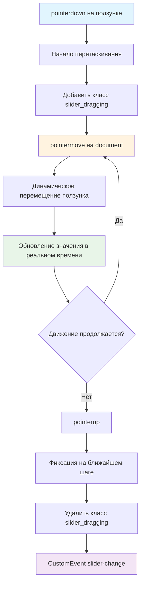

# 🎚️ Учебный проект: Пошаговый слайдер с перетаскиванием

> **Добавляем Drag-and-Drop в слайдер!** 🚀  
> Эта задача научит вас работать с Pointer Events, реализовывать перетаскивание элементов и создавать плавные
> интерактивные компоненты.

## 🎯 Задача

Модифицируйте класс `StepSlider` из предыдущей задачи, добавив возможность **перетаскивания ползунка** с динамическим
изменением значения во время движения.

```js
const stepSlider = new StepSlider({
  steps: 5,
  value: 2
});

// Теперь можно:
// 1. Кликать по слайдеру (из части 1)
// 2. Перетаскивать ползунок (новое!)
```

## 🔍 Механика Drag-and-Drop



## 📋 Принцип работы Drag-and-Drop

### 🎬 Последовательность действий

| Этап               | Действие пользователя | Реакция компонента             |
|--------------------|-----------------------|--------------------------------|
| **1. Захват**      | Нажимает на ползунок  | Начинает отслеживание движения |
| **2. Перемещение** | Двигает курсор        | Ползунок следует за курсором   |
| **3. Обновление**  | Продолжает движение   | Значение меняется динамически  |
| **4. Отпускание**  | Отпускает кнопку      | Фиксация на ближайшем шаге     |

### 🔄 События Pointer vs Mouse

| Mouse Event | Pointer Event | Описание              |
|-------------|---------------|-----------------------|
| `mousedown` | `pointerdown` | Начало взаимодействия |
| `mousemove` | `pointermove` | Движение указателя    |
| `mouseup`   | `pointerup`   | Конец взаимодействия  |

**Преимущества Pointer Events:** работают с мышью, тачпадом и сенсорными экранами! 📱

## ✅ Требования к реализации

| Компонент                      | Требование                                   |
|--------------------------------|----------------------------------------------|
| **Элемент перетаскивания**     | Класс `slider__thumb`                        |
| **Индикатор перетаскивания**   | Класс `slider_dragging` на корневом элементе |
| **Область отслеживания**       | `document` для pointermove                   |
| **Отключение браузерного D&D** | `thumb.ondragstart = () => false`            |
| **Динамическое обновление**    | Значение меняется во время движения          |
| **Фиксация значения**          | На ближайшем шаге при отпускании             |
| **Событие slider-change**      | Только при завершении перетаскивания         |

## 🛠️ Что нужно реализовать

```js
export default class StepSlider {
  constructor({steps, value}) {
    // Базовая инициализация из части 1
    // + добавить обработчики для drag-and-drop
  }

  // Новые методы для перетаскивания
  onPointerDown(event) {
  }

  onPointerMove(event) {
  }

  onPointerUp(event) {
  }
}
```

⚠️ **Важно:** Обработчики `pointermove` и `pointerup` вешаются на `document`, а не на слайдер!

## 💡 Концепции, которые вы изучите

- **Pointer Events API**: универсальная обработка указателей
- **Drag-and-Drop паттерн**: захват, перемещение, отпускание
- **Глобальные обработчики**: события на document
- **Динамическое обновление**: изменение UI в реальном времени
- **Предотвращение конфликтов**: отключение браузерного D&D
- **Ограничение области**: удержание значений в границах

## 🎓 Для новичков

**Почему события на document?**  
Пользователь может увести курсор за пределы слайдера, но перетаскивание должно продолжаться:

```js
// ❌ Плохо: потеряем событие, если курсор уйдет
slider.addEventListener('pointermove', handler);

// ✅ Хорошо: отслеживаем везде
document.addEventListener('pointermove', handler);
```

**Отключение браузерного Drag-and-Drop:**

```js
thumb.ondragstart = () => false; // Блокируем стандартное поведение
```

**Вычисление позиции с ограничениями:**

```js
let left = event.clientX - this.elem.getBoundingClientRect().left;
let leftRelative = left / this.elem.offsetWidth;

// Ограничиваем значение от 0 до 1
leftRelative = Math.max(0, Math.min(1, leftRelative));

let leftPercents = leftRelative * 100;
```

## ⚡ Частые ошибки

❌ **Забыть удалить обработчики**

```js
onPointerUp()
{
  this.elem.classList.remove('slider_dragging');
  // ❌ pointermove продолжает работать!
}
```

✅ **Правильная очистка**

```js
onPointerUp()
{
  this.elem.classList.remove('slider_dragging');
  document.removeEventListener('pointermove', this.onPointerMove); // ✅
}
```

❌ **Вешать события на слайдер**

```js
// ❌ Потеряем перетаскивание при выходе за границы
this.elem.addEventListener('pointermove', this.onPointerMove);
```

✅ **Вешать на document**

```js
// ✅ Работает везде
document.addEventListener('pointermove', this.onPointerMove);
```

❌ **Не ограничивать значения**

```js
let leftRelative = left / this.elem.offsetWidth; // ❌ Может быть < 0 или > 1
let leftPercents = leftRelative * 100; // ❌ Может быть отрицательным!
```

✅ **С ограничениями**

```js
let leftRelative = Math.max(0, Math.min(1, left / this.elem.offsetWidth)); // ✅
let leftPercents = leftRelative * 100; // ✅ Всегда от 0 до 100
```

## 🔧 Различные подходы к решению

### 🎯 Базовое решение (в задаче)

```js
export default class StepSlider {
  constructor({steps, value}) {
    this.steps = steps;
    this.value = value;
    this.elem = this.render();

    // Отключаем браузерный drag-and-drop
    const thumb = this.elem.querySelector('.slider__thumb');
    thumb.ondragstart = () => false;

    this.addEventListeners();
  }

  addEventListeners() {
    // Клик по слайдеру (из части 1)
    this.elem.addEventListener('click', this.onClick);

    // Начало перетаскивания
    this.elem.addEventListener('pointerdown', this.onPointerDown);
  }

  onPointerDown = (event) => {
    // Проверяем, что нажали на ползунок
    if (!event.target.closest('.slider__thumb')) {
      return;
    }

    event.preventDefault(); // Для сенсорных экранов

    // Добавляем класс для стилизации
    this.elem.classList.add('slider_dragging');

    // Вешаем обработчики на document
    document.addEventListener('pointermove', this.onPointerMove);
    document.addEventListener('pointerup', this.onPointerUp);
  };

  onPointerMove = (event) => {
    event.preventDefault(); // Для сенсорных экранов

    // Вычисляем позицию
    const left = event.clientX - this.elem.getBoundingClientRect().left;
    let leftRelative = left / this.elem.offsetWidth;

    // Ограничиваем от 0 до 1
    leftRelative = Math.max(0, Math.min(1, leftRelative));

    // Позиция в процентах для CSS
    const leftPercents = leftRelative * 100;

    // Вычисляем значение
    const segments = this.steps - 1;
    const value = Math.round(leftRelative * segments);

    // Обновляем только если значение изменилось
    if (value !== this.value) {
      this.value = value;
      this.updateValueDisplay();
      this.updateActiveStep();
    }

    // Всегда обновляем позицию ползунка (плавное движение)
    this.updateThumbPosition(leftPercents);
  };

  onPointerUp = (event) => {
    // Убираем класс
    this.elem.classList.remove('slider_dragging');

    // Удаляем обработчики с document
    document.removeEventListener('pointermove', this.onPointerMove);
    document.removeEventListener('pointerup', this.onPointerUp);

    // Фиксируем на ближайшем шаге
    this.snapToStep();

    // Генерируем событие
    this.elem.dispatchEvent(new CustomEvent('slider-change', {
      detail: this.value,
      bubbles: true
    }));
  };

  snapToStep() {
    // Фиксируем ползунок точно на шаге
    const segments = this.steps - 1;
    const stepPercents = segments > 0 ? (this.value / segments * 100) : 0;
    this.updateThumbPosition(stepPercents);
  }

  updateThumbPosition(percents) {
    const thumb = this.elem.querySelector('.slider__thumb');
    const progress = this.elem.querySelector('.slider__progress');

    thumb.style.left = `${percents}%`;
    progress.style.width = `${percents}%`;
  }

  updateValueDisplay() {
    this.elem.querySelector('.slider__value').textContent = this.value;
  }

  updateActiveStep() {
    const steps = this.elem.querySelectorAll('.slider__steps span');
    steps.forEach((step, index) => {
      step.classList.toggle('slider__step-active', index === this.value);
    });
  }
}
```

### 🛡️ С улучшенной производительностью

```js
class StepSlider {
  constructor({steps, value}) {
    // ... инициализация ...

    // Кешируем элементы
    this.elements = {
      thumb: this.elem.querySelector('.slider__thumb'),
      progress: this.elem.querySelector('.slider__progress'),
      value: this.elem.querySelector('.slider__value'),
      steps: this.elem.querySelectorAll('.slider__steps span')
    };

    // Используем RAF для оптимизации
    this.rafId = null;
  }

  onPointerMove = (event) => {
    event.preventDefault();

    // Отменяем предыдущий RAF
    if (this.rafId) {
      cancelAnimationFrame(this.rafId);
    }

    // Используем RAF для плавности
    this.rafId = requestAnimationFrame(() => {
      this.updateDragPosition(event);
    });
  };

  updateDragPosition(event) {
    const rect = this.elem.getBoundingClientRect();
    const left = event.clientX - rect.left;
    const leftRelative = Math.max(0, Math.min(1, left / rect.width));
    const leftPercents = leftRelative * 100;

    // Используем CSS-переменную для производительности
    this.elem.style.setProperty('--slider-progress', `${leftPercents}%`);

    // Обновляем значение
    const segments = this.steps - 1;
    const newValue = Math.round(leftRelative * segments);

    if (newValue !== this.value) {
      this.value = newValue;
      this.elements.value.textContent = this.value;
      this.updateActiveStep();
    }
  }
}
```

### ⚡ С поддержкой touch и предотвращением случайных движений

```js
class StepSlider {
  onPointerDown = (event) => {
    if (!event.target.closest('.slider__thumb')) {
      return;
    }

    // Сохраняем начальную позицию
    this.dragStartX = event.clientX;
    this.dragStartValue = this.value;
    this.isDragging = false;

    // Порог для начала перетаскивания (5px)
    this.dragThreshold = 5;

    document.addEventListener('pointermove', this.onPointerMove);
    document.addEventListener('pointerup', this.onPointerUp);

    // Предотвращаем выделение текста
    event.preventDefault();

    // Захватываем указатель (для touch)
    this.elem.setPointerCapture(event.pointerId);
  };

  onPointerMove = (event) => {
    // Проверяем порог для начала перетаскивания
    if (!this.isDragging) {
      const distance = Math.abs(event.clientX - this.dragStartX);
      if (distance < this.dragThreshold) {
        return;
      }
      this.isDragging = true;
      this.elem.classList.add('slider_dragging');
    }

    // Остальная логика перемещения...
    this.updateDragPosition(event);
  };

  onPointerUp = (event) => {
    if (this.isDragging) {
      this.elem.classList.remove('slider_dragging');
      this.snapToStep();
      this.dispatchChangeEvent();
    }

    // Освобождаем указатель
    this.elem.releasePointerCapture(event.pointerId);

    // Очищаем обработчики
    document.removeEventListener('pointermove', this.onPointerMove);
    document.removeEventListener('pointerup', this.onPointerUp);

    this.isDragging = false;
  };
}
```

## 🌟 Расширенные версии

### 🎨 С визуальной обратной связью

```js
onPointerMove = (event) => {
  // ... вычисления позиции ...

  // Показываем подсказку с текущим значением
  if (!this.tooltip) {
    this.tooltip = createElement('<div class="slider__tooltip"></div>');
    this.elem.appendChild(this.tooltip);
  }

  const rect = this.elem.getBoundingClientRect();
  const x = event.clientX - rect.left;

  this.tooltip.textContent = this.value;
  this.tooltip.style.left = `${x}px`;
  this.tooltip.classList.add('visible');
};

onPointerUp = () => {
  // Скрываем подсказку
  if (this.tooltip) {
    this.tooltip.classList.remove('visible');
  }
  // ... остальная логика
};
```

### 📱 С haptic feedback для мобильных

```js
snapToStep()
{
  const segments = this.steps - 1;
  const stepPercents = segments > 0 ? (this.value / segments * 100) : 0;
  this.updateThumbPosition(stepPercents);

  // Вибрация при фиксации на шаге (для мобильных)
  if ('vibrate' in navigator) {
    navigator.vibrate(10);
  }
}
```

### 🔄 С поддержкой двойного клика

```js
addEventListeners()
{
  // ... существующие обработчики ...

  // Двойной клик для сброса на начальное значение
  this.elem.addEventListener('dblclick', (event) => {
    if (event.target.closest('.slider__thumb')) {
      this.setValue(Math.floor(this.steps / 2));
      this.dispatchChangeEvent();
    }
  });
}
```

## 🎨 Практическое применение

### 🎵 Регулятор громкости

```js
class VolumeSlider extends StepSlider {
  constructor() {
    super({steps: 11, value: 5}); // 0-10
    this.addVolumeIcon();
  }

  addVolumeIcon() {
    const icon = createElement('<span class="volume-icon">🔊</span>');
    this.elem.appendChild(icon);
  }

  updateValueDisplay() {
    super.updateValueDisplay();

    // Меняем иконку в зависимости от уровня
    const icon = this.elem.querySelector('.volume-icon');
    if (this.value === 0) {
      icon.textContent = '🔇';
    } else if (this.value < 5) {
      icon.textContent = '🔉';
    } else {
      icon.textContent = '🔊';
    }
  }
}
```

### 📸 Слайдер яркости изображения

```js
const brightnessSlider = new StepSlider({
  steps: 21, // -10 до +10
  value: 10  // Нормальная яркость (0)
});

document.body.addEventListener('slider-change', (event) => {
  const brightness = (event.detail - 10) / 10; // От -1 до 1
  const image = document.querySelector('.product-image');
  image.style.filter = `brightness(${1 + brightness})`;
});
```

## 🧪 Тестирование

```bash
npm test
```

**Проверьте:**

- ✅ Перетаскивание работает плавно
- ✅ Класс `slider_dragging` добавляется/удаляется
- ✅ Значение обновляется динамически
- ✅ Фиксация на ближайшем шаге при отпускании
- ✅ Событие генерируется только при завершении
- ✅ Работает при уходе курсора за пределы слайдера
- ✅ Корректно работает на touch-устройствах

## 🚀 Что дальше?

Вы освоили продвинутые техники создания интерактивных компонентов! Теперь можете создавать: цветовые палитры, временные
шкалы, регуляторы с множественными ползунками, джойстики управления!

---
📚 **Полезные ссылки:**

- [Learn.javascript.ru: Drag'n'Drop с событиями мыши](https://learn.javascript.ru/mouse-drag-and-drop)
- [MDN: Pointer Events](https://developer.mozilla.org/ru/docs/Web/API/Pointer_events)
- [MDN: Element.setPointerCapture()](https://developer.mozilla.org/ru/docs/Web/API/Element/setPointerCapture)
- [MDN: requestAnimationFrame](https://developer.mozilla.org/ru/docs/Web/API/Window/requestAnimationFrame)
