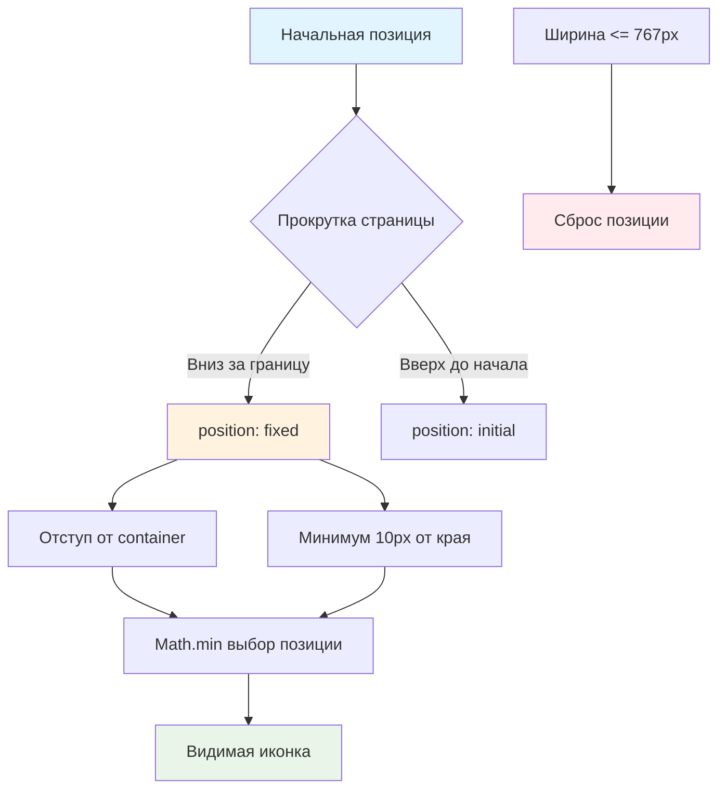

# 🛒 Учебный проект: Иконка корзины

> **Создаем умную иконку корзины, которая всегда на виду!** 📌  
> Эта задача научит вас работать с позиционированием элементов, отслеживать прокрутку страницы и создавать "липкие"
> интерфейсные элементы.

## 🎯 Задача

Создайте класс `CartIcon`, который отображает **иконку корзины** с количеством товаров и общей стоимостью, и
автоматически фиксируется при прокрутке страницы, чтобы всегда оставаться видимой.

```js
const cartIcon = new CartIcon();
document.body.append(cartIcon.elem);

// При прокрутке страницы иконка "прилипает" к верху экрана
// На мобильных устройствах остается в исходной позиции
```

## 🔍 Механика позиционирования



## 📋 Структура компонента

### 🏗️ HTML структура иконки

```html

<div class="cart-icon cart-icon_visible">
  <div class="cart-icon__inner">
    <span class="cart-icon__count">0</span>
    <span class="cart-icon__price">€0.00</span>
  </div>
</div>
```

### 📊 Параметры позиционирования

| Параметр                | Значение  | Описание                        |
|-------------------------|-----------|---------------------------------|
| **Отступ сверху**       | `50px`    | При фиксированной позиции       |
| **Отступ от container** | `20px`    | Справа от элемента `.container` |
| **Минимум от края**     | `10px`    | От правого края окна            |
| **Мобильная ширина**    | `≤ 767px` | Без фиксации                    |
| **z-index**             | `1000+`   | Поверх других элементов         |

## ✅ Требования к реализации

| Компонент                  | Требование                          |
|----------------------------|-------------------------------------|
| **Метод updatePosition()** | Обновляет позицию при scroll/resize |
| **Начало фиксации**        | Когда верх иконки выходит за экран  |
| **Горизонтальная позиция** | Math.min от container и края окна   |
| **Мобильные устройства**   | Сброс позиционирования              |
| **События**                | scroll и resize на window/document  |
| **Проверка видимости**     | offsetHeight/offsetWidth > 0        |

## 🛠️ Что нужно реализовать

```js
export default class CartIcon {
  constructor() {
    this.render();
    this.addEventListeners();
  }

  updatePosition() {
    // Ваша реализация позиционирования
  }

  // Остальные методы...
}
```

⚠️ **Важно:** Сохраните начальную позицию иконки для сравнения!

## 💡 Концепции, которые вы изучите

- **position: fixed vs absolute**: переключение между режимами позиционирования
- **getBoundingClientRect()**: получение координат элементов
- **window.pageYOffset**: отслеживание прокрутки страницы
- **Адаптивность**: разное поведение для мобильных устройств
- **Math.min()**: выбор оптимальной позиции
- **Object.assign()**: массовое изменение стилей

## 🎓 Для новичков

**Что такое "липкое" позиционирование?**  
Элемент остается на месте, пока не достигнет края viewport, затем "прилипает":

```js
// Обычная позиция
element.style.position = 'absolute';

// "Прилипшая" позиция
element.style.position = 'fixed';
element.style.top = '50px';
```

**Как определить, что элемент вышел за верхний край?**

```js
// Начальная позиция элемента
const initialTop = elem.getBoundingClientRect().top + window.pageYOffset;

// Текущая прокрутка
if (window.pageYOffset > initialTop) {
  // Элемент вышел за верхний край
}
```

**Зачем Math.min для позиции?**

```js
// Два варианта отступа слева
const fromContainer = container.right + 20;
const fromEdge = window.innerWidth - icon.width - 10;

// Выбираем меньший (чтобы не выйти за края)
const left = Math.min(fromContainer, fromEdge);
```

## ⚡ Частые ошибки

❌ **Забыть проверить видимость элемента**

```js
updatePosition()
{
  // ❌ Может вызвать ошибку если элемент скрыт
  const rect = this.elem.getBoundingClientRect();
}
```

✅ **Проверка перед позиционированием**

```js
updatePosition()
{
  // ✅ Проверяем, что элемент видим
  if (!this.elem.offsetHeight && !this.elem.offsetWidth) {
    return;
  }
  // Далее позиционирование...
}
```

❌ **Вычислять начальную позицию каждый раз**

```js
updatePosition()
{
  // ❌ Лишние вычисления при каждом скролле
  const initialTop = this.elem.getBoundingClientRect().top + window.pageYOffset;
}
```

✅ **Сохранить начальную позицию**

```js
updatePosition()
{
  // ✅ Вычисляем один раз
  if (!this.initialTopCoord) {
    this.initialTopCoord = this.elem.getBoundingClientRect().top + window.pageYOffset;
  }
}
```

❌ **Не сбрасывать стили для мобильных**

```js
if (window.pageYOffset > this.initialTopCoord) {
  // Фиксируем позицию
  // ❌ Забыли проверить ширину экрана
}
```

✅ **Учитывать мобильные устройства**

```js
if (document.documentElement.clientWidth <= 767) {
  // ✅ Сбрасываем стили для мобильных
  this.resetPosition();
  return;
}

if (window.pageYOffset > this.initialTopCoord) {
  // Фиксируем позицию для десктопа
}
```

## 🔧 Различные подходы к решению

### 🎯 Базовое решение (в задаче)

```js
export default class CartIcon {
  constructor() {
    this.render();
    this.addEventListeners();
  }

  render() {
    this.elem = createElement(`
      <div class="cart-icon cart-icon_visible">
        <div class="cart-icon__inner">
          <span class="cart-icon__count">0</span>
          <span class="cart-icon__price">€0.00</span>
        </div>
      </div>
    `);
  }

  addEventListeners() {
    document.addEventListener('scroll', () => this.updatePosition());
    window.addEventListener('resize', () => this.updatePosition());
  }

  updatePosition() {
    // Проверяем видимость элемента
    if (!this.elem.offsetHeight && !this.elem.offsetWidth) {
      return;
    }

    // Проверяем мобильную версию
    if (document.documentElement.clientWidth <= 767) {
      this.resetPosition();
      return;
    }

    // Сохраняем начальную позицию
    if (!this.initialTopCoord) {
      this.initialTopCoord = this.elem.getBoundingClientRect().top + window.pageYOffset;
    }

    // Определяем необходимость фиксации
    if (window.pageYOffset > this.initialTopCoord) {
      // Вычисляем горизонтальную позицию
      const container = document.querySelector('.container');

      if (!container) return;

      const leftIndent = Math.min(
        container.getBoundingClientRect().right + 20,
        document.documentElement.clientWidth - this.elem.offsetWidth - 10
      );

      // Фиксируем позицию
      Object.assign(this.elem.style, {
        position: 'fixed',
        top: '50px',
        left: leftIndent + 'px',
        zIndex: 1000
      });
    } else {
      // Возвращаем в исходное состояние
      this.resetPosition();
    }
  }

  resetPosition() {
    Object.assign(this.elem.style, {
      position: '',
      top: '',
      left: '',
      zIndex: ''
    });
  }

  update(cart) {
    const count = this.elem.querySelector('.cart-icon__count');
    const price = this.elem.querySelector('.cart-icon__price');

    count.textContent = cart.getTotalCount();
    price.textContent = `€${cart.getTotalPrice().toFixed(2)}`;

    // Показываем/скрываем иконку
    this.elem.classList.toggle('cart-icon_visible', !cart.isEmpty());
  }
}
```

### 🛡️ С оптимизацией производительности

```js
export default class CartIcon {
  constructor() {
    this.render();
    this.addEventListeners();
    this.isFixed = false;
  }

  addEventListeners() {
    // Throttle для оптимизации
    this.throttledUpdate = this.throttle(this.updatePosition.bind(this), 100);

    document.addEventListener('scroll', this.throttledUpdate);
    window.addEventListener('resize', this.throttledUpdate);
  }

  throttle(func, delay) {
    let isThrottled = false;

    return function () {
      if (isThrottled) return;

      func.apply(this, arguments);
      isThrottled = true;

      setTimeout(() => isThrottled = false, delay);
    };
  }

  updatePosition() {
    // Кешируем частые обращения к DOM
    const isMobile = this.checkMobile();

    if (isMobile) {
      if (this.isFixed) {
        this.resetPosition();
        this.isFixed = false;
      }
      return;
    }

    const shouldFix = window.pageYOffset > this.getInitialTop();

    if (shouldFix && !this.isFixed) {
      this.fixPosition();
      this.isFixed = true;
    } else if (!shouldFix && this.isFixed) {
      this.resetPosition();
      this.isFixed = false;
    }
  }

  getInitialTop() {
    if (!this.initialTop) {
      this.initialTop = this.elem.offsetTop;
    }
    return this.initialTop;
  }

  checkMobile() {
    return document.documentElement.clientWidth <= 767;
  }

  fixPosition() {
    const container = document.querySelector('.container');
    if (!container) return;

    const containerRight = container.getBoundingClientRect().right;
    const windowWidth = document.documentElement.clientWidth;
    const iconWidth = this.elem.offsetWidth;

    const leftIndent = Math.min(
      containerRight + 20,
      windowWidth - iconWidth - 10
    );

    this.elem.style.cssText = `
      position: fixed;
      top: 50px;
      left: ${leftIndent}px;
      z-index: 1000;
    `;
  }
}
```

### ⚡ С использованием IntersectionObserver

```js
export default class CartIcon {
  constructor() {
    this.render();
    this.setupObserver();
  }

  setupObserver() {
    // Создаем элемент-маркер
    this.marker = createElement('<div class="cart-icon-marker"></div>');
    this.elem.insertAdjacentElement('beforebegin', this.marker);

    // Настраиваем наблюдатель
    const options = {
      rootMargin: '-50px 0px 0px 0px',
      threshold: 0
    };

    this.observer = new IntersectionObserver(entries => {
      entries.forEach(entry => {
        if (document.documentElement.clientWidth <= 767) {
          this.resetPosition();
          return;
        }

        if (entry.isIntersecting) {
          this.resetPosition();
        } else {
          this.fixPosition();
        }
      });
    }, options);

    this.observer.observe(this.marker);
  }

  destroy() {
    if (this.observer) {
      this.observer.disconnect();
    }
    if (this.marker) {
      this.marker.remove();
    }
  }
}
```

## 🌟 Расширенные версии

### 🎨 С анимацией появления

```js
fixPosition()
{
  // Добавляем плавное появление
  this.elem.style.transition = 'none';
  this.elem.style.opacity = '0';

  // Устанавливаем позицию
  Object.assign(this.elem.style, {
    position: 'fixed',
    top: '50px',
    left: this.calculateLeft() + 'px',
    zIndex: 1000
  });

  // Плавное появление
  requestAnimationFrame(() => {
    this.elem.style.transition = 'opacity 0.3s ease';
    this.elem.style.opacity = '1';
  });
}
```

### 📱 С поддержкой sticky (современный подход)

```js
export default class CartIcon {
  constructor() {
    this.render();
    this.setupSticky();
  }

  setupSticky() {
    // Проверяем поддержку position: sticky
    if (CSS.supports('position', 'sticky')) {
      this.elem.style.cssText = `
        position: sticky;
        top: 50px;
        z-index: 1000;
        float: right;
        margin-left: auto;
      `;

      // Для мобильных отключаем sticky
      this.addMediaQuery();
    } else {
      // Fallback на scroll-based решение
      this.addEventListeners();
    }
  }

  addMediaQuery() {
    const mediaQuery = window.matchMedia('(max-width: 767px)');

    const handleChange = (e) => {
      if (e.matches) {
        this.elem.style.position = 'absolute';
      } else {
        this.elem.style.position = 'sticky';
      }
    };

    mediaQuery.addListener(handleChange);
    handleChange(mediaQuery);
  }
}
```

### 🔄 С эффектом "магнита"

```js
updatePosition()
{
  const scrollY = window.pageYOffset;
  const threshold = this.initialTopCoord;
  const transitionZone = 50; // px

  if (scrollY > threshold - transitionZone && scrollY < threshold + transitionZone) {
    // В зоне перехода - плавное движение
    const progress = (scrollY - (threshold - transitionZone)) / (transitionZone * 2);
    const topPosition = 100 - (progress * 50); // От 100px до 50px

    Object.assign(this.elem.style, {
      position: 'fixed',
      top: `${topPosition}px`,
      transition: 'top 0.1s ease-out'
    });
  } else if (scrollY >= threshold + transitionZone) {
    // Полностью зафиксирована
    this.fixPosition();
  } else {
    // В исходной позиции
    this.resetPosition();
  }
}
```

## 🎨 Практическое применение

### 🛍️ Мини-корзина в интернет-магазине

```js
class ShopCartIcon extends CartIcon {
  constructor() {
    super();
    this.addQuickView();
  }

  addQuickView() {
    this.elem.addEventListener('mouseenter', () => {
      this.showCartPreview();
    });

    this.elem.addEventListener('mouseleave', () => {
      this.hideCartPreview();
    });
  }

  showCartPreview() {
    const preview = createElement(`
      <div class="cart-preview">
        ${this.getCartItems()}
        <button class="cart-checkout">Оформить заказ</button>
      </div>
    `);

    this.elem.appendChild(preview);
  }
}
```

### 📊 Индикатор прогресса заказа

```js
class ProgressCartIcon extends CartIcon {
  update(cart) {
    super.update(cart);

    // Показываем прогресс до бесплатной доставки
    const freeShippingThreshold = 50;
    const currentTotal = cart.getTotalPrice();
    const progress = Math.min(100, (currentTotal / freeShippingThreshold) * 100);

    this.elem.style.setProperty('--progress', `${progress}%`);

    if (progress < 100) {
      const remaining = freeShippingThreshold - currentTotal;
      this.showTooltip(`Добавьте товаров на €${remaining.toFixed(2)} для бесплатной доставки`);
    }
  }
}
```

## 🧪 Тестирование

```bash
npm test
```

**Проверьте:**

- ✅ Иконка фиксируется при прокрутке вниз
- ✅ Возвращается в исходное положение при прокрутке вверх
- ✅ Правильные отступы от container и края окна
- ✅ Сброс позиции на мобильных устройствах
- ✅ Корректная работа при resize окна
- ✅ z-index поверх других элементов

## 🚀 Что дальше?

Эта задача подготовила вас к созданию сложных липких элементов: плавающие панели, боковые меню, виджеты чата, кнопки "
наверх"!

---
📚 **Полезные ссылки:**

- [Learn.javascript.ru: Координаты](https://learn.javascript.ru/coordinates)
- [Learn.javascript.ru: Размеры и прокрутка элементов](https://learn.javascript.ru/size-and-scroll)
- [MDN: position](https://developer.mozilla.org/ru/docs/Web/CSS/position)
- [MDN: IntersectionObserver](https://developer.mozilla.org/ru/docs/Web/API/Intersection_Observer_API)
