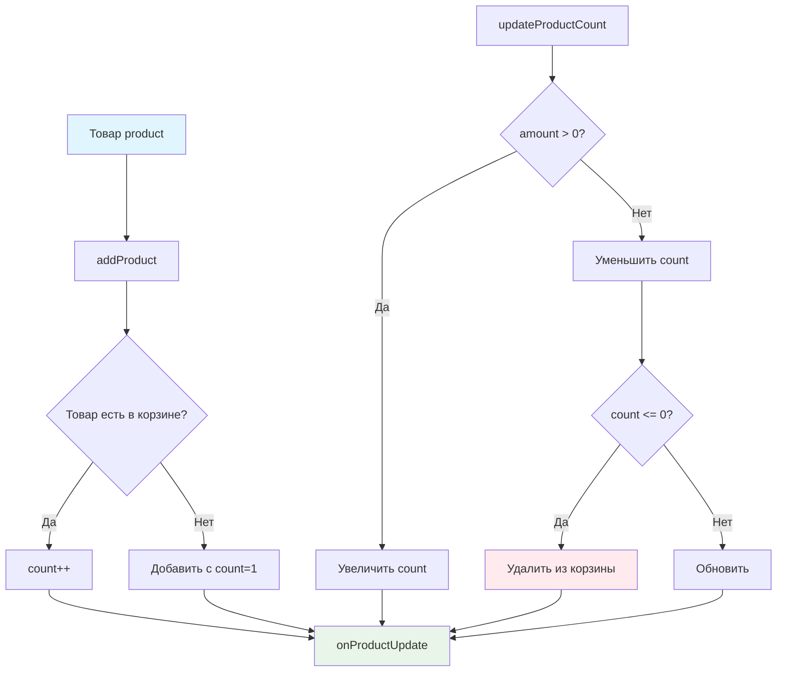

# 🛒 Учебный проект: Корзина, часть 1

> **Создаем логику корзины для онлайн-ресторана!** 🍽️  
> Эта задача научит вас управлять состоянием корзины, работать с коллекциями товаров и правильно организовывать
> структуры данных для e-commerce.

## 🎯 Задача

Создайте класс `Cart`, который управляет **логикой корзины**: добавление товаров, изменение количества, подсчет суммы и
количества товаров.

```js
const cart = new Cart(cartIcon);

cart.addProduct(product);           // Добавить товар
cart.updateProductCount(id, amount); // Изменить количество
cart.getTotalPrice();                // Получить общую сумму
cart.getTotalCount();                // Получить количество товаров
```

## 🔍 Архитектура компонента



## 📋 Структура данных

### 🏗️ Формат хранения товаров в корзине

```js
this.cartItems = [
  {
    product: {
      id: "laab-kai-chicken-salad",  // Уникальный ID
      name: "Laab kai chicken salad", // Название
      price: 10,                      // Цена
      category: "salads",             // Категория
      image: "laab_kai.png"           // Изображение
    },
    count: 2  // Количество единиц товара
  },
  // ... другие товары
];
```

### 📊 Методы класса

| Метод                | Параметры           | Возвращает | Описание                  |
|----------------------|---------------------|------------|---------------------------|
| `addProduct`         | `product`           | -          | Добавляет товар в корзину |
| `updateProductCount` | `productId, amount` | -          | Изменяет количество       |
| `isEmpty`            | -                   | `boolean`  | Проверка пустоты корзины  |
| `getTotalCount`      | -                   | `number`   | Общее количество товаров  |
| `getTotalPrice`      | -                   | `number`   | Общая стоимость           |

## ✅ Требования к реализации

| Компонент                | Требование                                       |
|--------------------------|--------------------------------------------------|
| **addProduct**           | Добавить новый или увеличить count существующего |
| **updateProductCount**   | Изменить количество на amount (+1/-1)            |
| **Удаление при count=0** | Автоматически удалять товар                      |
| **onProductUpdate**      | Вызывать после каждого изменения                 |
| **Защита от null**       | Проверка входных параметров                      |
| **Копия массива**        | getItems() возвращает копию                      |

## 🛠️ Что нужно реализовать

```js
export default class Cart {
  cartItems = [];

  constructor(cartIcon) {
    this.cartIcon = cartIcon;
  }

  addProduct(product) {
    // Добавление товара
  }

  updateProductCount(productId, amount) {
    // Изменение количества
  }

  isEmpty() {
    // Проверка пустоты
  }

  getTotalCount() {
    // Общее количество
  }

  getTotalPrice() {
    // Общая стоимость
  }

  onProductUpdate(cartItem) {
    this.cartIcon.update(this);
  }
}
```

💡 **Важно:** После каждого изменения вызывайте `onProductUpdate`!

## 💡 Концепции, которые вы изучите

- **Управление состоянием**: хранение и обновление данных корзины
- **Работа с массивами**: поиск, добавление, удаление элементов
- **Защитное программирование**: проверка входных данных
- **Паттерн Observer**: уведомление об изменениях через onProductUpdate
- **Иммутабельность**: возврат копий данных вместо ссылок
- **Бизнес-логика**: подсчет суммы, количества, управление товарами

## 🎓 Для новичков

**Как найти товар в корзине?**

```js
const existingItem = this.cartItems.find(
  item => item.product.id === productId
);

if (existingItem) {
  // Товар найден
  existingItem.count++;
} else {
  // Товар не найден, добавляем новый
}
```

**Зачем проверять входные данные?**

```js
// Защита от ошибок
if (!product || !product.id) {
  return; // Выходим, если данные некорректны
}
```

**Как безопасно удалить элемент из массива?**

```js
// Находим индекс
const index = this.cartItems.findIndex(
  item => item.product.id === productId
);

// Удаляем, если найден
if (index !== -1) {
  this.cartItems.splice(index, 1);
}
```

## ⚡ Частые ошибки

❌ **Изменение товара напрямую**

```js
addProduct(product)
{
  // ❌ Изменяем переданный объект
  product.count = 1;
  this.cartItems.push(product);
}
```

✅ **Создание нового объекта**

```js
addProduct(product)
{
  // ✅ Создаем новую структуру
  const cartItem = {
    product: product,
    count: 1
  };
  this.cartItems.push(cartItem);
}
```

❌ **Забыть вызвать onProductUpdate**

```js
updateProductCount(productId, amount)
{
  const item = this.findItem(productId);
  item.count += amount;
  // ❌ Забыли уведомить об изменении
}
```

✅ **Всегда уведомлять об изменениях**

```js
updateProductCount(productId, amount)
{
  const item = this.findItem(productId);
  item.count += amount;

  if (item.count <= 0) {
    this.removeItem(item);
  }

  this.onProductUpdate(item); // ✅ Уведомляем
}
```

❌ **Возвращать прямую ссылку на массив**

```js
getItems()
{
  return this.cartItems; // ❌ Внешний код может изменить массив
}
```

✅ **Возвращать копию массива**

```js
getItems()
{
  return [...this.cartItems]; // ✅ Безопасная копия
}
```

## 🔧 Различные подходы к решению

### 🎯 Базовое решение (в задаче)

```js
export default class Cart {
  cartItems = [];

  constructor(cartIcon) {
    this.cartIcon = cartIcon;
  }

  addProduct(product) {
    // Защита от некорректных данных
    if (!product || !product.id) {
      return;
    }

    // Ищем существующий товар
    const existingItem = this.cartItems.find(
      item => item.product.id === product.id
    );

    if (existingItem) {
      // Увеличиваем количество
      existingItem.count++;
      this.onProductUpdate(existingItem);
    } else {
      // Добавляем новый товар
      const newItem = {
        product: product,
        count: 1
      };
      this.cartItems.push(newItem);
      this.onProductUpdate(newItem);
    }
  }

  updateProductCount(productId, amount) {
    // Защита от некорректных данных
    if (!productId || !amount) {
      return;
    }

    // Находим товар
    const itemIndex = this.cartItems.findIndex(
      item => item.product.id === productId
    );

    if (itemIndex === -1) {
      return; // Товар не найден
    }

    const item = this.cartItems[itemIndex];
    item.count += amount;

    // Удаляем если количество <= 0
    if (item.count <= 0) {
      this.cartItems.splice(itemIndex, 1);
    }

    this.onProductUpdate(item);
  }

  isEmpty() {
    return this.cartItems.length === 0;
  }

  getTotalCount() {
    return this.cartItems.reduce((total, item) => {
      return total + item.count;
    }, 0);
  }

  getTotalPrice() {
    return this.cartItems.reduce((total, item) => {
      return total + (item.product.price * item.count);
    }, 0);
  }

  onProductUpdate(cartItem) {
    this.cartIcon.update(this);
  }
}
```

### 🛡️ С дополнительной валидацией

```js
export default class Cart {
  cartItems = [];

  constructor(cartIcon) {
    if (!cartIcon) {
      throw new Error('CartIcon is required');
    }
    this.cartIcon = cartIcon;
  }

  addProduct(product) {
    // Расширенная валидация
    if (!this.isValidProduct(product)) {
      console.warn('Invalid product:', product);
      return;
    }

    const existingItem = this.findCartItem(product.id);

    if (existingItem) {
      this.incrementItem(existingItem);
    } else {
      this.createNewItem(product);
    }
  }

  isValidProduct(product) {
    return product &&
      product.id &&
      typeof product.price === 'number' &&
      product.price >= 0;
  }

  findCartItem(productId) {
    return this.cartItems.find(item => item.product.id === productId);
  }

  incrementItem(item) {
    item.count++;
    this.onProductUpdate(item);
  }

  createNewItem(product) {
    const newItem = {
      product: {...product}, // Копируем объект товара
      count: 1
    };
    this.cartItems.push(newItem);
    this.onProductUpdate(newItem);
  }

  updateProductCount(productId, amount) {
    if (!productId || typeof amount !== 'number' || amount === 0) {
      console.warn('Invalid update parameters');
      return;
    }

    const itemIndex = this.cartItems.findIndex(
      item => item.product.id === productId
    );

    if (itemIndex === -1) {
      console.warn(`Product ${productId} not found in cart`);
      return;
    }

    const item = this.cartItems[itemIndex];
    const newCount = item.count + amount;

    if (newCount <= 0) {
      this.removeItemAtIndex(itemIndex);
    } else {
      item.count = newCount;
      this.onProductUpdate(item);
    }
  }

  removeItemAtIndex(index) {
    const [removedItem] = this.cartItems.splice(index, 1);
    this.onProductUpdate(removedItem);
  }

  // Вычисляемые свойства для производительности
  get totalCount() {
    return this.cartItems.reduce((sum, item) => sum + item.count, 0);
  }

  get totalPrice() {
    return this.cartItems.reduce(
      (sum, item) => sum + (item.product.price * item.count),
      0
    );
  }

  getTotalCount() {
    return this.totalCount;
  }

  getTotalPrice() {
    return this.totalPrice;
  }

  isEmpty() {
    return this.cartItems.length === 0;
  }

  onProductUpdate(cartItem) {
    this.cartIcon.update(this);

    // Можно добавить дополнительные действия
    this.saveToLocalStorage();
    this.logAnalytics(cartItem);
  }

  saveToLocalStorage() {
    try {
      localStorage.setItem('cart', JSON.stringify(this.cartItems));
    } catch (e) {
      console.error('Failed to save cart:', e);
    }
  }

  logAnalytics(item) {
    // Отправка аналитики
    console.log('Cart updated:', item);
  }
}
```

### ⚡ С оптимизацией производительности

```js
export default class Cart {
  cartItems = [];
  itemsMap = new Map(); // Для быстрого поиска O(1)

  constructor(cartIcon) {
    this.cartIcon = cartIcon;
  }

  addProduct(product) {
    if (!product?.id) return;

    if (this.itemsMap.has(product.id)) {
      // O(1) поиск
      const item = this.itemsMap.get(product.id);
      item.count++;
      this.onProductUpdate(item);
    } else {
      const newItem = {product, count: 1};
      this.cartItems.push(newItem);
      this.itemsMap.set(product.id, newItem);
      this.onProductUpdate(newItem);
    }
  }

  updateProductCount(productId, amount) {
    if (!productId || !amount) return;

    const item = this.itemsMap.get(productId);
    if (!item) return;

    item.count += amount;

    if (item.count <= 0) {
      // Удаление O(n), но можно оптимизировать
      const index = this.cartItems.indexOf(item);
      this.cartItems.splice(index, 1);
      this.itemsMap.delete(productId);
    }

    this.onProductUpdate(item);
  }

  // Мемоизация для частых вызовов
  _memoizedTotalCount = null;
  _memoizedTotalPrice = null;

  getTotalCount() {
    if (this._memoizedTotalCount === null) {
      this._memoizedTotalCount = this.cartItems.reduce(
        (sum, item) => sum + item.count, 0
      );
    }
    return this._memoizedTotalCount;
  }

  getTotalPrice() {
    if (this._memoizedTotalPrice === null) {
      this._memoizedTotalPrice = this.cartItems.reduce(
        (sum, item) => sum + (item.product.price * item.count), 0
      );
    }
    return this._memoizedTotalPrice;
  }

  onProductUpdate(cartItem) {
    // Сбрасываем кеш
    this._memoizedTotalCount = null;
    this._memoizedTotalPrice = null;

    this.cartIcon.update(this);
  }
}
```

## 🌟 Расширенные версии

### 🎨 С поддержкой скидок

```js
class CartWithDiscounts extends Cart {
  discounts = [];

  addDiscount(discount) {
    this.discounts.push(discount);
    this.onProductUpdate();
  }

  getTotalPrice() {
    let basePrice = super.getTotalPrice();

    // Применяем скидки
    for (const discount of this.discounts) {
      if (discount.type === 'percentage') {
        basePrice *= (1 - discount.value / 100);
      } else if (discount.type === 'fixed') {
        basePrice -= discount.value;
      }
    }

    return Math.max(0, basePrice);
  }
}
```

### 📦 С группировкой по категориям

```js
class CategorizedCart extends Cart {
  getItemsByCategory() {
    const categories = {};

    for (const item of this.cartItems) {
      const category = item.product.category;
      if (!categories[category]) {
        categories[category] = [];
      }
      categories[category].push(item);
    }

    return categories;
  }

  getCategoryTotal(category) {
    return this.cartItems
      .filter(item => item.product.category === category)
      .reduce((sum, item) => sum + (item.product.price * item.count), 0);
  }
}
```

### 🔄 С историей изменений

```js
class CartWithHistory extends Cart {
  history = [];
  maxHistorySize = 10;

  addProduct(product) {
    this.saveState('add', product);
    super.addProduct(product);
  }

  updateProductCount(productId, amount) {
    this.saveState('update', {productId, amount});
    super.updateProductCount(productId, amount);
  }

  saveState(action, data) {
    this.history.push({
      action,
      data,
      timestamp: Date.now(),
      snapshot: [...this.cartItems]
    });

    // Ограничиваем размер истории
    if (this.history.length > this.maxHistorySize) {
      this.history.shift();
    }
  }

  undo() {
    if (this.history.length > 0) {
      const lastState = this.history.pop();
      this.cartItems = lastState.snapshot;
      this.onProductUpdate();
    }
  }
}
```

## 🎨 Практическое применение

### 🍕 Корзина для пиццерии

```js
class PizzaCart extends Cart {
  addProduct(product, customizations = {}) {
    // Учитываем кастомизацию (размер, добавки)
    const customizedProduct = {
      ...product,
      id: `${product.id}_${JSON.stringify(customizations)}`,
      price: this.calculatePrice(product, customizations),
      customizations
    };

    super.addProduct(customizedProduct);
  }

  calculatePrice(product, customizations) {
    let price = product.price;

    if (customizations.size === 'large') price *= 1.5;
    if (customizations.extraCheese) price += 2;
    if (customizations.toppings) {
      price += customizations.toppings.length * 1;
    }

    return price;
  }
}
```

### 📊 Корзина с аналитикой

```js
class AnalyticsCart extends Cart {
  analytics = {
    addedProducts: [],
    removedProducts: [],
    totalAdded: 0,
    totalRemoved: 0
  };

  addProduct(product) {
    super.addProduct(product);
    this.analytics.addedProducts.push(product.id);
    this.analytics.totalAdded++;
  }

  updateProductCount(productId, amount) {
    const item = this.findCartItem(productId);
    const oldCount = item?.count || 0;

    super.updateProductCount(productId, amount);

    const newCount = item?.count || 0;

    if (newCount === 0 && oldCount > 0) {
      this.analytics.removedProducts.push(productId);
      this.analytics.totalRemoved++;
    }
  }

  getConversionRate() {
    if (this.analytics.totalAdded === 0) return 0;
    return (this.analytics.totalAdded - this.analytics.totalRemoved) /
      this.analytics.totalAdded * 100;
  }
}
```

## 🧪 Тестирование

```bash
npm test
```

**Проверьте:**

- ✅ Добавление нового товара создает запись с count=1
- ✅ Повторное добавление увеличивает count
- ✅ updateProductCount изменяет количество
- ✅ Товар удаляется при count <= 0
- ✅ getTotalPrice считает правильную сумму
- ✅ getTotalCount возвращает общее количество
- ✅ isEmpty корректно определяет пустоту

## 🚀 Что дальше?

Во второй части мы добавим модальное окно корзины, оформление заказа и интеграцию с сервером. Эта задача подготовила вас
к созданию полноценных e-commerce решений!

---
📚 **Полезные ссылки:**

- [MDN: Array.prototype.find()](https://developer.mozilla.org/ru/docs/Web/JavaScript/Reference/Global_Objects/Array/find)
- [MDN: Array.prototype.reduce()](https://developer.mozilla.org/ru/docs/Web/JavaScript/Reference/Global_Objects/Array/reduce)
- [Learn.javascript.ru: Методы массивов](https://learn.javascript.ru/array-methods)
- [Learn.javascript.ru: Map и Set](https://learn.javascript.ru/map-set)
