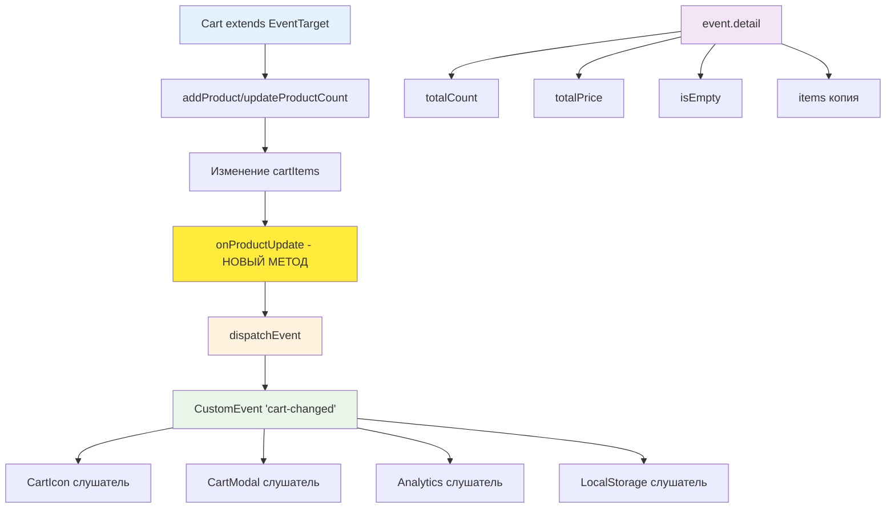

# 🛒 Учебный проект: Корзина, часть 2

> **Превращаем корзину в событийно-ориентированный компонент!** 🚀  
> Эта задача научит вас использовать EventTarget API для создания слабосвязанной архитектуры, работать с CustomEvent
> и строить масштабируемые e-commerce приложения с событийной моделью.

## 🎯 Задача

Расширьте класс `Cart` с помощью **EventTarget API**, добавив систему событий для уведомления других компонентов об
изменениях
в корзине без прямых зависимостей.

```js
const cart = new Cart(); // Наследуется от EventTarget

// Любой компонент может подписаться на изменения
cart.addEventListener('cart-changed', (event) => {
  console.log('Товаров:', event.detail.totalCount);
  console.log('Сумма:', event.detail.totalPrice);
  console.log('Товары:', event.detail.items);
});

cart.addProduct(product); // Автоматически генерирует событие
```

## 🔍 Архитектура компонента



## 📋 Структура данных

### 🏗️ Формат хранения товаров в корзине (без изменений)

```js
this.cartItems = [
  {
    product: {
      id: "laab-kai-chicken-salad",  // Уникальный ID
      name: "Laab kai chicken salad", // Название
      price: 10,                      // Цена
      category: "salads",             // Категория
      image: "laab_kai.png"           // Изображение
    },
    count: 2  // Количество единиц товара
  },
  // ... другие товары
];
```

### 🎉 Формат события cart-changed (НОВОЕ!)

```js
// CustomEvent, который генерирует корзина
{
  type: 'cart-changed',
    detail
:
  {
    totalCount: 5,           // Общее количество товаров
      totalPrice
  :
    125.50,       // Общая стоимость
      isEmpty
  :
    false,           // Флаг пустой корзины
      items
  :
    [                  // Копия массива товаров
      {
        product: {...},
        count: 2
      },
      // ...
    ]
  }
}
```

### 📊 Методы класса

| Метод                | Параметры           | Возвращает | Описание                        | Изменения                    |
|----------------------|---------------------|------------|---------------------------------|------------------------------|
| `constructor`        | -                   | -          | Вызывает super() от EventTarget | ✨ НОВОЕ: extends EventTarget |
| `addProduct`         | `product`           | -          | Добавляет товар                 | ✨ Вызывает onProductUpdate() |
| `updateProductCount` | `productId, amount` | -          | Изменяет количество             | ✨ Вызывает onProductUpdate() |
| `isEmpty`            | -                   | `boolean`  | Проверка пустоты корзины        | Без изменений                |
| `getTotalCount`      | -                   | `number`   | Общее количество товаров        | Без изменений                |
| `getTotalPrice`      | -                   | `number`   | Общая стоимость                 | Без изменений                |
| `getItems`           | -                   | `array`    | Копия массива товаров           | Без изменений                |
| `onProductUpdate`    | -                   | -          | Генерирует событие cart-changed | ✨ НОВЫЙ МЕТОД                |

## ✅ Требования к реализации

| Компонент                  | Требование                                       | Статус        |
|----------------------------|--------------------------------------------------|---------------|
| **Наследование**           | Класс должен наследоваться от EventTarget        | ✨ Новое       |
| **super() в конструкторе** | Обязательный вызов родительского конструктора    | ✨ Новое       |
| **onProductUpdate**        | Генерация события после каждого изменения        | ✨ Новое       |
| **CustomEvent**            | Использование CustomEvent с detail               | ✨ Новое       |
| **addProduct**             | Добавить новый или увеличить count существующего | Без изменений |
| **updateProductCount**     | Изменить количество на amount (+1/-1)            | Без изменений |
| **Удаление при count=0**   | Автоматически удалять товар                      | Без изменений |
| **Защита от null**         | Проверка входных параметров                      | Без изменений |
| **Копия массива**          | getItems() возвращает копию                      | Без изменений |

## 🛠️ Что нужно реализовать

```js
export default class Cart extends EventTarget {
  cartItems = [];

  constructor() {
    super(); // Обязательно! Вызываем конструктор EventTarget
  }

  addProduct(product) {
    // ... логика добавления товара ...

    // В конце вызываем onProductUpdate
    this.onProductUpdate();
  }

  updateProductCount(productId, amount) {
    // ... логика изменения количества ...

    // В конце вызываем onProductUpdate
    this.onProductUpdate();
  }

  isEmpty() {
    // Проверка пустоты
  }

  getTotalCount() {
    // Общее количество
  }

  getTotalPrice() {
    // Общая стоимость
  }

  getItems() {
    // Возвращаем копию массива
  }

  onProductUpdate() {
    // Генерируем событие с данными корзины
    this.dispatchEvent(new CustomEvent('cart-changed', {
      detail: {
        totalCount: this.getTotalCount(),
        totalPrice: this.getTotalPrice(),
        isEmpty: this.isEmpty(),
        items: this.getItems(),
      }
    }));
  }
}
```

💡 **Важно:** Теперь корзина не зависит от конкретных компонентов, а использует события!

## 💡 Концепции, которые вы изучите

- **EventTarget API**: создание компонентов с поддержкой событий
- **CustomEvent**: передача данных через события
- **Слабая связанность**: компоненты не знают друг о друге напрямую
- **Паттерн Observer**: подписка на изменения через addEventListener
- **Event-driven архитектура**: взаимодействие через события
- **Наследование классов**: extends и super()
- **Управление состоянием**: хранение и обновление данных корзины
- **Иммутабельность**: возврат копий данных в событиях

## 🎓 Для новичков

### Что такое EventTarget?

**EventTarget** - это интерфейс, который позволяет объектам принимать события и иметь слушателей для них.
Все DOM-элементы наследуются от EventTarget, и мы можем использовать его для наших классов!

```js
class MyClass extends EventTarget {
  constructor() {
    super(); // Обязательно вызываем конструктор родителя
  }

  doSomething() {
    // Генерируем событие
    this.dispatchEvent(new Event('something-done'));
  }
}

const obj = new MyClass();
obj.addEventListener('something-done', () => {
  console.log('Что-то произошло!');
});
```

### Зачем нужен CustomEvent?

**CustomEvent** позволяет передавать данные вместе с событием через свойство `detail`:

```js
// Создаем событие с данными
const event = new CustomEvent('my-event', {
  detail: {
    message: 'Привет!',
    timestamp: Date.now()
  }
});

// Получаем данные в обработчике
element.addEventListener('my-event', (e) => {
  console.log(e.detail.message); // "Привет!"
});
```

### Почему это лучше прямых вызовов?

```js
// ❌ Плохо: жесткая связь
class Cart {
  constructor(cartIcon, modal, analytics) {
    this.cartIcon = cartIcon;
    this.modal = modal;
    this.analytics = analytics;
  }

  onUpdate() {
    this.cartIcon.update(this);
    this.modal.update(this);
    this.analytics.track(this);
  }
}

// ✅ Хорошо: через события
class Cart extends EventTarget {
  onUpdate() {
    this.dispatchEvent(new CustomEvent('cart-changed', {
      detail: this.getState()
    }));
  }
}

// Компоненты подписываются независимо
cartIcon.listenTo(cart);
modal.listenTo(cart);
analytics.listenTo(cart);
```

## ⚡ Частые ошибки

❌ **Забыть вызвать super() в конструкторе**

```js
class Cart extends EventTarget {
  constructor() {
    // ❌ Ошибка! Must call super constructor
    this.cartItems = [];
  }
}
```

✅ **Всегда вызывать super() первым**

```js
class Cart extends EventTarget {
  constructor() {
    super(); // ✅ Первым делом!
    this.cartItems = [];
  }
}
```

❌ **Передавать ссылку на массив в событии**

```js
onProductUpdate()
{
  this.dispatchEvent(new CustomEvent('cart-changed', {
    detail: {
      items: this.cartItems // ❌ Передаем ссылку
    }
  }));
}
```

✅ **Передавать копию данных**

```js
onProductUpdate()
{
  this.dispatchEvent(new CustomEvent('cart-changed', {
    detail: {
      items: this.getItems() // ✅ Возвращает [...this.cartItems]
    }
  }));
}
```

❌ **Забыть вызвать onProductUpdate после изменений**

```js
addProduct(product)
{
  const item = this.findItem(product.id);
  if (item) {
    item.count++;
    // ❌ Забыли уведомить о изменении
  }
}
```

✅ **Всегда генерировать событие после изменений**

```js
addProduct(product)
{
  const item = this.findItem(product.id);
  if (item) {
    item.count++;
  } else {
    this.cartItems.push({product, count: 1});
  }
  this.onProductUpdate(); // ✅ Уведомляем
}
```

## 🔧 Различные подходы к решению

### 🎯 Базовое решение (как в задаче)

```js
export default class Cart extends EventTarget {
  cartItems = [];

  constructor() {
    super();
  }

  addProduct(product) {
    if (!product || !product.id) return;

    let found = false;

    for (let i = 0; i < this.cartItems.length; i++) {
      if (this.cartItems[i].product.id === product.id) {
        this.cartItems[i].count++;
        found = true;
        break;
      }
    }

    if (!found) {
      this.cartItems.push({
        product: product,
        count: 1
      });
    }

    this.onProductUpdate();
  }

  updateProductCount(productId, amount) {
    if (!productId || !amount) return;

    for (let i = 0; i < this.cartItems.length; i++) {
      if (this.cartItems[i].product.id === productId) {
        this.cartItems[i].count += amount;

        if (this.cartItems[i].count <= 0) {
          // Быстрое удаление O(1)
          this.cartItems[i] = this.cartItems[this.cartItems.length - 1];
          this.cartItems.pop();
        }
        break;
      }
    }

    this.onProductUpdate();
  }

  isEmpty() {
    return this.cartItems.length === 0;
  }

  getTotalCount() {
    let total = 0;
    for (let i = 0; i < this.cartItems.length; i++) {
      total += this.cartItems[i].count;
    }
    return total;
  }

  getTotalPrice() {
    let total = 0;
    for (let i = 0; i < this.cartItems.length; i++) {
      total += this.cartItems[i].count * this.cartItems[i].product.price;
    }
    return total;
  }

  getItems() {
    return [...this.cartItems];
  }

  onProductUpdate() {
    this.dispatchEvent(new CustomEvent('cart-changed', {
      detail: {
        totalCount: this.getTotalCount(),
        totalPrice: this.getTotalPrice(),
        isEmpty: this.isEmpty(),
        items: this.getItems(),
      }
    }));
  }
}
```

### 🛡️ С типизированными событиями

```js
// Создаем типизированные события для разных действий
export default class Cart extends EventTarget {
  cartItems = [];

  constructor() {
    super();
  }

  addProduct(product) {
    if (!product?.id) return;

    const existingItem = this.cartItems.find(
      item => item.product.id === product.id
    );

    if (existingItem) {
      existingItem.count++;
      this.emitEvent('product-updated', existingItem);
    } else {
      const newItem = {product, count: 1};
      this.cartItems.push(newItem);
      this.emitEvent('product-added', newItem);
    }

    this.emitEvent('cart-changed');
  }

  updateProductCount(productId, amount) {
    if (!productId || !amount) return;

    const index = this.cartItems.findIndex(
      item => item.product.id === productId
    );

    if (index === -1) return;

    const item = this.cartItems[index];
    item.count += amount;

    if (item.count <= 0) {
      this.cartItems.splice(index, 1);
      this.emitEvent('product-removed', item);
    } else {
      this.emitEvent('product-updated', item);
    }

    this.emitEvent('cart-changed');
  }

  emitEvent(eventName, itemData = null) {
    const detail = {
      totalCount: this.getTotalCount(),
      totalPrice: this.getTotalPrice(),
      isEmpty: this.isEmpty(),
      items: this.getItems()
    };

    if (itemData) {
      detail.item = itemData;
    }

    this.dispatchEvent(new CustomEvent(eventName, {detail}));
  }

  // Вспомогательный метод для основного события
  onProductUpdate() {
    this.emitEvent('cart-changed');
  }

  // ... остальные методы ...
}
```

### ⚡ С дебаунсом событий

```js
export default class Cart extends EventTarget {
  cartItems = [];
  updateTimer = null;

  constructor() {
    super();
  }

  addProduct(product) {
    if (!product?.id) return;

    const item = this.cartItems.find(i => i.product.id === product.id);

    if (item) {
      item.count++;
    } else {
      this.cartItems.push({product, count: 1});
    }

    this.scheduleUpdate();
  }

  updateProductCount(productId, amount) {
    if (!productId || !amount) return;

    const index = this.cartItems.findIndex(
      item => item.product.id === productId
    );

    if (index === -1) return;

    this.cartItems[index].count += amount;

    if (this.cartItems[index].count <= 0) {
      this.cartItems.splice(index, 1);
    }

    this.scheduleUpdate();
  }

  // Дебаунс для группировки быстрых изменений
  scheduleUpdate() {
    if (this.updateTimer) {
      clearTimeout(this.updateTimer);
    }

    // Немедленное событие для UI
    this.onProductUpdate();

    // Отложенное событие для аналитики/сохранения
    this.updateTimer = setTimeout(() => {
      this.dispatchEvent(new CustomEvent('cart-settled', {
        detail: {
          totalCount: this.getTotalCount(),
          totalPrice: this.getTotalPrice(),
          items: this.getItems()
        }
      }));
    }, 500);
  }

  onProductUpdate() {
    this.dispatchEvent(new CustomEvent('cart-changed', {
      detail: {
        totalCount: this.getTotalCount(),
        totalPrice: this.getTotalPrice(),
        isEmpty: this.isEmpty(),
        items: this.getItems()
      }
    }));
  }

  // ... остальные методы ...
}
```

## 🌟 Расширенные версии

### 🎨 С поддержкой множественных слушателей

```js
class ObservableCart extends Cart {
  listeners = new Map();

  // Упрощенный метод подписки
  subscribe(callback) {
    const listener = (event) => callback(event.detail);
    this.addEventListener('cart-changed', listener);

    // Возвращаем функцию отписки
    return () => {
      this.removeEventListener('cart-changed', listener);
    };
  }

  // Подписка на конкретные изменения
  watch(property, callback) {
    let previousValue = this[property]();

    const listener = (event) => {
      const currentValue = event.detail[property];
      if (currentValue !== previousValue) {
        callback(currentValue, previousValue);
        previousValue = currentValue;
      }
    };

    this.addEventListener('cart-changed', listener);
    return () => this.removeEventListener('cart-changed', listener);
  }
}

// Использование
const cart = new ObservableCart();

// Простая подписка
const unsubscribe = cart.subscribe(state => {
  console.log('Корзина изменилась:', state);
});

// Следим за конкретным свойством
cart.watch('totalPrice', (newPrice, oldPrice) => {
  console.log(`Цена изменилась: ${oldPrice} -> ${newPrice}`);
});
```

### 📦 С middleware для событий

```js
class MiddlewareCart extends Cart {
  middlewares = [];

  use(middleware) {
    this.middlewares.push(middleware);
  }

  async onProductUpdate() {
    const state = {
      totalCount: this.getTotalCount(),
      totalPrice: this.getTotalPrice(),
      isEmpty: this.isEmpty(),
      items: this.getItems()
    };

    // Применяем middleware
    let processedState = state;
    for (const middleware of this.middlewares) {
      processedState = await middleware(processedState, this);
    }

    this.dispatchEvent(new CustomEvent('cart-changed', {
      detail: processedState
    }));
  }
}

// Middleware для логирования
const loggingMiddleware = (state, cart) => {
  console.log('[Cart]', new Date().toISOString(), state);
  return state;
};

// Middleware для валидации
const validationMiddleware = (state, cart) => {
  if (state.totalPrice < 0) {
    console.error('Отрицательная сумма!');
    state.totalPrice = 0;
  }
  return state;
};

// Использование
const cart = new MiddlewareCart();
cart.use(loggingMiddleware);
cart.use(validationMiddleware);
```

### 🔄 С историей изменений через события

```js
class HistoryCart extends Cart {
  history = [];
  maxHistorySize = 50;

  constructor() {
    super();

    // Слушаем собственные события для записи истории
    this.addEventListener('cart-changed', (event) => {
      this.recordHistory(event.detail);
    });
  }

  recordHistory(state) {
    this.history.push({
      timestamp: Date.now(),
      state: JSON.parse(JSON.stringify(state))
    });

    if (this.history.length > this.maxHistorySize) {
      this.history.shift();
    }

    // Генерируем событие истории
    this.dispatchEvent(new CustomEvent('history-updated', {
      detail: {history: this.history}
    }));
  }

  undo() {
    if (this.history.length <= 1) return;

    this.history.pop(); // Удаляем текущее состояние
    const previousState = this.history[this.history.length - 1];

    if (previousState) {
      this.cartItems = previousState.state.items;
      this.dispatchEvent(new CustomEvent('cart-restored', {
        detail: previousState.state
      }));
    }
  }

  getHistory() {
    return [...this.history];
  }
}
```

## 🎨 Практическое применение

### 🔗 Интеграция с UI компонентами

```js
// CartIcon.js
class CartIcon {
  constructor(cart) {
    this.cart = cart;
    this.element = document.querySelector('.cart-icon');

    // Подписываемся на изменения корзины
    this.cart.addEventListener('cart-changed', (event) => {
      this.update(event.detail);
    });
  }

  update(cartState) {
    this.element.querySelector('.cart-icon__count').textContent =
      cartState.totalCount;
    this.element.querySelector('.cart-icon__price').textContent =
      `$${cartState.totalPrice.toFixed(2)}`;

    if (cartState.isEmpty) {
      this.element.classList.add('cart-icon--empty');
    } else {
      this.element.classList.remove('cart-icon--empty');
    }
  }
}

// Modal.js
class CartModal {
  constructor(cart) {
    this.cart = cart;
    this.modal = document.querySelector('.cart-modal');

    // Подписываемся на изменения
    this.cart.addEventListener('cart-changed', (event) => {
      this.render(event.detail);
    });
  }

  render(cartState) {
    if (cartState.isEmpty) {
      this.modal.innerHTML = '<p>Корзина пуста</p>';
      return;
    }

    const itemsHtml = cartState.items.map(item => `
      <div class="cart-item">
        <span>${item.product.name}</span>
        <span>${item.count} × $${item.product.price}</span>
      </div>
    `).join('');

    this.modal.innerHTML = `
      ${itemsHtml}
      <div class="cart-total">
        Итого: $${cartState.totalPrice.toFixed(2)}
      </div>
    `;
  }
}

// Использование
const cart = new Cart();
const icon = new CartIcon(cart);
const modal = new CartModal(cart);

// Теперь оба компонента автоматически обновляются!
cart.addProduct(product);
```

### 📊 Аналитика через события

```js
class CartAnalytics {
  constructor(cart) {
    // Подписываемся на разные события
    cart.addEventListener('cart-changed', this.trackChange.bind(this));

    // Можно добавить специализированные события
    cart.addEventListener('product-added', this.trackAdd.bind(this));
    cart.addEventListener('product-removed', this.trackRemove.bind(this));
  }

  trackChange(event) {
    const {totalCount, totalPrice, items} = event.detail;

    // Отправляем в Google Analytics
    gtag('event', 'cart_updated', {
      'value': totalPrice,
      'items_count': totalCount,
      'items': items.map(i => i.product.id)
    });
  }

  trackAdd(event) {
    gtag('event', 'add_to_cart', {
      'currency': 'USD',
      'value': event.detail.item.product.price,
      'items': [{
        'item_id': event.detail.item.product.id,
        'item_name': event.detail.item.product.name,
        'price': event.detail.item.product.price,
        'quantity': 1
      }]
    });
  }

  trackRemove(event) {
    gtag('event', 'remove_from_cart', {
      'currency': 'USD',
      'value': event.detail.item.product.price,
      'items': [{
        'item_id': event.detail.item.product.id
      }]
    });
  }
}

// Подключаем аналитику
const analytics = new CartAnalytics(cart);
```

### 💾 Автосохранение через события

```js
class CartPersistence {
  constructor(cart) {
    this.cart = cart;

    // Загружаем при инициализации
    this.load();

    // Сохраняем при изменениях
    cart.addEventListener('cart-changed', (event) => {
      this.save(event.detail);
    });
  }

  save(cartState) {
    try {
      localStorage.setItem('cart', JSON.stringify(cartState.items));

      // Генерируем событие успешного сохранения
      this.cart.dispatchEvent(new CustomEvent('cart-saved', {
        detail: {timestamp: Date.now()}
      }));
    } catch (e) {
      console.error('Failed to save cart:', e);

      // Генерируем событие ошибки
      this.cart.dispatchEvent(new CustomEvent('cart-save-error', {
        detail: {error: e.message}
      }));
    }
  }

  load() {
    try {
      const saved = localStorage.getItem('cart');
      if (saved) {
        const items = JSON.parse(saved);

        // Восстанавливаем товары
        items.forEach(item => {
          for (let i = 0; i < item.count; i++) {
            this.cart.addProduct(item.product);
          }
        });

        // Генерируем событие загрузки
        this.cart.dispatchEvent(new CustomEvent('cart-loaded', {
          detail: {itemsCount: items.length}
        }));
      }
    } catch (e) {
      console.error('Failed to load cart:', e);
    }
  }
}

// Автоматическое сохранение
const persistence = new CartPersistence(cart);
```

## 🧪 Тестирование

```bash
npm test
```

**Проверьте:**

- ✅ Класс наследуется от EventTarget
- ✅ Конструктор вызывает super()
- ✅ onProductUpdate генерирует событие 'cart-changed'
- ✅ Событие содержит правильный detail
- ✅ detail.items возвращает копию массива
- ✅ События генерируются после addProduct
- ✅ События генерируются после updateProductCount
- ✅ Можно подписаться через addEventListener
- ✅ Можно отписаться через removeEventListener
- ✅ Несколько слушателей получают события

## 🚀 Что дальше?

Поздравляем! Вы освоили событийно-ориентированную архитектуру! Теперь ваша корзина может интегрироваться с любыми
компонентами без прямых зависимостей. В следующих задачах мы добавим оформление заказа и интеграцию с сервером. Вы
готовы создавать профессиональные e-commerce приложения!

---
📚 **Полезные ссылки:**

- [MDN: EventTarget](https://developer.mozilla.org/ru/docs/Web/API/EventTarget)
- [MDN: CustomEvent](https://developer.mozilla.org/ru/docs/Web/API/CustomEvent)
- [MDN: dispatchEvent()](https://developer.mozilla.org/ru/docs/Web/API/EventTarget/dispatchEvent)
- [MDN: addEventListener()](https://developer.mozilla.org/ru/docs/Web/API/EventTarget/addEventListener)
- [Learn.javascript.ru: Диспетчеризация событий](https://learn.javascript.ru/dispatch-events)
- [Learn.javascript.ru: Пользовательские события](https://learn.javascript.ru/custom-events)
- [Learn.javascript.ru: Наследование классов](https://learn.javascript.ru/class-inheritance)
