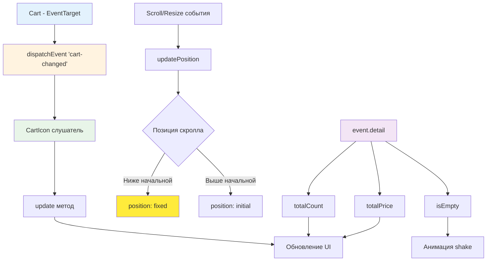

# 🛒 Учебный проект: Иконка корзины с событийной интеграцией

> **Создаем умную иконку корзины, которая слушает события и всегда на виду!** 🎯  
> Эта задача научит вас интегрировать компоненты через события, работать с позиционированием элементов,
> отслеживать прокрутку страницы и создавать реактивные "липкие" интерфейсные элементы.

## 🎯 Задача

Создайте класс `CartIcon`, который отображает **иконку корзины** с количеством товаров и общей стоимостью,
автоматически обновляется при изменениях в корзине через события и фиксируется при прокрутке страницы.

```js
const cart = new Cart(); // Корзина с поддержкой событий
const cartIcon = new CartIcon(cart); // Передаем корзину в иконку

document.body.append(cartIcon.elem);

// Иконка автоматически обновляется при изменениях корзины
cart.addProduct(product); // Иконка сама обновит счетчики!
```

## 🔍 Архитектура компонента



## 📋 Структура компонента

### 🏗️ HTML структура иконки

```html

<div class="cart-icon">
  <div class="cart-icon__inner">
    <span class="cart-icon__count">0</span>
    <span class="cart-icon__price">€0.00</span>
  </div>
</div>
```

### 📊 Данные из события cart-changed

```js
// event.detail содержит:
{
  totalCount: 5,        // Общее количество товаров
    totalPrice
:
  125.50,   // Общая стоимость
    isEmpty
:
  false,       // Флаг пустой корзины
    items
:
  [...]          // Массив товаров
}
```

### 🎨 Параметры позиционирования

| Параметр                | Значение  | Описание                        |
|-------------------------|-----------|---------------------------------|
| **Отступ сверху**       | `50px`    | При фиксированной позиции       |
| **Отступ от container** | `20px`    | Справа от элемента `.container` |
| **Минимум от края**     | `10px`    | От правого края окна            |
| **Мобильная ширина**    | `≤ 767px` | Без фиксации                    |
| **z-index**             | `100`     | Поверх других элементов         |
| **Анимация появления**  | `0.3s`    | Плавное появление при фиксации  |

## ✅ Требования к реализации

| Компонент                  | Требование                          | Статус        |
|----------------------------|-------------------------------------|---------------|
| **Конструктор с cart**     | Принимает экземпляр корзины         | ✨ Новое       |
| **subscribeToCart()**      | Подписка на событие 'cart-changed'  | ✨ Новое       |
| **update(cartData)**       | Обновление UI из event.detail       | ✨ Обновлено   |
| **Анимация shake**         | При добавлении товаров              | ✨ Новое       |
| **updatePosition()**       | Обновляет позицию при scroll/resize | Без изменений |
| **Начало фиксации**        | Когда верх иконки выходит за экран  | Без изменений |
| **Горизонтальная позиция** | Math.min от container и края окна   | Без изменений |
| **Мобильные устройства**   | Сброс позиционирования              | Без изменений |

## 🛠️ Что нужно реализовать

```js
export default class CartIcon {
  constructor(cart) {
    this.cart = cart;
    this.render();
    this.addEventListeners();
    this.subscribeToCart(); // Новое: подписка на события корзины
  }

  subscribeToCart() {
    // Подписываемся на событие изменения корзины
    this.cart.addEventListener('cart-changed', (event) => {
      this.update(event.detail);
    });
  }

  update(cartData) {
    // Обновляем счетчики из данных события
    const countElem = this.elem.querySelector('.cart-icon__count');
    const priceElem = this.elem.querySelector('.cart-icon__price');

    countElem.textContent = cartData.totalCount;
    priceElem.textContent = this.formatPrice(cartData.totalPrice);

    // Анимация при добавлении товаров
    if (!cartData.isEmpty && !this.elem.classList.contains('shake')) {
      this.elem.classList.add('shake');
      this.elem.addEventListener('transitionend', () => {
        this.elem.classList.remove('shake');
      }, {once: true});
    }
  }

  updatePosition() {
    // Логика позиционирования
  }

  // Остальные методы...
}
```

💡 **Важно:** Теперь иконка реактивно обновляется через события!

## 💡 Концепции, которые вы изучите

- **Событийная интеграция**: подписка на CustomEvent от другого компонента
- **Слабая связанность**: иконка не вызывает методы корзины напрямую
- **Реактивность**: автоматическое обновление UI при изменении данных
- **position: fixed vs initial**: переключение между режимами позиционирования
- **getBoundingClientRect()**: получение координат элементов
- **Анимации CSS**: добавление визуальной обратной связи
- **Event-driven архитектура**: построение приложения на событиях

## 🎓 Для новичков

### Как работает интеграция через события?

```js
// 1. Корзина генерирует событие при изменении
class Cart extends EventTarget {
  addProduct(product) {
    // ... добавление товара ...
    this.dispatchEvent(new CustomEvent('cart-changed', {
      detail: {totalCount: 5, totalPrice: 50}
    }));
  }
}

// 2. Иконка слушает это событие
class CartIcon {
  constructor(cart) {
    cart.addEventListener('cart-changed', (event) => {
      console.log('Получили данные:', event.detail);
      this.update(event.detail);
    });
  }
}

// 3. При изменении корзины иконка автоматически обновится!
```

### Что такое event.detail?

`event.detail` - это свойство CustomEvent, где хранятся переданные данные:

```js
// При создании события
new CustomEvent('cart-changed', {
  detail: {totalCount: 3, totalPrice: 30} // Эти данные
});

// При получении события
element.addEventListener('cart-changed', (event) => {
  console.log(event.detail.totalCount); // 3
  console.log(event.detail.totalPrice); // 30
});
```

### Зачем опция {once: true}?

```js
// Обработчик выполнится только один раз и автоматически удалится
elem.addEventListener('transitionend', handler, {once: true});

// Это эквивалентно:
elem.addEventListener('transitionend', function handler() {
  // ... код ...
  elem.removeEventListener('transitionend', handler);
});
```

## ⚡ Частые ошибки

❌ **Использовать глобальную переменную вместо параметра события**

```js
update(cartData)
{
  // ❌ Неправильно: используем глобальную переменную
  countElem.textContent = cart.getTotalCount();
  priceElem.textContent = cart.getTotalPrice();
}
```

✅ **Использовать данные из события**

```js
update(cartData)
{
  // ✅ Правильно: используем данные из event.detail
  countElem.textContent = cartData.totalCount;
  priceElem.textContent = this.formatPrice(cartData.totalPrice);
}
```

❌ **Забыть подписаться на события корзины**

```js
constructor(cart)
{
  this.cart = cart;
  this.render();
  // ❌ Забыли подписаться на события
}
```

✅ **Подписаться в конструкторе**

```js
constructor(cart)
{
  this.cart = cart;
  this.render();
  this.addEventListeners();
  this.subscribeToCart(); // ✅ Подписываемся на события
}
```

❌ **Не удалять обработчик анимации**

```js
if (!cartData.isEmpty) {
  this.elem.classList.add('shake');
  // ❌ Обработчик будет накапливаться при каждой анимации
  this.elem.addEventListener('transitionend', () => {
    this.elem.classList.remove('shake');
  });
}
```

✅ **Использовать {once: true} для одноразовых обработчиков**

```js
if (!cartData.isEmpty && !this.elem.classList.contains('shake')) {
  this.elem.classList.add('shake');
  // ✅ Обработчик автоматически удалится после выполнения
  this.elem.addEventListener('transitionend', () => {
    this.elem.classList.remove('shake');
  }, {once: true});
}
```

## 🔧 Различные подходы к решению

### 🎯 Базовое решение (как в задаче)

```js
export default class CartIcon {
  constructor(cart) {
    this.cart = cart;
    this.render();
    this.addEventListeners();
    this.subscribeToCart();
  }

  render() {
    this.elem = createElement(`
      <div class="cart-icon">
        <div class="cart-icon__inner">
          <span class="cart-icon__count">0</span>
          <span class="cart-icon__price">€0.00</span>
        </div>
      </div>
    `);
  }

  subscribeToCart() {
    // Подписываемся на событие корзины
    this.cart.addEventListener('cart-changed', (event) => {
      this.update(event.detail);
    });
  }

  update(cartData) {
    const countElem = this.elem.querySelector('.cart-icon__count');
    const priceElem = this.elem.querySelector('.cart-icon__price');

    countElem.textContent = cartData.totalCount;
    priceElem.textContent = this.formatPrice(cartData.totalPrice);

    // Анимация при добавлении
    if (!cartData.isEmpty && !this.elem.classList.contains('shake')) {
      this.elem.classList.add('shake');
      this.elem.addEventListener('transitionend', () => {
        this.elem.classList.remove('shake');
      }, {once: true});
    }
  }

  formatPrice(num) {
    return `€${parseFloat(num).toFixed(2)}`;
  }

  addEventListeners() {
    document.addEventListener('scroll', () => this.updatePosition());
    window.addEventListener('resize', () => this.updatePosition());
  }

  updatePosition() {
    const scrollY = window.scrollY || document.documentElement.scrollTop;
    const cartIcon = this.elem;
    const container = document.querySelector('.container');

    if (!container || !(cartIcon.offsetHeight || cartIcon.offsetWidth)) {
      return;
    }

    // Мобильные устройства
    if (document.documentElement.clientWidth <= 767) {
      this.resetPosition();
      return;
    }

    const {right} = container.getBoundingClientRect();
    const rightOffset = right + 20;
    const leftOffset = document.documentElement.clientWidth - cartIcon.offsetWidth - 10;

    if (scrollY > cartIcon.offsetTop) {
      // Фиксируем с анимацией
      Object.assign(cartIcon.style, {
        position: 'fixed',
        top: '50px',
        left: `${Math.min(rightOffset, leftOffset)}px`,
        transition: 'none',
        opacity: '0',
        zIndex: 100
      });

      requestAnimationFrame(() => {
        Object.assign(cartIcon.style, {
          transition: 'opacity 0.3s ease',
          opacity: '1',
        });
      });
    } else {
      this.resetPosition();
    }
  }

  resetPosition() {
    Object.assign(this.elem.style, {
      position: '',
      top: '',
      left: '',
      zIndex: ''
    });
  }
}
```

### 🛡️ С отпиской и очисткой

```js
export default class CartIcon {
  constructor(cart) {
    this.cart = cart;
    this.render();
    this.setupListeners();
  }

  setupListeners() {
    // Сохраняем ссылки на обработчики для отписки
    this.cartHandler = (event) => this.update(event.detail);
    this.scrollHandler = () => this.updatePosition();
    this.resizeHandler = () => this.updatePosition();

    // Подписываемся
    this.cart.addEventListener('cart-changed', this.cartHandler);
    document.addEventListener('scroll', this.scrollHandler);
    window.addEventListener('resize', this.resizeHandler);
  }

  destroy() {
    // Отписываемся от всех событий
    this.cart.removeEventListener('cart-changed', this.cartHandler);
    document.removeEventListener('scroll', this.scrollHandler);
    window.removeEventListener('resize', this.resizeHandler);

    // Удаляем элемент
    this.elem.remove();
  }

  update(cartData) {
    // Кешируем элементы для производительности
    if (!this.countElem) {
      this.countElem = this.elem.querySelector('.cart-icon__count');
      this.priceElem = this.elem.querySelector('.cart-icon__price');
    }

    this.countElem.textContent = cartData.totalCount;
    this.priceElem.textContent = this.formatPrice(cartData.totalPrice);

    // Управление видимостью
    this.elem.classList.toggle('cart-icon--empty', cartData.isEmpty);

    // Анимация
    this.animateIfNeeded(cartData);
  }

  animateIfNeeded(cartData) {
    if (!cartData.isEmpty && !this.isAnimating) {
      this.isAnimating = true;
      this.elem.classList.add('shake');

      this.elem.addEventListener('transitionend', () => {
        this.elem.classList.remove('shake');
        this.isAnimating = false;
      }, {once: true});
    }
  }
}
```

### ⚡ С дополнительными событиями

```js
export default class CartIcon {
  constructor(cart) {
    this.cart = cart;
    this.render();
    this.subscribeToMultipleEvents();
  }

  subscribeToMultipleEvents() {
    // Подписываемся на разные типы событий
    this.cart.addEventListener('cart-changed', (e) => {
      this.update(e.detail);
    });

    this.cart.addEventListener('product-added', (e) => {
      this.onProductAdded(e.detail);
    });

    this.cart.addEventListener('product-removed', (e) => {
      this.onProductRemoved(e.detail);
    });

    this.cart.addEventListener('cart-cleared', () => {
      this.onCartCleared();
    });
  }

  onProductAdded(detail) {
    // Специальная анимация для добавления
    this.showAddAnimation();
    this.update(detail);
  }

  onProductRemoved(detail) {
    // Специальная анимация для удаления
    this.showRemoveAnimation();
    this.update(detail);
  }

  onCartCleared() {
    // Анимация очистки корзины
    this.elem.classList.add('cart-icon--clearing');
    setTimeout(() => {
      this.elem.classList.remove('cart-icon--clearing');
      this.update({totalCount: 0, totalPrice: 0, isEmpty: true});
    }, 300);
  }

  showAddAnimation() {
    // Пульсация при добавлении
    this.elem.classList.add('pulse-green');
    setTimeout(() => this.elem.classList.remove('pulse-green'), 600);
  }

  showRemoveAnimation() {
    // Покачивание при удалении
    this.elem.classList.add('swing-red');
    setTimeout(() => this.elem.classList.remove('swing-red'), 600);
  }
}
```

## 🌟 Расширенные версии

### 🎨 С визуальными индикаторами

```js
class AdvancedCartIcon extends CartIcon {
  update(cartData) {
    super.update(cartData);

    // Цветовая индикация количества
    this.updateColorScheme(cartData.totalCount);

    // Прогресс-бар до бесплатной доставки
    this.updateDeliveryProgress(cartData.totalPrice);

    // Бейдж с типом товаров
    this.updateCategoryBadge(cartData.items);
  }

  updateColorScheme(count) {
    this.elem.classList.remove('cart-icon--few', 'cart-icon--medium', 'cart-icon--many');

    if (count === 0) return;
    if (count <= 3) {
      this.elem.classList.add('cart-icon--few'); // Зеленый
    } else if (count <= 10) {
      this.elem.classList.add('cart-icon--medium'); // Оранжевый
    } else {
      this.elem.classList.add('cart-icon--many'); // Красный
    }
  }

  updateDeliveryProgress(price) {
    const freeDeliveryThreshold = 50;
    const progress = Math.min(100, (price / freeDeliveryThreshold) * 100);

    this.elem.style.setProperty('--delivery-progress', `${progress}%`);

    if (progress < 100) {
      const remaining = freeDeliveryThreshold - price;
      this.showTooltip(`До бесплатной доставки: €${remaining.toFixed(2)}`);
    } else {
      this.showTooltip('Бесплатная доставка!', 'success');
    }
  }

  updateCategoryBadge(items) {
    const categories = new Set(items.map(item => item.product.category));

    if (categories.size > 0) {
      const badge = this.elem.querySelector('.cart-icon__badge') ||
        this.createBadge();
      badge.textContent = categories.size;
      badge.title = `Категорий: ${Array.from(categories).join(', ')}`;
    }
  }

  createBadge() {
    const badge = createElement('<span class="cart-icon__badge"></span>');
    this.elem.appendChild(badge);
    return badge;
  }
}
```

### 📱 С поддержкой touch-устройств

```js
class TouchCartIcon extends CartIcon {
  constructor(cart) {
    super(cart);
    this.setupTouchInteractions();
  }

  setupTouchInteractions() {
    let touchStartY = 0;
    let touchStartTime = 0;

    this.elem.addEventListener('touchstart', (e) => {
      touchStartY = e.touches[0].clientY;
      touchStartTime = Date.now();
    });

    this.elem.addEventListener('touchend', (e) => {
      const touchEndY = e.changedTouches[0].clientY;
      const touchDuration = Date.now() - touchStartTime;
      const swipeDistance = touchStartY - touchEndY;

      // Свайп вверх - открыть корзину
      if (swipeDistance > 50 && touchDuration < 500) {
        this.openCart();
      }

      // Долгое нажатие - показать превью
      if (touchDuration > 500 && Math.abs(swipeDistance) < 10) {
        this.showCartPreview();
      }
    });

    // Предотвращаем прокрутку при взаимодействии с иконкой
    this.elem.addEventListener('touchmove', (e) => {
      e.preventDefault();
    }, {passive: false});
  }

  openCart() {
    this.elem.dispatchEvent(new CustomEvent('cart-open-request'));
  }

  showCartPreview() {
    // Показываем мини-превью корзины
    const preview = this.createPreview();
    document.body.appendChild(preview);

    setTimeout(() => preview.remove(), 3000);
  }
}
```

### 🔄 С синхронизацией между вкладками

```js
class SyncedCartIcon extends CartIcon {
  constructor(cart) {
    super(cart);
    this.setupCrossTabSync();
  }

  setupCrossTabSync() {
    // Слушаем изменения в localStorage
    window.addEventListener('storage', (e) => {
      if (e.key === 'cart-state') {
        const cartData = JSON.parse(e.newValue);
        this.update(cartData);

        // Показываем уведомление
        this.showSyncNotification('Корзина обновлена в другой вкладке');
      }
    });

    // Сохраняем состояние при изменениях
    this.cart.addEventListener('cart-changed', (event) => {
      try {
        localStorage.setItem('cart-state', JSON.stringify(event.detail));
      } catch (e) {
        console.error('Failed to sync cart:', e);
      }
    });
  }

  showSyncNotification(message) {
    const notification = createElement(`
      <div class="cart-sync-notification">
        <span>${message}</span>
      </div>
    `);

    this.elem.appendChild(notification);

    setTimeout(() => {
      notification.classList.add('fade-out');
      notification.addEventListener('transitionend', () => {
        notification.remove();
      }, {once: true});
    }, 2000);
  }
}
```

## 🎨 Практическое применение

### 🛍️ Интеграция с модальным окном

```js
// CartModal.js
class CartModal {
  constructor(cart, cartIcon) {
    this.cart = cart;
    this.cartIcon = cartIcon;

    // Открытие модалки по клику на иконку
    this.cartIcon.elem.addEventListener('click', () => {
      this.open();
    });

    // Обновление модалки при изменениях корзины
    this.cart.addEventListener('cart-changed', (event) => {
      if (this.isOpen) {
        this.render(event.detail);
      }
    });
  }

  open() {
    this.isOpen = true;
    this.modal = this.createModal();
    document.body.appendChild(this.modal);

    // Получаем актуальное состояние
    const cartState = {
      totalCount: this.cart.getTotalCount(),
      totalPrice: this.cart.getTotalPrice(),
      items: this.cart.getItems(),
      isEmpty: this.cart.isEmpty()
    };

    this.render(cartState);
  }

  render(cartData) {
    // Рендерим содержимое модалки
    const content = this.modal.querySelector('.modal-content');

    if (cartData.isEmpty) {
      content.innerHTML = '<p>Корзина пуста</p>';
      return;
    }

    content.innerHTML = `
      <div class="cart-items">
        ${cartData.items.map(item => this.renderItem(item)).join('')}
      </div>
      <div class="cart-total">
        Итого: ${this.cartIcon.formatPrice(cartData.totalPrice)}
      </div>
      <button class="checkout-btn">Оформить заказ</button>
    `;
  }
}

// Использование
const cart = new Cart();
const cartIcon = new CartIcon(cart);
const cartModal = new CartModal(cart, cartIcon);

document.body.appendChild(cartIcon.elem);
```

### 📊 Система уведомлений

```js
class CartNotifications {
  constructor(cart, cartIcon) {
    this.cart = cart;
    this.cartIcon = cartIcon;
    this.setupNotifications();
  }

  setupNotifications() {
    let previousCount = 0;

    this.cart.addEventListener('cart-changed', (event) => {
      const {totalCount, totalPrice} = event.detail;

      // Определяем тип изменения
      if (totalCount > previousCount) {
        this.showNotification('✅ Товар добавлен в корзину', 'success');
        this.animateIcon('bounce');
      } else if (totalCount < previousCount && totalCount > 0) {
        this.showNotification('🗑️ Товар удален из корзины', 'warning');
        this.animateIcon('shake');
      } else if (totalCount === 0 && previousCount > 0) {
        this.showNotification('🛒 Корзина очищена', 'info');
        this.animateIcon('fade');
      }

      // Проверка на достижение порога бесплатной доставки
      if (totalPrice >= 50 && previousCount > 0) {
        this.showNotification('🎉 Достигнут порог бесплатной доставки!', 'success');
      }

      previousCount = totalCount;
    });
  }

  showNotification(message, type) {
    const notification = createElement(`
      <div class="notification notification--${type}">
        ${message}
      </div>
    `);

    // Позиционируем рядом с иконкой
    const iconRect = this.cartIcon.elem.getBoundingClientRect();
    Object.assign(notification.style, {
      position: 'fixed',
      top: `${iconRect.bottom + 10}px`,
      left: `${iconRect.left}px`,
      zIndex: 1001
    });

    document.body.appendChild(notification);

    // Автоудаление
    setTimeout(() => {
      notification.classList.add('notification--hiding');
      notification.addEventListener('animationend', () => {
        notification.remove();
      }, {once: true});
    }, 3000);
  }

  animateIcon(animation) {
    this.cartIcon.elem.classList.add(`icon-${animation}`);
    setTimeout(() => {
      this.cartIcon.elem.classList.remove(`icon-${animation}`);
    }, 1000);
  }
}

// Подключаем систему уведомлений
const notifications = new CartNotifications(cart, cartIcon);
```

## 🧪 Тестирование

```bash
npm test
```

**Проверьте:**

- ✅ Иконка принимает корзину в конструкторе
- ✅ Подписка на событие 'cart-changed' работает
- ✅ Счетчики обновляются из event.detail
- ✅ Анимация shake при добавлении товаров
- ✅ Форматирование цены в евро
- ✅ Иконка фиксируется при прокрутке вниз
- ✅ Возвращается в исходное положение при прокрутке вверх
- ✅ Правильные отступы от container и края окна
- ✅ Сброс позиции на мобильных устройствах
- ✅ Корректная работа при resize окна

## 🚀 Что дальше?

Отличная работа! Вы создали полностью интегрированную иконку корзины с событийной моделью. Теперь вы готовы создавать
сложные интерактивные компоненты: виджеты чата, панели уведомлений, плавающие меню и другие элементы, которые реагируют
на события приложения!

---
📚 **Полезные ссылки:**

- [MDN: EventTarget](https://developer.mozilla.org/ru/docs/Web/API/EventTarget)
- [MDN: CustomEvent](https://developer.mozilla.org/ru/docs/Web/API/CustomEvent)
- [MDN: addEventListener()](https://developer.mozilla.org/ru/docs/Web/API/EventTarget/addEventListener)
- [Learn.javascript.ru: Координаты](https://learn.javascript.ru/coordinates)
- [Learn.javascript.ru: Размеры и прокрутка элементов](https://learn.javascript.ru/size-and-scroll)
- [Learn.javascript.ru: Диспетчеризация событий](https://learn.javascript.ru/dispatch-events)
- [MDN: position](https://developer.mozilla.org/ru/docs/Web/CSS/position)
- [MDN: getBoundingClientRect](https://developer.mozilla.org/ru/docs/Web/API/Element/getBoundingClientRect)
- [MDN: requestAnimationFrame](https://developer.mozilla.org/ru/docs/Web/API/window/requestAnimationFrame)
