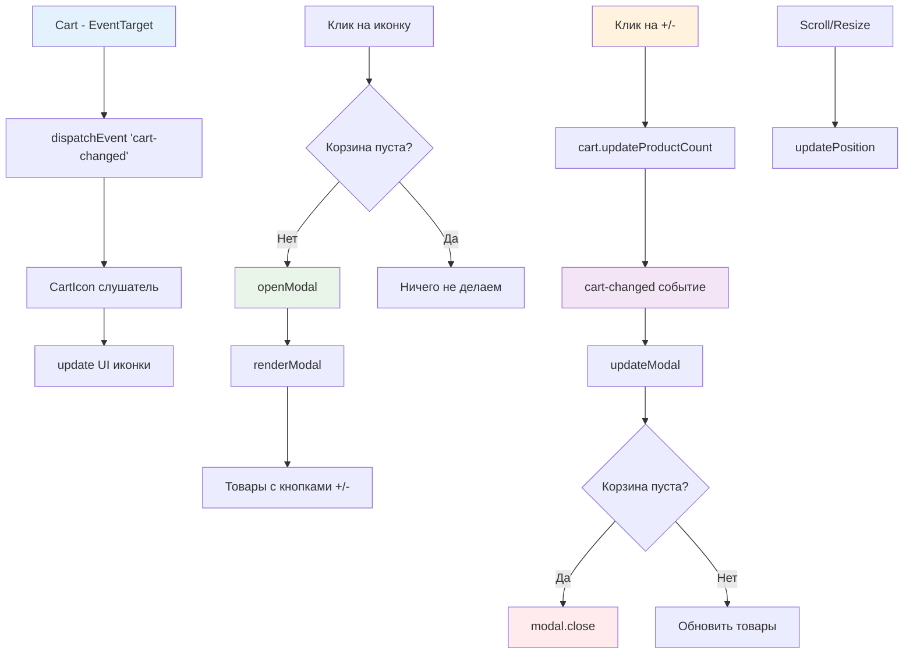

# 🛒 Учебный проект: Иконка корзины с модальным окном

> **Создаем полноценную корзину с модальным окном для управления товарами!** 🎯  
> Эта задача научит вас интегрировать компоненты через события, создавать интерактивные модальные окна,
> управлять состоянием корзины через UI и работать с позиционированием элементов.

## 🎯 Задача

Создайте класс `CartIcon`, который отображает **иконку корзины** с количеством товаров и общей стоимостью,
открывает модальное окно с товарами по клику, позволяет изменять количество товаров и автоматически
фиксируется при прокрутке страницы.

```js
const cart = new Cart(); // Корзина с поддержкой событий
const cartIcon = new CartIcon(cart); // Передаем корзину в иконку

document.body.append(cartIcon.elem);

// Клик на иконку открывает модалку с товарами
// Кнопки +/- в модалке изменяют количество
// Модалка закрывается при пустой корзине
```

## 🔍 Архитектура компонента



## 📋 Структура компонента

### 🏗️ HTML структура иконки

```html

<div class="cart-icon cart-icon_visible">
  <div class="cart-icon__inner">
    <span class="cart-icon__count">0</span>
    <span class="cart-icon__price">€0.00</span>
  </div>
</div>
```

### 🛍️ Структура товара в модалке

```html

<div class="cart-product" data-product-id="laab-kai">
  <div class="cart-product__img">
    
  </div>
  <div class="cart-product__info">
    <div class="cart-product__title">Laab kai chicken salad</div>
    <div class="cart-product__price-wrap">
      <div class="cart-counter">
        <button class="cart-counter__button cart-counter__button_minus">
          
        </button>
        <span class="cart-counter__count">2</span>
        <button class="cart-counter__button cart-counter__button_plus">
          
        </button>
      </div>
      <div class="cart-product__price">€20.00</div>
    </div>
  </div>
</div>
```

### 📊 Данные из события cart-changed

```js
// event.detail содержит:
{
  totalCount: 5,        // Общее количество товаров
    totalPrice
:
  125.50,   // Общая стоимость
    isEmpty
:
  false,       // Флаг пустой корзины
    items
:
  [              // Массив товаров
    {
      product: {
        id: "laab-kai",
        name: "Laab kai chicken salad",
        price: 10,
        image: "laab_kai.png"
      },
      count: 2
    }
  ]
}
```

## ✅ Требования к реализации

| Компонент                       | Требование                                        | Статус  |
|---------------------------------|---------------------------------------------------|---------|
| **Конструктор с cart**          | Принимает экземпляр корзины                       | Базовое |
| **subscribeToCart()**           | Подписка на событие 'cart-changed'                | Базовое |
| **initModal()**                 | Инициализация модального окна                     | ✨ Новое |
| **Клик открывает модалку**      | Только если корзина не пуста                      | ✨ Новое |
| **renderModal()**               | Рендер всех товаров в модалке                     | ✨ Новое |
| **renderProduct()**             | Рендер отдельного товара с кнопками               | ✨ Новое |
| **Кнопки +/- в модалке**        | Изменяют количество через cart.updateProductCount | ✨ Новое |
| **updateModal()**               | Обновление товаров при изменении корзины          | ✨ Новое |
| **Закрытие при пустой корзине** | modal.close() когда isEmpty = true                | ✨ Новое |
| **escapeHtml**                  | Защита от XSS при выводе названий                 | ✨ Новое |
| **updatePosition()**            | Липкое позиционирование при скролле               | Базовое |

## 🛠️ Что нужно реализовать

```js
import Modal from '../../7-module/2-task/modal.js';
import escapeHtml from '../../assets/lib/escape-html.js';

export default class CartIcon {
  constructor(cart) {
    this.cart = cart;
    this.render();
    this.addEventListeners();
    this.subscribeToCart();
    this.initModal(); // Новое: настройка модалки
  }

  initModal() {
    this.modal = new Modal();

    // Открываем модалку по клику на иконку
    this.elem.addEventListener('click', () => {
      if (!this.cart.isEmpty()) {
        this.openModal();
      }
    });
  }

  openModal() {
    this.renderModal();
    this.modal.open();
    this.addModalEventListeners();
  }

  renderModal() {
    this.modal.setTitle('Your order');

    // Создаем контейнер для товаров
    this.modalBody = document.createElement('div');

    // Рендерим все товары
    for (let item of this.cart.cartItems) {
      this.modalBody.append(
        this.renderProduct(item.product, item.count)
      );
    }

    this.modal.setBody(this.modalBody);
  }

  renderProduct({id, image, name, price}, count) {
    return createElement(`
      <div class="cart-product" data-product-id="${id}">
        <!-- Структура товара с кнопками +/- -->
      </div>
    `);
  }

  addModalEventListeners() {
    // Обработчик для кнопок +/-
    this.modalBody.addEventListener('click', (event) => {
      const button = event.target.closest('.cart-counter__button');
      if (!button) return;

      const productId = button.closest('.cart-product').dataset.productId;
      const amount = button.classList.contains('cart-counter__button_plus') ? 1 : -1;

      this.cart.updateProductCount(productId, amount);
    });

    // Слушаем изменения корзины для обновления модалки
    this.cart.addEventListener('cart-changed', (event) => {
      this.updateModal(event.detail);
    });
  }

  updateModal(cartData) {
    // Закрываем модалку если корзина пуста
    if (cartData.isEmpty) {
      this.modal.close();
      return;
    }

    // Обновляем отображение товаров
    // ...
  }
}
```

💡 **Важно:** Модалка автоматически обновляется при изменениях корзины!

## 💡 Концепции, которые вы изучите

- **Интеграция компонентов**: объединение Cart, CartIcon и Modal
- **Событийная архитектура**: подписка на события и реакция на изменения
- **Делегирование событий**: один обработчик для всех кнопок в модалке
- **Динамическое обновление DOM**: изменение содержимого модалки без перерисовки
- **Защита от XSS**: использование escapeHtml для пользовательского контента
- **Управление состоянием**: синхронизация UI с данными корзины
- **Слабая связанность**: компоненты взаимодействуют через события
- **Липкое позиционирование**: фиксация иконки при прокрутке

## 🎓 Для новичков

### Как работает интеграция трех компонентов?

```js
// 1. Cart генерирует события
class Cart extends EventTarget {
  updateProductCount(productId, amount) {
    // ... изменение количества ...
    this.dispatchEvent(new CustomEvent('cart-changed', {
      detail: {totalCount, totalPrice, isEmpty, items}
    }));
  }
}

// 2. CartIcon слушает события и управляет Modal
class CartIcon {
  constructor(cart) {
    this.cart = cart;
    this.modal = new Modal();

    // Слушаем изменения корзины
    this.cart.addEventListener('cart-changed', (e) => {
      this.update(e.detail);      // Обновляем иконку
      this.updateModal(e.detail);  // Обновляем модалку
    });
  }
}

// 3. Modal отображает содержимое
this.modal.setTitle('Your order');
this.modal.setBody(modalContent);
this.modal.open();
```

### Что такое делегирование событий?

Вместо навешивания обработчиков на каждую кнопку, ставим один на родителя:

```js
// ❌ Плохо: много обработчиков
buttons.forEach(button => {
  button.addEventListener('click', handler);
});

// ✅ Хорошо: один обработчик на родителя
modalBody.addEventListener('click', (event) => {
  const button = event.target.closest('.cart-counter__button');
  if (!button) return; // Клик не по кнопке

  // Обрабатываем клик по кнопке
});
```

### Зачем escapeHtml?

Защита от XSS-атак при выводе пользовательского контента:

```js
// ❌ Опасно: XSS уязвимость
innerHTML = `<div>${product.name}</div>`;
// Если name = "<script>alert('XSS')</script>" - выполнится скрипт!

// ✅ Безопасно: экранирование
innerHTML = `<div>${escapeHtml(product.name)}</div>`;
// Скрипт будет отображен как текст
```

## ⚡ Частые ошибки

❌ **Открывать модалку при пустой корзине**

```js
this.elem.addEventListener('click', () => {
  // ❌ Не проверяем, есть ли товары
  this.openModal();
});
```

✅ **Проверять наличие товаров**

```js
this.elem.addEventListener('click', () => {
  // ✅ Открываем только если есть товары
  if (!this.cart.isEmpty()) {
    this.openModal();
  }
});
```

❌ **Создавать новые обработчики при каждом открытии**

```js
openModal()
{
  this.renderModal();
  this.modal.open();

  // ❌ Новый обработчик при каждом открытии
  this.cart.addEventListener('cart-changed', handler);
}
```

✅ **Добавлять обработчики один раз**

```js
addModalEventListeners()
{
  // ✅ Обработчик для кнопок - один раз
  this.modalBody.addEventListener('click', this.handleButtonClick);

  // ✅ Слушатель корзины - один раз
  if (!this.cartListener) {
    this.cartListener = (e) => this.updateModal(e.detail);
    this.cart.addEventListener('cart-changed', this.cartListener);
  }
}
```

❌ **Не экранировать пользовательский контент**

```js
renderProduct({name})
{
  return createElement(`
    <!-- ❌ XSS уязвимость -->
    <div class="cart-product__title">${name}</div>
  `);
}
```

✅ **Всегда экранировать**

```js
renderProduct({name})
{
  return createElement(`
    <!-- ✅ Безопасно -->
    <div class="cart-product__title">${escapeHtml(name)}</div>
  `);
}
```

## 🔧 Различные подходы к решению

### 🎯 Базовое решение (как в задаче)

```js
export default class CartIcon {
  constructor(cart) {
    this.cart = cart;
    this.render();
    this.addEventListeners();
    this.subscribeToCart();
    this.initModal();
  }

  initModal() {
    this.modal = new Modal();

    this.elem.addEventListener('click', () => {
      if (!this.cart.isEmpty()) {
        this.openModal();
      }
    });
  }

  openModal() {
    this.renderModal();
    this.modal.open();
    this.addModalEventListeners();
  }

  renderModal() {
    this.modal.setTitle('Your order');
    this.modalBody = document.createElement('div');

    for (let item of this.cart.cartItems) {
      this.modalBody.append(this.renderProduct(item.product, item.count));
    }

    this.modal.setBody(this.modalBody);
  }

  renderProduct({id, image, name, price}, count) {
    return createElement(`
      <div class="cart-product" data-product-id="${id}">
        <div class="cart-product__img">
          
        </div>
        <div class="cart-product__info">
          <div class="cart-product__title">${escapeHtml(name)}</div>
          <div class="cart-product__price-wrap">
            <div class="cart-counter">
              <button type="button" class="cart-counter__button cart-counter__button_minus">
                
              </button>
              <span class="cart-counter__count">${count}</span>
              <button type="button" class="cart-counter__button cart-counter__button_plus">
                
              </button>
            </div>
            <div class="cart-product__price">${this.formatPrice(price * count)}</div>
          </div>
        </div>
      </div>
    `);
  }

  addModalEventListeners() {
    // Делегирование для кнопок
    this.modalBody.addEventListener('click', (event) => {
      const button = event.target.closest('.cart-counter__button');
      if (!button) return;

      const productElem = button.closest('.cart-product');
      const productId = productElem.dataset.productId;
      const isPlus = button.classList.contains('cart-counter__button_plus');
      const amount = isPlus ? 1 : -1;

      this.cart.updateProductCount(productId, amount);
    });

    // Обновление модалки при изменениях
    this.cart.addEventListener('cart-changed', (event) => {
      this.updateModal(event.detail);
    });
  }

  updateModal(cartData) {
    if (cartData.isEmpty) {
      this.modal.close();
      return;
    }

    // Обновляем существующие товары
    cartData.items.forEach(item => {
      const elem = this.modalBody.querySelector(`[data-product-id="${item.product.id}"]`);
      if (elem) {
        elem.querySelector('.cart-counter__count').textContent = item.count;
        elem.querySelector('.cart-product__price').textContent =
          this.formatPrice(item.product.price * item.count);
      }
    });

    // Удаляем товары, которых больше нет
    this.modalBody.querySelectorAll('.cart-product').forEach(elem => {
      const id = elem.dataset.productId;
      const exists = cartData.items.some(item => item.product.id === id);
      if (!exists) elem.remove();
    });
  }
}
```

### 🛡️ С оптимизацией и кешированием

```js
export default class CartIcon {
  constructor(cart) {
    this.cart = cart;
    this.productElements = new Map(); // Кеш элементов товаров
    this.isModalOpen = false;

    this.render();
    this.setupEventListeners();
  }

  setupEventListeners() {
    // Все обработчики в одном месте
    this.boundHandlers = {
      onCartChange: this.onCartChange.bind(this),
      onModalClick: this.onModalClick.bind(this),
      onIconClick: this.onIconClick.bind(this),
      updatePosition: this.updatePosition.bind(this)
    };

    this.cart.addEventListener('cart-changed', this.boundHandlers.onCartChange);
    this.elem.addEventListener('click', this.boundHandlers.onIconClick);
    document.addEventListener('scroll', this.boundHandlers.updatePosition);
    window.addEventListener('resize', this.boundHandlers.updatePosition);
  }

  onCartChange(event) {
    const cartData = event.detail;

    // Обновляем иконку
    this.update(cartData);

    // Обновляем модалку только если открыта
    if (this.isModalOpen) {
      this.updateModal(cartData);
    }
  }

  openModal() {
    if (this.isModalOpen) return;

    this.isModalOpen = true;
    this.renderModal();
    this.modal.open();

    // Добавляем обработчик только при открытии
    this.modalBody.addEventListener('click', this.boundHandlers.onModalClick);

    // Слушаем закрытие модалки
    this.modal.elem.addEventListener('modal-close', () => {
      this.isModalOpen = false;
      this.productElements.clear(); // Очищаем кеш
    }, {once: true});
  }

  renderModal() {
    this.modal.setTitle('Your order');
    this.modalBody = document.createElement('div');
    this.productElements.clear();

    // Рендерим и кешируем элементы
    for (let item of this.cart.cartItems) {
      const productElem = this.renderProduct(item.product, item.count);
      this.modalBody.append(productElem);
      this.productElements.set(item.product.id, productElem);
    }

    this.modal.setBody(this.modalBody);
  }

  updateModal(cartData) {
    if (cartData.isEmpty) {
      this.modal.close();
      return;
    }

    // Быстрое обновление через кеш
    cartData.items.forEach(item => {
      const elem = this.productElements.get(item.product.id);
      if (elem) {
        this.updateProductElement(elem, item);
      } else {
        // Новый товар - добавляем
        const newElem = this.renderProduct(item.product, item.count);
        this.modalBody.append(newElem);
        this.productElements.set(item.product.id, newElem);
      }
    });

    // Удаляем отсутствующие товары
    this.productElements.forEach((elem, id) => {
      const exists = cartData.items.some(item => item.product.id === id);
      if (!exists) {
        elem.remove();
        this.productElements.delete(id);
      }
    });
  }

  updateProductElement(elem, item) {
    const countElem = elem.querySelector('.cart-counter__count');
    const priceElem = elem.querySelector('.cart-product__price');

    // Обновляем только если изменилось
    const newCount = item.count.toString();
    const newPrice = this.formatPrice(item.product.price * item.count);

    if (countElem.textContent !== newCount) {
      countElem.textContent = newCount;
    }
    if (priceElem.textContent !== newPrice) {
      priceElem.textContent = newPrice;
    }
  }

  destroy() {
    // Отписываемся от всех событий
    this.cart.removeEventListener('cart-changed', this.boundHandlers.onCartChange);
    document.removeEventListener('scroll', this.boundHandlers.updatePosition);
    window.removeEventListener('resize', this.boundHandlers.updatePosition);

    if (this.modal) {
      this.modal.close();
    }

    this.elem.remove();
  }
}
```

### ⚡ С анимациями и эффектами

```js
export default class CartIcon {
  renderProduct(product, count) {
    const elem = createElement(`...`);

    // Добавляем анимацию появления
    elem.style.opacity = '0';
    elem.style.transform = 'translateY(-10px)';

    requestAnimationFrame(() => {
      elem.style.transition = 'all 0.3s ease';
      elem.style.opacity = '1';
      elem.style.transform = 'translateY(0)';
    });

    return elem;
  }

  updateModal(cartData) {
    // Анимация изменения количества
    cartData.items.forEach(item => {
      const elem = this.modalBody.querySelector(`[data-product-id="${item.product.id}"]`);
      if (elem) {
        const countElem = elem.querySelector('.cart-counter__count');
        const oldCount = parseInt(countElem.textContent);
        const newCount = item.count;

        if (oldCount !== newCount) {
          // Анимация изменения
          countElem.classList.add('count-changing');
          countElem.textContent = newCount;

          setTimeout(() => {
            countElem.classList.remove('count-changing');
          }, 300);

          // Подсветка строки
          elem.classList.add('product-updated');
          setTimeout(() => {
            elem.classList.remove('product-updated');
          }, 1000);
        }
      }
    });

    // Анимация удаления
    this.modalBody.querySelectorAll('.cart-product').forEach(elem => {
      const id = elem.dataset.productId;
      const exists = cartData.items.some(item => item.product.id === id);

      if (!exists) {
        elem.style.transition = 'all 0.3s ease';
        elem.style.opacity = '0';
        elem.style.transform = 'translateX(20px)';

        elem.addEventListener('transitionend', () => {
          elem.remove();
        }, {once: true});
      }
    });
  }
}
```

## 🌟 Расширенные версии

### 🎨 С формой оформления заказа

```js
class CartIconWithCheckout extends CartIcon {
  renderModal() {
    super.renderModal();

    // Добавляем форму оформления
    const checkoutForm = this.renderCheckoutForm();
    this.modalBody.append(checkoutForm);
  }

  renderCheckoutForm() {
    const totalPrice = this.cart.getTotalPrice();

    return createElement(`
      <div class="cart-checkout">
        <div class="cart-total">
          <span>Total:</span>
          <span class="cart-total-price">${this.formatPrice(totalPrice)}</span>
        </div>
        <form class="cart-form">
          <h3>Delivery</h3>
          <input type="text" name="name" placeholder="Name" required>
          <input type="email" name="email" placeholder="Email" required>
          <input type="tel" name="tel" placeholder="Phone" required>
          <input type="text" name="address" placeholder="Address" required>
          <button type="submit" class="button button_primary">
            <span>Order</span>
          </button>
        </form>
      </div>
    `);
  }

  addModalEventListeners() {
    super.addModalEventListeners();

    // Обработчик формы
    const form = this.modalBody.querySelector('.cart-form');
    if (form) {
      form.addEventListener('submit', (e) => {
        e.preventDefault();
        this.submitOrder(new FormData(form));
      });
    }
  }

  async submitOrder(formData) {
    const orderData = {
      items: this.cart.getItems(),
      ...Object.fromEntries(formData)
    };

    try {
      const response = await fetch('/api/orders', {
        method: 'POST',
        headers: {'Content-Type': 'application/json'},
        body: JSON.stringify(orderData)
      });

      if (response.ok) {
        this.showSuccessMessage();
        this.cart.clear();
        setTimeout(() => this.modal.close(), 2000);
      }
    } catch (error) {
      this.showErrorMessage(error.message);
    }
  }
}
```

### 📦 С сохранением состояния

```js
class PersistentCartIcon extends CartIcon {
  constructor(cart) {
    super(cart);
    this.loadModalState();
  }

  openModal() {
    super.openModal();
    this.saveModalState(true);
  }

  modal
.

  close() {
    super.close();
    this.saveModalState(false);
  }

  saveModalState(isOpen) {
    sessionStorage.setItem('cartModalOpen', isOpen);

    if (isOpen) {
      // Сохраняем позицию скролла в модалке
      const scrollTop = this.modalBody?.scrollTop || 0;
      sessionStorage.setItem('cartModalScroll', scrollTop);
    }
  }

  loadModalState() {
    const wasOpen = sessionStorage.getItem('cartModalOpen') === 'true';

    if (wasOpen && !this.cart.isEmpty()) {
      // Восстанавливаем модалку
      setTimeout(() => {
        this.openModal();

        const scrollTop = parseInt(sessionStorage.getItem('cartModalScroll') || 0);
        if (this.modalBody) {
          this.modalBody.scrollTop = scrollTop;
        }
      }, 100);
    }
  }
}
```

### 🔄 С рекомендациями товаров

```js
class SmartCartIcon extends CartIcon {
  async renderModal() {
    super.renderModal();

    // Добавляем блок рекомендаций
    const recommendations = await this.loadRecommendations();
    if (recommendations.length > 0) {
      this.modalBody.append(this.renderRecommendations(recommendations));
    }
  }

  async loadRecommendations() {
    const productIds = this.cart.getItems().map(item => item.product.id);

    try {
      const response = await fetch('/api/recommendations', {
        method: 'POST',
        headers: {'Content-Type': 'application/json'},
        body: JSON.stringify({productIds})
      });

      return await response.json();
    } catch {
      return [];
    }
  }

  renderRecommendations(products) {
    return createElement(`
      <div class="cart-recommendations">
        <h3>You might also like:</h3>
        <div class="recommendations-list">
          ${products.map(product => `
            <div class="recommendation-item" data-product-id="${product.id}">
              
              <span>${escapeHtml(product.name)}</span>
              <span>${this.formatPrice(product.price)}</span>
              <button class="button button_small">Add</button>
            </div>
          `).join('')}
        </div>
      </div>
    `);
  }

  addModalEventListeners() {
    super.addModalEventListeners();

    // Обработчик для рекомендаций
    this.modalBody.addEventListener('click', (e) => {
      const addBtn = e.target.closest('.recommendation-item button');
      if (addBtn) {
        const productId = addBtn.closest('.recommendation-item').dataset.productId;
        this.addRecommendedProduct(productId);
      }
    });
  }

  async addRecommendedProduct(productId) {
    // Загружаем полную информацию о товаре
    const product = await this.loadProduct(productId);
    if (product) {
      this.cart.addProduct(product);

      // Визуальная обратная связь
      const elem = this.modalBody.querySelector(`[data-product-id="${productId}"]`);
      elem.classList.add('added-to-cart');
    }
  }
}
```

## 🎨 Практическое применение

### 🛍️ Полноценная корзина для e-commerce

```js
// main.js - Инициализация всей системы
class ShoppingCartSystem {
  constructor() {
    this.cart = new Cart();
    this.cartIcon = new CartIcon(this.cart);
    this.products = new ProductGrid(this.cart);

    this.init();
  }

  init() {
    // Добавляем иконку в хедер
    const header = document.querySelector('.header__cart');
    header.append(this.cartIcon.elem);

    // Загружаем сохраненную корзину
    this.loadSavedCart();

    // Настраиваем автосохранение
    this.cart.addEventListener('cart-changed', () => {
      this.saveCart();
    });

    // Интеграция с продуктовой сеткой
    this.products.addEventListener('product-add', (e) => {
      this.cart.addProduct(e.detail.product);
      this.showAddedNotification(e.detail.product);
    });
  }

  loadSavedCart() {
    const saved = localStorage.getItem('cart');
    if (saved) {
      const items = JSON.parse(saved);
      items.forEach(item => {
        for (let i = 0; i < item.count; i++) {
          this.cart.addProduct(item.product);
        }
      });
    }
  }

  saveCart() {
    const items = this.cart.getItems();
    localStorage.setItem('cart', JSON.stringify(items));
  }

  showAddedNotification(product) {
    const notification = createElement(`
      <div class="notification notification--success">
        
        <span>${product.name} добавлен в корзину!</span>
      </div>
    `);

    document.body.append(notification);

    setTimeout(() => {
      notification.classList.add('notification--hiding');
      setTimeout(() => notification.remove(), 300);
    }, 2000);
  }
}

// Запуск системы
const shoppingCart = new ShoppingCartSystem();
```

### 📊 Интеграция с аналитикой

```js
class AnalyticsCartIcon extends CartIcon {
  constructor(cart) {
    super(cart);
    this.setupAnalytics();
  }

  setupAnalytics() {
    // Отслеживаем открытие корзины
    this.elem.addEventListener('click', () => {
      if (!this.cart.isEmpty()) {
        this.trackEvent('cart_opened', {
          items_count: this.cart.getTotalCount(),
          total_value: this.cart.getTotalPrice()
        });
      }
    });

    // Отслеживаем изменения в модалке
    this.modalBody?.addEventListener('click', (e) => {
      const button = e.target.closest('.cart-counter__button');
      if (button) {
        const productId = button.closest('.cart-product').dataset.productId;
        const isIncrease = button.classList.contains('cart-counter__button_plus');

        this.trackEvent('cart_item_updated', {
          product_id: productId,
          action: isIncrease ? 'increase' : 'decrease'
        });
      }
    });

    // Отслеживаем оформление заказа
    this.cart.addEventListener('order-submitted', (e) => {
      this.trackEvent('purchase', {
        transaction_id: e.detail.orderId,
        value: e.detail.totalPrice,
        currency: 'EUR',
        items: e.detail.items
      });
    });
  }

  trackEvent(eventName, eventParams) {
    // Google Analytics
    if (typeof gtag !== 'undefined') {
      gtag('event', eventName, eventParams);
    }

    // Яндекс.Метрика
    if (typeof ym !== 'undefined') {
      ym(12345678, 'reachGoal', eventName, eventParams);
    }

    // Собственная аналитика
    fetch('/api/analytics', {
      method: 'POST',
      headers: {'Content-Type': 'application/json'},
      body: JSON.stringify({event: eventName, params: eventParams})
    }).catch(console.error);
  }
}
```

### 💾 С промокодами и скидками

```js
class DiscountCartIcon extends CartIcon {
  renderModal() {
    super.renderModal();

    // Добавляем блок промокода
    const promoBlock = this.renderPromoBlock();
    this.modalBody.append(promoBlock);
  }

  renderPromoBlock() {
    return createElement(`
      <div class="cart-promo">
        <div class="promo-input-group">
          <input type="text" 
                 class="promo-code-input" 
                 placeholder="Enter promo code">
          <button class="button button_secondary promo-apply">Apply</button>
        </div>
        <div class="promo-message"></div>
        <div class="cart-discounts"></div>
      </div>
    `);
  }

  addModalEventListeners() {
    super.addModalEventListeners();

    // Обработчик промокода
    const applyBtn = this.modalBody.querySelector('.promo-apply');
    applyBtn?.addEventListener('click', () => {
      const input = this.modalBody.querySelector('.promo-code-input');
      this.applyPromoCode(input.value);
    });
  }

  async applyPromoCode(code) {
    if (!code) return;

    const messageElem = this.modalBody.querySelector('.promo-message');
    const discountsElem = this.modalBody.querySelector('.cart-discounts');

    try {
      // Проверяем промокод на сервере
      const response = await fetch('/api/promo/validate', {
        method: 'POST',
        headers: {'Content-Type': 'application/json'},
        body: JSON.stringify({code, items: this.cart.getItems()})
      });

      const result = await response.json();

      if (result.valid) {
        // Применяем скидку
        this.cart.applyDiscount(result.discount);

        messageElem.innerHTML = `
          <span class="success">✓ Promo code applied: ${result.description}</span>
        `;

        discountsElem.innerHTML = `
          <div class="discount-item">
            <span>${result.description}</span>
            <span>-${this.formatPrice(result.discountAmount)}</span>
          </div>
        `;

        // Обновляем итоговую сумму
        this.updateTotalWithDiscount();
      } else {
        messageElem.innerHTML = `
          <span class="error">✗ ${result.error}</span>
        `;
      }
    } catch (error) {
      messageElem.innerHTML = `
        <span class="error">✗ Failed to apply promo code</span>
      `;
    }
  }

  updateTotalWithDiscount() {
    const totalElem = this.modalBody.querySelector('.cart-total-price');
    if (totalElem) {
      const originalPrice = this.cart.getTotalPrice();
      const discountedPrice = this.cart.getTotalPriceWithDiscounts();

      if (originalPrice !== discountedPrice) {
        totalElem.innerHTML = `
          <span class="original-price">${this.formatPrice(originalPrice)}</span>
          <span class="discounted-price">${this.formatPrice(discountedPrice)}</span>
        `;
      }
    }
  }
}
```

## 🧪 Тестирование

```bash
npm test
```

**Проверьте:**

- ✅ Иконка принимает корзину в конструкторе
- ✅ Клик на иконку открывает модалку (если корзина не пуста)
- ✅ Модалка отображает все товары из корзины
- ✅ Кнопки +/- изменяют количество товаров
- ✅ Счетчики и цены обновляются при изменениях
- ✅ Модалка закрывается при пустой корзине
- ✅ Названия товаров экранируются через escapeHtml
- ✅ Делегирование событий работает для всех кнопок
- ✅ Иконка обновляется при изменениях корзины
- ✅ Позиционирование работает при прокрутке
- ✅ Удаленные товары исчезают из модалки
- ✅ Новые товары появляются в модалке

## 🚀 Что дальше?

Поздравляем! Вы создали полноценную систему корзины с модальным окном и событийной архитектурой. Теперь вы готовы
разрабатывать профессиональные e-commerce решения: системы оформления заказов, интеграцию с платежными системами,
управление складскими остатками и создание персонализированных рекомендаций!

---
📚 **Полезные ссылки:**

- [MDN: EventTarget](https://developer.mozilla.org/ru/docs/Web/API/EventTarget)
- [MDN: CustomEvent](https://developer.mozilla.org/ru/docs/Web/API/CustomEvent)
- [MDN: Event Delegation](https://developer.mozilla.org/ru/docs/Learn/JavaScript/Building_blocks/Events#event_delegation)
- [Learn.javascript.ru: Делегирование событий](https://learn.javascript.ru/event-delegation)
- [Learn.javascript.ru: Модальные окна](https://learn.javascript.ru/modals-popups)
- [Learn.javascript.ru: Формы, элементы управления](https://learn.javascript.ru/forms-controls)
- [MDN: Intersection Observer API](https://developer.mozilla.org/ru/docs/Web/API/Intersection_Observer_API)
- [OWASP: XSS Prevention](https://cheatsheetseries.owasp.org/cheatsheets/Cross_Site_Scripting_Prevention_Cheat_Sheet.html)
