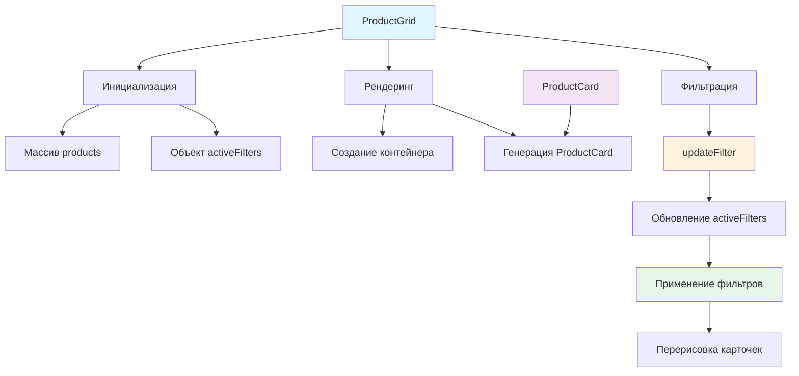

# 🍱 Учебный проект: Список блюд с фильтрацией

> **Создаем умную витрину ресторана!** 🎉  
> Эта задача научит вас создавать динамические списки товаров с мощной системой фильтрации, композицией компонентов и
> эффективным управлением состоянием.

## 🎯 Задача

Создайте класс `ProductGrid`, который отображает **сетку карточек блюд** с возможностью их фильтрации по множественным
критериям: категории, остроте, наличию орехов и вегетарианским опциям.

```js
const products = [
  {name: "Pad Thai", price: 15, category: "noodles", spiciness: 2},
  {name: "Tom Yum", price: 12, category: "soups", spiciness: 4},
  {name: "Green Curry", price: 18, category: "curry", vegetarian: true}
];

const productGrid = new ProductGrid(products);
document.body.append(productGrid.elem);

// Фильтрация: только острые супы без орехов
productGrid.updateFilter({
  category: 'soups',
  maxSpiciness: 3,
  excludeNuts: true
});
```

## 🔍 Архитектура компонента



## 📋 Структура компонента

### 🏗️ HTML структура

```html

<div class="products-grid">
  <div class="products-grid__inner">
    <!-- Здесь будут карточки товаров из ProductCard -->
    <div class="card">...</div>
    <div class="card">...</div>
    <div class="card">...</div>
  </div>
</div>
```

### 📊 Формат данных товара

| Свойство     | Тип       | Описание                   | Обязательное |
|--------------|-----------|----------------------------|--------------|
| `name`       | `string`  | Название блюда             | ✅            |
| `price`      | `number`  | Цена в евро                | ✅            |
| `category`   | `string`  | Категория блюда            | ✅            |
| `image`      | `string`  | Название файла изображения | ✅            |
| `id`         | `string`  | Уникальный идентификатор   | ✅            |
| `spiciness`  | `number`  | Уровень остроты (0-4)      | ❌            |
| `vegetarian` | `boolean` | Вегетарианское блюдо       | ❌            |
| `nuts`       | `boolean` | Содержит орехи             | ❌            |

### 🎚️ Параметры фильтрации

| Фильтр           | Тип       | Описание                           | Значение "сброса" |
|------------------|-----------|------------------------------------|-------------------|
| `category`       | `string`  | Показать только блюда категории    | `""` или `null`   |
| `maxSpiciness`   | `number`  | Максимальный уровень остроты (0-4) | `null`            |
| `onlyVegetarian` | `boolean` | Только вегетарианские блюда        | `false`           |
| `excludeNuts`    | `boolean` | Исключить блюда с орехами          | `false`           |

## ✅ Требования к классу

| Компонент               | Требование                                    |
|-------------------------|-----------------------------------------------|
| **Конструктор**         | Принимает массив `products`                   |
| **Свойство elem**       | DOM-элемент сетки товаров                     |
| **Композиция**          | Использует `ProductCard` для карточек         |
| **updateFilter()**      | Применяет фильтры и перерисовывает            |
| **Накопление фильтров** | Сохраняет предыдущие фильтры при обновлении   |
| **Сброс фильтра**       | Удаляет фильтр при передаче значения "сброса" |

## 🛠️ Что нужно реализовать

```js
export default class ProductGrid {
  constructor(products) {
    this.products = products;
    this.activeFilters = {};
    // Создание DOM и рендеринг карточек
  }

  updateFilter(newFilters) {
    // Обновление фильтров и перерисовка
  }
}
```

⚠️ **Важно:** Фильтры накапливаются между вызовами `updateFilter`!

## 💡 Концепции, которые вы изучите

- **Композиция компонентов**: использование `ProductCard` внутри `ProductGrid`
- **Управление состоянием**: хранение и обновление активных фильтров
- **Фильтрация данных**: применение множественных критериев
- **Динамическая перерисовка**: обновление DOM при изменении фильтров
- **Накопление параметров**: сохранение предыдущих настроек
- **Нормализация данных**: обработка отсутствующих свойств

## 🎓 Для новичков

### Что такое композиция компонентов?

Композиция — это когда один компонент использует другие компоненты как строительные блоки:

```js
// ProductGrid использует множество ProductCard
class ProductGrid {
  renderProducts(products) {
    products.forEach(product => {
      const card = new ProductCard(product); // Используем готовый компонент
      container.append(card.elem);
    });
  }
}
```

### Как работает накопление фильтров?

```js
// Первый вызов
grid.updateFilter({category: 'soups'});
// activeFilters = { category: 'soups' }

// Второй вызов - добавляет новый фильтр
grid.updateFilter({maxSpiciness: 2});
// activeFilters = { category: 'soups', maxSpiciness: 2 }

// Третий вызов - обновляет существующий
grid.updateFilter({category: 'salads'});
// activeFilters = { category: 'salads', maxSpiciness: 2 }
```

### Обработка необязательных свойств

```js
// Некоторые блюда могут не иметь свойства spiciness
const spiciness = product.spiciness ?? 0; // Если undefined, то 0

// Или с помощью условия
if (product.spiciness !== undefined) {
  // Проверяем остроту
}
```

## ⚡ Частые ошибки

### ❌ Перезапись всех фильтров

```js
updateFilter(newFilters)
{
  this.activeFilters = newFilters; // ❌ Теряем предыдущие фильтры!
  this.applyFilters();
}
```

### ✅ Правильное обновление

```js
updateFilter(newFilters)
{
  // ✅ Обновляем только переданные фильтры
  Object.entries(newFilters).forEach(([key, value]) => {
    if (this.shouldRemoveFilter(value)) {
      delete this.activeFilters[key];
    } else {
      this.activeFilters[key] = value;
    }
  });
  this.applyFilters();
}
```

### ❌ Неправильная проверка boolean фильтров

```js
if (this.activeFilters.onlyVegetarian) { // ❌ false тоже falsy!
                                         // Не сработает для onlyVegetarian: false
}
```

### ✅ Явная проверка

```js
if (this.activeFilters.onlyVegetarian === true) { // ✅
                                                  // Работает только для true
}
```

### ❌ Мутация исходного массива

```js
applyFilters()
{
  this.products = this.products.filter(...); // ❌ Теряем исходные данные!
  this.render();
}
```

### ✅ Работа с копией

```js
applyFilters()
{
  const filteredProducts = this.products.filter(...); // ✅
  this.renderProducts(filteredProducts);
}
```

## 🔧 Различные подходы к решению

### 🎯 Базовое решение

```js
export default class ProductGrid {
  constructor(products) {
    this.products = products;
    this.activeFilters = {};
    this.elem = createElement(this.getTemplate());
    this.renderProducts(this.products);
  }

  getTemplate() {
    return `
      <div class="products-grid">
        <div class="products-grid__inner"></div>
      </div>
    `;
  }

  renderProducts(products) {
    const container = this.elem.querySelector('.products-grid__inner');
    container.innerHTML = '';

    products.forEach(product => {
      const card = new ProductCard(product);
      container.append(card.elem);
    });
  }

  updateFilter(newFilters) {
    // Обновляем фильтры
    Object.entries(newFilters).forEach(([key, value]) => {
      if (value === '' || value === null || value === false) {
        delete this.activeFilters[key];
      } else {
        this.activeFilters[key] = value;
      }
    });

    // Фильтруем и перерисовываем
    const filtered = this.products.filter(product => {
      // Проверка категории
      if (this.activeFilters.category &&
        product.category !== this.activeFilters.category) {
        return false;
      }

      // Проверка остроты
      if (this.activeFilters.maxSpiciness !== undefined) {
        const spiciness = product.spiciness ?? 0;
        if (spiciness > this.activeFilters.maxSpiciness) {
          return false;
        }
      }

      // Проверка вегетарианского
      if (this.activeFilters.onlyVegetarian === true &&
        !product.vegetarian) {
        return false;
      }

      // Проверка орехов
      if (this.activeFilters.excludeNuts === true &&
        product.nuts) {
        return false;
      }

      return true;
    });

    this.renderProducts(filtered);
  }
}
```

### 🛡️ С валидацией и оптимизацией

```js
export default class ProductGrid {
  constructor(products) {
    this.products = products;
    this.activeFilters = {};
    this.elem = createElement(this.getTemplate());
    this.container = this.elem.querySelector('.products-grid__inner');
    this.productCards = new Map(); // Кеш карточек
    this.renderProducts(this.products);
  }

  renderProducts(products) {
    // Очищаем только если нужно
    if (this.container.children.length > 0) {
      this.container.innerHTML = '';
    }

    products.forEach(product => {
      // Переиспользуем существующие карточки
      let card = this.productCards.get(product.id);
      if (!card) {
        card = new ProductCard(product);
        this.productCards.set(product.id, card);
      }
      this.container.append(card.elem);
    });
  }

  updateFilter(newFilters) {
    // Валидация входных данных
    if (!newFilters || typeof newFilters !== 'object') {
      console.warn('Invalid filters provided');
      return;
    }

    // Обновляем только измененные фильтры
    let hasChanges = false;

    Object.entries(newFilters).forEach(([key, value]) => {
      const shouldRemove = this.isResetValue(key, value);

      if (shouldRemove && this.activeFilters[key] !== undefined) {
        delete this.activeFilters[key];
        hasChanges = true;
      } else if (!shouldRemove && this.activeFilters[key] !== value) {
        this.activeFilters[key] = value;
        hasChanges = true;
      }
    });

    // Перерисовываем только при изменениях
    if (hasChanges) {
      this.applyFilters();
    }
  }

  isResetValue(key, value) {
    // Разные условия сброса для разных типов фильтров
    const resetConditions = {
      category: v => v === '' || v === null,
      maxSpiciness: v => v === null || v === undefined,
      onlyVegetarian: v => v === false,
      excludeNuts: v => v === false
    };

    return resetConditions[key]?.(value) ?? false;
  }

  applyFilters() {
    const filtered = this.products.filter(product =>
      this.matchesAllFilters(product)
    );

    this.renderProducts(filtered);

    // Генерируем событие об изменении
    this.elem.dispatchEvent(new CustomEvent('filter-change', {
      detail: {
        filters: {...this.activeFilters},
        count: filtered.length
      },
      bubbles: true
    }));
  }

  matchesAllFilters(product) {
    // Используем every для раннего выхода
    return Object.entries(this.activeFilters).every(([key, value]) => {
      switch (key) {
      case 'category':
        return product.category === value;

      case 'maxSpiciness':
        return (product.spiciness ?? 0) <= value;

      case 'onlyVegetarian':
        return value !== true || product.vegetarian === true;

      case 'excludeNuts':
        return value !== true || product.nuts !== true;

      default:
        return true;
      }
    });
  }
}
```

### ⚡ С расширенной функциональностью

```js
export default class ProductGrid {
  constructor(products, options = {}) {
    this.products = products;
    this.activeFilters = {};
    this.options = {
      animateChanges: true,
      lazyLoad: false,
      ...options
    };

    this.elem = createElement(this.getTemplate());
    this.container = this.elem.querySelector('.products-grid__inner');
    this.init();
  }

  init() {
    this.renderProducts(this.products);

    if (this.options.lazyLoad) {
      this.setupLazyLoading();
    }
  }

  renderProducts(products) {
    const fragment = document.createDocumentFragment();

    products.forEach((product, index) => {
      const card = new ProductCard(product);

      if (this.options.animateChanges) {
        card.elem.style.animationDelay = `${index * 50}ms`;
        card.elem.classList.add('product-card_animated');
      }

      fragment.append(card.elem);
    });

    this.container.innerHTML = '';
    this.container.append(fragment);
  }

  updateFilter(newFilters) {
    const previousCount = this.getVisibleCount();

    // Batch обновление фильтров
    this.batchUpdateFilters(newFilters);

    const filtered = this.getFilteredProducts();
    const newCount = filtered.length;

    // Анимированная перерисовка
    if (this.options.animateChanges && previousCount !== newCount) {
      this.animateTransition(() => {
        this.renderProducts(filtered);
      });
    } else {
      this.renderProducts(filtered);
    }

    // Уведомление об изменениях
    this.notifyChange(filtered);
  }

  batchUpdateFilters(newFilters) {
    Object.entries(newFilters).forEach(([key, value]) => {
      if (this.shouldRemoveFilter(key, value)) {
        delete this.activeFilters[key];
      } else {
        this.activeFilters[key] = value;
      }
    });
  }

  getFilteredProducts() {
    // Оптимизация: ранний выход если нет фильтров
    if (Object.keys(this.activeFilters).length === 0) {
      return this.products;
    }

    return this.products.filter(product =>
      this.matchesAllFilters(product)
    );
  }

  animateTransition(callback) {
    this.container.style.opacity = '0';

    setTimeout(() => {
      callback();
      this.container.style.opacity = '1';
    }, 200);
  }

  // Дополнительные методы

  getVisibleCount() {
    return this.container.querySelectorAll('.card').length;
  }

  clearFilters() {
    this.activeFilters = {};
    this.renderProducts(this.products);
    this.notifyChange(this.products);
  }

  getActiveFilters() {
    return {...this.activeFilters};
  }

  hasActiveFilters() {
    return Object.keys(this.activeFilters).length > 0;
  }

  notifyChange(products) {
    this.elem.dispatchEvent(new CustomEvent('products-updated', {
      detail: {
        products: products,
        filters: this.getActiveFilters(),
        total: this.products.length,
        visible: products.length
      },
      bubbles: true
    }));
  }
}
```

## 🌟 Расширенные версии

### 🔍 С поиском по тексту

```js
class ProductGridWithSearch extends ProductGrid {
  constructor(products) {
    super(products);
    this.setupSearch();
  }

  setupSearch() {
    const searchHtml = `
      <div class="products-grid__search">
        <input type="text" placeholder="Поиск блюд..." 
               class="products-grid__search-input">
      </div>
    `;

    this.elem.insertAdjacentHTML('afterbegin', searchHtml);

    const searchInput = this.elem.querySelector('.products-grid__search-input');
    searchInput.addEventListener('input', (e) => {
      this.updateFilter({searchQuery: e.target.value});
    });
  }

  matchesAllFilters(product) {
    // Добавляем текстовый поиск
    if (this.activeFilters.searchQuery) {
      const query = this.activeFilters.searchQuery.toLowerCase();
      const name = product.name.toLowerCase();

      if (!name.includes(query)) {
        return false;
      }
    }

    return super.matchesAllFilters(product);
  }
}
```

### 📊 С сортировкой

```js
class ProductGridWithSort extends ProductGrid {
  constructor(products) {
    super(products);
    this.sortOrder = 'default';
  }

  setSortOrder(order) {
    this.sortOrder = order;
    this.applyFilters();
  }

  getFilteredProducts() {
    let filtered = super.getFilteredProducts();

    // Применяем сортировку
    switch (this.sortOrder) {
    case 'price-asc':
      filtered.sort((a, b) => a.price - b.price);
      break;

    case 'price-desc':
      filtered.sort((a, b) => b.price - a.price);
      break;

    case 'name':
      filtered.sort((a, b) => a.name.localeCompare(b.name));
      break;

    case 'spiciness':
      filtered.sort((a, b) => (b.spiciness ?? 0) - (a.spiciness ?? 0));
      break;
    }

    return filtered;
  }
}
```

### 📱 С адаптивной загрузкой

```js
class ProductGridResponsive extends ProductGrid {
  constructor(products) {
    super(products);
    this.itemsPerPage = this.calculateItemsPerPage();
    this.currentPage = 1;
    this.setupPagination();
    this.setupInfiniteScroll();
  }

  calculateItemsPerPage() {
    const width = window.innerWidth;
    if (width < 768) return 6;  // Мобильные
    if (width < 1024) return 9; // Планшеты
    return 12; // Десктоп
  }

  renderProducts(products) {
    const start = (this.currentPage - 1) * this.itemsPerPage;
    const end = start + this.itemsPerPage;
    const pageProducts = products.slice(start, end);

    if (this.currentPage === 1) {
      this.container.innerHTML = '';
    }

    pageProducts.forEach(product => {
      const card = new ProductCard(product);
      this.container.append(card.elem);
    });

    this.updatePaginationUI(products.length);
  }

  setupInfiniteScroll() {
    const observer = new IntersectionObserver((entries) => {
      if (entries[0].isIntersecting) {
        this.loadMore();
      }
    });

    // Создаем элемент-триггер
    const trigger = createElement('<div class="load-more-trigger"></div>');
    this.elem.append(trigger);
    observer.observe(trigger);
  }

  loadMore() {
    this.currentPage++;
    const filtered = this.getFilteredProducts();
    this.renderProducts(filtered);
  }
}
```

## 🎨 Практическое применение

### 🛒 Интеграция с корзиной

```js
class RestaurantApp {
  constructor() {
    this.products = await this.loadProducts();
    this.productGrid = new ProductGrid(this.products);
    this.cart = new Cart();

    this.setupEventListeners();
  }

  setupEventListeners() {
    // Слушаем события добавления в корзину от карточек
    this.productGrid.elem.addEventListener('product-add', (event) => {
      const product = this.products.find(p => p.id === event.detail);
      this.cart.addProduct(product);
      this.showNotification('Блюдо добавлено в корзину!');
    });

    // Обновляем счетчик при фильтрации
    this.productGrid.elem.addEventListener('products-updated', (event) => {
      this.updateCounter(event.detail.visible, event.detail.total);
    });
  }

  updateCounter(visible, total) {
    const counter = document.querySelector('.filter-counter');
    counter.textContent = `Показано ${visible} из ${total} блюд`;
  }
}
```

### 🎚️ Панель фильтров

```js
class FilterPanel {
  constructor(productGrid) {
    this.productGrid = productGrid;
    this.elem = this.render();
    this.setupFilters();
  }

  setupFilters() {
    // Категории
    this.elem.querySelector('.filter-category').addEventListener('change', (e) => {
      this.productGrid.updateFilter({category: e.target.value});
    });

    // Острота
    this.elem.querySelector('.filter-spiciness').addEventListener('input', (e) => {
      const value = e.target.value;
      this.productGrid.updateFilter({
        maxSpiciness: value === '4' ? null : Number(value)
      });
      this.updateSpicinessLabel(value);
    });

    // Чекбоксы
    this.elem.querySelector('.filter-vegetarian').addEventListener('change', (e) => {
      this.productGrid.updateFilter({onlyVegetarian: e.target.checked});
    });

    this.elem.querySelector('.filter-no-nuts').addEventListener('change', (e) => {
      this.productGrid.updateFilter({excludeNuts: e.target.checked});
    });

    // Сброс фильтров
    this.elem.querySelector('.filter-reset').addEventListener('click', () => {
      this.resetAllFilters();
    });
  }

  resetAllFilters() {
    // Сбрасываем UI
    this.elem.querySelector('.filter-category').value = '';
    this.elem.querySelector('.filter-spiciness').value = '4';
    this.elem.querySelector('.filter-vegetarian').checked = false;
    this.elem.querySelector('.filter-no-nuts').checked = false;

    // Очищаем фильтры в сетке
    this.productGrid.clearFilters();
  }
}
```

### 📊 Аналитика фильтров

```js
class FilterAnalytics {
  constructor(productGrid) {
    this.productGrid = productGrid;
    this.filterStats = {};
    this.trackFilters();
  }

  trackFilters() {
    this.productGrid.elem.addEventListener('filter-change', (event) => {
      const {filters, count} = event.detail;

      // Собираем статистику использования
      Object.keys(filters).forEach(filter => {
        this.filterStats[filter] = (this.filterStats[filter] || 0) + 1;
      });

      // Отправляем аналитику
      this.sendAnalytics({
        action: 'filter_applied',
        filters: filters,
        results_count: count,
        timestamp: Date.now()
      });

      // Показываем рекомендации
      if (count === 0) {
        this.suggestAlternatives(filters);
      }
    });
  }

  suggestAlternatives(filters) {
    // Предлагаем смягчить фильтры
    if (filters.maxSpiciness !== undefined && filters.maxSpiciness < 2) {
      this.showSuggestion('Попробуйте увеличить уровень остроты');
    }

    if (filters.onlyVegetarian && filters.excludeNuts) {
      this.showSuggestion('Мало вегетарианских блюд без орехов. Попробуйте убрать один из фильтров');
    }
  }

  getMostUsedFilters() {
    return Object.entries(this.filterStats)
      .sort(([, a], [, b]) => b - a)
      .slice(0, 3)
      .map(([filter]) => filter);
  }
}
```

## 🧪 Тестирование

```bash
npm test 8-module/2-task
```

**Проверьте:**

- ✅ Корректное отображение всех карточек при инициализации
- ✅ Фильтрация по категории работает правильно
- ✅ Фильтр максимальной остроты учитывает отсутствующее свойство
- ✅ Фильтры `onlyVegetarian` и `excludeNuts` работают корректно
- ✅ Накопление фильтров между вызовами `updateFilter`
- ✅ Сброс фильтра при передаче значения "сброса"
- ✅ Композиция с `ProductCard` работает правильно
- ✅ События от карточек всплывают наверх

## 🚀 Что дальше?

Поздравляем! 🎉 Вы создали мощный компонент для отображения и фильтрации товаров! Это основа любого интернет-магазина.
Теперь вы готовы создавать сложные каталоги с поиском, сортировкой и даже рекомендациями!

Следующий шаг — добавление этого компонента на главную страницу ресторана и интеграция с системой заказов!

---

📚 **Полезные ссылки:**

- [MDN: Array.prototype.filter()](https://developer.mozilla.org/ru/docs/Web/JavaScript/Reference/Global_Objects/Array/filter)
- [Learn.javascript.ru: Методы массивов](https://learn.javascript.ru/array-methods)
- [MDN: Nullish coalescing operator (??)](https://developer.mozilla.org/ru/docs/Web/JavaScript/Reference/Operators/Nullish_coalescing_operator)
- [Learn.javascript.ru: Композиция](https://learn.javascript.ru/mixin)
