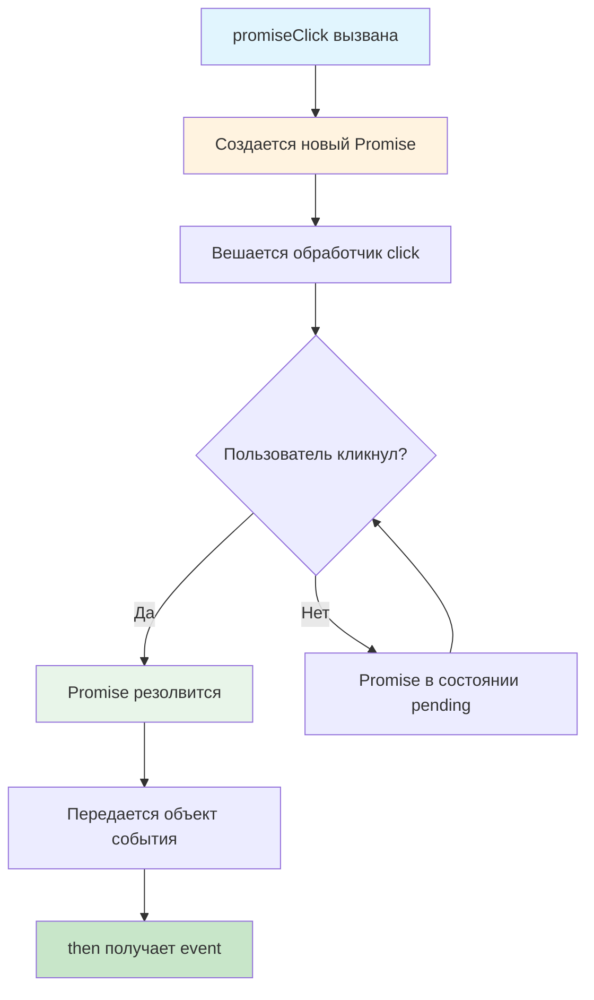

# 🎯 Учебный проект: Промисификация клика по кнопке

> **Превращаем события в промисы!** ✨  
> Эта задача научит вас работать с асинхронностью современным способом, превращая классические события браузера в
> удобные промисы для создания более чистого и предсказуемого кода.

## 🎯 Задача

Создайте функцию `promiseClick`, которая **превращает клик по кнопке в промис**. Вместо традиционных колбэков вы сможете
использовать современный подход с `async/await` или `.then()`.

```js
const button = document.querySelector('button');

// Традиционный подход с колбэками 😐
button.addEventListener('click', (event) => {
  console.log('Clicked!', event);
});

// Современный подход с промисами 🎉
const event = await promiseClick(button);
console.log('Clicked!', event);
```

## 🔍 Механика работы



## 📋 Структура функции

### 🏗️ Сигнатура функции

| Параметр | Тип           | Описание                  |
|----------|---------------|---------------------------|
| `button` | `HTMLElement` | DOM-элемент кнопки        |
| Возврат  | `Promise`     | Промис с объектом события |

### 📊 Жизненный цикл промиса

| Состояние   | Когда наступает                  | Что происходит                      |
|-------------|----------------------------------|-------------------------------------|
| `pending`   | Сразу после вызова функции       | Ожидание клика пользователя         |
| `fulfilled` | После первого клика по кнопке    | Promise резолвится с event объектом |
| `rejected`  | Не используется в базовой версии | -                                   |

## ✅ Требования к решению

| Компонент                 | Требование                                      |
|---------------------------|-------------------------------------------------|
| **Возвращаемое значение** | Promise, который резолвится при клике           |
| **Передача события**      | Event объект должен быть передан в resolve      |
| **Одноразовость**         | Обрабатывать только ПЕРВЫЙ клик                 |
| **Опция once**            | Рекомендуется использовать `{ once: true }`     |
| **Совместимость**         | Работа с любым HTML элементом, не только button |

## 🛠️ Что нужно реализовать

```js
export default function promiseClick(button) {
  // Вернуть новый Promise
  // Добавить обработчик события click
  // При клике зарезолвить промис с объектом события
}
```

⚠️ **Важно:** Используйте `{ once: true }` для автоматического удаления обработчика!

## 💡 Концепции, которые вы изучите

- **Промисификация**: превращение callback-based API в promise-based
- **Promise constructor**: создание промисов вручную
- **Event handling**: работа с событиями браузера
- **Once listeners**: одноразовые обработчики событий
- **Асинхронные паттерны**: современные подходы к асинхронности
- **Event object**: передача данных через промисы

## 🎓 Для новичков

### Что такое промисификация?

Промисификация — это превращение функций с колбэками в функции, возвращающие промисы:

```js
// Было: колбэк-стиль
function loadData(callback) {
  setTimeout(() => {
    callback('data');
  }, 1000);
}

// Стало: промис-стиль
function loadData() {
  return new Promise((resolve) => {
    setTimeout(() => {
      resolve('data');
    }, 1000);
  });
}
```

### Как работает Promise constructor?

```js
const promise = new Promise((resolve, reject) => {
  // resolve - функция для успешного завершения
  // reject - функция для завершения с ошибкой

  if (всёХорошо) {
    resolve(результат);
  } else {
    reject(ошибка);
  }
});
```

### Что такое `{ once: true }`?

```js
// Обработчик сработает только один раз
button.addEventListener('click', handler, {once: true});

// Эквивалентно этому:
button.addEventListener('click', function handler(e) {
  button.removeEventListener('click', handler);
  // ... ваш код
});
```

## ⚡ Частые ошибки

### ❌ Забыть вернуть промис

```js
function promiseClick(button) {
  new Promise((resolve) => { // ❌ Промис создан, но не возвращен!
    button.addEventListener('click', resolve);
  });
}
```

### ✅ Правильно: вернуть промис

```js
function promiseClick(button) {
  return new Promise((resolve) => { // ✅
    button.addEventListener('click', resolve);
  });
}
```

### ❌ Не передать событие в resolve

```js
function promiseClick(button) {
  return new Promise((resolve) => {
    button.addEventListener('click', () => {
      resolve(); // ❌ Событие потеряно!
    });
  });
}
```

### ✅ Правильно: передать event

```js
function promiseClick(button) {
  return new Promise((resolve) => {
    button.addEventListener('click', (event) => {
      resolve(event); // ✅ Событие передано
    });
  });
}
```

### ❌ Не использовать once

```js
function promiseClick(button) {
  return new Promise((resolve) => {
    // ❌ Обработчик останется висеть в памяти
    button.addEventListener('click', resolve);
  });
}
```

### ✅ Правильно: использовать once

```js
function promiseClick(button) {
  return new Promise((resolve) => {
    // ✅ Обработчик автоматически удалится
    button.addEventListener('click', resolve, {once: true});
  });
}
```

## 🔧 Различные подходы к решению

### 🎯 Базовое решение

```js
export default function promiseClick(button) {
  return new Promise((resolve) => {
    button.addEventListener('click', (event) => {
      resolve(event);
    }, {once: true});
  });
}
```

### 🛡️ С проверкой входных данных

```js
export default function promiseClick(button) {
  // Валидация входных данных
  if (!button || !(button instanceof EventTarget)) {
    return Promise.reject(new Error('Invalid button element'));
  }

  return new Promise((resolve) => {
    button.addEventListener('click', (event) => {
      resolve(event);
    }, {once: true});
  });
}
```

### ⚡ С поддержкой отмены

```js
export default function promiseClick(button) {
  let listener;

  const promise = new Promise((resolve) => {
    listener = (event) => resolve(event);
    button.addEventListener('click', listener, {once: true});
  });

  // Добавляем метод отмены
  promise.cancel = () => {
    button.removeEventListener('click', listener);
  };

  return promise;
}

// Использование:
const clickPromise = promiseClick(button);

// Можем отменить ожидание
setTimeout(() => {
  clickPromise.cancel();
}, 5000);
```

### 🎨 С таймаутом

```js
export default function promiseClick(button, timeout = null) {
  return new Promise((resolve, reject) => {
    let timeoutId;

    const cleanup = () => {
      if (timeoutId) clearTimeout(timeoutId);
    };

    // Обработчик клика
    button.addEventListener('click', (event) => {
      cleanup();
      resolve(event);
    }, {once: true});

    // Опциональный таймаут
    if (timeout) {
      timeoutId = setTimeout(() => {
        reject(new Error(`Click timeout after ${timeout}ms`));
      }, timeout);
    }
  });
}

// Использование:
try {
  const event = await promiseClick(button, 5000); // 5 секунд на клик
  console.log('Clicked!', event);
} catch (error) {
  console.log('Timeout!');
}
```

## 🌟 Расширенные версии

### 🔄 Универсальная промисификация событий

```js
function promiseEvent(element, eventName, options = {}) {
  return new Promise((resolve, reject) => {
    const {timeout, ...listenerOptions} = options;
    let timeoutId;

    const handler = (event) => {
      if (timeoutId) clearTimeout(timeoutId);
      resolve(event);
    };

    element.addEventListener(eventName, handler, {
      once: true,
      ...listenerOptions
    });

    if (timeout) {
      timeoutId = setTimeout(() => {
        element.removeEventListener(eventName, handler);
        reject(new Error(`Event "${eventName}" timeout`));
      }, timeout);
    }
  });
}

// Использование:
await promiseEvent(button, 'click');
await promiseEvent(input, 'change');
await promiseEvent(window, 'load');
await promiseEvent(video, 'ended');
```

### 📱 С поддержкой touch событий

```js
export default function promiseClick(button) {
  return new Promise((resolve) => {
    const handler = (event) => {
      // Предотвращаем двойное срабатывание на мобильных
      event.preventDefault();
      resolve(event);
    };

    // Поддержка и мыши, и тача
    const options = {once: true};

    button.addEventListener('click', handler, options);
    button.addEventListener('touchend', handler, options);
  });
}
```

### 🎮 Множественные клики

```js
function promiseClicks(button, count = 1) {
  return new Promise((resolve) => {
    const clicks = [];

    const handler = (event) => {
      clicks.push(event);

      if (clicks.length >= count) {
        button.removeEventListener('click', handler);
        resolve(clicks);
      }
    };

    button.addEventListener('click', handler);
  });
}

// Дождаться 3 кликов
const events = await promiseClicks(button, 3);
console.log(`Получено ${events.length} кликов`);
```

### 🔐 С подтверждением действия

```js
function promiseConfirmClick(button, confirmTime = 3000) {
  return new Promise((resolve, reject) => {
    let isWaitingConfirm = false;
    let timeoutId;

    const handler = (event) => {
      if (!isWaitingConfirm) {
        // Первый клик - начинаем ожидание подтверждения
        isWaitingConfirm = true;
        button.textContent = 'Подтвердите действие';
        button.classList.add('waiting-confirm');

        timeoutId = setTimeout(() => {
          // Время вышло - отменяем
          button.textContent = 'Нажмите еще раз';
          button.classList.remove('waiting-confirm');
          button.removeEventListener('click', handler);
          reject(new Error('Confirmation timeout'));
        }, confirmTime);
      } else {
        // Второй клик - подтверждение
        clearTimeout(timeoutId);
        button.classList.remove('waiting-confirm');
        button.removeEventListener('click', handler);
        resolve(event);
      }
    };

    button.addEventListener('click', handler);
  });
}
```

## 🎨 Практическое применение

### 🛒 Кнопка добавления в корзину

```js
class AddToCartButton {
  constructor(button, product) {
    this.button = button;
    this.product = product;
    this.init();
  }

  async init() {
    while (true) {
      try {
        const event = await promiseClick(this.button);
        await this.handleAddToCart(event);
      } catch (error) {
        console.error('Error adding to cart:', error);
        break;
      }
    }
  }

  async handleAddToCart(event) {
    // Показываем лоадер
    this.button.disabled = true;
    this.button.textContent = 'Добавляем...';

    try {
      // Отправляем на сервер
      await fetch('/api/cart/add', {
        method: 'POST',
        body: JSON.stringify(this.product)
      });

      // Успешно добавлено
      this.button.textContent = '✓ В корзине';
      await this.delay(2000);
      this.button.textContent = 'Добавить в корзину';
    } finally {
      this.button.disabled = false;
    }
  }

  delay(ms) {
    return new Promise(resolve => setTimeout(resolve, ms));
  }
}
```

### 📝 Форма с пошаговым заполнением

```js
class StepForm {
  constructor(form) {
    this.form = form;
    this.currentStep = 0;
    this.init();
  }

  async init() {
    const steps = this.form.querySelectorAll('.step');
    const nextButtons = this.form.querySelectorAll('.next-step');

    for (let i = 0; i < nextButtons.length; i++) {
      // Ждем клика по кнопке "Далее"
      await promiseClick(nextButtons[i]);

      // Валидируем текущий шаг
      if (!this.validateStep(steps[i])) {
        i--; // Остаемся на том же шаге
        continue;
      }

      // Переходим к следующему шагу
      steps[i].classList.remove('active');
      steps[i + 1]?.classList.add('active');
      this.currentStep++;
    }

    // Форма заполнена
    this.submit();
  }

  validateStep(stepElement) {
    const inputs = stepElement.querySelectorAll('input[required]');
    return Array.from(inputs).every(input => input.value);
  }
}
```

### 🎮 Игра "Проверка реакции"

```js
class ReactionGame {
  constructor() {
    this.button = document.querySelector('.reaction-button');
    this.scoreElement = document.querySelector('.score');
    this.score = 0;
  }

  async start() {
    while (true) {
      // Случайная задержка
      await this.delay(Math.random() * 3000 + 1000);

      // Показываем кнопку
      this.button.style.display = 'block';
      const startTime = Date.now();

      try {
        // Ждем клика с таймаутом
        await promiseClick(this.button);
        const reactionTime = Date.now() - startTime;

        // Обновляем счет
        this.score += Math.max(0, 1000 - reactionTime);
        this.scoreElement.textContent = this.score;

        // Скрываем кнопку
        this.button.style.display = 'none';
      } catch (error) {
        break; // Игра окончена
      }
    }
  }

  delay(ms) {
    return new Promise(resolve => setTimeout(resolve, ms));
  }
}

// Запуск игры
const game = new ReactionGame();
game.start();
```

### 🔄 Последовательные действия

```js
class TutorialFlow {
  async start() {
    const steps = [
      {button: '.start-btn', message: 'Нажмите для начала'},
      {button: '.next-btn', message: 'Отлично! Теперь сюда'},
      {button: '.finish-btn', message: 'И последний шаг'}
    ];

    for (const step of steps) {
      this.showTooltip(step.message, step.button);
      await promiseClick(document.querySelector(step.button));
      this.hideTooltip();
    }

    this.showSuccess('Обучение завершено!');
  }

  showTooltip(message, selector) {
    // Показываем подсказку рядом с элементом
    const element = document.querySelector(selector);
    const tooltip = document.createElement('div');
    tooltip.className = 'tooltip';
    tooltip.textContent = message;
    element.parentElement.appendChild(tooltip);
  }
}
```

## 🧪 Тестирование

```bash
npm test 9-module/1-task
```

**Проверьте:**

- ✅ Функция возвращает Promise
- ✅ Promise резолвится при клике на кнопку
- ✅ В resolve передается объект события
- ✅ Обрабатывается только первый клик
- ✅ Работает с разными типами элементов
- ✅ Правильно используется `{ once: true }`

## 🚀 Что дальше?

Поздравляем! 🎉 Вы освоили промисификацию — один из ключевых паттернов современного JavaScript! Теперь вы можете
превращать любые колбэки в промисы и писать более чистый асинхронный код с `async/await`.

Этот навык откроет вам дорогу к созданию сложных асинхронных flow: последовательной загрузке данных, orchestration
множественных запросов и созданию отзывчивых интерфейсов!

---

📚 **Полезные ссылки:**

- [MDN: Promise](https://developer.mozilla.org/ru/docs/Web/JavaScript/Reference/Global_Objects/Promise)
- [Learn.javascript.ru: Промисы](https://learn.javascript.ru/promise-basics)
- [MDN: addEventListener options](https://developer.mozilla.org/ru/docs/Web/API/EventTarget/addEventListener#parameters)
- [Learn.javascript.ru: Введение в браузерные события](https://learn.javascript.ru/introduction-browser-events)
