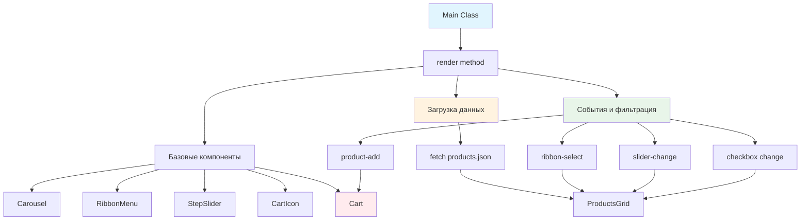

# 🚀 Учебный проект: Сбор полноценного приложения

> **Собираем все компоненты в работающий ресторан!** 🎊  
> Это финальная задача, где вы объедините все созданные компоненты в единое приложение, научитесь организовывать
> взаимодействие между модулями и создадите полноценный интернет-магазин тайской кухни!

## 🎯 Задача

Создайте класс `Main`, который **собирает все компоненты проекта** в единое приложение: карусель, меню категорий,
слайдер остроты, сетку товаров и корзину. Компоненты должны взаимодействовать через события и обновлять состояние друг
друга.

```js
const main = new Main();

// Рендерим все компоненты и загружаем товары
await main.render();

// Результат: полноценное SPA приложение ресторана! 🍜
```

## 🔍 Архитектура приложения



## 📋 Структура приложения

### 🏗️ Размещение компонентов на странице


### 📊 Компоненты и их контейнеры

| Компонент      | Класс          | Контейнер (data-атрибут)    | Параметры инициализации |
|----------------|----------------|-----------------------------|-------------------------|
| Карусель       | `Carousel`     | `data-carousel-holder`      | `slides` массив         |
| Меню категорий | `RibbonMenu`   | `data-ribbon-holder`        | `categories` массив     |
| Слайдер        | `StepSlider`   | `data-slider-holder`        | `{steps: 5, value: 3}`  |
| Иконка корзины | `CartIcon`     | `data-cart-icon-holder`     | -                       |
| Корзина        | `Cart`         | Не рендерится на странице   | `cartIcon` экземпляр    |
| Сетка товаров  | `ProductsGrid` | `data-products-grid-holder` | `products` с сервера    |

### 🎚️ События для взаимодействия

| Событие         | Источник   | Действие                          | Слушатель    |
|-----------------|------------|-----------------------------------|--------------|
| `product-add`   | `body`     | Добавить товар в корзину          | Cart         |
| `ribbon-select` | RibbonMenu | Фильтровать по категории          | ProductsGrid |
| `slider-change` | StepSlider | Фильтровать по остроте            | ProductsGrid |
| `change`        | Чекбоксы   | Фильтровать по орехам/вегетариан. | ProductsGrid |

## ✅ Требования к классу

| Компонент                 | Требование                                          |
|---------------------------|-----------------------------------------------------|
| **Метод render()**        | Асинхронный, возвращает Promise                     |
| **Порядок инициализации** | 1. Базовые компоненты 2. Загрузка данных 3. Фильтры |
| **Загрузка товаров**      | Fetch из `products.json` с преобразованием в JSON   |
| **Очистка контейнера**    | Удалить заглушки перед вставкой ProductsGrid        |
| **Связь компонентов**     | Через пользовательские события                      |
| **Начальная фильтрация**  | Применить текущие значения фильтров после загрузки  |

## 🛠️ Что нужно реализовать

```js
export default class Main {
  constructor() {
    // Инициализация
  }

  async render() {
    // 1. Создать и разместить базовые компоненты
    // 2. Загрузить товары с сервера
    // 3. Создать ProductsGrid
    // 4. Применить начальные фильтры
    // 5. Настроить обработчики событий
  }
}
```

⚠️ **Важно:** Метод `render()` должен быть асинхронным из-за загрузки данных!

## 💡 Концепции, которые вы изучите

- **Композиция приложения**: объединение модулей в единую систему
- **Асинхронная инициализация**: загрузка данных при старте
- **Event-driven архитектура**: взаимодействие через события
- **Управление состоянием**: синхронизация компонентов
- **Dependency injection**: передача зависимостей между компонентами
- **SPA паттерны**: организация одностраничного приложения

## 🎓 Для новичков

### Что такое точка входа приложения?

Класс `Main` — это точка входа (entry point), которая инициализирует все части приложения:

```js
// index.html
const app = new Main();
await app.render(); // Запускаем приложение
```

### Почему метод render() асинхронный?

```js
async
render()
{
  // Можем использовать await для загрузки данных
  const products = await fetch('products.json')
    .then(response => response.json());

  // Дожидаемся завершения всех операций
  return products;
}
```

### Как найти контейнеры по data-атрибутам?

```js
// Поиск элемента с data-атрибутом
const container = document.querySelector('[data-carousel-holder]');

// Или более явно
const container = document.querySelector('*[data-carousel-holder]');
```

### Event Bubbling для product-add

```js
// Событие всплывает от карточки до body
document.body.addEventListener('product-add', (event) => {
  // event.detail содержит id товара
  const productId = event.detail;
});
```

## ⚡ Частые ошибки

### ❌ Забыть async/await

```js
render()
{ // ❌ Не асинхронный метод
  const products = fetch('products.json').then(res => res.json());
  this.productsGrid = new ProductsGrid(products); // products - это Promise!
}
```

### ✅ Правильно: использовать async/await

```js
async
render()
{ // ✅
  const products = await fetch('products.json').then(res => res.json());
  this.productsGrid = new ProductsGrid(products); // products - это массив
}
```

### ❌ Не очистить контейнер с заглушками

```js
const gridHolder = document.querySelector('[data-products-grid-holder]');
gridHolder.append(this.productsGrid.elem); // ❌ Заглушки остались!
```

### ✅ Правильно: очистить перед вставкой

```js
const gridHolder = document.querySelector('[data-products-grid-holder]');
gridHolder.innerHTML = ''; // ✅ Удаляем заглушки
gridHolder.append(this.productsGrid.elem);
```

### ❌ Неправильная последовательность инициализации

```js
async
render()
{
  // ❌ Cart нужен для CartIcon!
  this.cartIcon = new CartIcon();
  this.cart = new Cart(this.cartIcon);
}
```

### ✅ Правильно: сначала Cart, потом CartIcon

```js
async
render()
{
  this.cart = new Cart(); // ✅ Сначала корзина
  this.cartIcon = new CartIcon(this.cart); // Потом иконка
}
```

### ❌ Захардкодить id чекбоксов

```js
// ❌ Опечатка в id!
document.getElementById('nut-checkbox').checked;
```

### ✅ Правильно: использовать правильные id

```js
// ✅ Правильные id из задания
document.getElementById('nuts-checkbox').checked;
document.getElementById('vegeterian-checkbox').checked;
```

## 🔧 Различные подходы к решению

### 🎯 Базовое решение

```js
export default class Main {
  constructor() {
    // Пустой конструктор
  }

  async render() {
    // 1. Карусель
    this.carousel = new Carousel(slides);
    document.querySelector('[data-carousel-holder]')
      .append(this.carousel.elem);

    // 2. Меню категорий
    this.ribbonMenu = new RibbonMenu(categories);
    document.querySelector('[data-ribbon-holder]')
      .append(this.ribbonMenu.elem);

    // 3. Слайдер остроты
    this.stepSlider = new StepSlider({
      steps: 5,
      value: 3
    });
    document.querySelector('[data-slider-holder]')
      .append(this.stepSlider.elem);

    // 4. Корзина и её иконка
    this.cart = new Cart();
    this.cartIcon = new CartIcon(this.cart);
    document.querySelector('[data-cart-icon-holder]')
      .append(this.cartIcon.elem);

    // 5. Загрузка товаров
    this.products = await fetch('products.json')
      .then(response => response.json());

    // 6. Сетка товаров
    this.productsGrid = new ProductsGrid(this.products);
    const gridHolder = document.querySelector('[data-products-grid-holder]');
    gridHolder.innerHTML = '';
    gridHolder.append(this.productsGrid.elem);

    // 7. Начальная фильтрация
    this.productsGrid.updateFilter({
      noNuts: document.getElementById('nuts-checkbox').checked,
      vegeterianOnly: document.getElementById('vegeterian-checkbox').checked,
      maxSpiciness: this.stepSlider.value,
      category: this.ribbonMenu.value
    });

    // 8. Обработчики событий
    this.addEventListeners();
  }

  addEventListeners() {
    // Добавление в корзину
    document.body.addEventListener('product-add', event => {
      const product = this.products.find(p => p.id === event.detail);
      this.cart.addProduct(product);
    });

    // Фильтр по категории
    this.ribbonMenu.elem.addEventListener('ribbon-select', event => {
      this.productsGrid.updateFilter({
        category: event.detail
      });
    });

    // Фильтр по остроте
    this.stepSlider.elem.addEventListener('slider-change', event => {
      this.productsGrid.updateFilter({
        maxSpiciness: event.detail
      });
    });

    // Фильтр по орехам
    document.getElementById('nuts-checkbox')
      .addEventListener('change', event => {
        this.productsGrid.updateFilter({
          noNuts: event.target.checked
        });
      });

    // Фильтр вегетарианское
    document.getElementById('vegeterian-checkbox')
      .addEventListener('change', event => {
        this.productsGrid.updateFilter({
          vegeterianOnly: event.target.checked
        });
      });
  }
}
```

### 🛡️ С обработкой ошибок

```js
export default class Main {
  constructor() {
    this.components = new Map();
  }

  async render() {
    try {
      await this.initializeComponents();
      await this.loadProducts();
      this.setupEventListeners();
      this.applyInitialFilters();

      console.log('✅ Приложение успешно инициализировано');
    } catch (error) {
      console.error('❌ Ошибка инициализации:', error);
      this.showErrorMessage();
    }
  }

  async initializeComponents() {
    // Инициализация с проверками
    const components = [
      {
        name: 'carousel',
        class: Carousel,
        args: [slides],
        container: '[data-carousel-holder]'
      },
      {
        name: 'ribbonMenu',
        class: RibbonMenu,
        args: [categories],
        container: '[data-ribbon-holder]'
      },
      {
        name: 'stepSlider',
        class: StepSlider,
        args: [{steps: 5, value: 3}],
        container: '[data-slider-holder]'
      }
    ];

    for (const config of components) {
      const container = document.querySelector(config.container);
      if (!container) {
        throw new Error(`Container ${config.container} not found`);
      }

      const component = new config.class(...config.args);
      this.components.set(config.name, component);
      container.append(component.elem);
    }

    // Особая обработка для корзины
    this.cart = new Cart();
    this.cartIcon = new CartIcon(this.cart);

    const cartIconHolder = document.querySelector('[data-cart-icon-holder]');
    if (cartIconHolder) {
      cartIconHolder.append(this.cartIcon.elem);
    }
  }

  async loadProducts() {
    try {
      const response = await fetch('products.json');

      if (!response.ok) {
        throw new Error(`HTTP error! status: ${response.status}`);
      }

      this.products = await response.json();

      // Валидация данных
      if (!Array.isArray(this.products)) {
        throw new Error('Products должен быть массивом');
      }

      this.renderProductsGrid();
    } catch (error) {
      console.error('Ошибка загрузки товаров:', error);
      throw error;
    }
  }

  renderProductsGrid() {
    const gridHolder = document.querySelector('[data-products-grid-holder]');

    if (!gridHolder) {
      throw new Error('Products grid holder not found');
    }

    // Очищаем заглушки
    gridHolder.innerHTML = '';

    // Создаем и добавляем сетку
    this.productsGrid = new ProductsGrid(this.products);
    this.components.set('productsGrid', this.productsGrid);
    gridHolder.append(this.productsGrid.elem);
  }

  showErrorMessage() {
    const container = document.querySelector('[data-products-grid-holder]');
    if (container) {
      container.innerHTML = `
        <div class="error-message">
          <h3>😔 Упс! Что-то пошло не так</h3>
          <p>Не удалось загрузить меню ресторана.</p>
          <button onclick="location.reload()">Попробовать снова</button>
        </div>
      `;
    }
  }
}
```

### ⚡ С оптимизацией и дополнительными функциями

```js
export default class Main {
  constructor() {
    this.initialized = false;
    this.filters = {
      noNuts: false,
      vegeterianOnly: false,
      maxSpiciness: 3,
      category: ''
    };
  }

  async render() {
    if (this.initialized) {
      console.warn('Application already initialized');
      return;
    }

    // Показываем индикатор загрузки
    this.showLoader();

    // Параллельная инициализация где возможно
    const [products] = await Promise.all([
      this.fetchProducts(),
      this.initializeStaticComponents()
    ]);

    this.products = products;

    // Инициализация динамических компонентов
    await this.initializeDynamicComponents();

    // Настройка взаимодействий
    this.setupEventListeners();
    this.setupFilters();

    // Применяем сохраненные фильтры
    this.restoreFiltersFromStorage();

    this.hideLoader();
    this.initialized = true;

    // Возвращаем публичный API
    return {
      cart: this.cart,
      updateFilters: this.updateAllFilters.bind(this),
      reset: this.reset.bind(this)
    };
  }

  async fetchProducts() {
    const response = await fetch('products.json');
    return response.json();
  }

  async initializeStaticComponents() {
    // Компоненты, не зависящие от данных
    this.carousel = this.mountComponent(
      new Carousel(slides),
      '[data-carousel-holder]'
    );

    this.ribbonMenu = this.mountComponent(
      new RibbonMenu(categories),
      '[data-ribbon-holder]'
    );

    this.stepSlider = this.mountComponent(
      new StepSlider({steps: 5, value: 3}),
      '[data-slider-holder]'
    );

    this.cart = new Cart();
    this.cartIcon = this.mountComponent(
      new CartIcon(this.cart),
      '[data-cart-icon-holder]'
    );
  }

  async initializeDynamicComponents() {
    this.productsGrid = new ProductsGrid(this.products);

    const gridHolder = document.querySelector('[data-products-grid-holder]');
    gridHolder.innerHTML = '';
    gridHolder.append(this.productsGrid.elem);
  }

  mountComponent(component, selector) {
    const container = document.querySelector(selector);
    if (container) {
      container.append(component.elem);
    }
    return component;
  }

  setupEventListeners() {
    // Используем единый обработчик для всех product-add
    document.body.addEventListener('product-add', this.handleProductAdd.bind(this));

    // Делегирование для фильтров
    this.stepSlider.elem.addEventListener('slider-change', (e) => {
      this.updateFilter('maxSpiciness', e.detail);
    });

    this.ribbonMenu.elem.addEventListener('ribbon-select', (e) => {
      this.updateFilter('category', e.detail);
    });

    // Чекбоксы
    const nutsCheckbox = document.getElementById('nuts-checkbox');
    const vegCheckbox = document.getElementById('vegeterian-checkbox');

    if (nutsCheckbox) {
      nutsCheckbox.addEventListener('change', (e) => {
        this.updateFilter('noNuts', e.target.checked);
      });
    }

    if (vegCheckbox) {
      vegCheckbox.addEventListener('change', (e) => {
        this.updateFilter('vegeterianOnly', e.target.checked);
      });
    }
  }

  handleProductAdd(event) {
    const product = this.products.find(p => p.id === event.detail);
    if (product) {
      this.cart.addProduct(product);
      this.showNotification(`${product.name} добавлен в корзину!`);
    }
  }

  updateFilter(name, value) {
    this.filters[name] = value;
    this.productsGrid.updateFilter({[name]: value});
    this.saveFiltersToStorage();
  }

  updateAllFilters() {
    this.productsGrid.updateFilter(this.filters);
  }

  saveFiltersToStorage() {
    localStorage.setItem('restaurant-filters', JSON.stringify(this.filters));
  }

  restoreFiltersFromStorage() {
    const saved = localStorage.getItem('restaurant-filters');
    if (saved) {
      try {
        this.filters = JSON.parse(saved);
        this.updateAllFilters();

        // Обновляем UI элементы
        if (this.filters.maxSpiciness !== undefined) {
          this.stepSlider.value = this.filters.maxSpiciness;
        }
        if (this.filters.category) {
          this.ribbonMenu.value = this.filters.category;
        }
      } catch (e) {
        console.error('Failed to restore filters:', e);
      }
    }
  }

  showLoader() {
    const loader = document.createElement('div');
    loader.className = 'app-loader';
    loader.innerHTML = '🍜 Загружаем меню...';
    document.body.append(loader);
  }

  hideLoader() {
    document.querySelector('.app-loader')?.remove();
  }

  showNotification(message) {
    const notification = document.createElement('div');
    notification.className = 'notification';
    notification.textContent = message;
    document.body.append(notification);

    setTimeout(() => {
      notification.classList.add('notification_show');
    }, 10);

    setTimeout(() => {
      notification.remove();
    }, 3000);
  }

  reset() {
    // Сброс всех фильтров
    this.filters = {
      noNuts: false,
      vegeterianOnly: false,
      maxSpiciness: 4,
      category: ''
    };

    this.updateAllFilters();
    localStorage.removeItem('restaurant-filters');
  }
}
```

## 🌟 Расширенные версии

### 📊 С аналитикой

```js
class MainWithAnalytics extends Main {
  constructor() {
    super();
    this.analytics = new Analytics();
  }

  async render() {
    const startTime = performance.now();

    await super.render();

    const loadTime = performance.now() - startTime;
    this.analytics.track('app_loaded', {
      loadTime: Math.round(loadTime),
      productsCount: this.products.length
    });
  }

  handleProductAdd(event) {
    super.handleProductAdd(event);

    const product = this.products.find(p => p.id === event.detail);
    this.analytics.track('product_added_to_cart', {
      productId: product.id,
      productName: product.name,
      price: product.price,
      category: product.category
    });
  }

  updateFilter(name, value) {
    super.updateFilter(name, value);

    this.analytics.track('filter_applied', {
      filterName: name,
      filterValue: value,
      resultsCount: this.productsGrid.getVisibleCount()
    });
  }
}
```

### 🌐 С поддержкой маршрутизации

```js
class MainWithRouter extends Main {
  async render() {
    await super.render();
    this.setupRouter();
  }

  setupRouter() {
    // Читаем фильтры из URL
    const params = new URLSearchParams(window.location.search);

    if (params.get('category')) {
      this.ribbonMenu.value = params.get('category');
      this.updateFilter('category', params.get('category'));
    }

    if (params.get('spiciness')) {
      const value = parseInt(params.get('spiciness'));
      this.stepSlider.value = value;
      this.updateFilter('maxSpiciness', value);
    }

    // Обновляем URL при изменении фильтров
    this.productsGrid.elem.addEventListener('filter-change', (event) => {
      this.updateURL(event.detail.filters);
    });
  }

  updateURL(filters) {
    const params = new URLSearchParams();

    if (filters.category) params.set('category', filters.category);
    if (filters.maxSpiciness !== undefined) params.set('spiciness', filters.maxSpiciness);
    if (filters.noNuts) params.set('no-nuts', 'true');
    if (filters.vegeterianOnly) params.set('vegeterian', 'true');

    const newURL = `${window.location.pathname}?${params.toString()}`;
    window.history.pushState({filters}, '', newURL);
  }
}
```

### 💾 С кешированием данных

```js
class MainWithCache extends Main {
  async fetchProducts() {
    // Проверяем кеш
    const cached = this.getCachedProducts();
    if (cached) {
      console.log('📦 Используем кешированные данные');
      return cached;
    }

    // Загружаем с сервера
    const products = await super.fetchProducts();
    this.cacheProducts(products);
    return products;
  }

  getCachedProducts() {
    const cached = localStorage.getItem('cached-products');
    if (!cached) return null;

    try {
      const data = JSON.parse(cached);
      const isExpired = Date.now() - data.timestamp > 3600000; // 1 час

      if (isExpired) {
        localStorage.removeItem('cached-products');
        return null;
      }

      return data.products;
    } catch (e) {
      return null;
    }
  }

  cacheProducts(products) {
    const data = {
      products,
      timestamp: Date.now()
    };

    try {
      localStorage.setItem('cached-products', JSON.stringify(data));
    } catch (e) {
      console.warn('Failed to cache products:', e);
    }
  }
}
```

## 🎨 Практическое применение

### 🎯 Полная интеграция с бэкендом

```js
class RestaurantApp extends Main {
  async render() {
    // Авторизация
    await this.authenticate();

    // Основной рендер
    await super.render();

    // Загрузка дополнительных данных
    await this.loadUserData();

    // WebSocket для real-time обновлений
    this.connectWebSocket();
  }

  async authenticate() {
    const token = localStorage.getItem('auth-token');
    if (!token) {
      window.location.href = '/login';
      return;
    }

    try {
      const response = await fetch('/api/verify', {
        headers: {'Authorization': `Bearer ${token}`}
      });

      if (!response.ok) {
        throw new Error('Invalid token');
      }

      this.user = await response.json();
    } catch (e) {
      localStorage.removeItem('auth-token');
      window.location.href = '/login';
    }
  }

  async loadUserData() {
    // Загружаем историю заказов
    const orders = await fetch('/api/orders').then(r => r.json());

    // Загружаем избранное
    const favorites = await fetch('/api/favorites').then(r => r.json());

    // Применяем персонализацию
    this.applyPersonalization(orders, favorites);
  }

  connectWebSocket() {
    this.ws = new WebSocket('wss://api.restaurant.com/live');

    this.ws.onmessage = (event) => {
      const data = JSON.parse(event.data);

      switch (data.type) {
      case 'product_update':
        this.updateProduct(data.product);
        break;

      case 'new_promotion':
        this.showPromotion(data.promotion);
        break;

      case 'order_status':
        this.updateOrderStatus(data.order);
        break;
      }
    };
  }
}
```

## 🧪 Тестирование

```bash
npm test 9-module/2-task
```

**Проверьте:**

- ✅ Все компоненты создаются и размещаются правильно
- ✅ Товары загружаются с сервера
- ✅ Заглушки удаляются перед показом товаров
- ✅ Начальная фильтрация применяется
- ✅ Событие `product-add` добавляет товар в корзину
- ✅ Событие `ribbon-select` фильтрует по категории
- ✅ Событие `slider-change` фильтрует по остроте
- ✅ Чекбоксы правильно фильтруют товары
- ✅ Метод `render()` возвращает Promise

## 🚀 Что дальше?

Поздравляем! 🎊 Вы создали полноценное SPA-приложение ресторана! Вы освоили архитектуру современных веб-приложений,
научились организовывать взаимодействие компонентов и управлять состоянием.

Теперь вы готовы к созданию реальных коммерческих проектов! Следующие шаги: добавление роутинга, интеграция с платежными
системами, PWA функциональность и развертывание в production!

---

📚 **Полезные ссылки:**

- [MDN: Fetch API](https://developer.mozilla.org/ru/docs/Web/API/Fetch_API)
- [Learn.javascript.ru: Промисы, async/await](https://learn.javascript.ru/async)
- [MDN: CustomEvent](https://developer.mozilla.org/ru/docs/Web/API/CustomEvent)
- [Learn.javascript.ru: Модули](https://learn.javascript.ru/modules)
